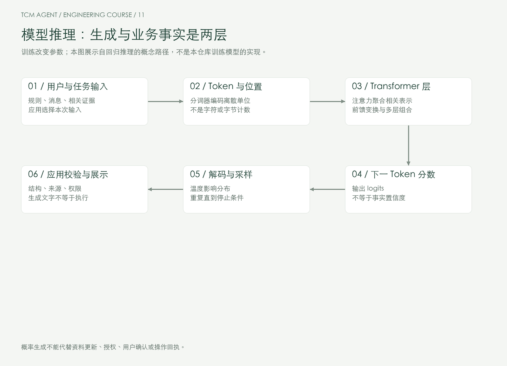
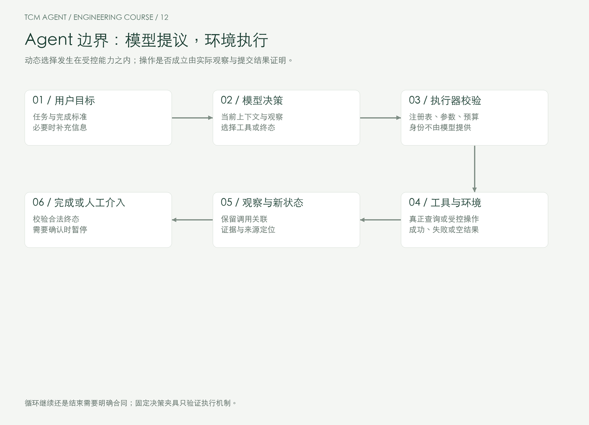
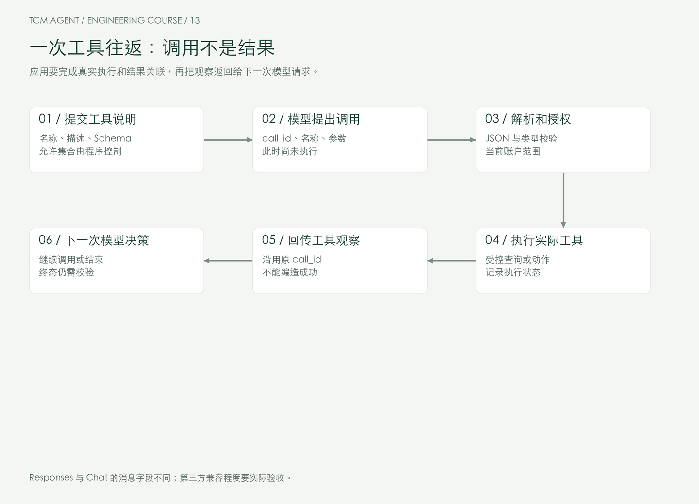
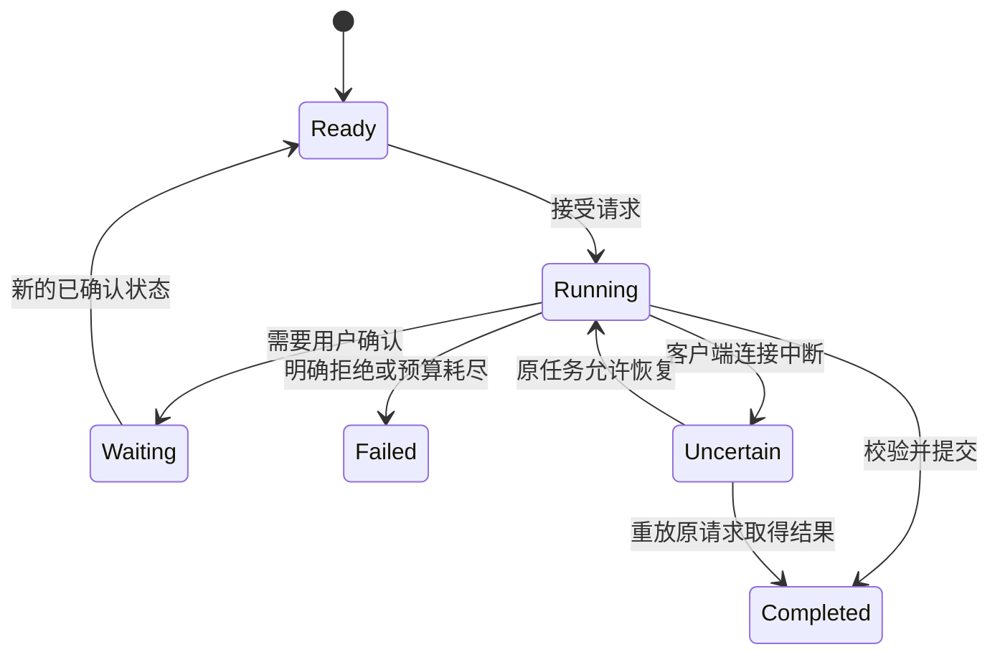
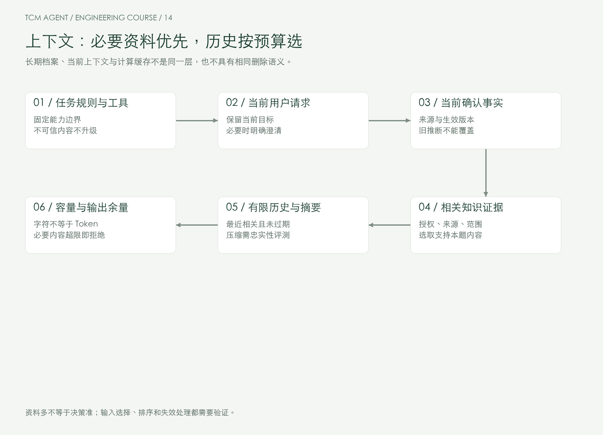
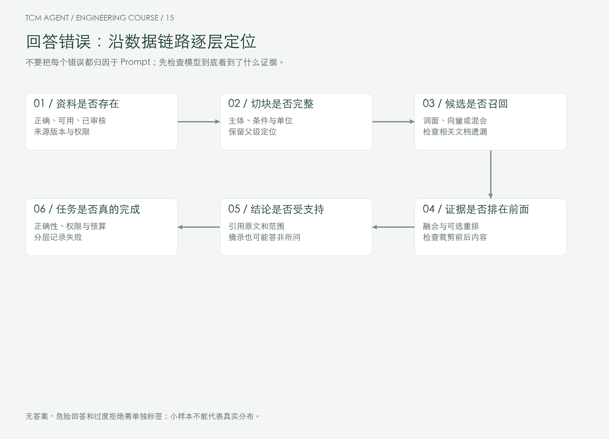
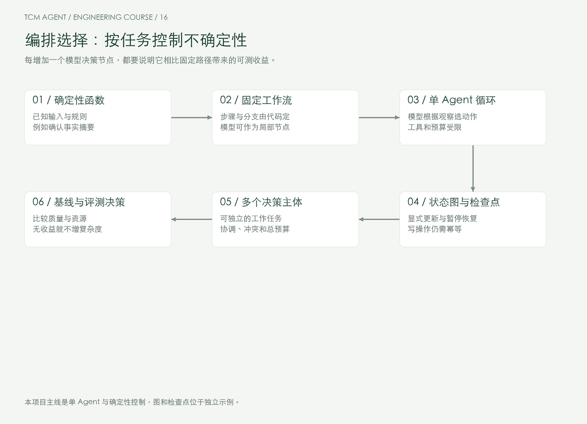
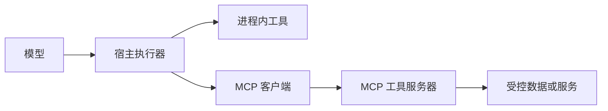
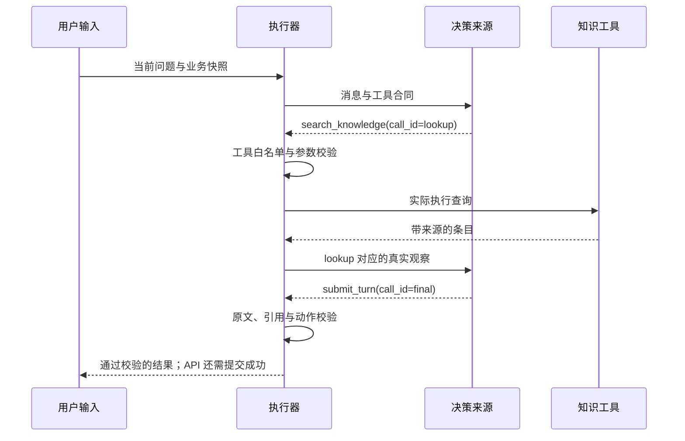

# Agent 开发系统课程：从基础机制到生产工程

**课程版本：1.4 · 优化日期：2026-10-18 · Python · 面向已有后端经验的开发者**

你不需要重新学习 Python、HTTP 或数据库，但需要建立一套 Agent 的知识结构：模型擅长什么、一次决策如何变成工具执行、上下文为何影响行为、何时需要检索、什么地方必须由确定性程序控制。完成这些基础之后，再看完整项目与生产工程，才不会把框架用法误当作系统原理。

本课程以“中医就诊准备助手”贯穿学习。前期它只是解释概念的例子，中期用于验证方法，最后才展开完整服务。它整理困扰、解释有来源的教学知识、提出候选事实，经过用户确认生成摘要；不自动诊断、开方或给出剂量。这个场景对事实、来源、权限和更正有明确要求，适合检验 Agent 的工程边界。

## 阅读导航

快速查找：[学习路线、30 节直达与术语索引](STUDY_GUIDE.md) · [独立作业](../exercises/README.md) · [综合答辩](DEFENSE.md) · [生产演练](OPERATIONS_LAB.md)

- [如何使用这门课](#如何使用这门课)
- [30 个学习节点](#30-个学习节点)
- [阶段一：建立基础认识](#阶段一建立基础认识)
- [阶段二：掌握执行机制](#阶段二掌握执行机制)
- [阶段三：知识与上下文能力](#阶段三知识与上下文能力)
- [阶段四：编排与系统设计](#阶段四编排与系统设计)
- [阶段五：完整项目整合](#阶段五完整项目整合)
- [阶段六：工程化与生产准备](#阶段六工程化与生产准备)
- [四个核心机制深讲](#核心机制深讲与故障工作坊)
- [独立面试模块](#独立模块agent-面试题与答案解析)
- [工程源码参考](ENGINEERING_REFERENCE.md)
- [来源与证据分级](#来源与证据分级)

## 如何使用这门课

每个节点依次安排“问题与目标 → 原理与机制 → 最小实验 → 代码详解 → 项目映射 → 练习与验收 → 面试关联”。先理解为什么存在这个问题，再看实验结果，最后阅读项目中相关的少量代码。无需在第 1 节读懂完整 Runtime、数据库与鉴权。

一个月是 30 个有依赖关系的学习节点，不是每日时长要求。建议第 1 周完成 01—08，第 2 周完成 09—15，第 3 周完成 16—24，第 4 周完成 25—30 和综合答辩。每个节点可以包含多个小节，按验收结果推进，不按阅读页数判断掌握程度。

课程交付由三个互相对应的部分组成：

| 部分 | 学习用途 | 入口 |
|---|---|---|
| 学习主线 | 概念、原理、实验、取舍、练习和面试关联 | 当前文档 |
| 六组最小实验 | 在小范围内观察概率、工具循环、上下文、检索、计划与评测 | [实验说明](../labs/README.md) |
| 完整项目和源码参考 | 同一业务的模型适配、检索、确认、API、界面、存储与可靠性实现 | [工程参考](ENGINEERING_REFERENCE.md)、[项目启动](../README.md) |

最小实验是学习工具，最终项目仍是完整服务。`ScriptedDecisions` 和项目的 `offline` 模式都是公开固定决策的工程夹具，不是语言模型；手工向量只演示几何，不伪称语义 Embedding。真实模型路径已提供，但用户平台尚未配置，不能把离线成功当作真实模型能力验证。

安装后可以先跑全部实验，不需要密钥、数据库或 Web 服务：

```bash
uv sync --all-extras --frozen
uv run python -m labs.run_all
uv run pytest tests/test_labs.py -q
```

每个实验都能独立执行，说明中给出预期现象和故障练习。需要真实 API 时，沿用 [README 的第三方兼容平台配置](../README.md#接入你的兼容-api-平台)，不把密钥粘贴到课程或提交到 Git。接入采用显式 Responses/Chat 协议；“兼容”以平台实际验收为准。

## 30 个学习节点

| 节点 | 知识目标 | 本阶段成果 |
|---|---|---|
| 01—05 | LLM 能力、Token/采样、Prompt/结构化输出、Agent 定义、架构区别 | 会判断任务是否需要 Agent |
| 06—10 | Function Calling、工具设计、执行循环、ReAct/计划、状态与停止 | 独立解释并运行受控工具循环 |
| 11—15 | 上下文、记忆、RAG、Embedding/混合检索、引用与评测 | 能分层定位知识问答失败 |
| 16—20 | 路由、状态图/人审、框架取舍、MCP、多 Agent | 有依据地选择编排方式 |
| 21—24 | 需求推导、检索问答、确认摘要、Chainlit 完整交互 | 贯通一条实际业务链路 |
| 25—30 | 服务/存储、并发/幂等、恢复/流式、安全、质量/成本、部署答辩 | 用运行证据说明系统可交付范围 |


**第一次出现术语时看什么。** 01—03 建立模型、Token、logits、上下文与 Schema 概念；04—10 解释 Agent、工具、观察和 Harness；11—15 解释记忆、RAG、Embedding、召回与重排；16—20 再介绍检查点、MCP 与多 Agent。术语在相关问题中展开，不要求先背一份名词表。

**四类能力标记。** 主项目已实现的能力用源码和测试证明；最小实验只验证声明的机制；框架对照位于 `examples/`；未实现的规划模型、多 Agent 协作、图检索、专业医学审核和公网 SLO 明确作为设计或扩展讨论。不要在面试中把后两类说成项目生产能力。

## 多模态辅助诊断方向的数据准备

现有课程代码的运行边界仍是就诊准备。新版另有独立 [问诊、诊断与辨证研究知识包](../knowledge/clinical/README.md)，用于理解有来源的数据如何整理、许可如何区分、病例共现为什么不是诊断规则，以及面舌脉结果如何保持来源和未知状态。它不把现有服务直接升级为可独立确诊的产品。

## 学习检查点

05 后能区分普通模型调用、固定 RAG、工作流和 Agent；10 后能手画 call→执行→观察→再决策，并解释失败如何停止；15 后能给一条坏回答找到检索、上下文或生成层的原因；20 后能说明为何主项目保留单 Agent；24 后在浏览器完成一次事实确认与撤回；30 后用并发、故障和评测证据答辩。

读完正文不是验收完成。每次练习都记录输入、配置版本、预期与实际结果。错误实验应按预期被拒绝；没有凭据的 live 测试必须保留跳过，不伪造成功。完整执行范围见 [验证报告](../evidence/validation.md)。本版仅维护 Markdown、源码与图示，不生成 PDF。

---

## 阶段一：建立基础认识

这一阶段先不讨论数据库、框架或业务类。要建立的心智模型是：模型生成候选行为，程序负责把行为变成受约束的系统结果。

### 第 01 节：LLM 的能力、推理过程与可靠性边界

**问题与目标。** 为什么一个能流畅解释术语的模型，还不能直接承担可靠的就诊记录系统？本节要区分语言生成、知识检索、状态保存和业务执行，避免把它们全部归给“模型很聪明”。

**原理与机制。** 常见自回归语言模型根据已有序列预测下一个 Token，反复生成形成输出。训练阶段改变参数；推理阶段通常使用固定参数和本次上下文。模型可以在上下文中归纳规则、解释文字、生成结构和选择动作，但这些输出仍需验证。一次解释听起来合理，不等于来源存在、事实最新或系统已经执行某项操作。

Transformer 的注意力按当前表示之间的关系聚合信息，前馈层再变换表示，多层组合形成下一 Token 的分布。对 Agent 开发者，关键不是从头训练网络，而是理解：输入顺序、证据、工具说明与已有观察都会影响下一步输出。参数中的知识也不是一张支持精确更新、删除和访问控制的业务表。[研究背景：Attention Is All You Need](https://arxiv.org/abs/1706.03762)。



可以用四个问题判断一段回答缺少什么：结论有出处吗？是否准确表达用户原话？是否真的读到了当前状态？声称完成的操作有系统回执吗？模型可能答出“四诊”的解释，却不知道用户刚撤回的事实，除非应用把新状态传给它。

**最小实验。** 运行模型机制实验，观察第二次请求没有显式历史时只包含当前一句话。这里没有加载模型，实验验证的是应用输入，不是模型理解能力。

```bash
uv run python -m labs.model_mechanics
```

[完整源码：request_messages](../labs/model_mechanics.py)

```python
def request_messages(current: str, history: tuple[str, ...] = ()) -> tuple[str, ...]:
    """History is explicitly supplied by the application, not remembered by this function."""
    return (*history, current)
```

**代码详解。** `history` 是显式参数，默认空元组；每次构造独立输入，不存在隐藏的跨请求变量。这对应 API 应用的责任：自己保存并传递上下文，或者明确使用供应商的会话协议。供应商可能提供存储能力，但它不自动成为你的业务事实库，也不能取代账户隔离和删除策略。

**项目映射。** 先只看 [`Message`](../src/tcm_agent/domain.py) 和 [`ContextBuilder`](../src/tcm_agent/context.py)：前者表示交给模型的消息，后者从应用状态构造请求。此时不用阅读数据库。项目允许模型选择检索，却不允许模型凭自己生成的文字修改正式病史。

**练习与验收。** 为“解释四诊”“查询用户已确认资料”“确认一条事实”“生成摘要”分别写下：模型是否必需、需要哪些真实数据、如何证明操作成功。能说明摘要可由程序确定性生成，而知识解释仍需受来源约束，才算理解本节。

**面试关联。** [Transformer 基础](#legacy-q65)、[减少幻觉](#legacy-q20)。回答重点是概率生成与系统事实的区别，不是背诵“LLM 会幻觉”。

### 第 02 节：Token、上下文窗口、采样与无状态请求

**问题与目标。** 为什么相同汉字数的输入消耗可能不同？为什么把 temperature 调低不能代替程序校验？本节建立调用成本、上下文预算和生成行为的基础认识。

**原理与机制。** Token 是模型分词器产生的离散单位，不固定等于一个字、单词或字节。字符串 `四诊` 的字符数是 2，UTF-8 字节数是 6，但 Token 数取决于具体分词器。上下文窗口约束模型本次可处理的序列容量；通常还要为输出、工具说明、协议封装与供应商保留内容留出空间，不能把整个窗口塞满用户历史。

一次生成可粗分 prefill 与 decode：先处理已有输入，随后逐步生成。KV cache 保存注意力计算的中间结果，减少重复计算；它不是跨用户长期记忆，也不是可以靠业务删除接口直接精确修改的档案。长输入和长输出影响延迟的方式不同，实际还受批处理、缓存和部署影响，最终应测量而不是只按字数猜。

给定某一步 logits，温度变换可写为 `p_i = exp(z_i / T) / Σ exp(z_j / T)`。减去共同最大值可避免指数溢出而不改变概率。较低正温度使概率更集中，不会给模型增加知识，也不授予工具权限。公式在 T=0 不适用；某些接口把 0 解释为近似贪心策略，不能因此承诺跨版本、硬件和后端绝对一致。

**最小实验。**

```bash
uv run python -m labs.model_mechanics
```

同一个实验输出 T=0.2、1、2 的分布。预期最高 logit 的概率随温度升高而降低，但排序不变。这是给定 logits 的数学计算，不包含真实模型采样。

[完整源码：probabilities](../labs/model_mechanics.py)

```python
def probabilities(logits: tuple[float, ...], temperature: float) -> tuple[float, ...]:
    """Stable softmax: temperature changes a distribution, not knowledge or permissions."""
    if not logits or not math.isfinite(temperature) or temperature <= 0:
        raise DataContractError("Use nonempty logits and positive finite temperature")
    if not all(math.isfinite(value) for value in logits):
        raise DataContractError("Logits must be finite")
    maximum = max(logits)
    weights = tuple(math.exp((value - maximum) / temperature) for value in logits)
    total = sum(weights)
    return tuple(value / total for value in weights)
```

**代码详解。** 入口拒绝空数组、非有限数和非正温度；稳定化后至少有一个权重为 1，总和非零。函数只返回概率，不会“验证回答正确”。实验同时打印字符和字节数，明确 Token 需要真实 tokenizer；不使用“中文一字一个 Token”的错误估计。

**项目映射。** [`Settings`](../src/tcm_agent/config.py) 分别限制输出 Token、回合总时间和上下文字符数。字符预算是可移植的保护线，不是精确 Token 计数。读取 [`gateway.py`](../src/tcm_agent/gateway.py) 的 usage 汇总位置，理解费用依据应来自供应商计量和平台合同，而不是本地字符数。

**练习与验收。** 预测 T 降低对最高概率的影响，然后运行验证。把 logits 改成 `(1003, 1002, 1000)`，结果仍应有限且总和约为 1。解释为什么“最大输出 Token=1600”既不是总上下文长度，也不是回合总费用上限。

**面试关联。** [Token、prefill 与缓存](#legacy-q66)、[temperature=0](#legacy-q13)。

### 第 03 节：Prompt、消息角色与结构化输出

**问题与目标。** 从“请帮我整理一下”到一个可执行的任务说明，中间缺少哪些合同？本节学习任务、输入、约束、示例和输出格式，并区分提示词约定与程序保证。

**原理与机制。** 一个可检查的 Prompt 至少说明目标、可用信息、完成条件和遇到信息不足时的行为。例如整理就诊资料时，可以要求只提取用户原文、缺失标为未知、不得把知识解释写成患者事实。Few-shot 示例帮助表达边界，但不是训练，也不能证明所有新输入都符合规则。示例中的字段和真实任务不一致，还可能把错误模式教给模型。

消息角色用于表达指令与对话的组织关系。具体角色、优先级和字段支持取决于平台；来自工具、网页或文档的文字应该作为数据处理。把一段不可信材料拼进“最高优先级规则”，会扩大注入影响。即便平台支持清晰的角色层次，数据库授权也不能交给 Prompt 执行。

结构化输出至少有三层：可解析的 JSON、符合 Schema 的对象、符合业务语义的结果。`{"term":"四诊"}` 可以是合法查询；`{"term":"四诊","owner":"other"}` 即使是 JSON，也不应被当前工具接受。一个符合字段类型的“无过敏”仍可能根本不在原文中，语义校验必须另做。

**最小实验。** 工具参数采用同一份 Pydantic 合同，比较有效查询、额外字段和空字符串：

[完整源码：LookupArgs](../labs/tool_loop.py)

```python
class LookupArgs(BaseModel):
    model_config: ClassVar[ConfigDict] = ConfigDict(frozen=True, extra="forbid")
    term: str = Field(min_length=1, max_length=30)
```

```bash
uv run pytest tests/test_labs.py -k 'tool_or_args' -q
```

**代码详解。** `extra="forbid"` 拒绝额外能力入口，长度约束保护基本体积，冻结模型避免内部随意改值。`model_json_schema()` 可导出工具说明需要的 Schema，但模型支持严格 Schema 不等于本地可以删除解析与校验。最小实验只验证参数边界，没有证明语言理解。

**项目映射。** 再阅读 [`FactDraft`、`FinalTurn`](../src/tcm_agent/domain.py)：终态限定动作与候选字段。项目先收集候选，再经用户确认成为事实，正是因为“结构正确”不等于“病史成立”。高级的供应商封装和兼容差异留到第 06 节和工程参考 E02/E03。

**练习与验收。** 为“提取起始时间”写一个包含缺失、否定、更正三个示例的任务说明，再列出 Prompt 无法保证的两件事。构造 Schema 合法但事实错误的对象，说明应在哪层拒绝。验收不是提示词写得长，而是能把约定和强约束分开。

**面试关联。** [结构化输出与业务校验](#legacy-q12)、[Prompt、上下文与 Harness](#legacy-q67)。

### 第 04 节：Agent 的组成与自主性边界

**问题与目标。** 给模型加一个函数，是否就有了 Agent？不要急于给项目贴标签，先看谁在决定下一步，以及决定如何接受环境反馈。

**原理与机制。** 本课采用一个可操作的定义：在程序限定的环境中，模型依据任务、状态和观察，选择下一步动作；应用执行动作，把实际结果反馈给模型，直到完成、需要人工介入或触发停止条件。目标、模型、工具、状态、执行循环和约束共同构成系统。不同产品对 Agent 的用词并不统一，面试时先说明你的定义与实际决策范围。

模型输出工具调用是动作提议，不是执行回执。运行环境负责工具注册、参数验证、账户绑定、真正执行和失败处理。观察来自实际工具结果，不能由模型自称“我查到了”代替。Harness 是包住模型的执行环境与控制逻辑，不只是一个 Prompt，也不必等同于某个框架。

自主性是局部授权。当前项目允许模型决定是否检索、问哪个审核过的问题；确认事实、账户权限和摘要保存仍由代码与用户控制。这个限制没有削弱工程价值，它明确了错误可能传播到哪里。



**最小实验。** `ScriptedDecisions` 给出固定的 search→finish 决策，实际执行器仍要调用工具并把观察关联到调用编号。它帮助你在不依赖模型稳定性的情况下验证循环。真实模型替换的是决策来源，不是取消执行器的约束。

```bash
uv run python -m labs.tool_loop
```

[完整源码：DecisionSource](../labs/tool_loop.py)

```python
class DecisionSource(Protocol):
    def decide(self, observations: tuple[Observation, ...]) -> Call | Finish:
        """A real adapter would request a model here; the fixture provides fixed decisions."""
        ...
```

**代码详解。** `Protocol` 表达“根据观察给出调用或终态”的最小能力。执行器依赖这个合同，不依赖某家 SDK；固定夹具和真实模型适配器都可以从架构上实现它，但当前小实验只提供夹具。完整项目的真实适配位于 `gateway.py`，两者不要混为同一个已接通的实验。

**项目映射。** 第一次对照 [`AgentRuntime`](../src/tcm_agent/runtime.py) 的职责即可：接收决策，验证并执行，汇总观察，校验终态。暂时不追踪租约、数据库和 HTTP 路由。后端工程经验在这里用于建立控制边界，而不是用一层接口名替代模型行为分析。

**练习与验收。** 画出“模型 → 调用提议 → 执行器 → 工具 → 观察 → 模型”的闭环。在每条线上标出谁控制数据与权限。解释模型能看见工具名称，为什么仍然不能删除任意数据库内容。

**面试关联。** [编排器与模型分工](#legacy-q09)、[工具执行安全](#legacy-q15)。

### 第 05 节：普通 LLM、RAG、工作流与 Agent 如何区分

**问题与目标。** 一个需求是不是必须用 Agent？本节用“谁决定路径”和“是否依赖外部证据”两个维度做选择，不用框架名称判断架构。

**原理与机制。** 普通 LLM 调用把准备好的输入变成输出；固定 RAG 在生成前按预定路径检索证据；工作流由代码规定步骤与分支，部分节点可以调用模型；Agent 允许模型根据观察动态选择后续动作。它们可以组合，例如外层工作流负责授权与提交，内部 Agent 自主选择检索策略。RAG 是能力与数据流程，不自动代表自主决策。

| 任务 | 较简单的起点 | 需要升级的证据 |
|---|---|---|
| 从已确认字段生成摘要 | 确定性模板 | 模板无法表达实际需求，且自由生成经过独立验证 |
| 解释某个已知术语 | 一次检索与受约束解释 | 用户需要多次澄清，检索路径事先无法固定 |
| 固定顺序的审核与确认 | 明确工作流 | 输入导致任务拆解动态变化且收益可测 |
| 多来源研究与追问 | 有界 Agent | 必须有工具能力、结束标准与可评测结果 |

给系统增加模型决策，一般同时引入更多不确定路径和调用成本。先建立简单方案的基线，再测量 Agent 是否提高任务完成率，不能仅凭“更智能”作为架构理由。[方法背景](https://www.anthropic.com/engineering/building-effective-agents)。

**最小实验。** 运行工作流实验，观察布尔条件决定路径时没有任何模型自主性。然后与上一节的工具循环比较：循环的执行器是代码，但下一步调用的来源可以是模型。两者差别不在于有没有 `while`。

[完整源码：route](../labs/workflows.py)

```python
def route(needs_external_evidence: bool) -> str:
    """A code-owned route is a workflow; the predicate is not an LLM decision."""
    return "retrieve_then_explain" if needs_external_evidence else "render_confirmed_summary"
```

```bash
uv run python -m labs.workflows
```

**代码详解。** `needs_external_evidence` 是上游已经确定的条件，函数只是确定性路由。如果把条件改成模型分类，路由器仍应解析分类结果、限定可选分支并评测误路由。写一个 `if` 不会自动得到 Agent，使用 StateGraph 也不会自动增加自主性。

**项目映射。** 就诊摘要使用确定性渲染，危险情况先走受控策略，其余请求再进入模型—工具循环。整个系统同时含有工作流与 Agent，这比强行把所有功能写成自主工具更贴近需求。

**练习与验收。** 为企业 FAQ、订单退款、代码修复和当前就诊准备分别选一个起点，列出需要升级的可观察失败。阶段验收：不看代码能解释四种架构，并能给出一个“不应调用模型”的项目功能。

**面试关联。** [什么时候不用 Agent](#legacy-q17)、[RAG、Prompt 与微调的取舍](#legacy-q69)。

## 阶段二：掌握执行机制

先把一次工具调用解释清楚，再组合为循环。此阶段可以使用固定决策重现协议和执行错误；真实模型是否会正确选择工具，需要独立的模型接入与行为评测。

### 第 06 节：Function Calling 的一次完整往返

**问题与目标。** 模型返回 `lookup_term` 之后，为什么请求还没有结束？本节跟踪一次工具调用从说明、提议、执行到反馈的全过程。

**原理与机制。** 应用先提交工具名称、描述和参数 Schema；模型可能提出调用并给出参数；应用按注册表验证和执行；返回结果携带原调用编号，再请求模型决定下一步。外部查询、数据库读写和文件操作由程序发生，不是模型在生成某个字符串时已经发生。工具结果可以是失败、空结果或拒绝，不能一律包装为“成功”。



下面是人工编写的 **Responses 形状夹具**，不是某次真实 API 响应：

```json
{"type":"function_call","call_id":"c1","name":"lookup_term","arguments":"{\"term\":\"四诊\"}"}
```

执行得到结果后，回传形状是：

```json
{"type":"function_call_output","call_id":"c1","output":"四诊是望、闻、问、切的传统信息采集方法。"}
```

`arguments` 在这里是 JSON 字符串，需再解析一次；`call_id` 关联调用与观察。Chat Completions 使用另一套消息组织方式，通常以 `tool_calls` 和 `tool_call_id` 对应。课程以官方协议作对照，第三方平台的端点、字段和推理状态支持仍需实测。[协议文档](https://developers.openai.com/api/docs/guides/function-calling)。

**最小实验。** 运行工具实验后观察输出中的 `call-1`，它来自调用提议，工具结果保留同一个编号。运行协议测试可进一步检查实际 HTTP 请求的序列化，测试使用 MockTransport，不向平台发送请求。

```bash
uv run python -m labs.tool_loop
uv run pytest tests/test_gateway.py -q
```

**代码详解。** [`Observation`](../labs/tool_loop.py) 只含调用编号和执行结果，这足以展示关联概念；生产网关则需保留供应商要求的完整重放条目。不能把推理型协议的所有条目压缩成一条普通文本，否则下一轮可能无法继续。

**项目映射。** 阅读工程参考 E02 的 `NativeConversation.step`，对照 Responses 与 Chat 各自构造工具、追加观察和解析结果的位置。真实入口是 `tcm doctor` 与配置后的 `tcm run`，不要将 MockTransport 的通过解释为你的供应商已经连通。

**练习与验收。** 画出两次模型请求之间应用做了什么。故意把观察的调用编号改错，说明它属于协议关联错误，为什么不能用业务 `request_id` 直接代替。能区分调用提议、执行结果和最终回复才算通过。

**面试关联。** [完整工具链路](#legacy-q11)、[兼容接口失败](#legacy-q10)。

### 第 07 节：工具描述、参数合同与执行边界

**问题与目标。** 模型选错工具时，是换模型，还是先改工具接口？本节建立一个可诊断的工具合同，理解模型可选择与应用可执行之间的差别。

**原理与机制。** 工具说明要回答：什么时候用、输入是什么、结果代表什么、不能完成什么。`lookup_term` 比 `do_everything` 更容易界定责任；“检索已审核公共知识，返回原文与来源”比“超强专家助手”更能指导模型。描述里的示例应覆盖容易混淆的场景，不用堆砌夸张能力声明。

参数 Schema 负责形状，执行环境负责账户与能力范围。只读检索不需要接受任意 SQL、文件路径或用户身份；这些参数会无谓扩大可利用空间。写操作还需要预览、审批、幂等和执行回执。模型选择调用不构成用户授权，输出的 owner 也不是可信身份。

工具结果设计同样重要：查不到与服务故障要可区分，空集合不等于“没有这种情况”。过大的结果会占用上下文，过小又可能丢失限定条件；应返回与任务相关的证据、状态和可引用定位，而不是原样倾倒整个数据库。

**最小实验。** 使用两个坏调用：未注册的 `shell`，以及带 `owner` 的查询参数。预期在执行前拒绝。

```bash
uv run pytest tests/test_labs.py -k 'tool_or_args' -q
```

[完整源码：lookup](../labs/tool_loop.py)

```python
def lookup(term: str) -> str:
    """Look up original teaching text; no network, medical diagnosis or side effect."""
    terms = {"四诊": "四诊是望、闻、问、切的传统信息采集方法。"}
    return terms.get(term, "教学词表没有这个条目")
```

**代码详解。** 词表查询函数本身非常普通，Agent 特性来自谁决定调用以及结果如何反馈。注册表只允许这个能力，不能通过把 `name` 改成任意函数名来获得 Python 执行权限。参数先经过 `LookupArgs` 解析，查不到只返回教学词表无条目的明确说明。

**项目映射。** [`tool_schema.py`](../src/tcm_agent/tool_schema.py) 注册检索、读取确认资料与提交终态三个工具；身份不出现在模型参数中。对照工程参考 E04，观察如何把模型可见的 Schema 与实际可执行函数绑定，避免 `eval` 或任意网络工具。

**练习与验收。** 为“读取已确认事实”写工具说明，分别给出应调用与不应调用的输入。准备工具选择错误、参数错误、执行失败三个案例，说明改描述、改 Schema 和改服务分别解决哪一类问题。不要把所有错误都叫成“Prompt 不好”。

**面试关联。** [选错工具怎么办](#legacy-q14)、[权限为什么不能由模型管理](#legacy-q21)。

### 第 08 节：从零理解并运行 Agent Loop

**问题与目标。** 工具往返如何变成能继续、能停止的循环？本节先读一个完整但短的执行器，再映射到实际项目。

**原理与机制。** 每一步输入当前观察，得到调用或终态。调用经过校验后产生新观察，终态结束。必须区分“模型表示完成”和“系统允许完成”：权限、来源和输出合同不满足时，不能因为模型说完成就成功返回。也必须限制总步数与总时间，否则重复检索可能不断消耗预算。

[完整源码：run](../labs/tool_loop.py)

```python
def run(source: DecisionSource, max_steps: int = 3) -> tuple[str, tuple[Observation, ...]]:
    """The host owns validation, execution, result linkage and termination."""
    observations: tuple[Observation, ...] = ()
    seen: set[str] = set()
    for _ in range(max_steps):
        match source.decide(observations):
            case Call(call_id=call_id, name=name, arguments=arguments):
                if not call_id or call_id in seen:
                    raise DataContractError("Missing or repeated call ID")
                if name != "lookup_term":
                    raise DataContractError("Tool is not registered")
                parsed = LookupArgs.model_validate_json(arguments)
                seen.add(call_id)
                observations = (*observations, Observation(call_id, lookup(parsed.term)))
            case Finish(answer=answer):
                return answer, observations
            case unreachable:
                assert_never(unreachable)
    raise DataContractError("Step budget exhausted")
```

**最小实验。** 默认夹具先查询四诊，再结束，预期输出真实词表结果。把预算降为 1 时，第二次决策尚未发生就应拒绝；重复调用编号或改成未注册工具也会失败。

```bash
uv run python -m labs.tool_loop
uv run pytest tests/test_labs.py -k 'loop' -q
```

**代码详解。** 执行器依赖 `DecisionSource`，每次将已有观察交给决策来源。`match` 明确处理调用和完成两个变体；新增变体时静态检查要求补齐逻辑。`seen` 避免同一编号重复执行，不能证明语义相同的两个新编号已经去重。这里还没有副作用写工具，也没有跨进程幂等，因此不能称为 exactly-once。

这个实验的 `Finish.answer` 直接来自固定夹具，仅用于说明停止分支。项目不会照搬这个自由文本出口，而是使用受约束终态并再次校验。最小实验少的是生产边界，不是把边界问题隐藏起来。

**项目映射。** 工程参考 E05 的 `AgentRuntime.run` 在同一机制上加入前置策略、上下文、协议错误、工具限制、检索证据登记和终态校验。按“小循环每一行对应大循环哪一步”的方式读源码，不要从上百行实现中反向猜 Agent 是什么。

**练习与验收。** 写出正常、未知工具、重复编号、错误参数、超预算五条轨迹。每条指出发生失败的确切位置，并确认失败之前有没有执行工具。能解释循环本身确定、决策来源可能不确定，才算掌握。

**面试关联。** [停止无限循环](#legacy-q16)、[三种标识为何不能合并](#legacy-q39)。

### 第 09 节：ReAct、任务拆解、计划执行与反思

**问题与目标。** 一个循环会调用工具，是否就具备可靠规划？本节区分即时反馈决策、先生成计划和用反馈修正三种设计，不把名称当效果保证。

**原理与机制。** ReAct 强调决策与环境反馈交替：查到的信息会影响下一步动作。教学时可以观察工具选择与结果，不需要索取或记录模型私有思维链。[ReAct 研究](https://arxiv.org/abs/2210.03629) 是方法背景，本课程不复制其论文中的全套实验条件。

Plan-and-Execute 把任务拆成计划，再由执行器落实；好处是可以检查依赖、范围和预算，代价是计划会过时，执行失败后需要修订而非盲目继续。计划中的步骤也可能编造不存在的工具，所以计划 Schema 合法仍需语义与依赖校验。简单查询不一定值得多一次规划调用。

反思机制利用失败信息或评估反馈修正后续行为。反馈必须来自独立可检查的标准，单纯让模型再夸自己一次不会增加证据。限定修正次数，并比较加入反思前后的成功率、成本与错误传播。[Reflexion 研究](https://arxiv.org/abs/2303.11366) 可供理解反馈记忆思路；当前项目没有实现其训练或完整代理方法。

**最小实验。**

```bash
uv run python -m labs.workflows
```
 验证一份固定计划的依赖：retrieve→explain→review。故意形成 A 依赖 B、B 依赖 A，预期执行任何任务前发现环。

[完整源码：order](../labs/workflows.py)

```python
def order(tasks: tuple[Task, ...]) -> tuple[str, ...]:
    """Reject unknown dependencies and cycles before executing any plan side effect."""
    ids = {task.task_id for task in tasks}
    if len(ids) != len(tasks) or any(set(task.depends_on) - ids for task in tasks):
        raise DataContractError("Duplicate IDs or unknown dependencies")
    completed: tuple[str, ...] = ()
    remaining = list(tasks)
    while remaining:
        ready = [task for task in remaining if set(task.depends_on) <= set(completed)]
        if not ready:
            raise DataContractError("Dependency cycle")
        for task in ready:
            completed = (*completed, task.task_id)
            remaining.remove(task)
    return completed
```

**代码详解。** 先验证唯一编号与依赖存在性，再每轮选择前置条件已完成的任务；没有就绪节点却仍有剩余任务即存在环。这是计划执行前的结构检查，不会生成计划，也不是一个多 Agent 系统。真实 Planner 需要把模型输出解析成同类结构，再经过同样检查。

**项目映射。** 主项目采用短而受控的工具循环，没有为了术语解释增加通用规划器。独立实验用于理解何时值得扩展；项目答辩应说明为什么当前任务用不到复杂计划，而不是声称已经实现所有 Agent 模式。

**练习与验收。** 为“整理资料并解释一个术语”写出固定工作流和可动态决策的版本，列出两个方案额外产生的调用。给计划增加预算和允许工具清单的设计，说明执行中资料被用户更正时如何使旧计划失效。

**面试关联。** [ReAct 与计划反思](#legacy-q68)、[多步骤可靠性](#legacy-q71)。

### 第 10 节：状态、终止、错误与恢复的基本合同

**问题与目标。** 断网后重新点击发送，究竟应该继续旧任务还是开始新任务？在深入事务前，先建立行为层面的状态与错误分类。

**原理与机制。** 至少区分任务状态、模型协议状态、业务事实和 UI 显示状态。任务状态说明运行、等待、完成或失败；协议状态保存下一次模型调用所需的重放条目；事实状态保存用户确认资料；UI 可能尚未收到已经提交的结果。把它们混成一段聊天历史，会使恢复时无法判断什么已经发生。

结束条件包括合法完成、需要人工信息、策略拦截、步数耗尽和总时限到达。错误也分不同类型：未知工具通常不应无限重试；短暂网络故障可在预算内重试；版本冲突需要重新审视状态；结果不确定时应使用原请求身份查询或重放。自动把所有异常当成新请求，可能扩大副作用。



**最小实验。** 分别运行步数耗尽、重复编号和旧版本确认测试。它们应暴露不同的失败理由，不通过“补一个默认答案”变成成功。

```bash
uv run pytest tests/test_labs.py -k 'budget or repeated or stale' -q
```

**代码详解。** 小实验的状态是不可变对象，确认返回新版本；工具执行器的步数限制在请求下一决策前生效。这些是单进程机制演示，尚未解决崩溃后的持久化。第 26 节再把版本、请求认领和结果一起放进数据库合同。

**项目映射。** [`ui_client.py`](../src/tcm_agent/ui_client.py) 明确区分截断流和正常完成；[`ui/app.py`](../ui/app.py) 对不确定结果保留原请求，对明确版本冲突则刷新并提示重新发送。此时先理解行为，不急着阅读租约 SQL。

**练习与验收。** 写一张“故障 → 已知事实 → 是否重试 → 是否复用 request_id”的表，覆盖请求尚未发出、服务已提交但断线、明确版本拒绝、工具参数错误。阶段验收是能说明每次恢复操作可能重复什么。

**面试关联。** [幂等与 exactly-once](#legacy-q40)、[超时重试](#legacy-q45)、[断线取消](#legacy-q48)。

继续深入：[核心机制深讲](#w1沿一条执行轨迹理解-agent-loop)，通过失败实验理解本阶段机制。

## 阶段三：知识与上下文能力

工具解决“能访问什么”，上下文解决“这次决策看到什么”，检索解决“从许多资料中选什么”。这三件事的失败会互相影响，但不能用同一个补救手段替代。

### 第 11 节：上下文工程与输入预算

**问题与目标。** 为什么加入更多历史反而答错？本节把上下文当作需要选择、排序和更新的输入，而不是无限增长的聊天字符串。

**原理与机制。** 一次决策通常包含任务规则、工具说明、当前请求、确认事实、相关证据和部分历史。它们的权威、时效和必要性不同。当前问题和必须遵守的约束不能因为历史太长而静默丢失；旧助手回答不能自动升级成用户事实；工具结果也不能作为更高优先级指令。

上下文工程包括选择、组织、压缩和失效处理。先明确必需内容，再在剩余额度中放最相关的历史与证据。压缩可降低体积，但会丢失否定、时间和条件；需要把压缩前后对关键字段的忠实性单独评测。长上下文窗口提高容量，不保证检索和注意分配正确。



**最小实验。** `assemble` 保留必需内容，再加入最近历史的连续后缀。预算按字符计算，故意不叫 token_budget。

[完整源码：assemble](../labs/context_memory.py)

```python
def assemble(required: tuple[str, ...], recent: tuple[str, ...], max_chars: int) -> tuple[str, ...]:
    """Keep required content, then a contiguous suffix; characters are not tokens."""
    budget = max_chars - sum(len(text) for text in required)
    if budget < 0:
        raise DataContractError("Required context exceeds character budget")
    selected: tuple[str, ...] = ()
    for text in reversed(recent):
        if len(text) > budget:
            break
        selected = (text, *selected)
        budget -= len(text)
    return (*required, *selected)
```

```bash
uv run python -m labs.context_memory
uv run pytest tests/test_labs.py -k 'context' -q
```

**代码详解。** 必需内容超限直接失败。历史从新向旧尝试，某条放不下就停止，避免删掉中间对话后把依赖指代的更旧句子单独留下。输出里的分隔符、角色标记和工具 Schema 也会占实际模型输入，因此这个实验的字符上限只是机制演示，接入时需用真实 tokenizer 或供应商计量留出余量。

**项目映射。** 对照 [`ContextBuilder.build`](../src/tcm_agent/context.py) 与工程参考 E06：确认事实、当前输入和可裁剪历史分别处理。完整原始回合另存记录，不必每轮全部发给模型。检索条目的多少由相关性与预算共同决定，而不是一律 top_k 越大越好。

**练习与验收。** 构造一段旧回复写“无过敏”、新用户说“我对某药过敏”的历史，设计输入优先级与失效规则。说明摘要压缩、事实存储和 KV cache 分别在哪一层，不再把它们都称为“记忆”。

**面试关联。** [长上下文退化](#legacy-q19)、[上下文与 Harness](#legacy-q67)。

### 第 12 节：会话记忆、事实记忆与长期记忆

**问题与目标。** “记住用户说过什么”与“认定它是有效事实”有什么区别？本节从来源、确认、时间和撤回四个维度设计记忆。

**原理与机制。** 会话历史记录发生过的交互；工作状态记录当前任务进度；事实记忆保存可引用的声明；长期记忆则涉及跨会话保留与检索。语义记忆可描述概念或事实，情节记忆保留事件与时间，程序性记忆描述做事的方法。分类用于说明用途，不意味着一定要分别部署三个向量库。

一次事实更新至少应知道：谁提供、在哪句话中、何时生效、是否确认、是否已被更正。未问到不能写成“无”，用户说法与医学验证也不是同一证据级别。助手自己的推测如果直接进入长期记忆，会在后续回答中被再次当作证据，形成污染循环。

**最小实验。** 候选字符串不会修改 `FactState`，必须显式调用确认；旧版本或不存在于原文的引用会被拒绝。

[完整源码：FactState](../labs/context_memory.py)

```python
@dataclass(frozen=True, slots=True)
class FactState:
    """Only explicit confirmation changes this teaching fact state."""

    version: int = 0
    confirmed: str | None = None

    def confirm(self, expected_version: int, quote: str, source: str) -> "FactState":
        """Reject stale confirmation and quotes absent from the original input."""
        if expected_version != self.version:
            raise DataContractError("Version conflict")
        if not quote or quote not in source:
            raise DataContractError("Quote lacks source evidence")
        return FactState(self.version + 1, quote)
```

```bash
uv run pytest tests/test_labs.py -k 'confirmation' -q
```

**代码详解。** 对象冻结，确认返回新状态；版本比较防止旧审批覆盖新状态；原文包含检查提供最基本的来源约束。但它没有证明“睡不好”被放进了正确字段，更没有证明用户陈述医学上成立。完整系统仍需要用户确认与针对分类错误的评测。内存对象也没有解决多进程并发，第 26 节再进入数据库实现。

**项目映射。** [`Fact`](../src/tcm_agent/domain.py) 保存来源回合和确认状态；[`repository.py`](../src/tcm_agent/repository.py) 限制候选确认；[`policy.py`](../src/tcm_agent/policy.py) 只从确认事实生成摘要。向量检索不承担事实版本的最终裁决，删除和更正后也不能继续让旧索引结果变成当前事实。

**练习与验收。** 设计“候选 → 确认 → 撤回 → 新候选 → 再确认”的时间线。给每一步标出旧数据是否仍可审计、是否还能进入当前模型上下文。能解释“保存了全部历史”不等于“正确记忆”，才算通过。

**面试关联。** [短期与长期记忆](#legacy-q18)、[记忆污染](#legacy-q35)、[Human-in-the-loop](#legacy-q34)。

### 第 13 节：RAG 全链路与文档处理

**问题与目标。** 为什么给模型接了一个文档目录，还不能称为可靠的知识问答？本节从资料进入系统开始，建立离线入库与在线问答两条链路。

**原理与机制。** 入库包含来源与许可确认、文本提取、清洗、结构保留、切块、元数据和索引版本；在线链路包含问题理解、权限过滤、检索、证据选择、上下文组装、生成与引用验证。经典 RAG 研究提供检索与生成结合的背景，工程实现可以使用词面、向量或混合检索，不等于必须复制原论文的训练结构。[RAG 原始论文](https://arxiv.org/abs/2005.11401)。

切块在“可召回”与“信息完整”之间取舍。块太长会混入多个主题，太短会丢失主体、单位、否定或适用条件。重叠只能缓解边界截断，不能修复被 OCR 识别错的药名，也不能补回丢失的标题。应保存文档、章节、版本和定位，必要时召回子块、补充父级上下文。

**最小实验。** 先对照知识 JSON 的 title、text、source_url、version、approved，再执行真实 BM25 查询。内置 8 条原创教学资料便于逐条核对，不把数据少的问题藏到复杂向量服务后面。

```bash
uv run python -m labs.retrieval
uv run tcm evaluate
```

**代码详解。** [`KnowledgeBase.load`](../src/tcm_agent/retrieval.py) 过滤未批准或无许可标记的条目，拒绝重复 ID；[`ingestion.py`](../src/tcm_agent/ingestion.py) 负责来源清单和切块。检索返回内容不意味着模型一定正确使用它，所以入库成功、召回成功与回答正确必须分开验收。

**项目映射。** 工程参考 E08/E09 给出来源与分块实现；此时才深入阅读它们。当前语料是教学条目，不是临床知识库；项目也没有自动抓取整站或宣称外部数据已获商业许可。

**练习与验收。** 用自写的三段术语说明准备一个块边界例子：标题说明“只用于概念解释”，正文却被切成独立句。设计保留父标题的方案，并写一个能让错误分块暴露的问题。对比两个块大小，比较召回和最终证据完整性，不把固定长度当万能参数。

**面试关联。** [资料质量](#legacy-q22)、[chunk 与 overlap](#legacy-q24)、[文档级条件](#legacy-q25)。

### 第 14 节：Embedding、BM25、混合检索与重排

**问题与目标。** 为什么“同义改写”可能需要向量，而药名、缩写和精确术语又不能只依靠向量？本节理解各检索器提供的信号以及组合方式。

**原理与机制。** BM25 使用词项稀有程度、出现频次的饱和效应和文档长度归一化排序。常见形式为 `Σ IDF(t) × tf×(k1+1)/(tf+k1×(1-b+b×|d|/avgdl))`。tf 不应线性无限奖励，长度项避免长文仅因内容多而占优。中文分词策略会影响这些统计；项目的字/双字分词不等于模型 Token。

Embedding 通过模型把文本映射为向量，目标是让相应任务中的相关文本在某种相似度下接近。余弦为 `a·b/(||a||||b||)`；维度相同只是必要条件，同维不同模型也可能不兼容。模型版本、归一化、输入模板和文档/查询编码方式都应固定。零向量与维度不匹配要有明确处理。

混合检索结合不同召回信号。RRF 可按 `Σ 1/(c+rank)` 融合名次，避免直接相加不同尺度的分数；它不会自动修复缺失的候选。Reranker 通常对较少的候选做更细的 query-document 相关性判断，以更多计算换排序质量，必须测量是否值得。ANN/HNSW 是候选搜索加速结构，不是 Embedding 模型本身。

**最小实验。**

```bash
uv run python -m labs.retrieval
```

手工向量的垂直夹角余弦应为 0；两份排序融合后 B 排第一；真实 BM25 对“四诊”返回教学条目。前三种输出分别注明了数学演示或实际词面检索，不能把手工数组称为语义模型。

[完整源码：fuse](../labs/retrieval.py)

```python
def fuse(rankings: tuple[tuple[str, ...], ...], constant: int = 60) -> tuple[str, ...]:
    """Fuse ranks, with deterministic ties and no incomparable score addition."""
    if constant < 0 or any(len(set(ranking)) != len(ranking) for ranking in rankings):
        raise DataContractError("Use nonnegative constant and unique IDs in each ranking")
    scores: dict[str, float] = {}
    for ranking in rankings:
        for position, entry in enumerate(ranking, start=1):
            scores[entry] = scores.get(entry, 0) + 1 / (constant + position)
    return tuple(sorted(scores, key=lambda entry: (-scores[entry], entry)))
```

**代码详解。** 每份排名只允许一个 ID 出现一次，位置从 1 开始，避免分母和重复奖励错误。使用 ID 打破同分，便于重现。生产实现还需统一候选标识、召回截断、授权过滤和索引版本。未召回的文档不会因为换一个融合常数就出现。

**项目映射。** 工程参考 E10—E12 对应 BM25、真实 Embedding 与 RRF。当前主线默认词面检索，可配置真实 Embedding；没有接入真实 reranker，也没有部署 HNSW，不把课程中的设计讨论当作已实现能力。

**练习与验收。** 提出精确词、同义表达、否定和未知四类问题，说明分别可能暴露哪种失败。若迁移 Embedding 模型，列出索引重建、版本切换、回滚和评测步骤，而不只修改模型名。

**面试关联。** [BM25 与向量](#legacy-q26)、[RRF](#legacy-q30)、[重排](#legacy-q31)、[Embedding 迁移](#legacy-q28)。

### 第 15 节：引用、事实性与分层评测

**问题与目标。** 回答附带链接，为什么仍可能错？本节把“检索到了”“引用存在”“结论被支持”“任务完成”拆开判断。

**原理与机制。** 来源存在不等于来源支持这句结论。原文说“四诊是传统的信息采集方法”，不能支持“仅凭文本可以完成全部诊断”。评价时同时核对原文、结论范围、用户条件和时间版本。精确摘录容易验证出处，但也可能答非所问；不能用摘录成功替代相关性评估。

检索指标要说明分母。Recall@k 是检回的相关条目占所有相关条目的比例；Precision@k 衡量前 k 个位置的相关密度；MRR 关注第一个相关条目的位置；分级相关性可进一步使用 nDCG。没有相关答案的样本应单独评价未知识别或拒答，不强行塞进相关集合为空的 Recall 公式。



**最小实验。**

```bash
uv run python -m labs.evaluation
```

排名 `wrong,B,A`、相关集 `{A,B}`、k=3，Recall=1，Precision=2/3，RR=1/2。把 A 移出前 3 后，RR 可能不变而 Recall 降低。正确回答但发生越权写入，任务应判失败。

[完整源码：score](../labs/evaluation.py)

```python
def score(ranking: tuple[str, ...], relevant: frozenset[str], k: int) -> RetrievalScore:
    """Precision@k uses k slots; this experiment requires nonempty relevance labels."""
    if k <= 0 or not relevant or len(set(ranking)) != len(ranking):
        raise DataContractError("Use positive k, nonempty labels and unique ranking IDs")
    top = ranking[:k]
    hits = len(set(top) & relevant)
    reciprocal = next(
        (1 / rank for rank, entry in enumerate(top, start=1) if entry in relevant), 0.0
    )
    return RetrievalScore(hits / len(relevant), hits / k, reciprocal)
```

[完整源码：task_success](../labs/evaluation.py)

```python
def task_success(answer_correct: bool, unauthorized_write: bool, calls: int, budget: int) -> bool:
    """Task success also requires respecting permissions and execution budget."""
    return answer_correct and not unauthorized_write and 0 <= calls <= budget
```

**代码详解。** 排名 ID 唯一；k 为正；相关标签非空，避免“分母为零算满分”的伪指标。这里 Precision 按 k 个位置计，返回不足 k 的位置算未命中，采用该约定必须写清楚。`task_success` 把正确性、权限和预算同时纳入合同，强调最终文字好不代表轨迹可接受。

**项目映射。** [`evaluation.py`](../src/tcm_agent/evaluation.py) 逐题计算基线检索指标；`policy.py` 验证引用必须来自本轮检索证据。8 条教学集的满分只能说明当前基线，不是市场准确率，更不是医学效果。更完整的数据集与回归治理放到第 29 节。

**练习与验收。** 对一条错误回答按“资料缺失、切块错误、未召回、排序错误、证据被裁掉、生成越界”归因。手算两份排名的指标，并说明为什么仅提高 Recall 不能保证回答更好。阶段验收是能拿出具体失败样本，而不是只给一个总分。

**面试关联。** [引用的支持性](#legacy-q32)、[检索失败排查](#legacy-q33)、[检索指标](#legacy-q72)。

继续深入：[核心机制深讲](#w2从记住更多推导正确的上下文与事实)，通过失败实验理解本阶段机制。

## 阶段四：编排与系统设计

已经理解循环与知识能力之后，再讨论框架与系统拓扑。框架帮助组织执行，不替你证明业务合理，也不自动赋予生产可靠性。

### 第 16 节：确定性工作流、路由与模型决策

**问题与目标。** 同一系统中哪些步骤固定，哪些步骤适合让模型选？本节以不确定性发生的位置划分控制，而不是把所有节点都变成 Agent。

**原理与机制。** 常见组合包括顺序链、条件路由、并行独立任务、汇聚和有限反馈循环。顺序链适合依赖已知的步骤；路由适合任务类别可判定且后续路径明确的情况；并行只适合读操作或相互独立的任务。一个模型给出的分类可以驱动路由，但分类结果仍需限制在允许集合，并测量误路由代价。

在就诊准备中，用户身份绑定和删除是确定性服务行为，危险情况可以先由受控规则处理，摘要只读确认事实；模型主要决定检索或追问。把固定逻辑交给模型可能增加延迟与错误路径，却没有带来相应能力收益。



**最小实验。** 对 `route` 的两个条件分别给出预期路径；检查固定计划中 explain 依赖 retrieve，因而不能为了“并行”同时启动。这里没有模型路由器，不能宣称测试了分类准确率。

```bash
uv run python -m labs.workflows
```

**代码详解。** 计划依赖和分支由普通 Python 表达。若升级为模型分类，应加入结构化类别、未知类和拒绝路径，而不是把任意模型输出拼成函数名。若增加并行读取，观察应按调用 ID 关联，不能依赖完成顺序。带副作用的节点还需检查相互冲突，不能只看参数不同。

**项目映射。** [`policy.needs_handoff`](../src/tcm_agent/policy.py) 在模型循环前决定受控分支，`render_summary` 从事实确定性生成文本。框架对照例子也保留这个决策边界，说明“图里有模型节点”和“整张图由模型自主决定”不是同一件事。

**练习与验收。** 为检索、事实确认、摘要导出、删除四个操作画一张控制权分布图；每个模型节点都要写下让它自主决定的理由。能给出一个删掉模型调用、结果反而更稳的步骤，才算掌握架构简化。

**面试关联。** [编排与模型分工](#legacy-q09)、[并行工具调用](#legacy-q73)。

### 第 17 节：状态图、检查点与人工介入

**问题与目标。** 等待用户确认时，应当一直占着一个请求吗？本节理解暂停、持久状态与恢复，以及审批为什么必须绑定具体版本。

**原理与机制。** 状态图显式描述节点、边与状态更新。检查点保存执行快照，使系统可以暂停或恢复；人工介入在特定边界取得新输入或授权。但快照存下来了，不代表节点中的外部操作只执行一次。恢复可能重新进入节点，所以不可重复的操作不能随便放在暂停前，仍需业务幂等。

审批对象应明确：用户确认的是哪条事实、哪份草稿、哪个版本，而不是一次永久的“我同意”。如果草稿被修改，旧审批不应继续授权新内容。一个会话 ID 也不能充当账户授权，恢复入口仍必须验证访问身份。

**最小实验。** 本版补充了真正调用 LangGraph 的 interrupt/resume 示例。它先暂停，使用相同 thread_id 恢复；第二条路径在暂停期间把版本改成 2，再用版本 1 的审批恢复，应被拒绝。

```bash
uv run --extra graph python examples/checkpoint_approval.py
uv run pytest tests/test_checkpoint_example.py -q
```

[完整源码：approve](../examples/checkpoint_approval.py)

```python
def approve(state: ApprovalState) -> ApprovalState:
    """On resume the node runs again; verify approval against the current revision."""
    decision = Decision.model_validate(
        interrupt({"draft": state["draft"], "revision": state["revision"]})
    )
    if decision.revision != state["revision"]:
        raise DataContractError("Approval revision is stale")
    return {"draft": state["draft"], "revision": state["revision"], "approved": decision.approved}
```

**代码详解。** `interrupt` 的返回值是外部恢复输入，先解析成 `Decision` 再比较 revision。恢复时节点可能从头运行，示例故意不在 interrupt 前做外部写入。`InMemorySaver` 只验证进程内暂停恢复，进程重启后不会保留；它不是生产持久化数据库，也没有实现一个公网审批接口。[官方中断说明](https://docs.langchain.com/oss/python/langgraph/interrupts)。

**项目映射。** 主项目的确认不是一个悬挂的模型协程：候选与原始回合在后端保存，用户随后通过独立 HTTP 请求确认。它没有使用 LangGraph checkpointer，但解决了相同的“先呈现、后确认”业务需要。两种实现都要防止过期确认与越权读取。

**练习与验收。** 实际执行成功与旧审批两条路径。画出服务重启前后哪些状态仍存在。设计一个写操作时，分别指出检查点、request_id 与数据库事务各保证什么。不能把“可恢复执行”解释为“外部 API exactly-once”。

**面试关联。** [人审位置](#legacy-q34)、[checkpoint 能解决什么](#legacy-q50)。

### 第 18 节：原生实现与 LangGraph 的选择

**问题与目标。** 掌握原生循环以后，何时值得引入图框架？本节比较维护需求与新增约束，而不是评选一个永远最好的框架。

**原理与机制。** 少量工具、短循环与明确终态可以用原生代码表达；分支较多、节点复用、状态更新和暂停恢复较复杂时，框架提供的组织与执行能力可能更有价值。与此同时，你仍需理解状态合并、节点重入、并发更新、持久化后端和升级兼容。把逻辑搬进图不自动改善 Prompt 或检索质量。

做选型时比较四项：控制流是否真的复杂，团队是否能调试真实执行轨迹，恢复语义是否符合业务，框架版本升级是否可被测试覆盖。不要把框架名称当成“可上线”证据，也不要因为自己能手写循环就否定所有框架收益。

**最小实验。** 先执行原生工具夹具，再运行同一项目 Runtime 的图路由对照，最后执行带检查点的审批示例。前两个比较执行组织，第三个验证新增恢复能力，不能把三个结果合成一个“模型更聪明”的结论。

```bash
uv run python -m labs.tool_loop
uv run --extra graph python examples/graph_workflow.py
uv run --extra graph python examples/checkpoint_approval.py
```

[完整源码：GraphState](../examples/graph_workflow.py)

```python
class GraphState(TypedDict):
    context: RuntimeInput
    result: TurnResponse | None
```

**代码详解。** 图状态保存 `RuntimeInput` 与结果，节点仍调用现有 runtime；路由不复制一套 Agent 实现。例子没有数据库持久化，应用服务里的幂等与事务也没有迁移到图里。检查点示例进一步演示恢复，但使用独立合成数据，不冒充主服务已经换成 LangGraph。

**项目映射。** 原生主线的 `service.py` 管理回合，`runtime.py` 管理工具循环；图示例只展示编排选择。若将来迁移，需要先定义哪层拥有可恢复状态，再处理重复节点执行、权限和已有 API 合同，而不只是替换入口函数。

**练习与验收。** 写一页简短技术决策记录：保留原生循环的理由、引入图框架的触发条件、如何证明迁移没有改变用户行为。列出至少一项框架替不了你的业务保证。

**面试关联。** [LangGraph 取舍](#legacy-q50)、[项目分层](#legacy-q02)。

### 第 19 节：MCP 的角色、发现与调用边界

**问题与目标。** Function Calling 已经能执行函数，为什么还会出现 MCP？本节区分模型接口与工具连接协议，不把两次往返合成一个黑箱。

**原理与机制。** 在典型 MCP 架构中，宿主应用管理模型与用户交互，客户端连接工具服务器；双方完成初始化与能力协商，再发现和调用允许的工具。服务器提供工具不表示模型自动获得执行权限，宿主仍要筛选工具、校验参数、绑定当前身份并限制结果体积。

Function Calling 描述“模型如何提出动作、应用如何反馈观察”；MCP 描述“应用如何通过标准化连接访问外部工具能力”。进程内函数可以不经过 MCP；MCP 服务器也不必内部再运行一个 Agent。协议还涉及资源、提示等能力，具体采用哪些取决于宿主，不应把整个规范缩成“另一个 HTTP API”。[官方架构](https://modelcontextprotocol.io/docs/learn/architecture)。



**最小实验。** 执行真实 stdio 客户端，观察初始化、列出工具、调用检索与取得结果。它是两个进程的真实协议交互，不是模拟函数名匹配。

```bash
uv run --extra mcp python examples/mcp_client.py
```

**代码详解。** [`mcp_client.py`](../examples/mcp_client.py) 管理连接生命周期；[`mcp_server.py`](../examples/mcp_server.py) 仅暴露公共教学知识检索。stdio 的 stdout 是协议通道，普通日志写入可能破坏通信。当前示例不开放公网，也不把模型供应商密钥转交给工具服务器。

**项目映射。** 主服务仍用进程内检索，MCP 位于独立示例。引入远程工具时还需要服务器身份验证、授权、允许地址、超时和操作审计；工具发现返回的描述也属于外部数据，不能提升为应用指令。

**练习与验收。** 手画模型 API 与 MCP 各自的请求—响应，分别标出调用标识的作用。解释为什么 list_tools 成功不代表模型已经会选工具，更不代表用户同意执行一个外部写操作。

**面试关联。** [MCP 阶段](#legacy-q04)、[MCP 与 Function Calling](#legacy-q49)、[Skills、工具与记忆](#legacy-q70)。

### 第 20 节：单 Agent、多 Agent 与复杂度收益

**问题与目标。** 为什么不直接设置问诊、检索、诊断和审核四个 Agent？本节从任务可分解性、沟通成本和错误传播判断是否需要多个决策主体。

**原理与机制。** 多个工具不等于多个 Agent，多个模型调用也可能只是固定流水线。多 Agent 通常引入多个具有独立任务或决策上下文的执行主体，由某种协作协议交换结果。可选结构包括主控—工作者、交接和并行独立子任务；每种结构都需要明确谁拥有状态、谁能写、何时结束和如何合并冲突。

多视角可能增加覆盖，也可能重复检索、传播同一错误或相互给出无依据的认可。若 n 个步骤独立且每步成功率都为 p，全部成功的理想化概率才是 p 的 n 次方；现实错误常相关，不能直接拿这个简化式预测项目质量。增加审核模型也不能替代医学专业审核或授权校验。

**最小实验。** 用固定计划检验并行前置条件，而不是伪造“多个专家正在思考”的日志。把两个任务设计成争抢同一份可写事实，说明此时缺少的不只是执行线程，还包括状态所有权和冲突解决。

```bash
uv run python -m labs.workflows
uv run pytest tests/test_labs.py -k 'plan' -q
```

**代码详解。** `order` 只根据依赖安排任务，完全没有独立模型主体，所以诚实称为工作流实验。扩展成多 Agent 后，消息需要结构、证据和预算，不能直接把一个模型的自由文本当成另一个的可信结论。总预算还应覆盖所有子任务与重试。

**项目映射。** 主项目保留单 Agent 配合公共检索、确定性政策和人工确认，未实现通用多 Agent 协作。当前小业务不需要额外的状态协调和模型费用；课程讲解多 Agent 是为了能判断何时值得升级，不是为了给简历增加框架名。

**练习与验收。** 提出一个确实能独立并行的扩展，例如分别检查两份公开知识来源，再定义证据合并和冲突出口。与单 Agent 基线比较任务质量、调用数、总时延和越权风险，只有测得收益才推进。阶段验收是一份有证据要求的架构选择说明。

**面试关联。** [为什么不拆多 Agent](#legacy-q51)、[整体可靠性](#legacy-q71)、[并行工具](#legacy-q73)。

## 阶段五：完整项目整合

到这里，才集中阅读中医就诊准备助手。前面的机制分别回答“为什么这样做”，本阶段回答“它们在一个用户任务里如何组合”。

### 第 21 节：从业务需求推导 Agent 系统

**问题与目标。** 不从技术栈出发，先说明用户想完成什么，以及哪些输出不能错。本项目的成功结果是可核对的就诊准备资料，不是模型听起来像一位医师。

**原理与机制。** 用户任务分为表达困扰、理解术语、核对事实和取得摘要。分别确定输入、输出、来源、修改方式与失败出口，再决定模型、工具和存储。越是涉及个人事实，越需要把“用户说过”“模型提出”“用户确认”区分；知识解释与用户事实也不能混在同一个无类型文本里。

| 业务能力 | 模型参与 | 确定性控制 |
|---|---|---|
| 追问和检索选择 | 在允许范围内选择 | 工具集合、参数、预算与审核过的问题模板 |
| 候选事实 | 提出原文片段与字段 | 当前输入来源校验，用户显式确认 |
| 知识解释 | 选择检索与引用 | 审核条目、原文匹配和来源版本 |
| 摘要、撤回和删除 | 不必调用模型 | 账户范围、版本条件、数据库操作与确定性渲染 |


**最小实验。** 先运行离线 CLI，确认自己能观察一条完整知识请求的 action、引用、步数和零模型 Token 使用。零 Token 是夹具标志，不代表真实模型调用免费。

```bash
uv run tcm init-db
uv run tcm run --text '什么是四诊？'
```

[完整源码：FinalTurn](../src/tcm_agent/domain.py)

```python
class FinalTurn(Contract):
    """Terminal tool arguments; all fields required by strict JSON schemas."""

    action: Action
    question: QuestionKey
    facts: list[FactDraft] = Field(max_length=5)
    citations: list[CitationDraft] = Field(max_length=4)
```

**代码详解。** 枚举动作让终态可检查；事实和引用是待校验候选，不因为 Schema 解析成功就成立。最终输出限定得较严，是该场景的设计取舍：模型主要负责选择，服务端避免自由生成未审核医疗主张。这不表示所有 Agent 都必须采用同样的输出限制。

**项目映射。** 用工程参考 E01/E07 阅读合同与策略。`routes → service → runtime → gateway/tools` 是调用路径；`repository/operations` 管理持久状态；UI 不再实现另一套 Agent。框架、数据库和图示都应能对应一个明确变化原因。

**练习与验收。** 写一页需求到实现的映射：每个模块至少对应一个用户结果或风险。对“增加预约”列出用户授权、外部回执、取消和幂等需求，而不是先往工具表里塞一个 URL。能说出当前项目的明确非目标，才算完成需求理解。

**面试关联。** [业务结果介绍项目](#legacy-q01)、[分层职责](#legacy-q02)、[新增功能](#legacy-q08)。

### 第 22 节：串联知识检索、模型决策与引用校验

**问题与目标。** 同样是“四诊是什么”，为什么不能把检索结果直接当成完整 Agent？本节沿一次请求查看决策、执行、观察、选择与校验如何配合。

**原理与机制。** 模型看到当前问题、上下文与工具说明，提出 `search_knowledge`；工具真正查询当前知识库，返回带来源的候选；执行器保存本轮实际检索过的证据；模型通过终态工具选择引用；输出层验证选中的条目和原文。这里的信任不断收窄，而不是因为内容经过模型就升级为可信。

证据限定到本轮见过的条目，防止模型编造来源 ID；精确引用防止改写原文后仍声称逐字引用。代价是解释能力受限，复杂概括和跨文档综合还需要独立设计与质量评测。当前实现是可检查的教学基线，不能称为已经解决所有 RAG 幻觉。

**最小实验。** 执行真实 Runtime 测试，观察非法引用、未知工具和合法知识终态。再比较稀疏检索与可选向量路径的配置，不能在未设置 Embedding 时声称跑了语义检索。

```bash
uv run pytest tests/test_runtime.py tests/test_retrieval.py -q
uv run tcm evaluate
```

[完整源码：KnowledgeBase.search](../src/tcm_agent/retrieval.py)

```python
async def search(self, query: str) -> list[Evidence]:
    """RRF uses rank, not incomparable sparse and dense score magnitudes."""
    sparse = self.sparse(query)
    ranks = [sparse]
    if self.embedder is not None and self.vectors:
        query_vector = (await self.embedder.embed([query]))[0]
        dense = sorted(
            ((i, cosine(query_vector, list(v))) for i, v in enumerate(self.vectors)),
            key=lambda x: -x[1],
        )
        ranks.append(dense[:10])
    scores: dict[int, float] = {}
    for ranking in ranks:
        for rank, (index, _) in enumerate(ranking[:10], start=1):
            scores[index] = scores.get(index, 0.0) + 1 / (60 + rank)
    return [
        Evidence(
            entry_id=self.entries[i].entry_id,
            title=self.entries[i].title,
            text=self.entries[i].text,
            source_url=self.entries[i].source_url,
            version=self.entries[i].version,
            license=self.entries[i].license,
            score=score,
        )
        for i, score in sorted(scores.items(), key=lambda item: (-item[1], item[0]))[:4]
    ]
```

**代码详解。** 词面候选和可选向量候选分别排序；融合使用名次而非原分值。返回值包含文本、来源、版本、许可和融合得分，供后续校验。源码对小语料精确扫描，计算逻辑透明但容量有限。得分不是医学正确概率，也不能直接作为用户个人建议的置信度。

**项目映射。** 工程参考 E10—E13 保存完整检索与引用代码。使用真实平台时运行 `doctor` 和 live 验收；模型接口、原生工具调用、推理条目重放、真实 Embedding 和最终回答质量分别检查。未通过的项不能被离线测试覆盖掉。

**练习与验收。** 对同一问题保存查询、候选、选择的引用与最终文本。故意提供一个不存在的 entry_id，确认被拒绝。解释“引用存在但不回答问题”的剩余限制，并设计一条能暴露它的测试问题。

**面试关联。** [RAG/API/MCP 组合](#legacy-q03)、[引用是否正确](#legacy-q32)、[效果评估](#legacy-q05)。

### 第 23 节：候选事实、用户确认、更正与摘要

**问题与目标。** 怎样既让模型帮助提取，又不让它偷偷写入正式病史？本节完整追踪一条事实的生命周期。

**原理与机制。** 用户原始输入进入回合记录；模型提出字段与原文片段；服务端检验片段来源，形成候选；用户确认特定字段、原文和回合后，才进入确认事实；摘要只读取确认事实。撤回会改变当前状态，后续输入可以提供新的候选。没有提供的字段明确为“未提供”，不转换成否定陈述。

原文匹配提供出处，不能证明字段分类正确。用户确认提供用户认可的事实，不等于专业诊断。更正也不能只在聊天窗口说“记住了”，必须更新事实状态并让旧版本的提交失效。保存完整原始记录用于追溯，但模型上下文仅使用当前有效资料和有限历史。

**最小实验。** 启动 README 中的离线服务，再执行真实 HTTP 客户端。它创建会话、提交、重放、确认、读取摘要、接收 SSE、导出并删除，使用合成资料。

```bash
uv run python examples/smoke_api.py
uv run pytest tests/test_api.py -q
```

[完整源码：ConfirmRequest](../src/tcm_agent/domain.py)

```python
class ConfirmRequest(Contract):
    expected_version: int = Field(ge=0)
    field: FactField
    source_turn_id: UUID
    quote: str = Field(min_length=1, max_length=600)
```

**代码详解。** 请求包含预期版本、字段、来源回合和原文，不能仅提交一个 `confirmed=true`。身份在认证入口确定，不从这个对象接收。仓库确认时再核对当前候选与版本，防止过期按钮、伪造原文或跨会话操作。完整确认代码见工程参考 E14/E16。

**项目映射。** UI 的确认按钮携带候选定位，后端仍重新校验；摘要由 `render_summary` 生成，因此撤回以后无需等待模型“忘记”。这也是业务事实存储与自然语言聊天历史分离的实际收益。

**练习与验收。** 先不确认就查看摘要，困扰应为未提供；确认后出现原文；撤回后消失；输入更正后重新确认。尝试旧版本或错误来源，必须得到明确拒绝。将全过程写成验收记录，不能只截最后一张成功页面。

**面试关联。** [记忆污染](#legacy-q35)、[摘要错误定位](#legacy-q62)、[快照与回合记录](#legacy-q37)。

### 第 24 节：Chainlit 界面与完整交互验收

**问题与目标。** 一个聊天窗口能否直接复用所有工程保证？本节验证界面只是可信 API 的客户端，而不是第二套业务状态机。

**原理与机制。** Chainlit 用 Python 组织原生聊天、步骤和按钮。UI 登录复用应用身份与访问令牌，模型密钥留在服务端。用户先同意数据处理，再创建 API 会话；界面从健康接口读取实际模式，明确区分 offline 夹具与真实平台配置。每个操作经同一套鉴权、版本与来源校验。

网络中断后，客户端可能不知道后端是否已经提交。UI 保留原始请求对象供重试；收到明确版本拒绝后则刷新并提示用户重新发送，不在新上下文里偷偷改写旧请求。最终回复在取得 committed 和正常结束之后显示，执行进度来自真实工作流事件，不伪造逐 Token 输出。


**最小实验。** 按 README 的“启动 Chainlit 界面”配置本地认证秘密和两个进程。依次进行未确认摘要、确认、更正、知识引用、删除与失败重试。应用令牌用于登录，不是模型平台密钥。

```bash
uv run --extra ui chainlit run ui/app.py --host 127.0.0.1 --port 8001
uv run pytest tests/test_ui_client.py -q
```

[完整源码：respond](../ui/app.py)

```python
@cl.on_message
async def respond(incoming: cl.Message) -> None:
    """Preserve the idempotency key across failures; never silently resubmit new work."""
    screen().messages.append(incoming)
    async with operation() as client:
        state = screen()
        if state.snapshot is None:
            await message("请先点击“同意并开始”。")
            return
        if state.pending is not None:
            await message(
                "上一次请求结果尚不确定，请先重试。",
                [button("重试同一请求", Selection(command="retry"))],
            )
            return
        state.snapshot = await client.load(state.snapshot.session_id)
        state.pending = TurnRequest(
            request_id=uuid4(), expected_version=state.snapshot.version, text=incoming.content
        )
        await execute(client)
```

**代码详解。** `pending` 在网络调用前创建，失败时不换 UUID；同一界面用锁串行化操作，多页面竞争仍由后端 CAS 处理。页面缓存不是事实真相。用户原文与摘要作为转义消息显示，避免生成健康信息文件附件；知识引用附件的临时缓存另有生命周期，见 SECURITY.md。

**项目映射。** 完整 UI 源码讲解保存在 [工程参考](ENGINEERING_REFERENCE.md)。目前未配置 Chainlit 历史持久化，刷新不会自动恢复原 API 会话；删除当前记录与模型供应商的留存是两条边界。项目没有上传文件、舌象分析或界面历史恢复，不因框架本身支持就宣称已经实现。

**练习与验收。** 在桌面和手机宽度走一次完整链路，检查已确认和未确认事实是否清楚区分。用合成图片 Markdown 语法确认原文不会生成外部图片节点。阶段成果是一份有输入、状态、结果和失败边界的端到端记录，不是一个只有聊天回复的截图。

**面试关联。** [SSE 与 Token 流](#legacy-q47)、[如何证明能运行](#legacy-q61)、[UI 状态与业务状态](#legacy-q37)。

## 阶段六：工程化与生产准备

这一阶段复用已有后端经验，重点处理模型调用长、不确定、可能重复，以及用户能同时更正状态这些新约束。已有实现和待部署验证项分别说明。

### 第 25 节：服务接口、资源生命周期与存储边界

**问题与目标。** 为什么能运行的循环还不是一个可靠服务？本节明确请求入口、应用状态、模型连接和数据库事务各由谁管理。

**原理与机制。** HTTP 入口解析请求并绑定身份；应用服务拥有一个回合的总时间、认领、提交与降级；Runtime 管理模型和工具；网关处理供应商协议；仓库保存状态。网络客户端与数据库引擎应有明确生命周期，避免每个工具随意创建无法关闭的资源。

数据至少分成当前快照、原始回合与操作记录。快照用于读取当前事实和版本；原始回合支持审计与导出；操作记录判断一次请求是否在运行、是否能重放结果。它们不是把同一段聊天重复存三份，而是承担不同查询和一致性需求。公开知识与个人会话也不应混在同一个无权限的检索入口。

**最小实验。** 运行真实 API/SQLite 的客户端生命周期测试，检查创建、确认、撤回、跨身份读取与删除。它使用真实路由与数据库，但模型为离线夹具；边界说明比只写“集成测试通过”更有价值。

```bash
uv run pytest tests/test_ui_client.py -k 'complete_visit' -q
uv run pytest tests/test_api.py -q
```

[完整源码：Access](../src/tcm_agent/service.py)

```python
@dataclass(frozen=True, slots=True)
class Access:
    owner: str
    session_id: UUID
```

**代码详解。** 身份和会话组合成可信入口参数，来源是已认证路由，不是模型输出。应用服务用同一访问范围加载状态，再进入工具循环。数据库资源在 composition root 中组装，模型请求不持有一个长事务。完整代码见工程参考 E15/E16。

**项目映射。** `api.py` 的 lifespan 管理共享网络客户端与引擎；`models.py`、迁移脚本和 repository 管理存储合同。SQLite 是本地可运行起点，PostgreSQL 配置与专用测试入口已经存在，但当前服务环境的实际验证以报告为准。

**练习与验收。** 画出一个请求持有哪些资源、何时释放。解释为什么不能把数据库 Session 跨多个并行工具随意共享，以及为什么原始记录完整不意味着应该全部喂给模型。故意使用另一个身份读取会话，确认实际查询被隔离。

**面试关联。** [接口分层](#legacy-q02)、[快照与原始回合](#legacy-q37)、[Python 异步边界](#legacy-q74)。

### 第 26 节：幂等、并发版本、事务与租约

**问题与目标。** 模型调用期间用户更正事实，迟到的结果该怎么办？这是把 Agent 变成多用户服务时必须明确的提交问题。

**原理与机制。** request_id 表示同一次业务提交，正文哈希防止相同编号换内容；expected_version 表示结果基于哪个快照；租约表示当前哪个工作者有资格提交。它们处理的竞争不同，不能用一个 ID 或一个 Python Lock 全部替代。

典型流程是短事务认领 → 读取授权快照 → 事务外执行模型 → 短事务条件提交。两个回合都读到版本 0 时，只有一个能把版本 0 改为 1；另一个必须拒绝旧结果，而不能覆盖已经确认的新事实。租约超时也不代表旧进程已经死亡，所以提交还要验证当前租约，阻止失去资格的工作者写回。


**最小实验。** 执行真实并发与旧租约测试，观察一方成功、另一方冲突；再观察状态与结果记录能否在同一事务中一起成功或回滚。

```bash
uv run pytest tests/test_operations.py tests/test_api.py -q
```

[完整源码：OperationStore.commit](../src/tcm_agent/operations.py)

```python
async def commit(
    self, claim: OperationClaim, snapshot: VisitSnapshot, response: TurnResponse
) -> None:
    """Result replay and new session state commit in one transaction."""
    revised = apply_turn(snapshot, response, claim.request.text)
    async with self.factory.begin() as db:
        changed = await db.scalar(
            update(VisitRow)
            .where(
                VisitRow.id == str(claim.session_id),
                VisitRow.version == claim.request.expected_version,
            )
            .values(version=revised.version, state=revised.model_dump_json())
            .returning(VisitRow.id)
        )
        if changed is None:
            raise AgentError("version_conflict", 409)
        fenced = await db.scalar(
            update(OperationRow)
            .where(
                OperationRow.session_id == str(claim.session_id),
                OperationRow.request_id == str(claim.request.request_id),
                OperationRow.lease == claim.lease,
                OperationRow.status == "running",
            )
            .values(status="completed", response=response.model_dump_json())
            .returning(OperationRow.lease)
        )
        if fenced is None:
            raise AgentError("operation_lease_lost", 409)
```

**代码详解。** 第一条条件更新检查版本，第二条检查运行状态和租约。它们位于同一个事务内，后者失败会使前者一起回滚。用户下一次重放需要拿到与当前状态对应的已保存结果，不能出现“状态已变但成功记录不在”的半完成状态。哈希只是请求体一致性证据，不是隐私匿名化措施。

当前保证是业务结果幂等重放与条件提交，不是外部模型调用 exactly-once。崩溃恢复可能重新调用供应商，模型费用也可能重复；未来写外部预约接口，还需对方支持幂等键或采用独立的业务去重和补偿机制。

**项目映射。** 工程参考 E17—E19 保留认领、重领和提交完整解读。单进程 UI 锁只能改善交互，跨页面与跨进程的正确性来自数据库条件，而不是前端按钮禁用。

**练习与验收。** 画两条竞争时间线：相同 request_id 重试，以及不同 request_id 同版本并发。再画租约过期但旧进程仍运行的第三条线。每条标出阻止错误写回的条件，并用对应测试结果证明，而不是只给出“加锁即可”的答案。

**面试关联。** [幂等与 exactly-once](#legacy-q40)、[CAS](#legacy-q41)、[旧工作者](#legacy-q43)、[原子提交](#legacy-q44)。

### 第 27 节：超时、重试、取消、降级与 SSE

**问题与目标。** 页面看到“正在处理”意味着什么？本节把执行总时间、单次网络等待、任务取消和可见进度组合成一致的用户行为。

**原理与机制。** 连接、读取和连接池等待超时与整个回合 deadline 分别控制不同资源。重试只适用于允许重试的错误，且消耗同一总预算；需要指数退避、抖动和最大次数，避免故障时同时放大压力。超时不保证远端没有执行，写工具尤其不能盲目重发。

取消是业务策略：临时就诊问答可在断线后取消并允许同请求重试；已经正式受理的后台任务可能选择继续并提供查询入口。无论哪种，清理租约和资源都要可靠，不能因为取消信号已经生效就跳过必要的释放。降级也必须真实：返回确认事实摘要，不能假装模型已经查过新资料。

SSE 是传输机制。工作流进度说明正在决策、执行工具或校验；Token 流说明模型文本逐段生成，语义完全不同。当前项目只发送真实工作流进度，最终结果在提交后发送。慢客户端会形成背压，不能让无界队列持续累积事件。

**最小实验。** 运行取消与降级测试，再检查 UI 对截断流的处理。`accepted` 并不等于完成，只有完整 committed/done 合同才可显示成功。

```bash
uv run pytest tests/test_cancellation.py tests/test_failure.py tests/test_ui_client.py -q
```

[完整源码：stream_turn](../src/tcm_agent/streaming.py)

```python
async def stream_turn(
    services: Services, access: Access, request: TurnRequest
) -> AsyncIterator[str]:
    """Stream progress immediately; final content is emitted only after commit."""
    send, receive = anyio.create_memory_object_stream[str](16)

    async def progress(event: Progress) -> None:
        await send.send("event: progress\ndata: " + event.model_dump_json() + "\n\n")

    async def execute() -> None:
        async with send:
            try:
                result = await services.turn(access, request, progress)
                await send.send("event: committed\ndata: " + result.model_dump_json() + "\n\n")
                await send.send("event: done\ndata: {}\n\n")
            except AgentError as error:
                await send.send('event: error\ndata: {"error":"' + error.code + '"}\n\n')

    async with anyio.create_task_group() as tasks:
        tasks.start_soon(execute)
        try:
            yield "event: accepted\ndata: {}\n\n"
            async with receive:
                async for frame in receive:
                    yield frame
        finally:
            tasks.cancel_scope.cancel()
```

**代码详解。** 有界内存流限制待发送消息数；任务组关联生产者与消费者；退出时取消后台执行；进度不携带未审核模型正文。源代码体现的是应用的流合同，不保证代理、浏览器和公网环境已经全部测过，部署时还需检查缓冲和空闲断线。

**项目映射。** 工程参考 E20/E21 说明服务总时限、资源清理与 SSE；UI 保留不确定请求身份。失败后使用相同请求可能取得已提交结果，也可能被告知仍在处理中，两者都不能自动变成新任务。

**练习与验收。** 在请求前、模型运行中、提交后发送前分别设想断线，写下用户看到什么、数据库保存什么、重试复用什么。说明为什么“打字机动画”不是流式实现证据。验证一次真实取消以后，原请求仍可按合同恢复或重试。

**面试关联。** [重试风暴](#legacy-q45)、[降级](#legacy-q46)、[SSE](#legacy-q47)、[断线](#legacy-q48)。

### 第 28 节：鉴权、注入防护与数据生命周期

**问题与目标。** Prompt 中写了“不要泄漏资料”，为什么仍需要在数据库和工具层授权？本节把安全约束落在实际执行点。

**原理与机制。** 认证确定是谁，授权确定能读写什么。身份由可信入口绑定，查询按账户和会话范围执行；模型不能通过参数选择别人的 owner。检索权限应在数据进入模型前生效，不能先把全部资料给模型再请求它保密。公共知识、私人事实、日志和导出分别管理。

Prompt Injection 是不可信数据试图改变执行指令。防护不能只依靠关键词：区分指令与材料，限制工具能力，不给任意执行入口，验证输出和审批对象，遇到未知或冲突时走明确失败路径。输入合法 JSON、使用严格 Schema、工具在白名单中，仍然不等于业务调用被授权。

删除需要列清对象：会话、回合、操作结果、索引、缓存、导出与备份策略。供应商留存不能由本地删除请求自动保证。配置秘密、健康正文和认证头不进入日志；去掉姓名也不意味着已经匿名化。

**最小实验。** 运行跨身份访问、删除、原文来源与 UI 错误脱敏测试。测试输入都是合成资料，不能为了复现错误把真实用户记录上传公开 Issue。

```bash
uv run pytest tests/test_api.py tests/test_ingestion.py tests/test_ui_client.py -q
```

[完整源码：VisitRepository.load](../src/tcm_agent/repository.py)

```python
async def load(self, owner: str, session_id: UUID) -> VisitSnapshot:
    """Always scope reads by owner; foreign and missing IDs both return 404."""
    async with self.factory() as db:
        state = await db.scalar(
            select(VisitRow.state).where(
                VisitRow.id == str(session_id), VisitRow.owner == owner
            )
        )
        if state is None:
            raise AgentError("session_not_found", 404)
        return VisitSnapshot.model_validate_json(state)
```

**代码详解。** 读取条件同时使用会话 ID 与 owner，猜到一个 UUID 不能绕过身份。写入和删除入口也要处于同一授权范围。应用 token 映射是课程的受控身份方案，公开部署还需要完整的账户、撤销、配额与数据保留策略，不能把当前示例称为成熟 IAM 平台。

**项目映射。** 工程参考 E27 和 SECURITY.md 描述实际控制点；UI 不把 API 令牌写入 metadata 或 Action payload。知识引用可能产生框架临时附件，用户事实与摘要直接作为消息显示；临时文件、数据库和 `.env` 都不进入 Git。

**练习与验收。** 建立“数据对象—存放位置—访问者—删除方式—剩余边界”表。用一段要求忽略规则的知识材料设计注入测试，但验收必须检查权限和实际写入，而不是只看助手是否说了拒绝的话。

**面试关联。** [认证与授权](#legacy-q36)、[注入](#legacy-q58)、[删除遗漏](#legacy-q59)、[缓存隔离](#legacy-q76)。

### 第 29 节：评测、观测、成本与容量治理

**问题与目标。** 模型换版以后，如何知道质量有没有退化？本节从小样本机制验证推进到可持续的工程评价。

**原理与机制。** 数据集应分开发、调参与保留评测，覆盖正常、未知、否定、矛盾、更正、注入、权限和故障情况。版本记录至少包含语料、模型、Prompt、工具 Schema、检索参数和判分规则。不要反复看保留集调参数，再把同一批题的高分当泛化证据。

分层看召回、排序、引用、事实忠实性、工具轨迹、任务完成和安全事件。LLM-as-judge 可以辅助判断开放回答，但需用人工标注样本校准，防位置、长度和自偏好，记录不确定性；它不独立证明医学结论，也不能替代权限断言。未知样本应同时检查危险回答与过度拒答，不能只优化其中一项。

观测把问题定位到一层：模型耗时、工具耗时、调用次数、提交冲突、错误类型、取消和降级。避免把用户原文、动态 ID 放进高基数指标标签。费用要统计失败与重试，优先看每个成功任务的总成本，而不是只统计最后一次成功请求。供应商缓存、推理计费和输出口径以实际合同为准。

**最小实验。** 手算检索指标，再运行实际教学集。把一条正确答案但越权的轨迹判失败，比较答案级与任务级的差别。

```bash
uv run python -m labs.evaluation
uv run tcm evaluate
```

[完整源码：Metrics.create](../src/tcm_agent/observability.py)

```python
@classmethod
def create(cls) -> "Metrics":
    """A registry per app prevents tests and reloads from double-registering."""
    registry = CollectorRegistry()
    return cls(
        registry,
        Counter("tcm_turns", "Completed turns", ["status", "action"], registry=registry),
        Histogram("tcm_turn_seconds", "Full turn latency", registry=registry),
        Counter(
            "tcm_model_tokens",
            "Provider reported token totals",
            ["direction"],
            registry=registry,
        ),
    )
```

**代码详解。** 指标使用有界标签，按步骤记录结果与资源；没有伪造患者满意度或线上 SLO。真实容量估计可用“平均在途量≈到达率×平均处理时间”做初步检查，但需要稳定负载与测量。p95、排队、速率限制和外部配额不能被一个均值公式替代。

**项目映射。** 工程参考 E24—E26 对应评测、观测和容量。当前进程内限流不适合直接声称多副本共享配额；8 条检索样本不代表真实用户分布；没有实际压测的数据不填虚构 QPS。

**练习与验收。** 设计至少 12 条独立新题，明确每类的分母和失败标准。提出一个模型升级验收：质量、危险失败、延迟、费用与回滚门槛分别写清。阶段成果是一份可复现的评价方案与基线结果，而不是“效果很好”的主观结论。

**面试关联。** [golden set](#legacy-q52)、[judge](#legacy-q53)、[观测](#legacy-q54)、[成本](#legacy-q56)、[安全判分](#legacy-q79)。

### 第 30 节：部署、回滚、故障演练与项目答辩

**问题与目标。** 哪些证据足以说“代码可运行”，哪些还不足以说“可生产使用”？本节将课程成果变成可审查的交付。

**原理与机制。** 可运行至少需要锁定依赖、配置说明、迁移、启动方式、测试和复现记录；生产准备还涉及环境资源、身份、TLS、配额、监控、备份、数据生命周期及独立领域审核。配置文件存在不等于容器跑过，SQLite 通过不等于 PostgreSQL 通过，离线夹具通过也不等于真实模型行为通过。

发布涉及代码、模型、Prompt、工具和知识索引多个版本。灰度先确定流量与身份隔离，再比较相同口径指标，保留回滚点。数据库变更应考虑新旧代码兼容，模型回滚也可能仍受新知识索引影响。不能只保存一个容器标签就称为完整回滚方案。

**最小实验。** 在当前环境运行全部检查；再构建源码包并从独立临时目录重新安装、迁移、运行实验、启动 CLI 与测试。外部服务测试只有明确配置时才启用。

```bash
make check
uv run python scripts/package_release.py
uv run python scripts/verify_release.py
```

**代码详解。** 发布脚本用明确纳入清单而非打包整个目录，排除 `.env`、运行库、缓存、内部记录与 PDF；独立安装排除依赖当前 editable checkout 的假成功。`tests/test_live.py`、`tests/test_postgres.py` 显式记录未执行状态。GitHub CI 当前以模板提供，权限和执行状态见 README，不将模板等同于已启用流水线。

**项目映射。** 工程参考 E28—E30 保留部署、故障演练和答辩细节。新增的 [课程迁移表](MIGRATION.md) 说明学习节点与旧工程模块的关系，[验证报告](../evidence/validation.md) 列出实际运行范围。完整源代码、实验、图和题库一起版本化，不生成 PDF。

**练习与验收。** 答辩依次完成五项：不用代码解释 Agent 的执行闭环；画出当前系统的控制权与数据流；现场运行一个机制实验与一个完整业务链路；重现一个版本冲突或恢复案例；诚实说明真实供应商、容量和领域效果的未验证边界。讲失败条件与取舍，不编造线上事故。

**面试关联。** [部署与回滚](#legacy-q60)、[可运行证据](#legacy-q61)、[可信高级作品](#legacy-q80)、[项目不足](#legacy-q64)。

完成主线后，可以把同一套“决策—工具—状态—证据—提交”方法迁移到企业 FAQ、运维或工单场景。迁移的是设计方法，不是把中医字段重命名后就自动获得另一个领域的生产能力。

继续深入：[核心机制深讲](#w4用真实进程退出理解幂等租约与恢复)，通过失败实验理解本阶段机制。

## 核心机制深讲与故障工作坊

本模块把第 08、11—15、26—27 节展开成四次完整推导。建议在对应节点第一次阅读，项目整合后再复做。每次都从一个可观察错误出发：预测失败 → 运行证据 → 定位边界 → 修改实现 → 用反例验收。主项目和离线夹具分别承担执行与决策职责，不能把夹具成功说成真实模型效果。

### W1：沿一条执行轨迹理解 Agent Loop

**先问一个具体问题。** 用户输入“什么是四诊？”，模型返回了 `search_knowledge`，页面是否可以马上显示“查询成功”？不可以。工具提议只是待执行动作；参数可能不合法，执行可能失败，最后输出也可能引用没有查到的条目。一次回合至少有请求构造、决策、执行、观察、再次决策、终态校验几个阶段；有数据库时，还要等状态提交。



这里 M 可以是真实兼容平台，也可以是公开固定决策的 OfflineGateway。图表达执行合同，不表示我们已经取得真实模型的上述输出。执行以下命令会调用生产 `AgentRuntime`、真实 BM25 与校验策略；决策仍是固定夹具，没有 HTTP 模型请求和数据库写入。

```bash
uv run python -m labs.trace_demo
```

查看 [实际轨迹](../evidence/runtime-traces.json) 的 `knowledge`：第一轮 decision 的 `observation_count=0`，调用检索；第二轮为 1，调用终态提交；最后出现 validated。观察数量是当前传入工具结果的数量，不是历史累计长度。决策器返回之后，执行器才校验和执行；所以“轨迹记录到某工具名”不能证明工具已经成功。终态输出同样要经过引用校验。

[完整源码：RecordingConversation.step](../labs/trace_runtime.py)

```python
async def step(self, observations: list[ToolResult]) -> ModelStep:
    """Observe a decision, not its private reasoning, arguments or raw response."""
    result = await self.inner.step(observations)
    self.events.append(
        TraceEvent(
            kind="decision",
            step=sum(e.kind == "decision" for e in self.events) + 1,
            calls=[
                c.name
                if c.name in {"search_knowledge", "read_visit_facts", "submit_turn"}
                else "rejected"
                for c in result.calls
            ],
            observation_count=len(observations),
            input_tokens=result.usage.input_tokens,
            output_tokens=result.usage.output_tokens,
        )
    )
    return result
```

**为什么采用这个记录位置？** 包装 `Conversation.step` 可以看到每次决策拿到了几个观察、返回哪些允许的工具以及用量；Runtime 的进度补充后续校验过程。它不改变模型请求、不替代业务逻辑，不保存 Prompt、参数、工具正文、认证头、网址或 reasoning。主项目没有默认启用全量追踪，也不应该为了调试把健康正文全部写入日志。这个教学记录器用于合成输入；部署前仍需控制接收方、保留期和访问权限。

**故意让系统犯错。** 同一命令还执行六条反例，实际错误码分别是：

| 决策错误 | 真实拒绝点 | 错误码 |
|---|---|---|
| 提议未注册删除工具 | 白名单 | tool_not_allowed |
| query 使用数字 | Pydantic 参数合同 | invalid_tool_arguments |
| 反复使用同一 call_id | 回合调用去重 | duplicate_tool_call_id |
| 凭空增加“无既往史” | 当前原文来源 | ungrounded_fact |
| 未检索就引用条目 | 本轮证据集合 | ungrounded_citation |
| 只允许一轮但需要两轮 | 总步数 | step_budget_exceeded |

修复不是“忽略报错继续聊天”。先判断错误属于协议、参数、业务还是预算；只在合同允许时重新请求，否则停止或降级。在主服务中，错误可能被转为已提交的降级结果，直接 Runtime 实验则展示原始错误码。这是两层行为，不能把 HTTP 200 自动视为模型成功。

**带着代码答辩。** 如果工具会预约或发消息，当前 `call_id` 去重还够吗？不够。它只覆盖本次循环，进程重启后还要有持久幂等记录及下游业务合同。再问：步骤上限为什么不是费用上限？一次步骤可以重试网络，也可能消耗不同输入/输出 Token；观察 decision 次数没有统计全部 HTTP 尝试或实际扣费。

**验收。** 运行 `uv run pytest tests/test_benchmark.py -q`。画出错误提议在哪一条箭头上被拒绝，说明哪些事件证明决策发生，哪些证明校验完成，以及为什么此实验不证明数据库提交或真实模型能力。进一步接平台时使用后文的显式 live 入口，不能改报告里的 mode 冒充。

### W2：从“记住更多”推导正确的上下文与事实

**先构造错误实现。** 把所有历史连接成字符串，每次都发给模型；再把模型提取出的字段直接写进摘要。第一轮“最近睡不好”，第二轮“前面说错了，是白天犯困”，第三轮撤回旧记录。即使全部对话仍在窗口内，模型也可能重新引用旧表述。问题不只是长度，而是权威、时效和状态没有被明确表达。

区分三份数据：原始回合说明发生过什么；当前确认事实说明现在允许摘要采用什么；模型上下文说明这一次决策实际可看见什么。原始回合为了审计可以保留更长，而失效声明不应该再次变成当前事实。删除历史、压缩上下文和撤回确认也是三种操作，它们不能彼此替代。

**第一步修复：规定必需输入与可裁剪输入。** 将任务规则、当前问题和确认事实放在必要集合中，只给历史剩余预算。如果必要集合已经超限，明确拒绝并要求减少输入，不能静默丢掉过敏声明。历史选取应保持连续关系；最新一条太长时，跳过它却加入更旧的“是的”会丢失指代对象。

在 [练习 1](../exercises/README.md) 中独立实现这个选择器。它以字符计算，真实请求还有分隔符、Schema、角色封装和输出余量，因此不能把实验预算等同于模型窗口。

[完整源码：select_context](../exercises/solution.py)

```python
def select_context(
    required: tuple[str, ...], history: tuple[str, ...], budget: int
) -> tuple[str, ...]:
    """A rejected newest message prevents skipping back to an older disconnected one."""
    remaining = budget - sum(map(len, required))
    if remaining < 0:
        raise DataContractError("required_overflow")
    selected: tuple[str, ...] = ()
    for message in reversed(history):
        if len(message) > remaining:
            break
        selected = (message, *selected)
        remaining -= len(message)
    return (*required, *selected)
```

逐行理解：先扣除必要字符数；不足立即失败；从新向旧遍历；遇到放不下的内容停止；把选中的消息放回原顺序。`selected` 是新的元组，原历史不修改。验收中的“最新放不下却旧消息很短”专门区分连续后缀和随意凑满预算，两种实现都可能看似合理，但只有前者符合此练习合同。

**第二步修复：把候选与确认分开。** 原文包含只能证明字符串存在，不能证明字段归类正确。例如“目前没有提供过敏资料”不能归纳为“无过敏”。确认还要绑定最新版本；用户在等待时更正了内容，旧审批不能授权新草稿。完整项目进一步绑定候选字段、来源回合与已认证身份。练习 2 只实现版本、非空与原文约束，刻意不把它说成完整审批系统。

```bash
TCM_EXERCISE=starter uv run pytest exercises/acceptance.py -k 'context or confirmation' -q
TCM_EXERCISE=solution uv run pytest exercises/acceptance.py -k 'context or confirmation' -q
```

starter 第一次出现失败是预期行为；在自己的分支补齐代码，不能通过修改验收条件把错误实现改绿。正常项目测试不会收集这份未完成练习。答案解释见练习说明的折叠区。

**第三步修复：压缩必须有保真评测。** 记录压缩前后的否定、主体、时间、药名和撤回状态；若丢失关键项，不应继续把摘要当权威资料。向量库可以帮助找到旧事件，但当前事实的版本裁决仍由数据库完成。KV cache、供应商会话状态和跨会话个人记忆也各有生命周期，不能因为都让调用“有历史”就混为一谈。

**验收。** 对“未提供”“明确否认”“不确定”“已更正”各给一条合成输入，写出候选、确认、摘要三层分别应该保留什么。再运行 `uv run pytest tests/test_api.py -k 'corrects or unconfirmed or removed or remove' -q`，查看原始记录仍可导出而当前摘要已采用新确认内容的证据。最后解释为何源字符串匹配通过仍可能语义错误，不能承诺这层检查解决了全部幻觉。

### W3：用失败样本拆开检索、证据选择与回答质量

**先推翻一个容易误判的结果。** 原来的 8 条检索题词面提示明显，Recall@4 满分不表示最终回答正确。top-4 包含正确条目，模型可能选了另一个；引用确实来自库，也可能完全不能支持问题。这里新增 [40 条原创合成问题](../knowledge/benchmark.json)，包含精确术语、改写、否定、边界和未知问题，预先给出标签及理由。

```bash
uv run python -m labs.benchmark
```

[当前报告](../evidence/benchmark.json) 没有通过筛题或改标签制造 Agent 优势：关键词规则 25/40，固定 BM25 首条 31/40，离线策略经真实 Runtime 14/40。这里的通过只表示“已知题选择支持条目，未知题不输出引用”，不评价自由回答、医学正确性或总体任务完成。离线模式是固定工程夹具，所以这不是任何真实模型的分数。

**为什么同一检索器结果差这么大？** 固定检索总会执行查询；离线策略先用少数关键词判断是否检索，没有触发时可能走追问或摘要。其错误主要体现简单路由的覆盖不足。另一方面，未知题可能因为共享“知识”“课程”等词召回无关资料；RRF 分数并不是“有答案的概率”。当前实现没有经过校准的拒答阈值，不能编造一个分数界线就宣称解决。

**看清打分的输入。** 规则和固定检索只取一条证据；Agent 检查它全部提交的引用都在相关集合中。只引用相关集合的一个条目即可通过；因此这是精确证据选择合同，不是 Recall。无相关资料的题要求引用为空；Agent 还必须正常结束为 knowledge，不能用任意追问冒充未知回答成功。评分器不读取答案来生成标签，也不把期望标签传给推理路径。

[完整源码：evidence_pass](../labs/benchmark.py)

```python
def evidence_pass(selected: list[str], relevant: list[str]) -> bool:
    """Unknown questions require abstention; answerable questions require relevant evidence."""
    return bool(selected) and set(selected) <= set(relevant) if relevant else not selected
```

同一数据集、语料文件都记录 SHA256，报告含分类结果与逐题轨迹。耗时来自单机顺序执行，p95 使用最近秩法；它描述这次实验的分布，不是在线并发 SLO。离线 Token 为零表示没有模型调用，不能推算真实费用；供应商未返回的用量也不能当作免费。报告没有填造货币成本。

**如何修复而不泄漏测试集？** 先按资料缺失、路由未触发、未召回、排序、证据选择、生成越界分类。把用于调阈值/改 Prompt 的题当开发集，另建由他人审核或新写的留出集；当前 40 题没有独立盲审，不把同题调参后的上涨当泛化。对未知问题可比较置信信号、交叉编码重排或显式问题可答性判断，但每项都要增加延迟、费用和误拒答测量。

**真实平台怎么比？** 配好本地兼容平台后先运行已有 live 工具往返测试，再显式执行：

```bash
TCM_RUN_LIVE=1 uv run pytest tests/test_live.py -m live -q
TCM_RUN_LIVE=1 uv run python -m labs.benchmark --live --limit 5
```

第二条最多跑 5 个题，每题最多 `max_steps` 次决策，底层重试还会增加 HTTP 尝试；有实际平台费用。默认顺序前缀只是连通性试跑，不代表均衡抽样。确认可用后用 `--limit 40` 执行完整集，结果保存在被忽略的 `tmp/benchmark-live.json`。记录器不保存原始请求与正文；输入只来自仓库合成题。没有配置时应报错，不能回退 offline 并保留 live 标记。

**验收。** 在练习 3 手算 RR，并解释 RR 不变但 Recall 降低的例子；从报告中各挑一个未知误引和改写失败，提出不同修复方案。最后补一个你自写的反例，先标注再运行。不要通过删除难题或换分母提高通过率。

### W4：用真实进程退出理解幂等、租约与恢复

**先构造故障。** 工作者认领任务后退出，客户端没拿到答案。如果重试立刻创建新请求，就可能重复调用供应商；如果旧任务永远保持 running，就会永久阻塞。仅用内存锁无法解决进程退出后的持久状态。相反，租约过期也不证明旧进程已经死掉，迟到结果仍必须被隔离。

```bash
uv run python -m labs.crash_recovery
uv run pytest tests/test_crash_recovery.py tests/test_operations.py -q
```

此实验使用全新临时 SQLite 数据库，启动真实 Python 子进程。子进程在 `OperationStore.claim` 事务完成后执行 `os._exit(73)`，绕过正常资源清理；父进程验证认领记录仍存在。它不读取你的数据库配置、不删除已有数据。租约到期通过 SQL 把时间戳设为过去，避免等待一分钟或时间抖动；这一步模拟时间推进，不是假装发生过真实等待。

[实际结果](../evidence/crash-recovery.json) 应为：退出码 73；到期前相同请求返回 request_in_progress；到期后取得新租约；旧租约提交返回 operation_lease_lost；旧提交后的会话版本仍是 0；新提交推进到 1；同一请求重放完全相同。父进程额外构造旧资格提交，模拟仍存活的旧工作者，其失败与真实子进程退出分别验证不同条件。

**为什么旧提交后版本仍为 0？** `commit` 先按 expected_version 更新快照，再按 lease 更新操作记录。如果第二条失败，事务异常使第一条一起回滚。不能把这两步拆成两个独立事务，否则会出现用户状态已变化、请求结果却没有持久化的半提交。原有并发测试继续验证两个不同请求基于同一版本只能有一个提交。

**不要把三种身份合并。** request_id 识别业务请求；正文哈希限制同编号不能换输入；expected_version 识别计算依据；lease 识别当前提交资格。练习 4 的 ID/哈希比较只是请求身份的一小部分，不实现数据库认领、版本锁、租约或外部幂等。哈希也不是脱敏，低熵健康描述仍可能被猜测。

**故障窗口决定恢复方式。**

| 中断位置 | 重试应做什么 | 仍有的限制 |
|---|---|---|
| 认领前 | 按原 ID 尝试认领 | 网络错误不能推断服务端没收到 |
| 认领后、调用模型前 | 到期后按原 ID 重领 | 到期前明确处理中 |
| 模型返回后、提交前 | 检查资格并重新计算或拒绝旧结果 | 可能重复产生供应商费用 |
| 提交后、响应前 | 重放已保存结果 | UI 必须保留原 ID 和正文 |
| 用户已确认新资料 | 旧 expected_version 拒绝 | 不能把旧模型结果强写入新快照 |

这里保证业务提交与重放合同，不保证模型调用 exactly-once；SQLite 子进程退出也不证明断电、磁盘故障或 PostgreSQL 主从切换。进程内限流、多副本配额与外部写工具的去重仍是独立问题。

**验收。** 先预测故障窗口，再执行并解释报告每项。完成练习 4 后，把它对应到 UI 的 pending request 与 `OperationStore` 的两个不同位置，说明为什么浏览器按钮禁用不能代替数据库合同。最后按 [生产演练手册](OPERATIONS_LAB.md) 记录环境能力，未执行的 Docker/PostgreSQL 不得写成已验收。

## 独立模块：Agent 面试题与答案解析

80 道题按“基础原理、设计取舍、项目追问、生产与排障”重排。每题保留原有来源归类与题意，同时给出核心回答、原理解释、项目证据、常见错误、考察要点和追问应答。项目证据指可查阅代码或验证边界，不表示主项目实现了题目提及的全部扩展。

**来源可信度。** 第一人称公开面经仅证明作者报告过相关问题，不能认证雇主和面试过程；开源题库不自动成为公司真题；根据项目设计的延伸题明确标注。“高频主题”指多份材料反复覆盖的能力域，不是岗位抽样统计后的题目概率。完整出处和核查日期见文末。

本版旧题号迁移见 [迁移表](MIGRATION.md)，并保留 legacy-q 锚点供课程稳定引用。先用 60—90 秒给出核心回答，再用机制、实际证据和失败条件接受追问；不要把未配置的真实模型、多 Agent、训练、HNSW 或专业医学审核说成已完成。

### 基础原理

<a id="legacy-q65"></a>
<a id="q01"></a>
#### Q01｜Transformer 自注意力为什么适合语言模型？

**来源：公开题库 [B4] 的模型基础主题，题意改写。难度：基础。**

**核心回答。** 注意力通过 `softmax(QKᵀ/√d)V` 按内容聚合信息，多头表示不同关联。自回归 decoder 使用因果 mask，当前位置不能利用未来 token，逐步预测下一个 token。注意力能关联较远位置，但不能保证长上下文中每条信息都被正确使用。项目使用模型 API，不把模型内部训练能力算成自己的实现。

**原理解释。** 注意力按内容聚合表示，本课程不训练 Transformer。

**项目证据。** [对应实现或边界记录](../labs/model_mechanics.py)。先核对这里实际提供的能力，再引用文中的扩展讨论。

**常见错误。** 认为参数知识是一张可精确更新的业务表。

**考察要点解析。** 是否知道模型生成机制与限制，能区分 encoder、decoder 和应用编排。

**追问方向与应答。** “会注意所有位置就不会遗忘？”——计算可访问不等于稳定利用，需要任务评测与上下文控制。

<a id="legacy-q66"></a>
<a id="q02"></a>
#### Q02｜Token、上下文窗口、prefill、decode 和 KV cache 有什么关系？

**来源：公开题库 [B4] 的推理基础主题，题意改写。难度：进阶。**

**核心回答。** 文本先分成 token；窗口限制可处理序列长度，并需给输出及可能的推理 token 留空间。prefill 处理输入前缀，decode 自回归地产生后续 token，KV cache 避免重复计算过去位置的键和值，但占用显存。输入字符数与 token 数不是固定比例，中文和专业术语尤其如此。API 用户应测量用量而非从字符数精确推算费用。

**原理解释。** Token 化、输入处理、逐步生成与应用记忆属于不同层。

**项目证据。** [对应实现或边界记录](../labs/model_mechanics.py)。先核对这里实际提供的能力，再引用文中的扩展讨论。

**常见错误。** 把字符数等同于 Token 数。

**考察要点解析。** 是否能解释首 token 时延、逐 token 时延和输入预算各自的影响。

**追问方向与应答。** “降低 max_output_tokens 能解决输入超窗吗？”——未必，先计算整体预算和供应商规则。

<a id="legacy-q13"></a>
<a id="q03"></a>
#### Q03｜temperature=0 是否保证相同答案和稳定格式？

**来源：公开题库 [B4] 的代表性练习题，题意改写。难度：基础。**

**核心回答。** 不保证。采样设置、底层实现、模型版本、并发调度和供应商变化都可能影响输出。格式依靠协议约束与解析，业务正确性依靠校验和评测。测试应验证动作、来源、状态与任务结果，不把模型自由表述逐字固定成快照。

**原理解释。** 采样策略控制分布，不能代替输出校验或跨环境一致性。

**项目证据。** [对应实现或边界记录](../labs/model_mechanics.py)。先核对这里实际提供的能力，再引用文中的扩展讨论。

**常见错误。** 把温度为零说成绝对可重复。

**考察要点解析。** 是否把低随机性误当确定性软件合同。确定性夹具适合工程回归，真实模型仍需重复测量。

**追问方向与应答。** “回归怎么做？”——固定数据和配置，记录版本、多次采样，按错误类别比较。

<a id="legacy-q67"></a>
<a id="q04"></a>
#### Q04｜Prompt 工程、上下文工程与 Agent Harness 如何区分？

**来源：项目延伸。难度：进阶。**

**核心回答。** Prompt 工程关注指令和示例如何表达任务；上下文工程决定本次模型实际看见哪些历史、事实、工具和证据；Harness 是使模型持续完成任务的外围运行系统，涵盖工具、状态、权限、预算、失败恢复和评测。本项目短规则在 tool_schema，上下文在 context，runtime/service/repository 共同形成运行支撑。

**原理解释。** Prompt 描述任务，上下文组织本次信息，Harness 控制执行。

**项目证据。** [对应实现或边界记录](../src/tcm_agent/context.py)。先核对这里实际提供的能力，再引用文中的扩展讨论。

**常见错误。** 把三者都简化成一段 system 文本。

**考察要点解析。** 是否能把流行名词落到真实组件，而不是把三者都说成更长的提示词。

**追问方向与应答。** “指令层级能阻止所有攻击吗？”——不能，实际权限与输出校验仍须在模型外实现。

<a id="legacy-q12"></a>
<a id="q05"></a>
#### Q05｜JSON Mode、严格 Schema 与业务校验分别解决什么？

**来源：公开题库 [B4] 的结构化输出题，题意改写。难度：基础。**

**核心回答。** JSON Mode 主要约束可解析 JSON；严格 Schema 进一步约束字段、类型与枚举，但仍可能遇到拒绝、截断或供应商兼容问题。业务校验检查事实是否出自当前输入、引用是否已检索、动作是否允许。最后还要检查用户身份与数据库版本，不能因为 JSON 合法就执行写操作。

**原理解释。** 语法、形状、语义与权限是不同验证层。

**项目证据。** [对应实现或边界记录](../src/tcm_agent/policy.py)。先核对这里实际提供的能力，再引用文中的扩展讨论。

**常见错误。** 严格 Schema 通过就相信提取事实。

**考察要点解析。** 是否区分语法、结构、语义和权限，能解释为什么还需要 Pydantic 和运行时校验。

**追问方向与应答。** “参数截断能自动补全吗？”——拒绝截断并按预算重试或降级，不猜测缺失数据。

<a id="legacy-q10"></a>
<a id="q06"></a>
#### Q06｜平台说兼容 OpenAI，为什么项目仍可能接不通？

**来源：项目延伸。难度：进阶。**

**核心回答。** 兼容可能只覆盖 Chat，不覆盖 Responses；还可能缺少工具、strict Schema、推理条目回传或某些 token 参数。先确认端点和模型能力，执行最小请求，再验证完整工具往返。记录 4xx、传输错误、解析失败或无工具终态各自的根因。项目显式配置协议，不把不同协议随机回退混成一次成功。

**原理解释。** 接口兼容包含端点、字段、重放和工具结果关联的完整合同。

**项目证据。** [对应实现或边界记录](../tests/test_gateway.py)。先核对这里实际提供的能力，再引用文中的扩展讨论。

**常见错误。** 只成功调用聊天端点就声称兼容 Responses。

**考察要点解析。** 是否真正做过兼容适配，而不是只换 base_url。第三方兼容声明不能替代合同测试和真实服务验证。

**追问方向与应答。** “HTTP 200 就通过吗？”——不算，必须校验响应协议与业务终态。

<a id="legacy-q11"></a>
<a id="q07"></a>
#### Q07｜工具调用从模型输出到应用完成的完整链路是什么？

**来源：公开题库 [B2] 的 Function Calling/MCP 主题，题意改写。难度：基础。**

**核心回答。** 提供工具名、描述与参数 Schema；模型返回函数名、序列化参数和调用标识；应用验证工具与参数后执行；将结果按调用标识回传；模型继续决策或提交终态；服务端校验并持久化。模型产生的是调用请求，实际执行代码的是应用。工具结果也可能包含错误，不能只把正常返回当成成功。

**原理解释。** 模型输出是提议，执行和真实观察由应用完成。

**项目证据。** [对应实现或边界记录](../labs/tool_loop.py)。先核对这里实际提供的能力，再引用文中的扩展讨论。

**常见错误。** 看到工具名字就宣称操作已经发生。

**考察要点解析。** 能否区分“选择调用”“执行调用”“完成业务”三个阶段。

**追问方向与应答。** “模型直接输出了一段可读答案呢？”——本项目不直接发布，未满足工具终态合同就拒绝。

<a id="legacy-q15"></a>
<a id="q08"></a>
#### Q08｜Function Calling 能保证工具执行安全吗？

**来源：项目延伸。难度：基础。**

**核心回答。** 不能。它只帮助模型产生结构化调用请求。应用仍须做白名单、参数解析、权限、预算和副作用控制。本项目没有任意 URL、shell 或 SQL 工具；用户身份来自认证入口，模型无法通过参数选择别人的会话。即便参数完全符合 Schema，也可能是语义错误或恶意动作。

**原理解释。** 可表达的调用不等于有权执行，能力应在执行器受限。

**项目证据。** [对应实现或边界记录](../labs/tool_loop.py)。先核对这里实际提供的能力，再引用文中的扩展讨论。

**常见错误。** 让模型传 SQL 或任意身份。

**考察要点解析。** 是否会把“函数名合法”误当“用户有权调用”。安全边界必须落在服务端。

**追问方向与应答。** “将来加发送邮件？”——需要明确授权、内容审核、幂等记录和发送结果确认。

<a id="legacy-q18"></a>
<a id="q09"></a>
#### Q09｜短期上下文与长期记忆怎么划分？

**来源：公开题库 [B1] 的记忆类型题，题意改写。难度：进阶。**

**核心回答。** 本回合工作上下文包含当前输入、确认事实与最近历史；长期状态保存用户明确确认的事实、来源和更正。公共知识是独立语料。三者有不同的生命周期、权限和更新策略。模型回复不能自动沉淀成用户事实；长期保存也不意味着每次完整发送给模型。

**原理解释。** 上下文是当前输入，长期状态需要显式保留与治理。

**项目证据。** [对应实现或边界记录](../labs/context_memory.py)。先核对这里实际提供的能力，再引用文中的扩展讨论。

**常见错误。** 把 KV cache 当作用户档案。

**考察要点解析。** 是否明确读写条件、真实性、保留期限和冲突策略，而不只是复述 episodic/semantic 名词。

**追问方向与应答。** “记忆检索会串用户吗？”——查询必须先有可信身份过滤，缓存也要带相同权限维度。

<a id="legacy-q19"></a>
<a id="q10"></a>
#### Q10｜长上下文为什么会退化，如何处理？

**来源：公开题库 [B4] 的长上下文题，题意改写。难度：进阶。**

**核心回答。** 超长输入包含噪声、过时信息与相互矛盾的资料，模型对信息位置的利用也可能不均匀。处理包括按任务检索、压缩非关键历史、限制观察体积、保留原始来源和结构化关键事实。不能只扩大窗口，也不能把摘要当成绝对忠实。字符预算只是工程上界，不是 tokenizer。

**原理解释。** 输入容量不等于有效信息利用，裁剪要保留必要资料。

**项目证据。** [对应实现或边界记录](../src/tcm_agent/context.py)。先核对这里实际提供的能力，再引用文中的扩展讨论。

**常见错误。** 把全部历史不加选择地拼进请求。

**考察要点解析。** 是否能结合上下文构建代码说明优先级与裁剪策略。

**追问方向与应答。** “关键事实放不下？”——明确拒绝或分步处理，不静默丢弃已确认资料。

<a id="legacy-q26"></a>
<a id="q11"></a>
#### Q11｜BM25 与向量检索分别擅长什么？

**来源：公开题库 [B1] 的 sparse/dense 对比题，题意改写。难度：基础。**

**核心回答。** BM25 擅长明确术语、编号和稀有词的精确匹配，容易解释且无需模型调用；向量检索更擅长语义改写，但可能混淆否定、时间和精确数值。两者都依赖语料质量。本项目提供中文 uni/bigram BM25，小语料下做精确扫描；开启真实 Embedding 后才产生第二路语义候选。

**原理解释。** 词面与语义信号互补，模型向量不保证精确术语命中。

**项目证据。** [对应实现或边界记录](../src/tcm_agent/retrieval.py)。先核对这里实际提供的能力，再引用文中的扩展讨论。

**常见错误。** 认为向量检索总能取代关键词。

**考察要点解析。** 是否知道语义相似不等于事实等价，不能盲目把 dense 当全面升级。

**追问方向与应答。** “药品名字特别重要呢？”——优先精确术语匹配与实体校验，再结合语义召回。

<a id="legacy-q27"></a>
<a id="q12"></a>
#### Q12｜BM25 的主要组成和长度归一化有什么作用？

**来源：公开题库 [B2] Q16，题意改写。难度：基础。**

**核心回答。** 由词频、逆文档频率与文档长度归一化组成。词频收益逐渐饱和，稀有词更有区分力；长度归一化减少长文档仅靠更多词项获得高分的优势。k1 调节词频饱和，b 调节长度影响。中文需要分词或 n-gram；当前单字双字方案是简单基线，也会引入泛化字符噪声。

**原理解释。** 词频饱和、稀有程度与长度归一化共同决定词面排序。

**项目证据。** [对应实现或边界记录](../src/tcm_agent/retrieval.py)。先核对这里实际提供的能力，再引用文中的扩展讨论。

**常见错误。** 只按字符串出现次数排序却称为 BM25。

**考察要点解析。** 是否能将公式变量对应到代码与失败样本。

**追问方向与应答。** “改 k1 有用吗？”——先检查词项与语料，再通过评测调参，不能把解析问题当公式参数问题。

<a id="legacy-q28"></a>
<a id="q13"></a>
#### Q13｜如何选 Embedding 模型并安全迁移？

**来源：公开题库 [B2] Q4/Q14，题意改写。难度：进阶。**

**核心回答。** 用目标语言、专业术语、同义与否定样本测召回，兼顾延迟、成本、许可与部署位置。索引记录模型标识、维度、归一化方法和语料版本。换模型要重新嵌入文档与查询；采用新索引构建、对照评测、切流和回退，不能把不同空间的向量混在一个索引中，即使维度相同。

**原理解释。** 索引和查询编码必须处于兼容的表示空间与版本。

**项目证据。** [对应实现或边界记录](../src/tcm_agent/embeddings.py)。先核对这里实际提供的能力，再引用文中的扩展讨论。

**常见错误。** 同维度就混用不同模型向量。

**考察要点解析。** 是否理解向量的语义空间与版本，而不只检查维度。

**追问方向与应答。** “新增文档怎么处理？”——同模型增量编码，版本冲突和删除显式同步；模型迁移是另一类变更。

<a id="legacy-q29"></a>
<a id="q14"></a>
#### Q14｜HNSW 和当前精确扫描有什么区别？

**来源：公开题库 [B1] 的 ANN/HNSW 题，题意改写。难度：进阶。**

**核心回答。** 精确扫描比较查询与所有向量，简单、结果可核查，计算随语料线性增长。HNSW 用分层近邻图降低搜索成本，以内存、构建开销和近似召回率换取速度；搜索参数越保守，时延与召回通常存在取舍。当前仅少量教学条目，精确扫描更合适，不能因为面试常问就伪称已经使用 HNSW。

**原理解释。** ANN 用召回近似换搜索效率，精确扫描是另一种容量取舍。

**项目证据。** [对应实现或边界记录](../src/tcm_agent/retrieval.py)。先核对这里实际提供的能力，再引用文中的扩展讨论。

**常见错误。** 把当前小语料扫描说成已部署 HNSW。

**考察要点解析。** 是否根据规模选型，并知道索引不是免费提速。

**追问方向与应答。** “怎么选参数？”——针对目标数据与权限过滤一起测 Recall/延迟/内存，不能套统一值。

<a id="legacy-q30"></a>
<a id="q15"></a>
#### Q15｜混合检索为什么常用 RRF 而不是分数直接相加？

**来源：公开题库 [B1] 的 hybrid search 题，题意改写。难度：进阶。**

**核心回答。** 不同检索器的分数范围和校准不同，BM25=8 与 cosine=0.8 没有可直接比较的含义。RRF 按各路名次贡献 `1/(k+r)`，降低分数尺度影响。它仍需要候选覆盖；正确片段两路都没召回就无法补救。权重、候选深度、去重和返回条数要按任务评测。

**原理解释。** 名次融合绕开分数尺度差异，但不能找回候选集中没有的文档。

**项目证据。** [对应实现或边界记录](../labs/retrieval.py)。先核对这里实际提供的能力，再引用文中的扩展讨论。

**常见错误。** 把 BM25 分值和余弦直接相加。

**考察要点解析。** 是否知道融合只是排序组合，不能制造不存在的证据。

**追问方向与应答。** “只有 BM25 也叫 hybrid？”——不能，本项目按实际配置报告模式。

<a id="legacy-q31"></a>
<a id="q16"></a>
#### Q16｜为什么已有向量召回还要 reranker？

**来源：公开题库 [B1] 的 reranking 题，题意改写。难度：进阶。**

**核心回答。** bi-encoder 为查询和文档独立编码，适合大规模候选召回；cross-encoder 联合处理查询与片段，通常能更精细判断相关性，但更昂贵。先召回候选，再重排少量结果，测量相关性提升是否值得延迟。项目主线尚未接入 reranker，RRF 不等同于 cross-encoder。

**原理解释。** 候选召回与细粒度相关性排序有不同计算预算。

**项目证据。** [对应实现或边界记录](../course/ENGINEERING_REFERENCE.md)。先核对这里实际提供的能力，再引用文中的扩展讨论。

**常见错误。** 未接入模型就声称已完成 reranker 实验。

**考察要点解析。** 是否区分召回、融合和重排，并承认实际实现范围。

**追问方向与应答。** “重排后仍答错？”——检查来源充分性、上位约束与生成/选择逻辑，不继续盲目换模型。

<a id="legacy-q32"></a>
<a id="q17"></a>
#### Q17｜回答带引用就能证明它正确吗？

**来源：项目延伸。难度：基础。**

**核心回答。** 不能。要分别验证来源存在、片段归属、版本有效、权限正确和引文支持当前结论。引用可能真实却不相关，也可能来自低质量资料。本项目机械核对本轮检索和原文包含，输出采用抽取式引文；这降低伪造，但不等于完成相关性与医学正确性审核。

**原理解释。** 引用存在、原文匹配与结论支持性分别检查。

**项目证据。** [对应实现或边界记录](../src/tcm_agent/runtime.py)。先核对这里实际提供的能力，再引用文中的扩展讨论。

**常见错误。** 有链接就认为所有结论已被证据支持。

**考察要点解析。** 能否区分可追溯性与正确性，不用“可引用”掩盖证据薄弱。

**追问方向与应答。** “生成解释超出了引文？”——拆为原子主张检查支持关系；高风险场景可以限制输出范围或转人工。

<a id="legacy-q72"></a>
<a id="q18"></a>
#### Q18｜Recall@k、Precision@k、MRR 与 nDCG 怎么算？

**来源：公开题库 [B2] Q8，题意改写。难度：进阶。**

**核心回答。** 若相关集合有 2 条，前 4 名命中 1 条，则 Recall@4=1/2，Precision@4=1/4；首个相关在第 3 名，RR@4=1/3。MRR 是逐查询 RR 的平均。nDCG 按相关等级及位置折扣累计 DCG，再除以相同候选理想顺序的 IDCG；必须明确等级、折扣公式及无相关样本处理。项目实现 Recall/MRR，未伪称已实现 nDCG。

**原理解释。** 相关集合、截断位置和排名目标决定指标分母。

**项目证据。** [对应实现或边界记录](../labs/evaluation.py)。先核对这里实际提供的能力，再引用文中的扩展讨论。

**常见错误。** 只记公式名称，不说明无答案样本怎么计分。

**考察要点解析。** 是否能说出分母与任务含义，知道排名指标不等同最终答案质量。

**追问方向与应答。** “为什么 Recall 高但用户仍不满意？”——相关证据排序、适用条件和回答支持度还可能失败。

<a id="legacy-q49"></a>
<a id="q19"></a>
#### Q19｜MCP 和 Function Calling 如何分工？

**来源：公开题库 [B2] Q20，题意改写。难度：基础。**

**核心回答。** Function Calling 是模型输出工具调用意图及参数的一种接口能力；MCP 是应用连接工具/资源的标准协议。调用侧把授权工具描述交给模型，模型提出调用，再由应用通过 MCP 或本地函数执行。没有 MCP 也可以 Function Calling，没有模型也可以调用 MCP 工具。

**原理解释。** 模型工具调用协议与跨进程工具连接协议分工不同。

**项目证据。** [对应实现或边界记录](../examples/mcp_server.py)。先核对这里实际提供的能力，再引用文中的扩展讨论。

**常见错误。** 没有 MCP 就认为无法构建 Agent。

**考察要点解析。** 是否区分模型能力与系统集成协议，避免把 MCP 当“更强版函数调用”。

**追问方向与应答。** “模型直接连接 MCP 吗？”——取决于供应商或客户端架构，权限、连接和结果处理责任必须明确。

<a id="legacy-q70"></a>
<a id="q20"></a>
#### Q20｜Skills、工具、MCP 和记忆分别是什么？

**来源：项目延伸。难度：基础。**

**核心回答。** 工具是可执行能力；MCP 是连接工具/资源的协议；Skill 常指一组按任务加载的操作说明与资源约定，其精确定义依产品而异；记忆是跨步骤或跨回合保留的数据。Skill 说明不会自动获得执行权限，也不能替代真实函数实现。本项目用固定规则与工具注册，不声称实现某产品完整 Skill 运行时。

**原理解释。** 方法指导、可执行能力、连接协议与持久信息不是一物。

**项目证据。** [对应实现或边界记录](../examples/mcp_client.py)。先核对这里实际提供的能力，再引用文中的扩展讨论。

**常见错误。** 把 Skills 文件本身当成工具执行结果。

**考察要点解析。** 能否辨别说明、执行、连接与数据四种职责，避免把一切都叫插件。

**追问方向与应答。** “检索到一份操作手册能直接执行吗？”——先核实来源、权限与工具能力，外部文档不是可信授权。

### 设计取舍

<a id="legacy-q09"></a>
<a id="q21"></a>
#### Q21｜哪些逻辑放在编排器，哪些交给模型？

**来源：公开题库 [B1] 的编排器职责题，题意改写。难度：进阶。**

**核心回答。** 权限、预算、事务、终止、合同校验、事实确认与结果发布属于确定性编排。语义查询构造、必要追问选择、证据选择可以交给模型。模型不负责决定自己有没有权限，也不负责宣布数据库写入成功。本项目 `submit_turn` 只提出终态，成功提交由 service 决定。

**原理解释。** 模型选动作，服务端拥有授权、预算与提交规则。

**项目证据。** [对应实现或边界记录](../src/tcm_agent/runtime.py)。先核对这里实际提供的能力，再引用文中的扩展讨论。

**常见错误。** 把确定性权限检查写成 Prompt。

**考察要点解析。** 是否能在概率决策与确定性约束之间划界。把所有控制交给模型会失控，把所有内容固定死又可能不需要 Agent。

**追问方向与应答。** “为什么不是固定问卷？”——模型可以按当前任务动态选择下一字段，用户也能跳过和结束。

<a id="legacy-q17"></a>
<a id="q22"></a>
#### Q22｜什么时候应该用固定工作流而不是 Agent？

**来源：公开题库 [B1] 的适用边界题，题意改写。难度：基础。**

**核心回答。** 路径稳定、输入结构明确、结果可规则计算时优先固定流程，例如确认事实写库、生成摘要和导出。路径需要语义判断、查询方式不确定时可引入受控 Agent。本项目混合使用：动态选择与解释走模型，正式事实与事务走代码。最终选型要比较完成率、可解释性、成本和维护复杂度。

**原理解释。** 预先确定路径用工作流，必要时才增加动态决策。

**项目证据。** [对应实现或边界记录](../labs/workflows.py)。先核对这里实际提供的能力，再引用文中的扩展讨论。

**常见错误。** 按框架名称判断系统自主性。

**考察要点解析。** 是否能为了业务放弃不必要的智能体，避免“全部 Agent 化”。

**追问方向与应答。** “Agent 比工作流先进吗？”——是不同控制方式，没有脱离任务的先进性排名。

<a id="legacy-q14"></a>
<a id="q23"></a>
#### Q23｜模型选错工具、传错参数，优先改什么？

**来源：公开题库 [B3] 的代表性工具设计题，题意改写。难度：进阶。**

**核心回答。** 先检查工具是否职责重叠、命名是否清楚、参数是否过于自由、错误结果是否可理解。用枚举和明确单位减少歧义，移除模型不应该控制的身份/权限参数。再补最小示例和提示。真实失败样本回归后才判断改动有效，不是一味给 System Prompt 加粗警告。

**原理解释。** 工具选择依赖描述、粒度、参数约束和可区分的结果。

**项目证据。** [对应实现或边界记录](../src/tcm_agent/tool_schema.py)。先核对这里实际提供的能力，再引用文中的扩展讨论。

**常见错误。** 不分析错选样本，直接增加模型大小。

**考察要点解析。** 是否把工具接口当作模型使用的 API 设计，而不只是普通函数签名。

**追问方向与应答。** “工具很多怎么办？”——先分域授权与检索候选工具，再评估发现成本，不把全部工具永久塞入上下文。

<a id="legacy-q16"></a>
<a id="q24"></a>
#### Q24｜如何终止无限规划或反复调用工具？

**来源：公开题库 [B1] 的终止/循环控制题，题意改写。难度：进阶。**

**核心回答。** 同时设置最大步数、总 deadline、单次输出预算、上下文上限，跟踪调用标识和业务进展。重复标识直接拒绝；不同标识但重复无进展的调用也需要策略。本项目目前用标识去重与步数硬上限，不宣称具备完整语义循环检测。结束必须有结构化终态，不能仅凭模型说“好了”。

**原理解释。** 停止依赖终态合同与多维预算，而不是模型礼貌地说结束。

**项目证据。** [对应实现或边界记录](../src/tcm_agent/runtime.py)。先核对这里实际提供的能力，再引用文中的扩展讨论。

**常见错误。** 只设置一个递归参数就忽略时限与费用。

**考察要点解析。** 是否知道次数、时间、费用与完成判断是不同维度。

**追问方向与应答。** “达到上限怎么办？”——返回稳定失败/降级，保留已确认资料，不放宽预算无限重试。

<a id="legacy-q68"></a>
<a id="q25"></a>
#### Q25｜ReAct、Plan-and-Execute 和反思机制如何选？

**来源：公开题库 [B3] 的控制流主题，项目化改写。难度：进阶。**

**核心回答。** ReAct 类循环让决策与工具观察交替，适合短任务和即时反馈；Plan-and-Execute 先形成计划再执行，适合较长可分解任务，但计划过时要重规划；反思增加检查和改进机会，也增加调用成本及自我确认风险。本项目采用短有界工具循环，不通过输出长思维链判断规划质量。

**原理解释。** 交替决策、预先计划与反馈修正适用条件不同。

**项目证据。** [对应实现或边界记录](../labs/workflows.py)。先核对这里实际提供的能力，再引用文中的扩展讨论。

**常见错误。** 增加反思调用却不测独立收益。

**考察要点解析。** 是否按任务反馈频率和成本选模式，知道“多想一次”不一定正确。

**追问方向与应答。** “模型自审通过就安全吗？”——不，独立约束、外部证据与任务评测不能省略。

<a id="legacy-q69"></a>
<a id="q26"></a>
#### Q26｜何时选 RAG、Prompt、SFT/LoRA 或更大模型？

**来源：公开题库 [B2] Q1，题意改写。难度：进阶。**

**核心回答。** 频繁更新、需引用和权限控制的知识优先 RAG；任务表达与格式不清先改 Prompt/Schema；稳定行为或领域技能缺口、有合法高质量数据且基线不足时评估 SFT。LoRA 以低秩增量训练降低可训练参数开销；QLoRA 结合量化底座降低显存需求。它们不自动保证事实新鲜、可引用或临床可靠。更大模型也要同任务对照，不能仅看通用榜单。

**原理解释。** 知识缺失、行为规范与能力不足需要不同干预。

**项目证据。** [对应实现或边界记录](../course/COURSE.md)。先核对这里实际提供的能力，再引用文中的扩展讨论。

**常见错误。** 用微调替代实时资料检索或权限校验。

**考察要点解析。** 是否按错误类型选方案，知道本项目尚未做微调，不虚构训练指标。

**追问方向与应答。** “微调能替代检索权限吗？”——不能把知识写进权重后再按用户精确撤销访问。

<a id="legacy-q71"></a>
<a id="q27"></a>
#### Q27｜为什么多步骤和多 Agent 的整体可靠性可能下降？

**来源：公开题库 [B3] 的长轨迹可靠性主题，题意改写。难度：进阶。**

**核心回答。** 每一步都有误解、工具失败和信息丢失机会，后续可能放大早期错误。在独立且每步都必须成功的简化模型下，总成功率是各步成功率乘积；真实错误通常相关，不能机械套 p 的 n 次方预测。减少无效阶段、引入可验证中间结果和失败停止，比无界增加反思角色更可控。

**原理解释。** 额外步骤增加失败机会，相关错误不能用独立概率简单预测。

**项目证据。** [对应实现或边界记录](../labs/workflows.py)。先核对这里实际提供的能力，再引用文中的扩展讨论。

**常见错误。** 多个同源模型相互认可就当作独立证据。

**考察要点解析。** 是否理解路径长度与错误累积，能说清独立性假设。

**追问方向与应答。** “再加一个审查 Agent？”——先测是否捕捉独立错误及其成本，不能凭角色数量推断可靠。

<a id="legacy-q73"></a>
<a id="q28"></a>
#### Q28｜什么时候允许模型并行调用工具？

**来源：项目延伸。难度：进阶。**

**核心回答。** 当工具只读且相互独立时可并行，例如不同公共来源检索；有依赖或共享写状态时需显式排序。并行要给每个调用保留标识、超时、错误和预算，汇总结果后再交给模型。本项目明确每步单工具，换取简单、可审查的执行；不能仅把 parallel_tool_calls 打开就声称并发执行已完成。

**原理解释。** 并行依赖任务独立性和副作用不冲突，不仅是提升线程数。

**项目证据。** [对应实现或边界记录](../labs/workflows.py)。先核对这里实际提供的能力，再引用文中的扩展讨论。

**常见错误。** 把依赖前一步结果的两个工具同时执行。

**考察要点解析。** 是否区分模型同时提出多个调用和应用真正安全并发执行。

**追问方向与应答。** “一个失败全部取消吗？”——按任务定义 fail-fast 或部分结果合同，不能吞掉失败后拼成成功。

<a id="legacy-q34"></a>
<a id="q29"></a>
#### Q29｜Human-in-the-loop 应放在什么位置？

**来源：公开题库 [B1] 的人工介入题，题意改写。难度：进阶。**

**核心回答。** 放在决策风险、信息不确定和不可逆副作用的边界。本项目最重要的人审是“候选事实→正式事实”，用户必须确认内容和字段，后续摘要才能使用。将来涉及医疗判断或高风险操作时，还需要具备相应资格的专业人员流程，用户点确认不能替代专业审核。暂停流程要有状态、版本、超时和恢复语义。

**原理解释。** 人工确认必须绑定具体对象、来源和有效版本。

**项目证据。** [对应实现或边界记录](../examples/checkpoint_approval.py)。先核对这里实际提供的能力，再引用文中的扩展讨论。

**常见错误。** 一个同意按钮永久授权后续全部操作。

**考察要点解析。** 人审不是所有步骤弹一个确认框，而是在风险边界明确谁有权批准什么。

**追问方向与应答。** “LangGraph interrupt 就完成审核了吗？”——它只是暂停/恢复机制，审核权限与业务落库仍要实现。

<a id="legacy-q35"></a>
<a id="q30"></a>
#### Q30｜怎样防止长期记忆被错误回复或旧事实污染？

**来源：公开题库 [B1] 的记忆污染题，题意改写。难度：进阶。**

**核心回答。** 记忆写入有明确来源和用户确认门槛，模型回复与猜测不自动成为事实。每条正式事实保留原文与 source_turn_id；更正按字段替换，版本增加；旧聊天只作有限历史，不覆盖新确认信息。撤回和删除传播到缓存与索引。当前私人事实不进入公共向量库，减少混用。

**原理解释。** 推断、历史和确认事实分层，旧事实必须可失效。

**项目证据。** [对应实现或边界记录](../src/tcm_agent/repository.py)。先核对这里实际提供的能力，再引用文中的扩展讨论。

**常见错误。** 让助手自己生成的回复反复写入长期记忆。

**考察要点解析。** 是否具有冲突解决、真实性与删除策略，而不是“所有聊天都向量化”。

**追问方向与应答。** “用户没说过敏能记录无过敏吗？”——不能，缺失与否定是不同状态。

<a id="legacy-q50"></a>
<a id="q31"></a>
#### Q31｜什么时候选择 LangGraph，checkpoint 能解决什么？

**来源：项目延伸，主题与公开题库 [B1] 的编排/持久状态题一致。难度：进阶。**

**核心回答。** 当存在多阶段、条件分支、可恢复暂停与节点级状态检查时，图模型更容易表达。checkpoint 保存执行状态，帮助恢复节点路径；但不会自动让外部写工具幂等，也不替代业务事务。本项目短工具循环用显式 runtime，独立示例演示条件图，没有声称部署持久 checkpointer。

**原理解释。** 检查点保存执行快照，不能替代写操作幂等与授权。

**项目证据。** [对应实现或边界记录](../examples/checkpoint_approval.py)。先核对这里实际提供的能力，再引用文中的扩展讨论。

**常见错误。** 把 InMemorySaver 当作重启后仍可用的生产存储。

**考察要点解析。** 是否根据控制流复杂度选框架，并知道框架没有接管哪些责任。

**追问方向与应答。** “恢复时节点会重跑吗？”——按具体框架持久化语义判断，副作用设计仍须假设可能重放。

<a id="legacy-q51"></a>
<a id="q32"></a>
#### Q32｜为什么不拆成问诊、检索、诊断、审核多个 Agent？

**来源：公开题库 [B3] 的单/多 Agent 选型主题，项目化改写。难度：进阶。**

**核心回答。** 共享病史、强一致写入和短任务不天然适合多 Agent。拆分增加上下文复制、协议通信、冲突与故障归因成本；多个模型同意也不证明医学正确。可以先按模块分工，只有当独立任务、不同权限或可并行验证带来实测收益时再拆智能体。当前不实现诊断 Agent。

**原理解释。** 多个决策主体增加协调、上下文和错误传播成本。

**项目证据。** [对应实现或边界记录](../course/COURSE.md)。先核对这里实际提供的能力，再引用文中的扩展讨论。

**常见错误。** 为了架构图复杂而拆分多个模型角色。

**考察要点解析。** 是否把角色名数量当作系统水平，能否讨论团队协调和错误传播。

**追问方向与应答。** “什么时候值得并行？”——独立证据来源检索可并行，但最终合并和事实写入仍需明确裁决。

<a id="legacy-q75"></a>
<a id="q33"></a>
#### Q33｜模型选型怎样同时比较质量、时延与费用？

**来源：公开题库 [B5] 的运行取舍主题，项目化改写。难度：进阶。**

**核心回答。** 使用同一授权数据、任务合同和工具，比较动作正确、引用、事实忠实性、拒绝行为、分位时延和每个成功任务费用。区分供应商协议失败与模型判断失败；重复运行观察波动。只用一个复杂问题评比或通用榜单不能支持上线选择。可以做小/大模型路由，但路由阈值也要评测。

**原理解释。** 选型需要同任务、同预算与独立标签的质量成本比较。

**项目证据。** [对应实现或边界记录](../evidence/validation.md)。先核对这里实际提供的能力，再引用文中的扩展讨论。

**常见错误。** 把更贵或更新直接等同于更适合。

**考察要点解析。** 是否给出可复现实验与决策标准，而非按品牌或参数量选择。

**追问方向与应答。** “两个模型准确率相同选哪个？”——看错误风险分布、稳定性、成本及可运维性，而不仅平均分。

<a id="legacy-q76"></a>
<a id="q34"></a>
#### Q34｜RAG 和 Agent 缓存怎样设计才不会串数据？

**来源：公开题库 [B5] 的缓存主题，题意改写。难度：系统。**

**核心回答。** 区分 embedding、检索、前缀和最终答案缓存。缓存键至少覆盖内容/查询、模型与知识版本，涉及私有资料再包含租户和权限版本。最终答案还依赖确认事实和会话版本；相似问题不代表相同授权或病史。撤权、更正、删除要失效。当前项目没有跨用户答案缓存，优先保留一致性。

**原理解释。** 缓存键与失效必须包含身份、版本和相关策略。

**项目证据。** [对应实现或边界记录](../src/tcm_agent/operations.py)。先核对这里实际提供的能力，再引用文中的扩展讨论。

**常见错误。** 不同账户共用未分区的私人结果缓存。

**考察要点解析。** 是否知道缓存正确性与隐私边界比命中率更优先。

**追问方向与应答。** “只做 query 哈希？”——会忽略身份、事实与版本，返回错误或他人的结果。

<a id="legacy-q77"></a>
<a id="q35"></a>
#### Q35｜何时需要 query rewrite、多跳检索或 GraphRAG？

**来源：公开题库 [B2] 的检索增强主题，项目化改写。难度：进阶。**

**核心回答。** 先看失败类别。口语改写导致词面失配可尝试查询改写；跨实体关系或多步证据可能需要分解与多跳；明确关系结构且维护成本合理时评估图检索。每次多调用都增加费用、噪声和循环风险，应保留原问题、来源与终止条件。本项目只有简单检索，未实现 GraphRAG，不会把它作为默认必需组件。

**原理解释。** 先证明现有检索失败类型，再增加改写或图结构。

**项目证据。** [对应实现或边界记录](../course/COURSE.md)。先核对这里实际提供的能力，再引用文中的扩展讨论。

**常见错误。** 未构建图索引却把项目介绍为 GraphRAG。

**考察要点解析。** 是否以失败证据驱动高级方法，而不是只背范式清单。

**追问方向与应答。** “改写把药名改错了？”——保留实体约束与原查询路径，按标签验证，不能让改写替代原始事实。

### 项目追问

<a id="legacy-q01"></a>
<a id="q36"></a>
#### Q36｜请用业务结果介绍这个 Agent 项目

**来源：面经自述 [I1]，题意改写。难度：基础。**

**核心回答。** 项目帮助准备中医就诊的人整理困扰、核对病史并获得有出处的术语解释。模型在受控工具集合中决定检索和追问；正式摘要由代码从用户确认资料生成。后端实现鉴权隔离、来源校验、幂等、并发版本和故障降级。验证包括真实 HTTP 流程、协议合同、数据库测试及小样本检索评测，真实供应商效果以接入后的 live 验收为准。

**原理解释。** 系统价值用用户任务与可验证结果表达，模型能力和工程能力分开举证。

**项目证据。** [对应实现或边界记录](../evidence/validation.md)。先核对这里实际提供的能力，再引用文中的扩展讨论。

**常见错误。** 把框架列表当成业务成果。

**考察要点解析。** 是否从用户任务出发，能否区分模型能力与自建工程能力。只讲 LangChain、向量库等名词，不能说明解决了什么问题，会丢分。

**追问方向与应答。** “怎么证明有价值？”——描述任务完成、摘要更正负担和事实忠实性如何测量；没有真实用户研究就明确说还没有。

<a id="legacy-q02"></a>
<a id="q37"></a>
#### Q37｜一个 Agent 接口怎样分层，各层负责什么？

**来源：面经自述 [I1]，题意改写。难度：基础。**

**核心回答。** HTTP 层解析请求并绑定身份；应用服务认领请求、控制 deadline 和事务；runtime 管理模型—工具循环；gateway 适配供应商；检索模块处理知识；repository 处理状态；policy 负责可对外展示的输出。依赖在 composition root 组装。模型决策不直接操作 Session，路由也不承担完整业务循环。

**原理解释。** 按变化原因分层，业务与模型协议、持久状态各有明确责任。

**项目证据。** [对应实现或边界记录](../src/tcm_agent/service.py)。先核对这里实际提供的能力，再引用文中的扩展讨论。

**常见错误。** 所有逻辑堆进路由，或无理由增加抽象。

**考察要点解析。** 分层是否对应不同变化原因，以及是否能避免“一个 controller 包办全部”和无收益的抽象。应能指出 `routes.py → service.py → runtime.py` 的实际调用。

**追问方向与应答。** “替换模型影响哪些层？”——通常改 gateway/config/合同测试和效果评测，不改数据库授权规则。

<a id="legacy-q03"></a>
<a id="q38"></a>
#### Q38｜如何把模型 API、RAG 和 MCP 组合成 Agent？

**来源：面经自述 [I1]，题意改写。难度：进阶。**

**核心回答。** 模型接收工具合同后生成调用意图，runtime 验证并执行。RAG 是检索知识的能力，MCP 是连接外部工具的协议，两者可以组合但并非必须同时存在。本项目主线本地调用检索，独立 MCP 示例把同一类公共检索暴露为外部工具；不把示例误说成主服务已通过 MCP 调用所有工具。

**原理解释。** 决策、检索与工具连接是可组合但不同的能力。

**项目证据。** [对应实现或边界记录](../src/tcm_agent/runtime.py)。先核对这里实际提供的能力，再引用文中的扩展讨论。

**常见错误。** 把向量库或 MCP 本身当成 Agent。

**考察要点解析。** 能否讲清决策、知识与连接协议的分工。把 MCP 当成模型，或认为用了向量数据库就自动成为 Agent，都是概念混淆。

**追问方向与应答。** “不经过 MCP 可以吗？”——可以，进程内工具更直接；跨进程复用或标准工具接入时再引入 MCP。

<a id="legacy-q04"></a>
<a id="q39"></a>
#### Q39｜MCP 工具从发现到执行经过哪些阶段？

**来源：面经自述 [I1]，题意改写。难度：进阶。**

**核心回答。** 客户端先建立传输并初始化会话，获取服务器工具清单和 Schema；调用侧把允许工具提供给模型；收到工具调用后验证参数和权限，通过 MCP 发送调用，接收结果再回传模型，最后验证业务终态。MCP 初始化并不是每个生成 token 都重做。服务器发现的工具也不应不加筛选全部开放。

**原理解释。** 工具发现、允许、执行和模型观察属于不同阶段。

**项目证据。** [对应实现或边界记录](../examples/mcp_client.py)。先核对这里实际提供的能力，再引用文中的扩展讨论。

**常见错误。** 发现服务器工具后不筛选就全部开放。

**考察要点解析。** 是否知道协议客户端、模型 API 和工具执行是不同往返，以及工具清单属于不完全可信的外部输入。

**追问方向与应答。** “stdout 打日志有什么问题？”——stdio 传输下可能污染协议通道，日志应写 stderr。

<a id="legacy-q05"></a>
<a id="q40"></a>
#### Q40｜生成式 Agent/RAG 如何评价效果，能用一个准确率吗？

**来源：面经自述 [I2]，题意改写。难度：进阶。**

**核心回答。** 分开看检索 Recall/MRR、工具选择与参数正确率、任务完成率、事实忠实性、引用支持度、越权率及成本时延。摘要任务重点检查是否新增事实、更正是否生效；未知问题检查是否适度拒答。每项指标说明样本、分母和版本，多个风险类型分别报告。8 条教学检索样本全对不代表真实用户问诊准确率。

**原理解释。** 答案、轨迹、权限和资源需要不同标签与判分合同。

**项目证据。** [对应实现或边界记录](../labs/evaluation.py)。先核对这里实际提供的能力，再引用文中的扩展讨论。

**常见错误。** 用一个满意度分数代替生成式系统评测。

**考察要点解析。** 是否能把“听起来不错”转为任务可判定结果，而不是直接给 judge 打一个总体 1—5 分。

**追问方向与应答。** “答案好但工具调用很多呢？”——需要轨迹评测，测重复调用、步数、延迟和每个成功任务的消耗。

<a id="legacy-q06"></a>
<a id="q41"></a>
#### Q41｜RAG 涉及敏感资料时，具体怎样防泄露？

**来源：面经自述 [I2]，题意改写。难度：进阶。**

**核心回答。** 身份由可信入口绑定，权限过滤落在实际检索/数据库查询中；公共知识与私人资料分开；不向模型暴露密钥或跨用户查询接口。传输、数据库、导出和日志分别处理访问与保留。当前 token 映射适合受控身份，不是完整用户平台。若供应商处理健康数据，还要确认处理目的、部署与保留政策，不能把 `store=false` 当作隐私合同。

**原理解释。** 权限在检索和读写时生效，内容进入模型前就应受到限制。

**项目证据。** [对应实现或边界记录](../src/tcm_agent/repository.py)。先核对这里实际提供的能力，再引用文中的扩展讨论。

**常见错误。** 先检索全部私人资料再要求模型保密。

**考察要点解析。** 是否有具体控制点，能否区分脱敏、匿名化、加密和授权。加密不等于有权访问，过滤姓名也不自动消除可识别性。

**追问方向与应答。** “先检索全部再让模型过滤？”——不应让未经授权内容进入模型上下文。

<a id="legacy-q07"></a>
<a id="q42"></a>
#### Q42｜讲一个项目中的具体技术困难和解决过程

**来源：面经自述 [I1]，题意改写。难度：进阶。**

**核心回答。** 可以选择“模型运行时用户更正资料”的并发问题：两个操作读到相同版本，若直接保存快照，后返回的模型会覆盖新确认事实。解决是所有修改带 expected_version，提交用 CAS；模型调用在事务外，状态与重放结果在短事务内共同提交。测试实际并发请求，确认一个成功、一个冲突，且版本只加一。

**原理解释。** 并发错误需要从触发时间线解释到条件提交与实际测试。

**项目证据。** [对应实现或边界记录](../tests/test_operations.py)。先核对这里实际提供的能力，再引用文中的扩展讨论。

**常见错误。** 把可以本地重现的竞争说成亲历线上事故。

**考察要点解析。** 讲清触发、根因、方案和验证。不能把假设的真实线上事故包装成亲历经历；这是可以在本项目本地重现的故障。

**追问方向与应答。** “冲突后自动重试可以吗？”——必须重新读取状态并重新决策，不能直接提交旧计算结果。

<a id="legacy-q08"></a>
<a id="q43"></a>
#### Q43｜给这个 Agent 新增一个功能，代码要改哪里？

**来源：面经自述 [I1]，题意改写。难度：进阶。**

**核心回答。** 以只读“查看已确认事实变化”为例：先定义用途与授权，补参数/返回合同、数据查询、工具注册与 runtime 分发，再补协议、权限和行为测试；必要时更新上下文规则、指标、评测集和文档。写操作还需要人审、幂等与事务设计。不是只在 Prompt 里加一句“你现在会查历史”。

**原理解释。** 新增功能先确定授权和失败语义，再修改边界与执行。

**项目证据。** [对应实现或边界记录](../src/tcm_agent/tool_schema.py)。先核对这里实际提供的能力，再引用文中的扩展讨论。

**常见错误。** 只加工具描述，不改回执与测试。

**考察要点解析。** 是否掌握完整变更面，能区分模型可发现能力与真实系统已实现能力。

**追问方向与应答。** “多一个工具会不会让原功能退化？”——会增加选择混淆和上下文成本，要回归旧任务。

<a id="legacy-q20"></a>
<a id="q44"></a>
#### Q44｜如何减少健康助手中的幻觉？

**来源：公开题库 [B1] 的医疗聊天与幻觉主题，题意改写。难度：进阶。**

**核心回答。** 缩小业务范围、使用审核知识、验证来源、把用户事实与推断分开、缺证据时有限回答，并由用户确认正式记录。本项目进一步限制输出为模板与引文，不允许自由生成处方或诊断。来源包含校验不保证语义相关，也不替代医学审核；风险关键词规则更不能证明临床分诊可靠。

**原理解释。** 控制可输出范围、来源与事实确认，比自信措辞更可检查。

**项目证据。** [对应实现或边界记录](../src/tcm_agent/policy.py)。先核对这里实际提供的能力，再引用文中的扩展讨论。

**常见错误。** 仅让模型再次确认自己有没有幻觉。

**考察要点解析。** 是否按风险降低自由度，知道技术校验的实效和边界。

**追问方向与应答。** “接一个中医专用模型就够吗？”——领域名称不是验证证据，仍需同任务对照、授权和专业审核。

<a id="legacy-q21"></a>
<a id="q45"></a>
#### Q45｜为什么不能让模型自己管理权限？

**来源：项目延伸。难度：基础。**

**核心回答。** 模型会受不可信输入影响，也无法独立证明调用者身份。授权应由可信认证信息、工具 allowlist 与数据库查询条件决定。Prompt 可以描述限制以降低错误，但不能成为唯一执行控制。模型即使说“用户已授权”，服务端仍须使用自己的授权记录。

**原理解释。** 授权来源是可信身份，模型参数不能扩大账户范围。

**项目证据。** [对应实现或边界记录](../src/tcm_agent/routes.py)。先核对这里实际提供的能力，再引用文中的扩展讨论。

**常见错误。** 相信模型生成的 owner 字段。

**考察要点解析。** 是否理解数据平面与控制权限的区别。模型生成的文字不具有凭据效力。

**追问方向与应答。** “把用户 ID 写进提示词？”——可以作为上下文说明，但不能替代服务端绑定与查询过滤。

<a id="legacy-q22"></a>
<a id="q46"></a>
#### Q46｜如何保证 RAG 的输入资料质量？

**来源：公开题库 [B1] 的数据质量题，题意改写。难度：进阶。**

**核心回答。** 先登记来源、版本、权利、用途与审核状态，再做解析、去重、分块和索引；对表格单位、上位条件、扫描错误与过期资料分类处理。用版本与内容哈希追踪变更，知识更新后跑回归。管理员批准进入工程语料与医师完成医学审核是两件事。本项目没有把原创教学条目称为已临床审核。

**原理解释。** 入库质量涉及许可、版本、来源与适用性，不只是向量化成功。

**项目证据。** [对应实现或边界记录](../src/tcm_agent/ingestion.py)。先核对这里实际提供的能力，再引用文中的扩展讨论。

**常见错误。** 把公开下载当成已取得使用权。

**考察要点解析。** 是否知道 RAG 失败往往始于知识入库，而不是向量数据库性能。

**追问方向与应答。** “公开 PDF 可以直接商用吗？”——不可以仅凭公开访问判断权利，需核实许可与上游限制。

<a id="legacy-q23"></a>
<a id="q47"></a>
#### Q47｜私有资料如何做检索权限过滤？

**来源：项目延伸。难度：进阶。**

**核心回答。** 根据认证身份得到 tenant/user/role，在召回前或搜索服务的可信过滤层限制候选，随后仍验证返回结果权限。索引、缓存与导出也保持同样维度。不能先把全部资料交给模型，再让它“不回答别人的内容”。当前主线公共知识不含患者资料，个人事实用 owner 过滤的关系库读取。

**原理解释。** 未授权证据不能先进入模型上下文再过滤。

**项目证据。** [对应实现或边界记录](../src/tcm_agent/repository.py)。先核对这里实际提供的能力，再引用文中的扩展讨论。

**常见错误。** 在生成结束后才检查访问权限。

**考察要点解析。** 能否解释召回过滤和输出过滤的位置，以及过滤后不足 k 个结果的处理。

**追问方向与应答。** “权限撤销了缓存怎么办？”——版本化权限、主动失效或短生命周期，不能继续命中旧结果。

<a id="legacy-q24"></a>
<a id="q48"></a>
#### Q48｜chunk 大小和 overlap 应如何确定？

**来源：公开题库 [B2] Q3，题意改写。难度：基础。**

**核心回答。** 根据文档结构、问题粒度、模型窗口和评测选择。大块保留上下文但噪声多，小块更聚焦但易丢上位限制；重叠补边界覆盖，也增加重复与成本。先以固定参数做基线，再比较召回、排序、答案支持与延迟。本项目默认字符切块是可解释起点，不能当成医学资料最优参数。

**原理解释。** 块边界在召回粒度与信息完整性间取舍，需针对任务测量。

**项目证据。** [对应实现或边界记录](../src/tcm_agent/ingestion.py)。先核对这里实际提供的能力，再引用文中的扩展讨论。

**常见错误。** 把固定块大小当成通用最佳值。

**考察要点解析。** 是否用任务证据调参，而不是背“512/1024 token”。

**追问方向与应答。** “表格怎么切？”——保留行列关系、表头单位与来源定位，不能照搬纯文本窗口。

<a id="legacy-q25"></a>
<a id="q49"></a>
#### Q49｜分块后如何保留文档级单位或适用条件？

**来源：公开题库 [B1] 的跨页上下文题，题意改写。难度：进阶。**

**核心回答。** 将单位、适用人群、标题路径与有效期作为继承元数据，检索后随片段注入，并保留原始位置。必要时使用父子块：检索小块、返回包含完整约束的父块。不能靠扩大 overlap 保证捕获远处说明。当前切块器只保留标题与来源，不具备自动识别所有临床适用条件的能力。

**原理解释。** 子块必须保留解释其主体、条件与单位的父级语境。

**项目证据。** [对应实现或边界记录](../src/tcm_agent/ingestion.py)。先核对这里实际提供的能力，再引用文中的扩展讨论。

**常见错误。** 召回孤立句子后忽略标题限制。

**考察要点解析。** 是否关注“原文都在，却因遗漏限定而答错”的失败模式。

**追问方向与应答。** “父块太大？”——按需要展开并施加预算，缺乏关键限定时拒绝给出个人结论。

<a id="legacy-q33"></a>
<a id="q50"></a>
#### Q50｜检索看似相关但答案不对，如何排查？

**来源：公开题库 [B1] 的 RAG 故障诊断题，题意改写。难度：进阶。**

**核心回答。** 固定查询、数据与模型版本，先确认标准答案和相关片段是否在语料；再区分未召回、排序靠后、上下文组装丢条件、模型选错引用或输出改写越界。逐段检查入库、检索、候选与最终输出，建立可复现的最小 badcase。不要把所有问题都归到“Embedding 不够好”。

**原理解释。** 按资料、召回、排序、上下文和生成逐层定位。

**项目证据。** [对应实现或边界记录](../src/tcm_agent/evaluation.py)。先核对这里实际提供的能力，再引用文中的扩展讨论。

**常见错误。** 一有坏回答就先改 Prompt。

**考察要点解析。** 是否按链路定位最早失真点，并能选择匹配的修复。

**追问方向与应答。** “从哪改起？”——优先修复确定性数据与合同错误，再评估昂贵模型方案。

<a id="legacy-q37"></a>
<a id="q51"></a>
#### Q51｜为什么同时保存当前快照和回合记录？

**来源：项目延伸。难度：进阶。**

**核心回答。** 快照使读取当前确认事实与版本简单；回合记录支持幂等重放、原文溯源和错误分析。两者一起增加存储与一致性要求，因此回合成功结果与快照必须共同提交。当前使用 JSON 快照和操作表，便于教学和小规模运行；这不是完整 event sourcing，不能宣称支持任意事件重放恢复全部历史。

**原理解释。** 快照服务当前读取，回合与操作记录支持追溯和恢复。

**项目证据。** [对应实现或边界记录](../src/tcm_agent/models.py)。先核对这里实际提供的能力，再引用文中的扩展讨论。

**常见错误。** 用一段聊天文本承担所有状态责任。

**考察要点解析。** 是否能说明数据各自用途与一致性边界，而不只说“为了审计”。

**追问方向与应答。** “聊天历史裁剪会丢原文吗？”——模型上下文裁剪与已提交原始回合记录分开，records 可导出来源。

<a id="legacy-q39"></a>
<a id="q52"></a>
#### Q52｜call ID、turn ID 和 request ID 为什么不能合并？

**来源：项目延伸。难度：基础。**

**核心回答。** call ID 关联一次模型工具请求与工具观察；turn ID 标识已处理回合及事实来源；request ID 由客户端标识同一次提交并用于重试去重。一个回合可以多次工具调用，一次提交可以多次 HTTP 重试。它们生命周期不同。日志追踪 ID 又可以覆盖一次网络尝试，不应直接当幂等键。

**原理解释。** 协议关联、业务回合和用户提交具有不同标识域。

**项目证据。** [对应实现或边界记录](../src/tcm_agent/domain.py)。先核对这里实际提供的能力，再引用文中的扩展讨论。

**常见错误。** 把调用编号当作持久幂等键。

**考察要点解析。** 是否把不同层次身份混成一个 UUID，造成重放、溯源或工具结果错配。

**追问方向与应答。** “重试换 request ID？”——会被当成新操作；同一次提交应保留原 ID 和请求体。

<a id="legacy-q61"></a>
<a id="q53"></a>
#### Q53｜你怎样证明这个项目能运行？

**来源：项目延伸。难度：基础。**

**核心回答。** 提供锁定环境、迁移和启动方法，执行真实 HTTP 完整流程、数据库并发与恢复测试、双协议 wire 测试、MCP 子进程和图分支验证，保存命令和结果。真实供应商测试、真实 Embedding、PostgreSQL 与容器状态单独列出。测试通过应指明范围，不能用 offline 工程结果代替真实模型效果。

**原理解释。** 可运行由独立安装、实际入口和可复现测试共同证明。

**项目证据。** [对应实现或边界记录](../evidence/validation.md)。先核对这里实际提供的能力，再引用文中的扩展讨论。

**常见错误。** 把配置文件存在说成已部署验证。

**考察要点解析。** 是否有可复现证据与诚实边界，而不是只展示聊天截图。

**追问方向与应答。** “面试官电脑如何启动？”——按 README，先 offline 验证工程链路，再配置对方授权的平台做 live 验收。

<a id="legacy-q62"></a>
<a id="q54"></a>
#### Q54｜如果用户说摘要写错了，你怎么定位？

**来源：项目延伸。难度：进阶。**

**核心回答。** 先检查用户所指条目和版本，沿 source_turn_id 找原始输入与确认请求；区分抽取错、用户未确认、确认字段错、旧版本覆盖或渲染错。用最早失真阶段建立最小复现和回归。当前摘要不走生成模型，因此不能一概说是模型幻觉；也要检查用户确认交互是否清楚。

**原理解释。** 按原文、候选、确认、当前事实和渲染定位错误。

**项目证据。** [对应实现或边界记录](../src/tcm_agent/policy.py)。先核对这里实际提供的能力，再引用文中的扩展讨论。

**常见错误。** 摘要错误就直接归咎于模型。

**考察要点解析。** 是否保留来源、版本和确认边界，能否把产品交互错误与模型错误分开。

**追问方向与应答。** “修 Prompt 就够吗？”——若是 CAS 或渲染问题，应修确定性代码；模型问题也要补效果评测。

<a id="legacy-q64"></a>
<a id="q55"></a>
#### Q55｜这个项目最值得保留的取舍，以及最大的不足是什么？

**来源：项目延伸。难度：系统。**

**核心回答。** 重要取舍是将模型限制为动态选择与候选提议，正式事实和输出发布由代码控制；先用单 Agent 和模块化后端把闭环做实。代价是自由对话表达受限，内置知识很小，关键词风险规则不具备临床验证。真实平台效果、大规模容量、完整运维平台和医学审核仍须独立完成。下一步优先接入实际平台、建设授权语料和任务保留集，再根据失败证据升级。

**原理解释。** 取舍需要说明收益、代价与尚未证明的边界。

**项目证据。** [对应实现或边界记录](../evidence/validation.md)。先核对这里实际提供的能力，再引用文中的扩展讨论。

**常见错误。** 把未配置的能力说成生产经验。

**考察要点解析。** 是否有自己的判断，能坦诚描述限制与可执行改进，避免把教学产物包装成已上市医疗产品。

**追问方向与应答。** “为什么不先微调？”——先验证错误来自知识、控制还是能力；只有稳定的行为/领域能力缺口和合法数据支持时再比较微调。

### 面试自测与评分

每题按 0—3 分自评：0 分只能复述名词；1 分能解释机制；2 分能指向项目实现和失败路径；3 分能给验证证据并讨论替代方案与边界。面试前优先练到 Q01—Q08、Q10—Q12、Q24—Q33、Q40—Q48 和 Q52—Q64 能用自己的话回答。

不要背一个没有做过的生产故事。真实模型未接通就不说已上线；没有压测不说高并发；没有临床审核不说医疗可靠。这个项目足够支持深入讨论，其价值在于你能展示并解释自己的工程证据。

<a id="legacy-q78"></a>
<a id="q56"></a>
#### Q56｜如果加舌象或报告 OCR，工程上需要补哪些环节？

**来源：项目延伸。难度：系统。**

**核心回答。** 先明确只是附件、文字识别还是临床判断。附件要有授权、大小类型限制、私有存储和删除；OCR 要保留原图、识别置信信息与用户校对，药名数值不能未经确认进入事实。图像模型需处理质量、设备差异和适用验证。当前没有实现舌象诊断与 OCR，不会凭一个视觉接口开放个人诊疗功能。

**原理解释。** 多模态输入新增提取误差、确认与数据生命周期边界。

**项目证据。** [对应实现或边界记录](../docs/product-requirements.md)。先核对这里实际提供的能力，再引用文中的扩展讨论。

**常见错误。** 界面能上传照片就宣称完成可靠诊断。

**考察要点解析。** 是否知道多模态增加新的数据边界与验证需求，不只是把图片转 base64。

**追问方向与应答。** “图片颜色变化说明好转吗？”——不能仅据照片推断疗效，需要独立医学证据与专业流程。

<a id="legacy-q80"></a>
<a id="q57"></a>
#### Q57｜如何把这个项目讲成可信的高级工程师作品？

**来源：项目延伸。难度：系统。**

**核心回答。** 展示从用户任务到合同、工具、状态、事务、评测与运行的完整决策链；选两个真实可复现的难点，说明取舍与证据；明确依赖供应商的部分和未完成验证。用运行记录、失败用例和代码说明“我实现了什么”，用实验计划说明“下一步怎么验证”。不虚构用户量、业务营收、模型训练或临床效果。

**原理解释。** 作品可信度来自设计、复现和边界，不来自虚构规模。

**项目证据。** [对应实现或边界记录](../evidence/validation.md)。先核对这里实际提供的能力，再引用文中的扩展讨论。

**常见错误。** 把教学夹具与未经验证的真实模型效果混为一谈。

**考察要点解析。** 高级程度体现在判断、边界和证据，而不在技术名词数量。能承认不足并给出优先级更可信。

**追问方向与应答。** “如果再给两周？”——先完成真实平台协议/任务验收和独立保留集，再按实际失败选择下一项改进。

### 生产与排障

<a id="legacy-q36"></a>
<a id="q58"></a>
#### Q58｜认证成功以后，为什么还需要授权过滤？

**来源：项目延伸。难度：基础。**

**核心回答。** 认证证明请求对应哪个身份，授权判断该身份能访问什么。session UUID 难猜并不能代替 owner 条件。所有读取、提交、确认、记录导出和删除都需要同一授权边界。本项目 token 映射到 owner，再在关系库查询中限制 owner；模型不能提供身份值。

**原理解释。** 认证确定身份，查询条件落实每项资源的授权。

**项目证据。** [对应实现或边界记录](../src/tcm_agent/routes.py)。先核对这里实际提供的能力，再引用文中的扩展讨论。

**常见错误。** 只在登录时检查一次权限。

**考察要点解析。** 是否理解 IDOR 风险，以及授权覆盖所有旁路入口。

**追问方向与应答。** “只在会话首页检查一次？”——后续 API 仍应独立授权，前端隐藏按钮无效。

<a id="legacy-q38"></a>
<a id="q59"></a>
#### Q59｜为什么不在数据库事务内等待模型？

**来源：项目延伸。难度：进阶。**

**核心回答。** 模型调用可能持续很久、失败或重试，长事务会占用连接、锁和数据库资源，还可能放大并发冲突。先读快照并认领请求，在事务外调用模型，再用短事务做版本 CAS 和结果保存。接受可能的计算浪费，换取数据库可用性和明确冲突语义。

**原理解释。** 长网络调用在事务外，提交使用短事务与版本条件。

**项目证据。** [对应实现或边界记录](../src/tcm_agent/service.py)。先核对这里实际提供的能力，再引用文中的扩展讨论。

**常见错误。** 持有数据库锁等待外部模型。

**考察要点解析。** 是否会把传统短业务方法的事务注解机械套到长外部任务。

**追问方向与应答。** “那一致性怎么保证？”——提交时验证版本和租约，旧结果失败并回滚，不依靠长锁。

<a id="legacy-q40"></a>
<a id="q60"></a>
#### Q60｜幂等结果重放是否等于 exactly-once 执行？

**来源：公开题库 [B1] 的工具失败与幂等主题，题意改写。难度：进阶。**

**核心回答。** 不等于。数据库唯一键、请求哈希和保存响应可保证同键完成后重放一致，业务状态原子提交。但进程可能在供应商执行后、落库前崩溃，再次调用模型会重复计费。若将来有外部写工具，应采用供应商幂等键、outbox、状态查询和补偿等机制，按副作用定义保证范围。

**原理解释。** 结果可重放与远端副作用只发生一次不是同一保证。

**项目证据。** [对应实现或边界记录](../src/tcm_agent/operations.py)。先核对这里实际提供的能力，再引用文中的扩展讨论。

**常见错误。** 把数据库去重说成外部 API exactly-once。

**考察要点解析。** 是否知道本地事务不能自动覆盖外部系统。

**追问方向与应答。** “支付工具怎么做？”——先用对方幂等能力和业务订单状态对账，不能让模型凭文本重试支付。

<a id="legacy-q41"></a>
<a id="q61"></a>
#### Q61｜两个并发回合同时修改一个会话怎么办？

**来源：公开题库 [B1] 的并发竞争主题，项目化改写。难度：进阶。**

**核心回答。** 请求携带 expected_version，读取快照后计算，提交用 `WHERE version=expected` 更新并加一。只有一个请求命中，另一个 409。前端读取最新状态后决定重新提交。已完成的同键重试先重放，不因旧 expected_version 被错误拒绝。用户确认或删除字段也必须参与同一版本规则。

**原理解释。** 提交必须验证生成结果所依据的快照仍然有效。

**项目证据。** [对应实现或边界记录](../tests/test_operations.py)。先核对这里实际提供的能力，再引用文中的扩展讨论。

**常见错误。** 后返回的旧模型结果覆盖新确认事实。

**考察要点解析。** 是否覆盖所有修改路径，并能说明重放检查与版本检查的先后。

**追问方向与应答。** “有两个独立字段能否合并？”——可以设计更细粒度冲突，但需明确合并规则和事实来源，当前选择保守会话级 CAS。

<a id="legacy-q42"></a>
<a id="q62"></a>
#### Q62｜为什么不用一个 Python Lock 解决所有竞争？

**来源：项目延伸。难度：进阶。**

**核心回答。** 进程内锁只协调当前进程，多个 worker、重启与不同服务节点不共享它。数据库 CAS 提供跨进程持久化竞争判断。锁可以优化局部重复计算，但不应是唯一正确性保证。关系库行锁要缩短持有时间，并统一加锁顺序；不要在锁内等待模型或远程工具。

**原理解释。** 进程内互斥不能协调多个进程或多台机器。

**项目证据。** [对应实现或边界记录](../src/tcm_agent/operations.py)。先核对这里实际提供的能力，再引用文中的扩展讨论。

**常见错误。** 用一个全局 Python Lock 宣称分布式正确性。

**考察要点解析。** 是否区分局部互斥与全局一致性，理解数据库才是共享状态裁判。

**追问方向与应答。** “用 Redis 分布式锁就够了吗？”——还要处理租约过期和旧工作者继续执行，通常需要 fencing 或数据层条件写。

<a id="legacy-q43"></a>
<a id="q63"></a>
#### Q63｜租约已经过期，为什么旧工作者仍然危险？

**来源：项目延伸。难度：系统。**

**核心回答。** 网络暂停或进程卡顿不代表旧工作者消失。新工作者拿到租约后，旧工作者可能继续并提交。必须在最终写入时校验当前 lease/fencing token，拒绝旧执行。回收时也校验旧状态、时间与 lease，避免把刚完成的操作改回 running。当前实现令牌相等性配合数据库条件更新，不依赖本地锁。

**原理解释。** 租约失效不等于旧工作者停止，写回需验证当前资格。

**项目证据。** [对应实现或边界记录](../src/tcm_agent/operations.py)。先核对这里实际提供的能力，再引用文中的扩展讨论。

**常见错误。** 只等待超时，不做 fencing。

**考察要点解析。** 是否能描述时间过期与写权限失效的区别，以及如何在落库处执行隔离。

**追问方向与应答。** “旧 worker 已改了会话怎么办？”——同一事务中校验租约，失败整体回滚，不能分开提交。

<a id="legacy-q44"></a>
<a id="q64"></a>
#### Q64｜状态已保存但响应记录没保存，会发生什么？

**来源：项目延伸。难度：系统。**

**核心回答。** 客户端重试时无法重放原结果，可能再次执行或得到不一致版本。因此会话 CAS 更新和操作完成响应必须在同一数据库事务里。任何条件失败都回滚。锁顺序一致，避免提交和删除互相等待造成死锁。真实部署还需处理数据库不可用与连接中断的提交不确定性，通过重新读取幂等记录恢复判断。

**原理解释。** 状态与重放结果必须同事务提交以避免半完成状态。

**项目证据。** [对应实现或边界记录](../src/tcm_agent/operations.py)。先核对这里实际提供的能力，再引用文中的扩展讨论。

**常见错误。** 先改事实，再异步保存成功记录。

**考察要点解析。** 是否能给出原子性范围，考虑提交成功但网络响应丢失的情形。

**追问方向与应答。** “HTTP 超时说明没提交吗？”——不说明，应用应使用同一幂等键查询或重试。

<a id="legacy-q45"></a>
<a id="q65"></a>
#### Q65｜LLM 请求如何设置超时和重试，避免重试风暴？

**来源：公开题库 [B5] 的可靠客户端题，题意改写。难度：进阶。**

**核心回答。** 分连接、读、写、池等待和总任务 deadline；只对明确瞬态错误做有界退避与抖动，尊重供应商等待指引并限制并发。401、超上下文、参数错误不盲重试。多层重试要统一总预算。当前已实现总时限和有限状态码重试，未实现完整分布式熔断系统，不应夸大。

**原理解释。** 单次等待与回合总预算分开，重试依据错误和副作用语义。

**项目证据。** [对应实现或边界记录](../src/tcm_agent/gateway.py)。先核对这里实际提供的能力，再引用文中的扩展讨论。

**常见错误。** 所有异常立即无限重试。

**考察要点解析。** 是否知道高重试数会放大负载、费用和尾延迟。

**追问方向与应答。** “流已输出一半怎么办？”——单独定义部分输出语义，不能把已展示内容无痕重复发送。

<a id="legacy-q46"></a>
<a id="q66"></a>
#### Q66｜供应商不可用时怎样降级，不伤害用户信任？

**来源：公开题库 [B5] 的 fallback 主题，项目化改写。难度：进阶。**

**核心回答。** 优先交付已验证、低风险的确定性能力。本项目直接返回已确认资料摘要，明确 degraded，不编造新的知识或判断。摘要 GET 本来就不依赖模型。若切换另一模型，还须验证其协议、提示和任务效果；不能只因为另一个模型 HTTP 200 就认为质量等价。

**原理解释。** 降级结果只能来自已知能力和已确认状态。

**项目证据。** [对应实现或边界记录](../src/tcm_agent/service.py)。先核对这里实际提供的能力，再引用文中的扩展讨论。

**常见错误。** 供应商故障时伪造完成的检索或诊断。

**考察要点解析。** 是否把降级定义为业务价值保留，而不是偷偷换个质量未知的答案来源。

**追问方向与应答。** “降级算成功率吗？”——单独统计 completed/degraded/error，不能合并掩盖模型故障。

<a id="legacy-q47"></a>
<a id="q67"></a>
#### Q67｜SSE 进度与模型 token 流是什么关系？

**来源：项目延伸。难度：基础。**

**核心回答。** SSE 是事件传输机制，内容可以是任务阶段、最终结果或上游 token。模型 token 流需要解析供应商增量事件并重建内容/工具参数。本项目只实现实时工作流事件，最终内容在校验和提交后发送，不实现上游逐 token 透传。accepted 不表示业务已完成；committed 才表示持久化成功。

**原理解释。** SSE 是传输协议，事件的语义由应用定义。

**项目证据。** [对应实现或边界记录](../src/tcm_agent/streaming.py)。先核对这里实际提供的能力，再引用文中的扩展讨论。

**常见错误。** 把轮询结果的打字机动画叫真实 Token 流。

**考察要点解析。** 是否真正理解流式协议与业务语义，而非把完整文本切片伪装流式生成。

**追问方向与应答。** “HTTP 200 但事件是 error？”——流开始后状态码不能重新选择，客户端必须解析业务终态事件。

<a id="legacy-q48"></a>
<a id="q68"></a>
#### Q68｜用户关闭页面后任务应该取消还是继续？

**来源：项目延伸。难度：进阶。**

**核心回答。** 按业务合同选择。即时问答通常可以取消以节省资源；长任务若需要离线完成，应先持久化任务并允许订阅恢复。本项目连接关联任务组，断线取消未完成运行，短屏蔽区释放租约；如果已提交，则可以通过同键重放获取结果。取消不应抹掉已经完成的事务。

**原理解释。** 取消、继续与恢复是产品合同，资源清理需配合它。

**项目证据。** [对应实现或边界记录](../tests/test_cancellation.py)。先核对这里实际提供的能力，再引用文中的扩展讨论。

**常见错误。** 断线就遗留后台任务和永久运行标记。

**考察要点解析。** 是否定义了连接、工作者与业务任务三个生命周期，而不直接 fire-and-forget。

**追问方向与应答。** “客户端没看到 committed？”——用同一 request_id 重试，不能假设服务端一定未保存。

<a id="legacy-q52"></a>
<a id="q69"></a>
#### Q69｜如何建立 golden set，避免评测泄漏？

**来源：公开题库 [B1] 的评测数据题，题意改写。难度：进阶。**

**核心回答。** 从授权任务中抽样，按意图、难度、来源、风险、未知和更正分层，标注相关证据与可观察的成功条件。开发集用于迭代，保留集用于决策；同人、同文档或近重复样本按组划分，避免背题。记录标注规范、分歧裁决与数据版本。当前 8 条教学检索问题只验证流程，不是可靠 golden set。

**原理解释。** 开发与保留评测分开，版本和标签必须可追溯。

**项目证据。** [对应实现或边界记录](../knowledge/eval.json)。先核对这里实际提供的能力，再引用文中的扩展讨论。

**常见错误。** 反复用同一批保留题调参数后报告泛化。

**考察要点解析。** 是否明确分布、标签与隔离原则，知道评测数据需要维护。

**追问方向与应答。** “用户反馈全放进去？”——先去敏、授权、去重与分类，不能让反馈自动成为正确标签。

<a id="legacy-q53"></a>
<a id="q70"></a>
#### Q70｜如何使用 LLM-as-judge，避免自己骗自己？

**来源：公开题库 [B6] 的 judge 校准题，题意改写。难度：进阶。**

**核心回答。** 对具体维度给明确 rubric，让 judge 输出可检查判定与依据；用人工标注校准一致性，分析位置、冗长和自偏好，随机化比较顺序。更换模型家族可能减少部分相关偏差，但不保证消失。高风险医学判断不能让未验证的通用 judge 独立裁决。机械校验能覆盖的先机械校验。

**原理解释。** 模型裁判是需要校准的测量工具，不是事实真相。

**项目证据。** [对应实现或边界记录](../course/COURSE.md)。先核对这里实际提供的能力，再引用文中的扩展讨论。

**常见错误。** 用同一模型的自评替代独立标签。

**考察要点解析。** judge 本身也是需要评测的模型，不是权威标签生成器。

**追问方向与应答。** “一致率很高就够？”——还要看类别分布、错误类型、成本与人工标签质量。

<a id="legacy-q54"></a>
<a id="q71"></a>
#### Q71｜Agent 在线观测要记录哪些指标？

**来源：公开题库 [B5] 的可观测性主题，题意改写。难度：进阶。**

**核心回答。** 完整任务时延分布、模型调用次数、工具成功率、终态类别、degraded、token、重放、冲突与限流；效果还要看完成率、事实错误与引用相关性。指标使用低基数标签，trace 关联稳定阶段和版本。当前提供 Prometheus 指标，但没有完整失败类别计数或外部 tracing/告警接收端，需按部署需求补齐。

**原理解释。** 指标覆盖质量与执行层，标签需有界且不携带私人正文。

**项目证据。** [对应实现或边界记录](../src/tcm_agent/observability.py)。先核对这里实际提供的能力，再引用文中的扩展讨论。

**常见错误。** 把用户输入或会话 UUID 放进指标标签。

**考察要点解析。** 是否能从指标找到用户失败原因，避免只看 HTTP 200 比例。

**追问方向与应答。** “session ID 能做 label 吗？”——不适合，造成高基数与隐私暴露，应放受控追踪体系。

<a id="legacy-q55"></a>
<a id="q72"></a>
#### Q72｜不记录患者正文，怎么定位 badcase？

**来源：项目延伸。难度：进阶。**

**核心回答。** 日常记录阶段、错误码、模型/Prompt/知识版本与长度耗时；内容分析走独立授权采样、脱敏和限制访问的流程。用合成重现或受控样本建立最小回归。不要把脱敏日志与原始医疗资料放到同一公开运维平台。当前日志不输出正文；没有原始数据授权时明确排查能力限制。

**原理解释。** 通过版本、错误码和受控合成复现定位问题。

**项目证据。** [对应实现或边界记录](../evidence/validation.md)。先核对这里实际提供的能力，再引用文中的扩展讨论。

**常见错误。** 为了调试公开上传真实健康记录。

**考察要点解析。** 是否能在数据最小化与可调试性之间做具体分层，而不是全量记录或完全不可观测二选一。

**追问方向与应答。** “哈希能匿名化吗？”——固定哈希可能可关联或被猜测，不自动满足匿名化要求。

<a id="legacy-q56"></a>
<a id="q73"></a>
#### Q73｜如何降低 Agent 成本和延迟？

**来源：公开题库 [B3] 的轨迹成本与 [B5] 的运行成本主题，题意改写。难度：进阶。**

**核心回答。** 先按阶段测量，再减少无效步骤、缩小观察结果、限制输出、复用连接和稳定前缀；检索与 embedding 可按权限和版本安全缓存。模型降级或路由必须通过任务评测。多步完整 transcript 反复发送会累积输入成本，不能只优化最后一句答案。费用按实际输入、输出、缓存计费和重试计算。

**原理解释。** 成本看整个成功任务，失败、重试和多步调用也计入。

**项目证据。** [对应实现或边界记录](../src/tcm_agent/service.py)。先核对这里实际提供的能力，再引用文中的扩展讨论。

**常见错误。** 只比较最后一次模型调用的 Token。

**考察要点解析。** 是否以每个完成任务的成本衡量，而不是只说换小模型。

**追问方向与应答。** “TTFT 为什么慢？”——区分排队、网络与 prefill；后续 decode 可能复用 KV cache，供应商内部细节不能无证据归因。

<a id="legacy-q57"></a>
<a id="q74"></a>
#### Q74｜流量峰值如何避免压垮模型供应商？

**来源：公开题库 [B5] 的 429 与限流题，题意改写。难度：系统。**

**核心回答。** 按 RPM/TPM 配额做全局准入与并发控制，使用有界队列、拒绝或降级策略，重试带退避并受总预算约束。区别用户级公平与平台总配额。当前限流是单进程实现，多个 worker 不能简单叠加；升级时把配额放到共享控制点，再测尾延迟与任务完成率。

**原理解释。** 队列、并发和配额共同限制压力，多副本需共享控制。

**项目证据。** [对应实现或边界记录](../src/tcm_agent/observability.py)。先核对这里实际提供的能力，再引用文中的扩展讨论。

**常见错误。** 把进程内计数器当作全局配额。

**考察要点解析。** 是否理解应用容量和模型供应商容量是两个约束。

**追问方向与应答。** “加 worker 能提升多少？”——先看外部配额与数据库瓶颈，不能凭 CPU 核数推导模型吞吐。

<a id="legacy-q58"></a>
<a id="q75"></a>
#### Q75｜如何防范用户或检索资料中的 Prompt Injection？

**来源：公开题库 [B6] 的注入与安全评测题，题意改写。难度：进阶。**

**核心回答。** 不可信内容作为数据传递，模型不获得决定权限的工具；实际访问与写入由服务端校验。减少私有数据、外部通信与不可信资料在同一高权限主体中聚合。分隔符和指令有辅助作用，但不是安全证明。建立用户输入、资料内嵌指令、工具描述污染等对抗样本，检查最坏后果。

**原理解释。** 不可信材料不能改变工具权限和应用控制流。

**项目证据。** [对应实现或边界记录](../src/tcm_agent/tool_schema.py)。先核对这里实际提供的能力，再引用文中的扩展讨论。

**常见错误。** 只靠提示词要求忽略恶意指令。

**考察要点解析。** 是否采用能力隔离，而不是只说“Prompt 写不许泄露”。

**追问方向与应答。** “本项目风险还剩什么？”——模型仍可能选错问题或不相关引文，权限隔离不保证所有任务判断正确。

<a id="legacy-q59"></a>
<a id="q76"></a>
#### Q76｜用户要求删除会话时，哪些数据容易漏掉？

**来源：项目延伸。难度：系统。**

**核心回答。** 当前快照、原始输入、幂等结果、候选与确认事实、向量索引、缓存、日志、导出、供应商记录和备份。当前删除事务覆盖应用库中的快照和操作记录；没有私人向量索引。数据库物理页、备份与供应商保留不在这笔事务保证范围，需要明确保留与过期策略，不能声称已即时物理擦除。

**原理解释。** 删除按数据流逐处落实，供应商留存是独立边界。

**项目证据。** [对应实现或边界记录](../SECURITY.md)。先核对这里实际提供的能力，再引用文中的扩展讨论。

**常见错误。** 只删除聊天消息而保留索引或导出。

**考察要点解析。** 是否把删除当作数据生命周期问题，而不是仅删主表。

**追问方向与应答。** “备份恢复后会复活吗？”——需要删除墓碑/恢复后再执行删除清单或适用的备份生命周期机制。

<a id="legacy-q60"></a>
<a id="q77"></a>
#### Q77｜怎样发布、灰度和回滚一个 Agent？

**来源：公开题库 [B1] 的版本回滚主题，题意改写。难度：系统。**

**核心回答。** 把应用、Prompt、模型标识、工具 Schema、知识和索引配置作为发布版本集合。先做确定性检查、协议与效果回归，再小流量/影子验证，比较风险错误、成本与延迟；回滚到已验证组合。数据库迁移检查兼容性，不能把代码回退等同于 schema 安全回退。本项目已提供 CI 和迁移，灰度平台需要部署环境集成。

**原理解释。** 代码、模型、Prompt 与索引版本共同定义可回滚系统。

**项目证据。** [对应实现或边界记录](../compose.yaml)。先核对这里实际提供的能力，再引用文中的扩展讨论。

**常见错误。** 只有容器回滚而不考虑数据迁移兼容。

**考察要点解析。** 是否认识到模型与知识变化即使无代码提交也会改变行为。

**追问方向与应答。** “供应商模型别名漂移？”——优先固定可用版本并持续做回归；不能固定时记录观测并准备替代验收。

<a id="legacy-q63"></a>
<a id="q78"></a>
#### Q78｜如果要扩展到更多用户和大知识库，先改什么？

**来源：项目延伸，系统设计主题与 [B1] 相同。难度：系统。**

**核心回答。** 先明确峰值请求、任务时长、配额、知识规模与隐私边界。基于测量决定迁移 PostgreSQL、独立倒排/向量检索、共享限流、有界任务队列与服务拆分。大语料预计算索引与版本化发布，不在每次查询重算 BM25 全语料。保护已有幂等和 CAS 合同，所有新增组件有监控与故障语义，不直接照抄“十万 QPS 架构”。

**原理解释。** 按实测瓶颈分解容量升级，保留正确性合同。

**项目证据。** [对应实现或边界记录](../course/ENGINEERING_REFERENCE.md)。先核对这里实际提供的能力，再引用文中的扩展讨论。

**常见错误。** 尚无负载证据就先拆成微服务。

**考察要点解析。** 是否从容量与瓶颈推导组件，而不是堆 Redis、Kafka 和多 Agent。

**追问方向与应答。** “预计 100 万次/日够吗？”——日均约 11.6 次/秒只是粗平均，还须峰谷、每回合调用次数、TPM 和尾延迟。

<a id="legacy-q74"></a>
<a id="q79"></a>
#### Q79｜Python 异步、GIL 与数据库会话有哪些常见坑？

**来源：公开题库 [B1] 的 Python 并发主题，题意改写。难度：基础。**

**核心回答。** async 适合协作式等待 I/O，阻塞网络、同步大文件处理或 CPU 计算会占住事件循环。CPU 密集任务考虑进程或适合的执行器；线程行为还需结合 Python 构建与第三方扩展判断，不把 GIL 当所有版本的绝对结论。异步 Session 是有状态对象，不能在并发任务间随意共享。任务应有所有者、取消和清理逻辑。

**原理解释。** 异步 I/O、CPU 并行与数据库会话生命周期是不同问题。

**项目证据。** [对应实现或边界记录](../src/tcm_agent/database.py)。先核对这里实际提供的能力，再引用文中的扩展讨论。

**常见错误。** 让多个并发任务任意共享同一个数据库 Session。

**考察要点解析。** 是否能把已有 Python 经验用于 Agent 的长外部调用与资源管理。

**追问方向与应答。** “FastAPI async def 中放同步检索？”——小语料可接受但要测；扩大后移到合适执行资源或检索服务。

<a id="legacy-q79"></a>
<a id="q80"></a>
#### Q80｜安全评测中，拒答和未知问题怎样计分？

**来源：公开题库 [B6] 的安全评分题，题意改写。难度：进阶。**

**核心回答。** 按任务预期分别标注：越权或无证据问题的正确拒绝可能是成功；正常资料整理的无故拒绝则是失败。同时报告安全漏放与过度拒绝，不能只优化某一项。评测 rubric 应说明允许内容、必须保留的低风险帮助和禁止行为，避免 judge 把“没有照做攻击者要求”当作任务失败。

**原理解释。** 未知、安全拒绝和有答案任务要有各自标签与代价。

**项目证据。** [对应实现或边界记录](../labs/evaluation.py)。先核对这里实际提供的能力，再引用文中的扩展讨论。

**常见错误。** 把全部拒绝都当作安全满分。

**考察要点解析。** 是否理解业务完成与安全边界共同定义成功。

**追问方向与应答。** “全部拒绝最安全？”——会损失业务价值，必须与正常任务通过率一起评估。

## 来源与证据分级

### 面试题来源

核查日期：2026-10-16。下列材料用于核实**题目或主题确实公开出现**，答案与项目分析由本课程原创。开源题库并不等于雇主认证真题；本课程没有独立验证其声称的公司频率、薪酬或统计结论。

| 编号 | 材料 | 核查范围与可信度 |
|---|---|---|
| I1 | [作业帮一面面经，后端研发工程师][I1]，Oisin_16，2025-09-24 | 读取正文，包含项目介绍、RAG 流程、API 分层、MCP 阶段、功能扩展等；作者自述 |
| I2 | [LangGraph Agentic RAG 项目面试讨论][I2]，RegularDependent4780 | 读取原帖，包含生成式效果评估、敏感数据和预测模型集成；作者自述，未认证雇主 |
| B1 | [AI/ML Engineer Interview Questions][B1] | 公开题库；核对 Agent、RAG、工程、隐私与评测主题，不把其公司关联当独立事实 |
| B2 | [AgentGuide RAG 系统题库][B2] | 读取题目正文；保留题库身份，不采信其中未经核实的“大厂真题/高频”标签 |
| B3 | [Landed Agents 题库][B3] | 读取并区分 Representative 与 Reported；本课程选用代表性题意，不升级为真实面试证明 |
| B4 | [Landed Fundamentals 题库][B4] | 读取温度、结构化输出与上下文主题；答案独立撰写，不复制其绝对化结论 |
| B5 | [Landed LLMOps 题库][B5] | 读取重试、限流、降级、费用与观测主题；不采用固定费用倍数推断 |
| B6 | [Landed Evals 题库][B6] | 读取轨迹评估、judge 与安全主题；不把某个单一统计量强制当作所有服务 SLA |

未纳入已核实题目证据：本次搜索出现的部分新面经页面只能取得搜索摘要或导航壳，未读到正文，因此没有用它们证明“某公司确实问过”。链接可能变化；如来源失效，应保留原核查范围并重新核对，不捏造新出处。

[I1]: https://api-cdn.nowcoder.com/discuss/800455656703590400?sourceSSR=users
[I2]: https://www.reddit.com/r/LangChain/comments/1k662xc/got_grilled_in_an_ml_interview_today_for_my/
[B1]: https://github.com/VenkateshRoshan/ml-ai-interview-questions/blob/main/README.md
[B2]: https://github.com/adongwanai/AgentGuide/blob/main/docs/04-interview/02-rag-questions.md
[B3]: https://github.com/landedjobs/awesome-ai-engineer-interview/blob/main/questions/agents.md
[B4]: https://github.com/landedjobs/awesome-ai-engineer-interview/blob/main/questions/fundamentals.md
[B5]: https://github.com/landedjobs/awesome-ai-engineer-interview/blob/main/questions/llmops.md
[B6]: https://github.com/landedjobs/awesome-ai-engineer-interview/blob/main/questions/evals.md

### 技术原始资料

基础原理补充核查日期：2026-10-17。以下是核对原理与接口的第一方文档/论文；课程实现与取舍并不声称来自某一篇资料的完整方案。第三方文档查询工具本次额度耗尽后，改为直接读取官方页面。

- [OpenAI Function Calling](https://developers.openai.com/api/docs/guides/function-calling)：原生函数调用与工具结果关联。
- [Responses Create API](https://developers.openai.com/api/reference/python/resources/responses/methods/create)：请求和响应字段；第三方支持范围需另验。
- [FastAPI Lifespan](https://fastapi.tiangolo.com/advanced/events/)：应用资源生命周期。
- [SQLAlchemy 异步支持](https://docs.sqlalchemy.org/en/20/orm/extensions/asyncio.html)与[版本计数](https://docs.sqlalchemy.org/en/20/orm/versioning.html)：会话与并发控制边界。
- [uv 项目工作流](https://docs.astral.sh/uv/guides/projects/)：环境、依赖与锁文件。
- [Building Effective Agents](https://www.anthropic.com/engineering/building-effective-agents)：工作流与自主 Agent 的设计取舍。
- [Attention Is All You Need](https://arxiv.org/abs/1706.03762)：Transformer 与注意力机制背景。
- [Transformers 生成教程](https://huggingface.co/docs/transformers/main/en/llm_tutorial)：分词、输入与生成机制。
- [Reflexion](https://arxiv.org/abs/2303.11366)：反馈与语言反思的研究背景，不保证自动提高正确率。
- [LangGraph Interrupts](https://docs.langchain.com/oss/python/langgraph/interrupts)与[持久化](https://docs.langchain.com/oss/python/langgraph/persistence)：暂停、恢复与检查点边界。
- [ReAct](https://arxiv.org/abs/2210.03629)：决策与环境反馈交替的研究背景。
- [RAG 原始论文](https://arxiv.org/abs/2005.11401)：检索与生成结合的研究背景。
- [LangGraph Graph API](https://docs.langchain.com/oss/python/langgraph/graph-api)：图状态、节点与边。
- [MCP Python SDK](https://github.com/modelcontextprotocol/python-sdk)与[MCP 规范](https://modelcontextprotocol.io/specification/2026-07-28)：工具连接与协议概念。
- [MCP 安全实践](https://modelcontextprotocol.io/docs/2026-07-28/tutorials/security/security_best_practices)：外部工具的信任与凭据边界。
- [评测设计](https://platform.claude.com/docs/en/test-and-evaluate/develop-tests)与[OWASP LLM 风险](https://owasp.org/projects/top-10-for-large-language-model-applications)：评测和攻击面参考。

### 图示清单与复用方式

所有架构与原理图为本课程原创工程图；PNG 用于直接阅读，SVG 用于清晰缩放，Mermaid 源码用于重新编辑。可用 `uv run python scripts/render_figures.py` 重建 SVG/PNG。该脚本依赖开发环境 Pillow，中文字体会选择系统 Heiti 或 Noto Sans CJK；其它环境需安装中文字体并在脚本字体候选中配置。

| 图 | 内容 | 可编辑源 |
|---|---|---|
| 01 | 30 节路线 | [Mermaid](assets/roadmap.mmd) · [SVG](assets/roadmap.svg) |
| 02 | 系统架构 | [Mermaid](assets/architecture.mmd) · [SVG](assets/architecture.svg) |
| 03 | Agent Loop | [Mermaid](assets/agent-loop.mmd) · [SVG](assets/agent-loop.svg) |
| 04 | Responses/Chat 协议 | [Mermaid](assets/protocols.mmd) · [SVG](assets/protocols.svg) |
| 05 | RAG 入库与检索 | [Mermaid](assets/rag.mmd) · [SVG](assets/rag.svg) |
| 06 | 事实与记忆 | [Mermaid](assets/memory.mmd) · [SVG](assets/memory.svg) |
| 07 | 事务、幂等与版本 | [Mermaid](assets/transactions.mmd) · [SVG](assets/transactions.svg) |
| 08 | SSE 与取消 | [Mermaid](assets/streaming.mmd) · [SVG](assets/streaming.svg) |
| 09 | 分层评测 | [Mermaid](assets/evaluation.mmd) · [SVG](assets/evaluation.svg) |
| 10 | 部署与运行 | [Mermaid](assets/deployment.mmd) · [SVG](assets/deployment.svg) |
| 11 | 模型生成与输入输出 | [Mermaid](assets/model-inference.mmd) · [SVG](assets/model-inference.svg) |
| 12 | Agent 组成与权限边界 | [Mermaid](assets/agent-boundary.mmd) · [SVG](assets/agent-boundary.svg) |
| 13 | 工具调用往返 | [Mermaid](assets/tool-roundtrip.mmd) · [SVG](assets/tool-roundtrip.svg) |
| 14 | 上下文分层与预算 | [Mermaid](assets/context-layers.mmd) · [SVG](assets/context-layers.svg) |
| 15 | RAG 分层诊断 | [Mermaid](assets/rag-diagnosis.mmd) · [SVG](assets/rag-diagnosis.svg) |
| 16 | 编排与人工介入 | [Mermaid](assets/orchestration.mmd) · [SVG](assets/orchestration.svg) |

### 代码与资料许可

本项目新编写的源码采用 MIT，课程正文、原创图示与内置原创教学知识采用 CC BY 4.0，参见根目录 LICENSE 与 COURSE-LICENSE.md。外部面经、题库、论文和文档仍遵循各自权利；本课程仅作简短题意改写与链接引用，不将第三方材料整体重新授权。已有项目研究文档与其外部资源不因本课程新增许可而改变权利状态。

当前交付的运行与质量证据以 [验证报告](../evidence/validation.md) 为准。课程不是临床效果报告，也不把单次工程验收当作长期服务可靠性结论。
