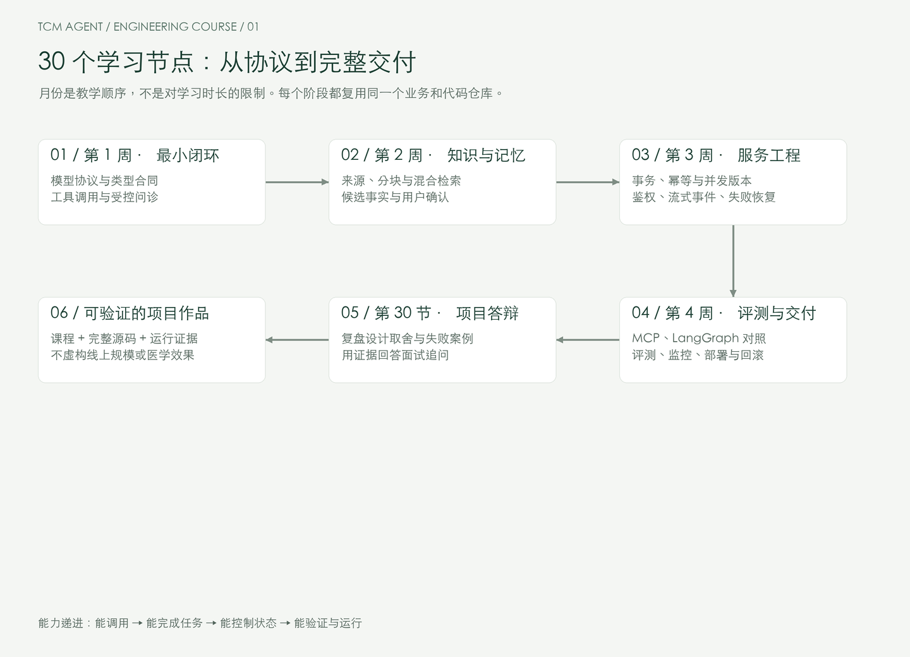

# 从 Python 后端到 Agent 工程：中医就诊准备助手实战课程

**版本：1.0 · 编写与核查日期：2026-10-16 · 面向已有后端工程经验的 Python 开发者**

这是一套围绕同一个真实业务闭环展开的课程：用户描述困扰，助手选择必要追问，检索可核查知识，提出待确认事实，用户核对后导出就诊摘要。你会从模型协议一直做到事务、并发、故障恢复、评测和部署，不需要重新学习 Python 基础。

“一个月”表示 30 个有依赖关系的学习节点，不限制每天投入。你可以按自己的节奏推进；每节的验收通过后再进入下一节。本文件包含全部课程正文、代码节选与详解，以及最后独立的项目面试题模块。配套仓库中的源码是执行依据，文中的节选从对应源码自动提取，避免教程和实现各说各话。

## 阅读导航

- [项目目标与交付边界](#项目目标与交付边界)
- [快速启动与运行方式](#快速启动与运行方式)
- [30 节课程路线](#30-节课程路线)
- [第一周：协议、合同与执行循环](#第一周协议合同与执行循环)
- [第二周：知识、检索与事实记忆](#第二周知识检索与事实记忆)
- [第三周：持久化、并发与服务可靠性](#第三周持久化并发与服务可靠性)
- [第四周：协议扩展、评测与交付](#第四周协议扩展评测与交付)
- [第 29—30 节：集成验收与项目答辩](#第-2930-节集成验收与项目答辩)
- [独立模块：项目面试题与答案解析](#独立模块项目面试题与答案解析)
- [来源与证据分级](#来源与证据分级)

## 项目目标与交付边界

项目名称为 **TCM Visit Preparation Agent，中医就诊准备助手**。它围绕问诊前的信息采集展开，不生成个体诊断、处方或剂量，不把舌象照片当作已验证的诊断输入。中医场景的价值在于：术语解释要有出处、病史不能编造、用户更正必须立即生效、记录涉及个人健康信息。这些约束正好迫使我们把 Agent 工程做完整。

已有产品需求见 [原始需求](../docs/product-requirements.md)。课程沿用主场景，但当前交付以 API 后端、终端工具和交互式 OpenAPI 文档为入口，没有另造一个未经测试的前端应用。

| 能力 | 本项目实际实现 | 实际边界 |
|---|---|---|
| 模型接入 | Responses 与 Chat Completions 分别适配、原生工具调用 | 用户平台尚未配置，真实连接与效果未验收 |
| 自主决策 | 模型选择检索、读取确认事实、追问或结束 | 工具集合和最终输出由代码约束 |
| 知识检索 | 中文 BM25；可选真实 Embedding、余弦排序、RRF | 默认 8 条原创教学知识，不称为临床知识库 |
| 问诊记录 | 候选事实、显式确认、同字段更正、原文溯源 | 精确匹配只能证明文本来源，不能证明语义分类正确 |
| 就诊摘要 | 确定性生成、缺失标记、导出 | 无自动诊断、无未确认信息 |
| 可靠性 | 幂等、版本 CAS、租约 fencing、事务外模型调用、超时降级 | 不宣称外部模型调用 exactly-once |
| 服务运行 | 鉴权隔离、进程内限流、SSE 进度、Prometheus 指标 | 多进程共享限流、外部告警接收端需要部署集成 |
| 扩展对照 | 可运行 MCP 服务端/客户端、LangGraph 条件路由 | 独立教学示例，不伪称主服务已改为分布式多 Agent |
| 交付 | 锁文件、数据库迁移、容器与 Compose、自动化检查 | 容器和 PostgreSQL 的验证状态见最终验证报告 |

医疗服务上线另有资质、专业审核与数据处理要求。国家卫健委发布的互联网诊疗监管细则明确约束 AI 替代医师和自动生成处方；课程按就诊准备定位设计，不能因为软件测试通过就声称完成医疗上线审核。[官方文件](https://www.nhc.gov.cn/yzygj/c100068/202203/2072f0e8988249e59d942e1b2a933916.shtml) · [官方政策解读](https://www.nhc.gov.cn/yzygj/c100067/202203/61bb44c669144ad1a4266fc4d63dd7a4.shtml)


架构图的可编辑源码：[Mermaid](assets/architecture.mmd) · [SVG](assets/architecture.svg)。后文全部图示也提供这两种源文件。

## 快速启动与运行方式

在仓库根目录执行。需要 Python 3.12 与 uv；uv 可按[官方安装说明](https://docs.astral.sh/uv/getting-started/installation/)安装。首次依赖同步需要联网，后续使用锁定环境。

```bash
uv sync --all-extras --frozen
uv run tcm init-db
uv run tcm run --text '什么是四诊？'
uv run pytest
uv run tcm evaluate
```

未设置配置时，`run` 使用 **offline 确定性工程夹具**，旨在让你立即验证安装、工具循环和数据链路。它不是语言模型，也不用于证明问诊理解、语义检索或医学能力。课程实际模型路径已实现，切换配置后走第三方平台。

启动可交互服务需显式配置访问令牌。以下令牌是公开的本地教学值，不能用于公开部署：

```bash
export TCM_MODEL_MODE=offline
export TCM_ACCESS_TOKENS='{"local-course-token-change-before-sharing":"learner"}'
uv run tcm serve
```

浏览 [交互式 API 文档](http://127.0.0.1:8000/docs)，点 Authorize 输入令牌，按顺序调用创建会话、提交回合、确认事实、生成摘要。完整的 HTTP 请求方法见第 15 节。服务只绑定本机；不要直接将教学令牌映射公开到互联网。

接入你的兼容平台时，在本地 `.env` 配置，密钥不进入 Git 或聊天：

```dotenv
TCM_MODEL_MODE=responses
TCM_MODEL_BASE_URL=https://your-provider.example/v1
TCM_MODEL_NAME=your-provider-model-name
TCM_MODEL_API_KEY=由你在本地填写
TCM_ACCESS_TOKENS={"由你生成的长随机访问令牌":"learner"}
```

推理型 Responses 模型通常需要回传加密 reasoning 条目，默认请求 `include=["reasoning.encrypted_content"]`。若第三方不支持该字段且使用非推理模型，可显式设 `TCM_RESPONSES_INCLUDE_REASONING=false`；不要对需要该状态的模型随意关闭。Chat 模型若要求 `max_completion_tokens`，设置 `TCM_CHAT_TOKEN_PARAMETER=max_completion_tokens`。这些兼容开关都应重新做 live 工具往返验收。

这里填写的是 API **基地址**，不要再附加 `/responses`。如果供应商只支持 `/chat/completions`，显式改为 `TCM_MODEL_MODE=chat`；项目不会在请求失败后偷偷改变协议。访问令牌用于你的应用鉴权，模型 API Key 用于供应商鉴权，两者不是同一把密钥。

```bash
uv run tcm doctor
uv run tcm run --text '请检索知识库解释四诊并给出引用'
TCM_RUN_LIVE=1 uv run pytest tests/test_live.py -m live -q
```

真实模型验收要求至少完成“模型发出检索调用 → 服务执行工具 → 模型收到工具结果 → 提交有引用的终态”。只收到 HTTP 200 或普通文本不算通过。测试失败可能说明平台协议子集、模型能力、参数支持或提示策略不同，应根据失败类型处理，不能直接关闭校验。

## 30 节课程路线



| 周 | 节点 | 技术推进 | 阶段验收 |
|---|---|---|---|
| 第一周 | 01—07 | 产品合同、协议、类型、工具调用、Agent Loop、上下文、策略 | 一次完整的模型—工具—结果闭环；失败可解释 |
| 第二周 | 08—14 | 知识清单、切块、BM25、Embedding、RRF、引用、事实记忆 | 有出处的知识解释；更正后的事实可用于摘要 |
| 第三周 | 15—21 | API、存储、事务、幂等、版本冲突、恢复、SSE | 多用户隔离；并发不覆盖；重复请求不重复落库 |
| 第四周 | 22—28 | MCP、LangGraph、评测、可观测性、容量、安全、部署 | 可复现检查；能定位 badcase；运行状态有证据 |
| 集成 | 29—30 | 故障演练、交付审查、项目答辩 | 独立复现项目，解释方案与尚未完成的验证 |

### 代码阅读地图

```text
src/tcm_agent/
  domain.py          所有应用合同
  gateway.py         两种模型协议的发送与重放
  wire.py            供应商响应解析
  runtime.py         有界 Agent 执行循环
  policy.py          最终输出与摘要约束
  context.py         上下文预算
  ingestion.py       知识入库
  retrieval.py       BM25、余弦、RRF
  embeddings.py      真实向量接口
  repository.py      用户会话与事实存取
  operations.py      幂等、租约与原子提交
  service.py         完整回合的应用服务
  routes.py          HTTP 入口与鉴权
  streaming.py       SSE 与取消传播
  observability.py   指标与限流
  api.py             生命周期与依赖组装
```

以下代码块是具名函数或类型的源码节选。需要完整导入与上下文时，打开标注的源文件；每节给出的命令运行的是完整项目，节选不要求脱离仓库独立粘贴运行。课程节点是阅读、实现练习和验收顺序，不是 30 个互不关联的 demo。

## 第一周：协议、合同与执行循环

### 第 01 节：把业务目标变成可执行合同

**本节功能。** 把“帮我问诊”拆成采集资料、理解知识、核对事实和准备摘要四种任务。先明确最终输出，才能决定模型需要哪些能力。资深后端开发者容易把 Agent 理解成一个智能服务方法；关键变化是服务内部存在不确定的决策，而外部合同仍须稳定。

本项目的最终决策不是任意文本，而是 `FinalTurn`。问什么、何时检索交给模型选择；输出哪些动作、哪些字段允许存在由类型限制。

源码：`src/tcm_agent/domain.py`。

[完整源码：FinalTurn](../src/tcm_agent/domain.py)

```python
class FinalTurn(Contract):
    """Terminal tool arguments; all fields required by strict JSON schemas."""

    action: Action
    question: QuestionKey
    facts: list[FactDraft] = Field(max_length=5)
    citations: list[CitationDraft] = Field(max_length=4)
```

**代码详解。** `action` 是业务动作枚举；`question` 是经过产品审核的问题枚举。`facts` 是候选事实，不是正式病史；`citations` 是待校验引用。列表长度上限限制输出体积。所有字段必填，避免模型把遗漏字段与空列表混淆。`Contract.extra="forbid"` 会拒绝模型额外偷偷添加的 `diagnosis` 或 `prescription` 字段。

**操作与验收。** 阅读 `Action`、`FactField` 和 `QuestionKey`，画出输入到输出的合同。执行 `uv run pytest tests/test_runtime.py -q`。在分支练习中给终态加入一个新动作，先观察类型检查如何要求补齐渲染逻辑，再撤销练习改动。能说明“类型正确”和“业务事实正确”的区别才算通过。

**面试关联。** Q01：怎样介绍 Agent 项目？Q09：什么放在编排器，什么交给模型？答案与考点见最终题库。

### 第 02 节：亲手分清 Responses 与 Chat Completions

**本节功能。** 通过一个统一的 `Conversation.step()` 使用两种协议，但不混用其请求字段。你所说的“response 格式”需要最终通过供应商协议确认；Responses 常见端点是 `/v1/responses`，Chat 是 `/v1/chat/completions`。

官方工具调用文档展示了 Responses 中 `function_call` 与 `function_call_output` 的关联方式；本项目据此实现兼容适配，但第三方平台是否完整实现仍需实测。[协议依据](https://developers.openai.com/api/docs/guides/function-calling)


源码：`src/tcm_agent/gateway.py`。

[完整源码：NativeConversation.step](../src/tcm_agent/gateway.py)

```python
async def step(self, observations: list[ToolResult]) -> ModelStep:
    """Use protocol-specific schemas and call-result linkage."""
    tool_specs: list[dict[str, JsonValue]] = [
        {
            "type": "function",
            "name": name,
            "description": description,
            "parameters": TypeAdapter(JsonValue).validate_python(schema.model_json_schema()),
            "strict": True,
        }
        for name, description, schema in TOOLS
    ]
    payload: dict[str, JsonValue] = {
        "model": self.settings.model_name,
        "parallel_tool_calls": False,
    }
    match self.mode:
        case "responses":
            self.transcript.extend(
                {"type": "function_call_output", "call_id": r.call_id, "output": r.output}
                for r in observations
            )
            payload.update(
                input=self.transcript,
                instructions=SYSTEM_PROMPT,
                tools=list(tool_specs),
                store=False,
                max_output_tokens=self.settings.max_output_tokens,
            )
            if self.settings.responses_include_reasoning:
                payload["include"] = ["reasoning.encrypted_content"]
            raw = await self.post("responses", json.dumps(payload).encode())
            result, replay = parse_responses(raw)
        case "chat":
            self.transcript.extend(
                {"role": "tool", "tool_call_id": r.call_id, "content": r.output}
                for r in observations
            )
            tools: list[JsonValue] = [
                {"type": "function", "function": {k: v for k, v in spec.items() if k != "type"}}
                for spec in tool_specs
            ]
            payload.update(
                messages=self.transcript,
                tools=tools,
            )
            payload[self.settings.chat_token_parameter] = self.settings.max_output_tokens
            raw = await self.post("chat/completions", json.dumps(payload).encode())
            result, replay = parse_chat(raw)
        case unreachable:
            assert_never(unreachable)
    self.transcript.extend(replay)
    return result
```

**代码详解。** Responses 的函数描述放在工具对象顶层；Chat 将函数放进 `function` 子对象。Responses 用 `call_id` 回传结果；Chat 用 `role="tool"` 与 `tool_call_id`。同一份 Pydantic Schema 在协议边界转成 JSON。适配器只负责通信，不决定业务是否可信。每次回合构造独立 transcript，避免两个用户共享模型重放状态。

Responses 设置 `store=false` 表示请求不使用该接口的服务端存储能力，**不代表第三方平台已经承诺不记录数据**。平台的数据策略需要单独确认。本地保留会话状态，跨回合不依赖供应商保存的 response ID。

**操作与验收。** `uv run pytest tests/test_gateway.py -q`。检查测试捕获的实际请求体，解释两个协议的差异。故意把 `call_id` 改错，看协议断言失败。真实平台接入执行 `TCM_RUN_LIVE=1 uv run pytest tests/test_live.py -q`，没有平台配置则保留待验收状态。

**面试关联。** Q10：兼容接口为什么仍会失败？Q11：工具调用完整链路是什么？

### 第 03 节：结构化输出与边界解析

**本节功能。** 把供应商的 JSON 变成内部类型，在信任边界拒绝不完整或错误响应。结构化输出解决形状问题，不能证明事实、来源或权限正确。

源码：`src/tcm_agent/wire.py`。

[完整源码：parse_responses](../src/tcm_agent/wire.py)

```python
def parse_responses(raw: bytes) -> tuple[ModelStep, list[JsonValue]]:
    """Return calls plus original items, including encrypted reasoning items."""
    try:
        envelope = ResponseEnvelope.model_validate_json(raw)
        if envelope.status != "completed":
            raise AgentError("provider_incomplete")
        items = [ResponseItem.model_validate(item) for item in envelope.output]
        calls = [
            ToolCall(call_id=item.call_id, name=item.name, arguments=item.arguments)
            for item in items
            if item.type == "function_call"
        ]
        if any(not call.call_id or not call.name for call in calls):
            raise AgentError("provider_invalid_call")
        replay: list[JsonValue] = list(envelope.output)
        return ModelStep(
            calls=calls,
            usage=Usage(
                input_tokens=envelope.usage.input_tokens,
                output_tokens=envelope.usage.output_tokens,
            ),
        ), replay
    except (ValidationError, json.JSONDecodeError) as error:
        raise AgentError("provider_schema_error") from error
```

**代码详解。** `ResponseEnvelope` 对 `output` 和 `usage` 建立合同；非 `completed` 状态不能当成完整答案。函数调用必须带标识和名称。`replay` 保留原始 output 条目，而不是只留下提取出的工具调用；这样推理型模型所需的 reasoning 等条目不会在下一轮丢失。它们只是供应商协议数据，不是我们能解释或展示的思维链。

应用合同拒绝多余字段，供应商 envelope 则允许协议添加非关键字段：前者保护业务，后者避免因供应商新增元数据而无意义失败。要理解为什么这两个边界采用不同策略。

**操作与验收。** 运行 `uv run pytest tests/test_gateway.py -k 'parse or native_protocol' -q`。准备三个输入：没有 output、status=incomplete、带 reasoning 与 function_call。前两个应失败，第三个保留重放条目。不要用补右括号来“修复”截断后的参数。

**面试关联。** Q12：JSON Mode、严格 Schema 与语义校验有何不同？Q13：temperature=0 能保证稳定吗？

### 第 04 节：设计工具，而不是给模型一个万能函数

**本节功能。** 提供三个职责明确的工具：检索公共知识、读本会话确认事实、提交本回合终态。工具没有 `owner`、SQL、文件路径、密钥或通用 HTTP URL 参数，模型无法通过工具参数扩大访问范围。

源码：`src/tcm_agent/tool_schema.py`。

[完整源码：SearchArgs](../src/tcm_agent/domain.py)

```python
class SearchArgs(Contract):
    query: str = Field(min_length=1, max_length=300)
```

[完整源码：ToolCall](../src/tcm_agent/domain.py)

```python
class ToolCall(Contract):
    call_id: str
    name: str
    arguments: str
```

**代码详解。** `query` 长度在边界限制。`ToolCall.arguments` 仍是字符串，因为协议中的工具参数就是序列化 JSON；执行前必须用具体工具参数类型解析，不能直接 `eval`。`call_id` 用于结果关联，不等于业务幂等键。模型可能给出不同 call ID 的重复语义调用，所以还需要步数和任务层预算。

工具描述是模型的操作说明书。描述应说明输入含义、返回信息和限制，不应该用“这是一个超级强大的万能助手”替代合同。新增写工具前先定义授权、校验和幂等策略。

**操作与验收。** 阅读 `TOOLS` 注册表，运行 `uv run pytest tests/test_runtime.py -k 'unknown or arguments' -q`。在练习中尝试构造 `delete_all_patients` 调用，应该被执行器拒绝，且不会触达仓库。讨论如果将来新增预约接口，为什么不能只添一条 Prompt。

**面试关联。** Q14：好的 Tool Schema 有什么特征？Q15：Function Calling 是否意味着安全执行？

### 第 05 节：实现可终止、可调试的 Agent Loop

**本节功能。** 模型根据观察决定下一步，执行器循环校验与调用工具。这里有真实的模型决策接口，offline 路径只是确定性夹具。ReAct 的核心启发是让决策和环境反馈交替发生；工程系统不需要索取或记录私有思维链。[ReAct 论文](https://arxiv.org/abs/2210.03629)


源码：`src/tcm_agent/runtime.py`。这是主线最重要的一段代码，建议完整阅读。

[完整源码：AgentRuntime.run](../src/tcm_agent/runtime.py)

```python
async def run(self, context: RuntimeInput, emit: ProgressSink | None = None) -> TurnResponse:  # noqa: C901, PLR0912
    # Keep the bounded decision loop visible as one teaching unit.
    """Model decisions never get credentials, owner IDs, arbitrary SQL or writes."""
    if needs_handoff(context.request.text):
        return self.handoff(context)
    conversation = self.gateway.conversation(ContextBuilder(self.context_chars).build(context))
    observations: list[ToolResult] = []
    retrieved: dict[str, Evidence] = {}
    used_ids: set[str] = set()
    totals = Usage()
    for step_index in range(1, self.max_steps + 1):
        if emit is not None:
            await emit(Progress(kind="model_step", step=step_index))
        step = await conversation.step(observations)
        totals = Usage(
            input_tokens=totals.input_tokens + step.usage.input_tokens,
            output_tokens=totals.output_tokens + step.usage.output_tokens,
        )
        if len(step.calls) != 1:
            raise AgentError("expected_single_tool_call", 422)
        call = step.calls[0]
        if call.call_id in used_ids:
            raise AgentError("duplicate_tool_call_id", 422)
        used_ids.add(call.call_id)
        if emit is not None:
            await emit(
                Progress(
                    kind="tool_started",
                    step=step_index,
                    tool=call.name
                    if call.name in {"search_knowledge", "read_visit_facts", "submit_turn"}
                    else "rejected",
                )
            )
        try:
            match call.name:  # noqa: MATCH_OK
                # Names cross an open untrusted string boundary; reject unknowns.
                case "search_knowledge":
                    args = SearchArgs.model_validate_json(call.arguments)
                    entries = await self.knowledge.search(args.query)
                    retrieved.update((entry.entry_id, entry) for entry in entries)
                    observations = [
                        ToolResult(
                            call_id=call.call_id,
                            output="[" + ",".join(e.model_dump_json() for e in entries) + "]",
                        )
                    ]
                case "read_visit_facts":
                    EmptyArgs.model_validate_json(call.arguments)
                    observations = [
                        ToolResult(
                            call_id=call.call_id,
                            output="["
                            + ",".join(f.model_dump_json() for f in context.snapshot.facts)
                            + "]",
                        )
                    ]
                case "submit_turn":
                    final = FinalTurn.model_validate_json(call.arguments)
                    candidates = validate_final(final, context)
                    citations: list[Evidence] = []
                    for citation in final.citations:
                        evidence = retrieved.get(citation.entry_id)
                        if evidence is None or citation.quote not in evidence.text:
                            raise AgentError("ungrounded_citation", 422)
                        citations.append(evidence.model_copy(update={"text": citation.quote}))
                    if emit is not None:
                        await emit(Progress(kind="validated", step=step_index))
                    return TurnResponse(
                        turn_id=context.turn_id,
                        session_id=context.snapshot.session_id,
                        version=context.snapshot.version + 1,
                        action=final.action,
                        answer=render_answer(final, context, [e.text for e in citations]),
                        candidates=candidates,
                        citations=citations,
                        usage=totals,
                        steps=step_index,
                    )
                case _:
                    raise AgentError("tool_not_allowed", 422)
        except ValidationError as error:
            raise AgentError("invalid_tool_arguments", 422) from error
    raise AgentError("step_budget_exceeded")
```

**代码详解。** 执行顺序是：前置策略 → 上下文 → 模型决策 → 单调用限制 → call ID 去重 → 参数解析 → 工具观察/终态校验。每轮检索返回的证据登记到 `retrieved`，最终引用只能使用本轮见过的条目。`submit_turn` 结束循环，其它普通文本不直接发给用户。没有工具调用、一次多个调用、重复标识、未知工具、超预算都具有明确失败结果。

最大步数限制只控制循环次数。总时间由应用服务约束，单次输出 token 由网关约束，输入体积另有预算。这些限制共同工作，不能用一个 recursion_limit 代替全部运行控制。

**操作与验收。** `uv run tcm run --text '什么是四诊？'`，观察 `steps=2`、引用和零 token 的 offline 标记。执行 `uv run pytest tests/test_runtime.py -q`，再阅读实际模型运行入口。能逐步解释一次 search→observation→submit 才算通过。

**面试关联。** Q16：如何避免无限循环？Q17：什么时候不用 Agent？

### 第 06 节：上下文工程与记忆预算

**本节功能。** 将确认事实与当前输入视为必需信息，把最近对话视为可裁剪信息。不是把数据库所有历史拼成一个越来越大的字符串。

源码：`src/tcm_agent/context.py`。

[完整源码：ContextBuilder.build](../src/tcm_agent/context.py)

```python
def build(self, context: RuntimeInput) -> list[Message]:
    """Newest history fits first; current input and confirmed state are mandatory."""
    current = Message(role="user", content=context.request.text)
    facts = Message(
        role="user",
        content=json.dumps(
            {
                "confirmed_facts_data": [
                    f.model_dump(mode="json") for f in context.snapshot.facts
                ]
            },
            ensure_ascii=False,
        ),
    )
    remaining = self.max_chars - len(current.content) - len(facts.content)
    if remaining < 0:
        raise AgentError("context_budget_exceeded", 413)
    history: list[Message] = []
    for message in reversed(context.snapshot.messages):
        if len(message.content) > remaining:
            break
        history.insert(0, message)
        remaining -= len(message.content)
    return [facts, *history, current]
```

**代码详解。** 当前输入始终位于最后。确认事实独立标记为数据，不依赖模型从旧助手回复里重新推断。历史从新到旧填入剩余额度；必需内容放不下就明确报错，不静默删除用户已确认资料。本实现按字符做可移植预算，网关还按请求字节限制体积；二者都不是精确 token 计数。生产接入应使用目标模型的 tokenizer 或供应商计数能力测量安全余量。

保留更多历史不一定更准确：会引入过时事实、错误回复和更多无关信息。摘要也可能丢失否定、时间与药名。事实存储与对话压缩必须分别设计。

**操作与验收。** 阅读 `apply_turn` 对历史最多保留 12 条消息的实现。构造长度超限的必要事实，验证系统拒绝，而不是悄悄遗忘。解释为什么完整原始回合仍可在 records 导出，而不必每次都发送给模型。

**面试关联。** Q18：短期/长期记忆如何划分？Q19：如何处理长上下文与记忆污染？

### 第 07 节：业务策略、模型自由度与确定性输出

**本节功能。** 使用代码决定可对外呈现的内容。模型选择动作、问题字段和证据片段；最终答案由固定问题、核对后的资料和精确引文组成。这样仍有 Agent 的动态决策，同时缩小健康场景中自由生成的风险。

源码：`src/tcm_agent/policy.py`。

[完整源码：validate_final](../src/tcm_agent/policy.py)

```python
def validate_final(final: FinalTurn, context: RuntimeInput) -> list[Fact]:
    """Proposed facts must quote CURRENT input; user confirmation decides semantics."""
    if len({f.field for f in final.facts}) != len(final.facts):
        raise AgentError("duplicate_fact_field", 422)
    for draft in final.facts:
        if draft.quote not in context.request.text:
            raise AgentError("ungrounded_fact", 422)
    if final.action != Action.ASK and final.question != QuestionKey.NONE:
        raise AgentError("invalid_question_action", 422)
    return [Fact(field=f.field, quote=f.quote, source_turn_id=context.turn_id) for f in final.facts]
```

[完整源码：render_answer](../src/tcm_agent/policy.py)

```python
def render_answer(final: FinalTurn, context: RuntimeInput, quotes: list[str]) -> str:
    """Render trusted templates and verified extractive evidence only."""
    match final.action:
        case Action.ASK:
            return QUESTION_TEXT[final.question]
        case Action.KNOWLEDGE:
            return (
                "\n\n".join(quotes)
                if quotes
                else "当前知识库没有足够依据回答这个问题。可以记录问题并向医师咨询。"
            )
        case Action.SUMMARY:
            return render_summary(context.snapshot.facts)
        case Action.HANDOFF:
            return HANDOFF
        case unreachable:
            assert_never(unreachable)
```

**代码详解。** 候选事实必须是当前用户输入的原文片段；同一字段不能重复。非追问动作不能再携带追问字段。摘要走确定性代码。知识回答只展示已经核对出处的引文；来源不足时给出有限回答。这个设计不能证明引文相关、条目医学正确或模型对字段归类正确，后续仍要用评测和用户确认弥补。

`needs_handoff` 的关键词集合只是保守的工程演示，不是医学分诊模型。它可能误报，也可能漏报。项目不以此声称识别全部急症；所有输出都不提供个体诊疗方案。

**阶段验收。** `uv run pytest tests/test_runtime.py tests/test_api.py -q`。越权工具、虚构事实、未经检索的引用必须拒绝。未确认事实不能进入摘要。已知风险触发走 handoff，且不调用模型。

**面试关联。** Q20：如何减少健康助手幻觉？Q21：为什么 Prompt 不能当权限系统？

## 第二周：知识、检索与事实记忆

### 第 08 节：建立可追溯的知识来源清单

**本节功能。** 知识不是随便下载的 PDF。系统需要知道文本来自哪里、什么版本、是否允许使用、谁批准进入当前语料。你要先有来源清单，再有向量索引。

源码：`src/tcm_agent/ingestion.py` 与 `knowledge/entries.json`。

[完整源码：SourceSpec](../src/tcm_agent/ingestion.py)

```python
class SourceSpec(Contract):
    path: Path
    title: str
    source_url: str
    version: str
    license: str = Field(min_length=1)
    approved: bool
```

**代码详解。** `license` 不允许空字符串；`approved` 是管理员提供的工程准入状态，不是模型自我审核，也不等于医师审核。`version` 代表资料版本，后续还会绑定内容哈希。`source_url` 是出处定位。本课程内置条目使用 `course://` 标识作者原创教材，而不是伪造一个外部权威引用。

知识数据与评测数据用途不同。发布原始语料前需要确认权利和用途；公开可访问并不等于可复制或商用。进入私人病史的内容不应自动成为公共检索数据。

**操作。** 自己写一个无医学诊疗建议的 Markdown 资料 `data/notes.md`，再创建 `data/manifest.json`：

```json
[{"path":"notes.md","title":"课程项目操作说明","source_url":"course://notes","version":"v1","license":"original author permission","approved":true}]
```

```bash
uv run tcm ingest data/manifest.json --destination data/knowledge.json
```

**验收。** 产物带来源和版本；未批准文件不进入产物。不要把内置评测切换到自建语料后仍沿用旧标准答案，必须重新标注。

**面试关联。** Q22：RAG 数据质量如何保证？Q23：如何处理敏感资料？

### 第 09 节：切块、重叠与文档级上下文

**本节功能。** 将较长文档变成适合召回的单元，保持顺序与来源。RAG 原始论文提出将检索到的外部信息与生成结合；本项目把知识选择和引用控制落实为可观察的工具链路。[RAG 论文](https://arxiv.org/abs/2005.11401)


源码：`src/tcm_agent/ingestion.py`。

[完整源码：chunk_text](../src/tcm_agent/ingestion.py)

```python
def chunk_text(text: str, size: int = 600, overlap: int = 80) -> list[str]:
    """Bound by characters, not tokens; repeat context only within the same document."""
    if size <= overlap or overlap < 0:
        raise DataContractError("Chunk size must exceed nonnegative overlap")
    text = text.strip()
    chunks: list[str] = []
    start = 0
    while start < len(text):
        end = min(start + size, len(text))
        if end < len(text):
            boundary = text.rfind("\n\n", start + size // 2, end)
            if boundary > start:
                end = boundary
        chunk = text[start:end].strip()
        if chunk:
            chunks.append(chunk)
        if end == len(text):
            break
        start = end - overlap
    return chunks
```

**代码详解。** 默认 600 字符与 80 字符重叠是课程起始参数，不是通用最优值。切分器优先在后半段找段落边界，避免切得过碎；末块明确终止，防止 overlap 造成无限循环。字符预算便于中文资料在无 tokenizer 时运行，但正式检索需要根据目标模型、结构和评测集调整。

重叠增加召回覆盖，也增加索引和上下文重复。文档中“全部单位为毫克”“以下适用于成人”这样的上位约束不能靠任意 overlap 保证保留。当前入库保存标题元数据；有复杂适用条件的医学资料应进行结构化审核和条件绑定，不能直接当作通用医学知识导入。

**操作与验收。** `uv run pytest tests/test_ingestion.py -q`。用段落、单行长文本、空文档和中文混合资料观察边界。将 overlap 改为与 size 相等，应立即拒绝。新增规则后比较检索指标与输入成本，不能只凭片段看起来漂亮决定。

**面试关联。** Q24：如何选 chunk 大小？Q25：如何保持跨页或文档级上下文？

### 第 10 节：实现一个解释得清的中文 BM25 基线

**本节功能。** 没有 Embedding 服务时也能进行真实检索。基线使用中文单字、双字片段与英文词项，让“望闻问切”这样的无空格文本具有可匹配的检索单元。

源码：`src/tcm_agent/retrieval.py`。

[完整源码：tokenize](../src/tcm_agent/retrieval.py)

```python
def tokenize(text: str) -> list[str]:
    """Use Chinese uni/bigrams plus English words; not claimed to be semantic."""
    runs = [match.group() for match in re.finditer(r"[\u4e00-\u9fff]+|[a-zA-Z0-9_]+", text.lower())]
    terms: list[str] = []
    for run in runs:
        if run.isascii():
            terms.append(run)
        else:
            terms.extend(run)
            terms.extend(run[i : i + 2] for i in range(len(run) - 1))
    return terms
```

[完整源码：KnowledgeBase.sparse](../src/tcm_agent/retrieval.py)

```python
def sparse(self, query: str) -> list[tuple[int, float]]:
    """BM25 k1=1.2, b=0.75, computed transparently for this bounded corpus."""
    if not self.entries:
        return []
    docs = [Counter(tokenize(e.title + " " + e.text)) for e in self.entries]
    avg = sum(sum(d.values()) for d in docs) / len(docs)
    scored: list[tuple[int, float]] = []
    for index, doc in enumerate(docs):
        score = 0.0
        for term in set(tokenize(query)):
            df = sum(term in d for d in docs)
            tf = doc[term]
            idf = math.log(1 + (len(docs) - df + 0.5) / (df + 0.5))
            score += idf * tf * 2.2 / (tf + 1.2 * (0.25 + 0.75 * sum(doc.values()) / avg))
        if score > 0:
            scored.append((index, score))
    return sorted(scored, key=lambda x: (-x[1], x[0]))
```

**代码详解。** `tf` 表示词在一个文档中的频率，`df` 表示出现该词的文档数；稀有词的区分作用更强。长度归一化避免长文档仅因内容多而长期占优。这里使用 k1=1.2、b=0.75，代码公开公式，便于观察和替换。它不是语义向量检索，不能把词形相近误称为理解同义词。

当前实现每次遍历整个小语料，适合教学和受控小规模资料；不是百万文档的搜索引擎。若语料扩大，应预计算统计并采用倒排索引，先测召回与时延，再选搜索服务。

**操作与验收。** `uv run pytest tests/test_retrieval.py -q`。用“药名”“用药记录”“既往服药”测试同义改写，记录失败原因。执行 `uv run tcm evaluate`，注意报告只含 8 条小样本，不可宣传为全场景准确率。

**面试关联。** Q26：稀疏与稠密检索如何比较？Q27：BM25 为什么适合做基线？

### 第 11 节：接入真实 Embedding，处理维度与版本

**本节功能。** 通过供应商 `/embeddings` 得到真实向量，而不是用随机数或哈希向量冒充语义能力。默认该能力关闭；开启需要平台确实支持 Embedding 模型。

源码：`src/tcm_agent/embeddings.py`。

[完整源码：ProviderEmbedder.embed](../src/tcm_agent/embeddings.py)

```python
async def embed(self, texts: list[str]) -> list[list[float]]:
    """Keep this course corpus bounded; reject missing/reordered/empty embeddings."""
    response = await self.client.post(
        f"{self.settings.model_base_url.rstrip('/')}/embeddings",
        headers={"Authorization": f"Bearer {self.settings.model_api_key.get_secret_value()}"},
        json={
            "model": self.settings.embedding_model,
            "input": texts,
            "encoding_format": "float",
        },
    )
    if response.status_code != 200:
        raise AgentError("embedding_http_error")
    envelope = EmbeddingEnvelope.model_validate_json(response.content)
    rows = sorted(envelope.data, key=lambda r: r.index)
    if [r.index for r in rows] != list(range(len(texts))) or any(not r.embedding for r in rows):
        raise AgentError("embedding_schema_error")
    return [row.embedding for row in rows]
```

**代码详解。** 返回结果按 index 排序，并检查完整性。不能假设服务返回顺序必然等于输入顺序。查询和文档使用同一配置的向量模型；维度漂移必须报错，不能让 zip 静默截断。即使两个模型维度相同，也不意味着它们处于同一向量空间。

本项目在进程启动时为小语料构建内存向量索引，重启重新计算；没有声称实现大规模向量数据库。真实平台若用不同的 Embedding 基地址或独立密钥，当前适配器需要扩展独立配置，不能误把聊天密钥发送给未确认的地址。

**操作与验收。** 配置 `TCM_EMBEDDING_MODEL` 后重启服务，并运行评测。没有真实向量服务时只做合同测试，报告保留“未验证”。比较同义问题的召回与额外延迟；检索指标不改善就不要为了技术栈好看而强行启用。

**面试关联。** Q28：Embedding 如何选型与迁移？Q29：HNSW 与精确扫描有什么取舍？

### 第 12 节：混合检索、RRF 与重排的边界

**本节功能。** 将 BM25 与向量结果按排名融合，避免直接相加不可比的分数。BM25 分数与 cosine 数值的尺度并不相同。

源码：`src/tcm_agent/retrieval.py`。

[完整源码：KnowledgeBase.search](../src/tcm_agent/retrieval.py)

```python
async def search(self, query: str) -> list[Evidence]:
    """RRF uses rank, not incomparable sparse and dense score magnitudes."""
    sparse = self.sparse(query)
    ranks = [sparse]
    if self.embedder is not None and self.vectors:
        query_vector = (await self.embedder.embed([query]))[0]
        dense = sorted(
            ((i, cosine(query_vector, list(v))) for i, v in enumerate(self.vectors)),
            key=lambda x: -x[1],
        )
        ranks.append(dense[:10])
    scores: dict[int, float] = {}
    for ranking in ranks:
        for rank, (index, _) in enumerate(ranking[:10], start=1):
            scores[index] = scores.get(index, 0.0) + 1 / (60 + rank)
    return [
        Evidence(
            entry_id=self.entries[i].entry_id,
            title=self.entries[i].title,
            text=self.entries[i].text,
            source_url=self.entries[i].source_url,
            version=self.entries[i].version,
            license=self.entries[i].license,
            score=score,
        )
        for i, score in sorted(scores.items(), key=lambda item: (-item[1], item[0]))[:4]
    ]
```

**代码详解。** RRF 对各路中的第 r 名增加 `1/(60+r)`。60 是平滑常数；它不是模型输出概率。每路保留前 10，再选融合后的前 4。关闭 Embedding 时只有一条 BM25 排名，不应宣传为混合检索。这里计算的是完整候选排名，而不是 ANN；这与当前小知识库的规模一致。

重排与融合不同：RRF 结合各路排序；cross-encoder 对 query/document 联合打分，可以识别更细粒度相关性，但需要额外推理与延迟。当前主线没有接入 cross-encoder，课程会讲清升级点，面试时不能声称已经上线。

**操作与验收。** 比较 BM25-only 与 hybrid 的 Recall@4、MRR@4、单次耗时。做一个失败记录：某查询两路都没有正确条目时，再好的融合也无法补救。练习为同一文档多个 chunk 去重，说明为什么会减少来源多样性偏差。

**面试关联。** Q30：为什么做混合检索？Q31：重排放在哪、如何评估收益？

### 第 13 节：让每个知识解释都能回到证据

**本节功能。** 模型只能引用本回合实际检索过的条目，并且引文必须是该条目原文片段。引用有效性不能靠模型自己声明。

源码：`src/tcm_agent/domain.py`。

[完整源码：Evidence](../src/tcm_agent/domain.py)

```python
class Evidence(Contract):
    entry_id: str
    title: str
    text: str
    source_url: str
    version: str
    license: str
    score: float = 0
```

[完整源码：CitationDraft](../src/tcm_agent/domain.py)

```python
class CitationDraft(Contract):
    entry_id: str
    quote: str = Field(min_length=1, max_length=1000)
```

**代码详解。** `Evidence` 同时携带 entry ID、出处、版本、许可和本次排名分数。模型终态只提交 ID 和 quote，服务端从自己的 `retrieved` 登记表补齐可信元数据。模型不能把一个好看的外部 URL 填进最终来源字段。render_answer 只使用通过包含校验的片段，降低生成未经证据支持的新医学说法的机会。

需要区分三层：来源真实存在、引文确实来自该来源、引文能够支持当前回答。前两层可用机械校验覆盖一部分，第三层需要相关性评估与领域审核。古籍、科普和临床研究也不能被当成同等级证据。

**操作与验收。** `uv run pytest tests/test_runtime.py -k citation -q`。先构造从未检索过但真实存在的 entry ID，应失败；再构造不存在的引文，也应失败。检查知识解释对未知问题的有限回答，不用虚构链接兜底。

**面试关联。** Q32：RAG 有引用是否就可信？Q33：检索正确、回答仍错怎么查？

### 第 14 节：事实记忆、人类确认与确定性摘要

**本节功能。** 将用户确认写成真正的应用状态变化。用户输入中的事实片段先成为候选；确认时可以改正字段归类；同一字段的新确认替换旧值，版本加一。


源码：`src/tcm_agent/repository.py` 与 `policy.py`。

[完整源码：VisitRepository.confirm](../src/tcm_agent/repository.py)

```python
async def confirm(self, owner: str, session_id: UUID, request: ConfirmRequest) -> VisitSnapshot:
    """Confirm/correct only a quote grounded in an actual input turn."""
    snapshot = await self.load(owner, session_id)
    if snapshot.version != request.expected_version:
        raise AgentError("version_conflict", 409)
    candidate = next(
        (
            f
            for f in snapshot.candidates
            if f.source_turn_id == request.source_turn_id and f.quote == request.quote
        ),
        None,
    )
    if candidate is None:
        raise AgentError("candidate_not_found", 422)
    fact = Fact(
        field=request.field,
        quote=request.quote,
        source_turn_id=request.source_turn_id,
        confirmed=True,
    )
    facts = [f for f in snapshot.facts if f.field != request.field] + [fact]
    revised = snapshot.model_copy(
        update={
            "version": snapshot.version + 1,
            "facts": facts,
            "candidates": [f for f in snapshot.candidates if f != candidate],
        }
    )
    await self.replace(owner, revised)
    return revised
```

[完整源码：render_summary](../src/tcm_agent/policy.py)

```python
def render_summary(facts: list[Fact]) -> str:
    """No model call: missing facts stay missing, never inferred negative."""
    indexed = {fact.field: fact for fact in facts if fact.confirmed}
    lines = ["就诊准备摘要（用户确认资料）"]
    for field, label in FIELD_TEXT.items():
        fact = indexed.get(field)
        lines.append(f"{label}：{fact.quote if fact else '未提供'}")
    lines.append("此摘要不包含诊断或处方；请由医师结合实际情况判断。")
    return "\n".join(lines)
```

**代码详解。** 确认请求必须引用已有候选的 source_turn_id 和 quote，防止把助手推断当作用户既往输入。字段由用户确认决定，因此即使模型把“我没有说过敏”错误分类成过敏事实，也不能在用户确认前生效。摘要遍历固定字段，未提供始终标记为未提供，不把“没问到”写成“没有”。

更正流程是：用户发来新表述 → 形成新候选 → 确认该字段 → 替换旧值。删除某个已确认字段有独立 API，同样需要版本号。正式事实的存在不依赖旧聊天历史是否还在上下文里。

**阶段验收。** `uv run pytest tests/test_api.py -k 'summary or confirm' -q`。先不确认直接导出，摘要不含候选；确认后导出，原话出现；更正再导出，仅保留新事实。能够解释用户确认与 LangGraph 的 interrupt 为何不是同一层问题。

**面试关联。** Q34：Human-in-the-loop 应放在哪里？Q35：更正和记忆污染怎么处理？

## 第三周：持久化、并发与服务可靠性

### 第 15 节：将 Agent 接成稳定的 HTTP 服务

**本节功能。** 通过稳定 API 连接认证用户、会话状态和模型运行；业务逻辑在 `Services`，HTTP 路由只解析请求、绑定身份并返回合同。依赖生命周期用 FastAPI lifespan 管理。[官方生命周期文档](https://fastapi.tiangolo.com/advanced/events/)

源码：`src/tcm_agent/api.py`。

[完整源码：create_app](../src/tcm_agent/api.py)

```python
def create_app(settings: Settings | None = None, gateway: ModelGateway | None = None) -> FastAPI:
    """Support explicit dependency injection for offline and wire-contract tests."""
    config = settings or Settings()
    resources: list[Services] = []

    @asynccontextmanager
    async def lifespan(_application: FastAPI) -> AsyncGenerator[None]:
        if not config.access_tokens:
            raise AgentError("configure_access_tokens_before_serving", 500)
        engine = engine_for(config.database_url)
        try:
            async with create_client() as client:
                factory = async_sessionmaker(engine, expire_on_commit=False)
                knowledge = KnowledgeBase.load(config.knowledge_path)
                if config.embedding_model:
                    knowledge = await knowledge.with_embeddings(ProviderEmbedder(config, client))
                model = gateway or (
                    OfflineGateway() if config.model_mode == "offline" else Gateway(config, client)
                )
                resources.append(
                    Services(
                        VisitRepository(factory),
                        OperationStore(factory, int(config.turn_timeout_seconds) + 30),
                        AgentRuntime(model, knowledge, config.max_steps, config.context_chars),
                        Metrics.create(),
                        RateLimiter(config.rate_limit_per_minute),
                        config,
                    )
                )
                yield
        finally:
            resources.clear()
            await engine.dispose()

    app = FastAPI(
        title="中医就诊准备 Agent",
        version="1.0.0",
        lifespan=lifespan,
        description="整理资料、核对事实与知识解释。offline 模式是确定性工程夹具。",
    )
    app.include_router(build_router(config, lambda: resources[0]))

    @app.exception_handler(AgentError)
    async def agent_error(_request: Request, error: AgentError) -> JSONResponse:
        headers = {"WWW-Authenticate": "Bearer"} if error.status == 401 else {}
        if error.status == 429:
            headers["Retry-After"] = "60"
        return JSONResponse(
            status_code=error.status, content={"error": error.code}, headers=headers
        )

    return app
```

**代码详解。** 引擎、连接池和 HTTP 客户端属于应用生命周期，不是每次工具调用创建。测试可注入 gateway，但真实服务按照显式配置选择模型。空鉴权配置拒绝启动；没有用默认管理员身份兜底。资源通过应用闭包注入，不依赖未类型化的 `app.state` 散落全局。

**操作。** 启动服务后，在另一个终端设置 `TCM_CLIENT_TOKEN` 为同一个本地教学令牌：

```bash
export TCM_CLIENT_TOKEN='local-course-token-change-before-sharing'
uv run python examples/smoke_api.py
```

也可以手动调用：

```bash
curl -s http://127.0.0.1:8000/sessions \
  -H "Authorization: Bearer $TCM_CLIENT_TOKEN" \
  -H 'Content-Type: application/json' \
  -d '{"consent":true}'
```

拿到 session_id 后提交 `request_id`、`expected_version`、`text`。request_id 是客户端为同一次提交生成的 UUID；重试时保留它，新的用户消息生成新 UUID。

**验收。** `/docs` 能展示合同；无令牌 401、他人会话 404、缺少同意 422，错误代码稳定。真实 HTTP smoke 与内存 TestClient 都要跑，前者覆盖启动和网络入口。

**面试关联。** Q02：接口如何分层？Q36：认证与授权如何区分？

### 第 16 节：数据库模型、迁移与持久化状态

**本节功能。** 将会话快照与请求执行记录分开。快照服务于读取当前状态；操作记录服务于幂等、原文溯源和失败恢复。最小部署使用 SQLite；PostgreSQL 使用相同 SQLAlchemy 仓库接口。

源码：`src/tcm_agent/models.py`。

[完整源码：VisitRow](../src/tcm_agent/models.py)

```python
class VisitRow(Base):
    """Mutable ORM record; version increments on every successful state change."""

    __tablename__: str = "visits"
    id: Mapped[str] = mapped_column(String(36), primary_key=True)
    owner: Mapped[str] = mapped_column(String(128), index=True)
    version: Mapped[int] = mapped_column(Integer, default=0)
    state: Mapped[str] = mapped_column(Text)
```

[完整源码：OperationRow](../src/tcm_agent/models.py)

```python
class OperationRow(Base):
    """Mutable idempotency record with fencing token for crash recovery."""

    __tablename__: str = "operations"
    session_id: Mapped[str] = mapped_column(ForeignKey("visits.id"), primary_key=True)
    request_id: Mapped[str] = mapped_column(String(36), primary_key=True)
    body_hash: Mapped[str] = mapped_column(String(64))
    request_text: Mapped[str] = mapped_column(Text)
    status: Mapped[str] = mapped_column(String(16))
    lease: Mapped[str] = mapped_column(String(36))
    started: Mapped[int] = mapped_column(Integer)
    response: Mapped[str] = mapped_column(Text, default="")
```

**代码详解。** `VisitRow.version` 贯穿所有修改。`OperationRow` 使用 `(session_id, request_id)` 复合主键，保存请求哈希、原始输入、状态、租约和最终响应。健康正文只在受控数据库中保存，不加入指标标签。`state` 使用序列化合同减少教学项目的表数量，但每次修改整个快照有写放大；规模增长后可以拆分事实表和回合表。

迁移文件固定初始结构，不从未来的 ORM 模型动态推导历史。服务启动不偷偷执行 create_all；先执行 `uv run tcm init-db`。测试初始化辅助函数仅用于隔离数据库。一个 AsyncSession 不应在多个并发任务之间共享。[SQLAlchemy 异步会话文档](https://docs.sqlalchemy.org/en/20/orm/extensions/asyncio.html)

**操作与验收。** 连续运行两次 `uv run tcm init-db` 都应成功。重启服务后旧会话可读取。检查迁移表版本；未来更改结构必须新增迁移，不能修改已部署的 0001。

**面试关联。** Q37：快照与事件记录怎么选？Q38：为什么不用长事务包住模型调用？

### 第 17 节：请求幂等与结果重放

**本节功能。** 对同一用户消息的网络重试返回原结果，而不是重复执行并重复修改状态。请求 ID 不只是日志追踪 ID。


源码：`src/tcm_agent/operations.py`。

[完整源码：OperationStore.claim](../src/tcm_agent/operations.py)

```python
async def claim(self, session_id: UUID, request: TurnRequest) -> OperationClaim | TurnResponse:
    """Same key/different payload is forbidden; running work is never duplicated."""
    digest = hashlib.sha256(request.model_dump_json().encode()).hexdigest()
    lease = str(uuid4())
    try:
        async with self.factory.begin() as db:
            db.add(
                OperationRow(
                    session_id=str(session_id),
                    request_id=str(request.request_id),
                    body_hash=digest,
                    request_text=request.text,
                    status="running",
                    lease=lease,
                    started=int(time.time()),
                    response="",
                )
            )
    except IntegrityError:
        return await self.reclaim(OperationClaim(session_id, request, lease), digest)
    return OperationClaim(session_id, request, lease)
```

**代码详解。** 第一次请求插入唯一记录；相同键再次插入触发唯一约束，再读取已有状态。请求哈希防止客户端用同一个键提交不同文本。已完成请求重放保存的 `TurnResponse`，包括原 turn ID 和 version，而不是重新计算一个“看起来差不多”的结果。

同键同内容正在执行时返回 409；客户端可以延迟后以相同键重试。已失败请求可以重新认领。幂等重放检查必须先于 expected_version 校验，否则首次请求已将版本加一后，合法重试会被误判为旧版本。

**操作与验收。** `uv run pytest tests/test_api.py -k 'replayed or reused' -q`。逐字段比较首次与重放响应。将同一 request_id 的 text 改掉，应该得到 payload_conflict。若模型供应商已经执行请求但你的进程崩溃，外部请求仍可能重复；不能宣称整个链路 exactly-once。

**面试关联。** Q39：工具 call ID、请求 ID、幂等键有何不同？Q40：如何实现幂等而不假装 exactly-once？

### 第 18 节：乐观并发、版本 CAS 与丢失更新

**本节功能。** 防止用户在两个页面同时操作，或模型运行期间用户更正事实，导致后完成的请求覆盖新状态。

源码：`src/tcm_agent/repository.py`。

[完整源码：VisitRepository.replace](../src/tcm_agent/repository.py)

```python
async def replace(self, owner: str, snapshot: VisitSnapshot) -> None:
    """CAS prevents stale turns or confirmations from overwriting newer state."""
    async with self.factory.begin() as db:
        row = await db.scalar(
            update(VisitRow)
            .where(
                VisitRow.id == str(snapshot.session_id),
                VisitRow.owner == owner,
                VisitRow.version == snapshot.version - 1,
            )
            .values(version=snapshot.version, state=snapshot.model_dump_json())
            .returning(VisitRow.id)
        )
        if row is None:
            raise AgentError("version_conflict", 409)
```

**代码详解。** CAS 条件包含 session、owner 和旧 version；只有版本仍匹配才能成功更新。`returning` 判断是否命中，不依赖不同数据库对 rowcount 的细微差异。新状态版本等于旧版本加一。

两个请求读取同一 version=3，在事务外分别计算；提交时一个写到 4，另一个条件不匹配，返回 409。失败请求必须重新读取新状态，由客户端决定是否作为新操作提交，不能在旧模型结果上盲目把 version 改成 4 强行重试。

SQLAlchemy 的 ORM version_id_col 可帮助普通 ORM 更新检测冲突；本项目使用显式条件更新，因此直接维护 CAS 条件，不能误以为配置 ORM 版本计数会自动覆盖所有 bulk update。[官方版本计数说明](https://docs.sqlalchemy.org/en/20/orm/versioning.html)

**操作与验收。** `uv run pytest tests/test_api.py -k 'concurrent or stale' -q`。同版本两次并发提交恰好一个成功，状态版本只增加一。解释为什么进程内 Lock 无法单独保护多进程部署。

**面试关联。** Q41：如何处理并发对话与更正冲突？Q42：数据库锁和应用锁怎么选？

### 第 19 节：租约 fencing、崩溃恢复与原子提交

**本节功能。** 已占用请求的进程崩溃后，系统不能永久认为它还在运行；旧工作者恢复后也不能覆盖新的执行结果。

源码：`src/tcm_agent/operations.py`。

[完整源码：OperationStore.reclaim](../src/tcm_agent/operations.py)

```python
async def reclaim(self, claim: OperationClaim, digest: str) -> OperationClaim | TurnResponse:
    """A new lease fences an old worker that survived a process crash timeout."""
    async with self.factory.begin() as db:
        row = await db.get(OperationRow, (str(claim.session_id), str(claim.request.request_id)))
        if row is None:
            raise AgentError("session_not_found", 404)
        if row.body_hash != digest:
            raise AgentError("idempotency_payload_conflict", 409)
        if row.status == "completed":
            return TurnResponse.model_validate_json(row.response)
        now = int(time.time())
        if row.status == "running" and now - row.started <= self.stale_seconds:
            raise AgentError("request_in_progress", 409)
        old_lease = row.lease
        updated = await db.scalar(
            update(OperationRow)
            .where(
                OperationRow.session_id == str(claim.session_id),
                OperationRow.request_id == str(claim.request.request_id),
                OperationRow.lease == old_lease,
                OperationRow.status == row.status,
                OperationRow.started == row.started,
            )
            .values(lease=claim.lease, status="running", started=now)
            .returning(OperationRow.lease)
        )
        if updated is None:
            raise AgentError("request_in_progress", 409)
    return claim
```

[完整源码：OperationStore.commit](../src/tcm_agent/operations.py)

```python
async def commit(
    self, claim: OperationClaim, snapshot: VisitSnapshot, response: TurnResponse
) -> None:
    """Result replay and new session state commit in one transaction."""
    revised = apply_turn(snapshot, response, claim.request.text)
    async with self.factory.begin() as db:
        changed = await db.scalar(
            update(VisitRow)
            .where(
                VisitRow.id == str(claim.session_id),
                VisitRow.version == claim.request.expected_version,
            )
            .values(version=revised.version, state=revised.model_dump_json())
            .returning(VisitRow.id)
        )
        if changed is None:
            raise AgentError("version_conflict", 409)
        fenced = await db.scalar(
            update(OperationRow)
            .where(
                OperationRow.session_id == str(claim.session_id),
                OperationRow.request_id == str(claim.request.request_id),
                OperationRow.lease == claim.lease,
                OperationRow.status == "running",
            )
            .values(status="completed", response=response.model_dump_json())
            .returning(OperationRow.lease)
        )
        if fenced is None:
            raise AgentError("operation_lease_lost", 409)
```

**代码详解。** 超过“总时限+缓冲”的运行记录可以重新认领，但必须通过旧 lease、status、started 的条件更新。新的随机 lease 是 fencing token，不是增加等待时间就获得正确性的魔法。旧工作者提交时租约不匹配，整笔事务回滚。

提交事务先 CAS 修改会话，再核对并更新本次操作记录；两步必须同事务。若租约已失效，即使会话 UPDATE 暂时执行过，也会回滚。删除流程采用兼容的锁顺序，减少数据库死锁。外部模型调用始终在这些短事务之外。

**操作与验收。** 阅读租约测试，分别模拟正常重放、过期重领、旧租约提交、版本冲突。检查失败提交不会留下“状态变了但重放记录没保存”的半成功。不要把一秒钟 sleep 当作崩溃恢复测试的主要证据，应直接构造可控的过期记录。

**面试关联。** Q43：租约为什么还需要 fencing？Q44：如何保证状态和结果原子提交？

### 第 20 节：超时、重试、降级与取消

**本节功能。** 模型调用失败时仍可交付已经确认的就诊资料，并清楚标注 degraded。失败不能伪装成模型成功，也不能让网络异常泄露上游响应体。

源码：`src/tcm_agent/service.py`。

[完整源码：Services.turn](../src/tcm_agent/service.py)

```python
async def turn(
    self, access: Access, request: TurnRequest, emit: ProgressSink | None = None
) -> TurnResponse:
    """Claim before expensive work, replay before version checks, commit via CAS."""
    snapshot = await self.visits.load(access.owner, access.session_id)
    claim = await self.operations.claim(access.session_id, request)
    match claim:
        case TurnResponse():
            return claim
        case OperationClaim():
            pass
        case unreachable:
            assert_never(unreachable)
    completed = False
    started = time.monotonic()
    try:
        if request.expected_version != snapshot.version:
            raise AgentError("version_conflict", 409)
        self.limiter.check(access.owner)
        context = RuntimeInput(snapshot=snapshot, request=request, turn_id=uuid4())
        try:
            with anyio.fail_after(self.settings.turn_timeout_seconds):
                result = await self.runtime.run(context, emit)
        except (AgentError, TimeoutError) as error:
            match error:
                case AgentError(status=status) if status < 500:
                    raise
                case AgentError() | TimeoutError():
                    pass
                case unreachable:
                    assert_never(unreachable)
            LOGGER.warning("turn_degraded error_type=%s", type(error).__name__)
            result = self.runtime.handoff(context).model_copy(
                update={
                    "action": Action.SUMMARY,
                    "status": "degraded",
                    "answer": "模型暂不可用，以下为已确认资料。\n"
                    + render_summary(snapshot.facts),
                }
            )
        await self.operations.commit(claim, snapshot, result)
        completed = True
        self.metrics.turns.labels(status=result.status, action=result.action.value).inc()
        self.metrics.tokens.labels(direction="input").inc(result.usage.input_tokens)
        self.metrics.tokens.labels(direction="output").inc(result.usage.output_tokens)
        return result
    finally:
        self.metrics.duration.observe(time.monotonic() - started)
        if not completed:
            with anyio.move_on_after(5, shield=True):
                await self.operations.fail(claim)
```

**代码详解。** 应用服务读取快照、认领请求、校验版本后，在总时限内运行 Agent。已知供应商故障或超时返回已确认资料摘要；参数、越权、来源错误等 4xx 不降级成成功答案。finally 在短暂屏蔽取消的窗口内释放未完成租约。客户端断线后，任务取消向内传播；若已经提交，之后的相同请求能重放结果。

网关对 429 和部分 5xx 最多重试两次，带有界抖动；连接建立重试由 HTTP transport 处理。总时限防止层层重试放大时延。401、协议参数错误、内容拒绝不能靠重试修好。当前实现未解析供应商 Retry-After 的所有形式，扩展时仍须服从总 deadline。

**操作与验收。** `uv run pytest tests/test_failure.py -q`。核对 degraded 明确标记、无新增事实、状态可读取。进一步练习注入慢模型与取消，检查请求不会永久卡在 running。

**面试关联。** Q45：怎样设计 LLM 调用重试？Q46：Agent 如何优雅降级？

### 第 21 节：真实 SSE、背压与断线处理

**本节功能。** 客户端在任务执行期间收到真实阶段事件：accepted、model_step、tool_started、validated，随后收到 committed 和 done。不会把完整文本生成后逐字 sleep 来伪装 token streaming。


源码：`src/tcm_agent/streaming.py`。

[完整源码：stream_turn](../src/tcm_agent/streaming.py)

```python
async def stream_turn(
    services: Services, access: Access, request: TurnRequest
) -> AsyncIterator[str]:
    """Stream progress immediately; final content is emitted only after commit."""
    send, receive = anyio.create_memory_object_stream[str](16)

    async def progress(event: Progress) -> None:
        await send.send("event: progress\ndata: " + event.model_dump_json() + "\n\n")

    async def execute() -> None:
        async with send:
            try:
                result = await services.turn(access, request, progress)
                await send.send("event: committed\ndata: " + result.model_dump_json() + "\n\n")
                await send.send("event: done\ndata: {}\n\n")
            except AgentError as error:
                await send.send('event: error\ndata: {"error":"' + error.code + '"}\n\n')

    async with anyio.create_task_group() as tasks:
        tasks.start_soon(execute)
        try:
            yield "event: accepted\ndata: {}\n\n"
            async with receive:
                async for frame in receive:
                    yield frame
        finally:
            tasks.cancel_scope.cancel()
```

**代码详解。** AnyIO memory stream 容量是 16，消费者慢会对生产者施加背压。任务组将请求工作绑定到连接生命周期，finally 取消未完成工作。没有往进度事件放工具参数、模型原文或病史正文。最终结果在事务提交后才发送，客户端不应把 accepted 或 progress 当作已保存。

流建立之后，业务失败通过 error 事件呈现，HTTP 状态通常已是 200。客户端必须一直解析到 committed/done 或 error。当前选择工作流事件流，是为了先校验最终内容；上游模型 token 流适配没有实现，不能在面试中说已经做了原生模型逐 token 输出。

**阶段验收。** 运行 `uv run python examples/smoke_api.py`；观察真实事件顺序。慢模型下 accepted 和 progress 应先于完成事件到达。客户端断开连接后请求应取消或已经提交，不能同时出现未保存却宣称成功的最终事件。

**面试关联。** Q47：SSE 与 token streaming 有什么区别？Q48：断线以后服务端应该继续还是取消？

## 第四周：协议扩展、评测与交付

### 第 22 节：MCP 服务端与客户端完整往返

**本节功能。** 将公共知识检索作为 MCP 工具暴露给其它受控客户端，并实际经历初始化、发现工具和执行调用。MCP 解决工具连接协议，模型如何选择工具仍属于调用侧的 Agent 逻辑。[MCP Python SDK](https://github.com/modelcontextprotocol/python-sdk)

源码：`examples/mcp_server.py`。

[完整源码：search_public_knowledge](../examples/mcp_server.py)

```python
@server.tool()
async def search_public_knowledge(query: str) -> str:
    """Search original educational entries, never patient data or medical diagnoses."""
    bounded = query[:300]
    entries = await knowledge.search(bounded)
    return "[" + ",".join(entry.model_dump_json() for entry in entries) + "]"
```

源码：`examples/mcp_client.py`。

[完整源码：main](../examples/mcp_client.py)

```python
async def main() -> None:
    """A real subprocess round trip, not a mocked tool list."""
    parameters = StdioServerParameters(command=sys.executable, args=["examples/mcp_server.py"])
    async with stdio_client(parameters) as (read, write), ClientSession(read, write) as session:
        await session.initialize()
        tools = await session.list_tools()
        print("tools:", [tool.name for tool in tools.tools])
        result = await session.call_tool("search_public_knowledge", {"query": "四诊"})
        for content in result.content:
            if isinstance(content, TextContent):
                print(content.text)
```

**代码详解。** 服务端只提供公共教学知识，不提供会话病史。客户端启动一个真实子进程，通过 stdio 交换协议消息。stdout 是协议通道，不应随意 print 调试内容；日志走 stderr。初始化后获取工具清单，再发送已校验参数。工具返回的数据仍不可信，不能因为来自 MCP 就自动成为系统指令。

本示例不开放网络端口；迁移到远程传输时，需要独立身份验证、授权、受众校验和网络边界。不能将你的模型供应商密钥透传给任意 MCP 服务。[MCP 安全实践](https://modelcontextprotocol.io/docs/2026-07-28/tutorials/security/security_best_practices)

**操作与验收。** `uv run --extra mcp python examples/mcp_client.py`。应发现唯一工具并获得带来源的检索结果；`uv run pytest tests/test_optional.py -k mcp -q` 验证真实进程往返。练习解释新增私有数据工具时，身份需要在哪个可信边界绑定。

**面试关联。** Q03：如何将 LLM、RAG 和 MCP 组合？Q04：MCP 调用有哪些阶段？Q49：MCP 与 Function Calling 如何分工？

### 第 23 节：LangGraph 对照与工作流选型

**本节功能。** 用明确 state、node、edge 描述“风险分流→Agent 或 handoff”的执行路径，同时复用相同业务运行时。目的在于理解框架的收益与责任边界，不为一个短循环强行引入大型平台。[LangGraph Graph API](https://docs.langchain.com/oss/python/langgraph/graph-api)

源码：`examples/graph_workflow.py`。

[完整源码：exercise](../examples/graph_workflow.py)

```python
async def exercise(text: str) -> TurnResponse:
    """Graph owns routing; application service still owns durable transaction commits."""
    runtime = AgentRuntime(
        OfflineGateway(), KnowledgeBase.load(Path("knowledge/entries.json")), 6, 16000
    )

    def route(state: GraphState) -> Literal["handoff", "agent"]:
        return "handoff" if needs_handoff(state["context"].request.text) else "agent"

    async def agent(state: GraphState) -> GraphState:
        return {"context": state["context"], "result": await runtime.run(state["context"])}

    def handoff(state: GraphState) -> GraphState:
        return {"context": state["context"], "result": runtime.handoff(state["context"])}

    builder = StateGraph(GraphState)
    builder.add_node("agent", agent)
    builder.add_node("handoff", handoff)
    builder.add_conditional_edges(START, route)
    builder.add_edge("agent", END)
    builder.add_edge("handoff", END)
    graph = builder.compile()
    context = RuntimeInput(
        snapshot=VisitSnapshot(session_id=uuid4(), version=0, facts=[], candidates=[], messages=[]),
        request=TurnRequest(request_id=uuid4(), expected_version=0, text=text),
        turn_id=uuid4(),
    )
    state = await graph.ainvoke({"context": context, "result": None})
    return TurnResponse.model_validate(state["result"])
```

**代码详解。** `GraphState` 传递业务上下文和结果；条件边决定进入哪个节点。节点是普通函数，不必每个都调用模型。图编译检查结构；运行中仍需自己的权限、总预算和业务结果校验。当前示例没有持久 checkpointer，不能把它描述成已具备跨进程节点级恢复。

主服务保留显式循环，因为只有三种工具和短回合。出现长流程、多个可恢复阶段、人审暂停、多分支或跨节点观测需要时，再评估图框架。即使加 checkpointer，外部副作用也要幂等；它不能替代应用数据库中原子保存用户事实与返回结果的合同。

**操作与验收。** `uv run --extra graph python examples/graph_workflow.py`，分别观察知识问题与风险输入。`uv run pytest tests/test_optional.py -k graph -q`。练习增加审核节点，先明确暂停期间保存哪些状态，再讨论存储与恢复，不能仅在内存里暂停就叫“人工审核上线”。

**面试关联。** Q50：何时选择 LangGraph？Q51：为什么不直接上多 Agent？

### 第 24 节：建立分层评测，而不是一个“准确率”

**本节功能。** 分别度量检索、模型动作、事实忠实性、工具执行和最终业务完成。工程测试通过只能证明确定性合同；不能自动证明真实模型选择的动作合理。


源码：`src/tcm_agent/evaluation.py`。

[完整源码：evaluate_retrieval](../src/tcm_agent/evaluation.py)

```python
async def evaluate_retrieval(output: Path) -> None:
    """Compute macro recall@4 and MRR@4 with explicit denominators."""
    settings = Settings()
    knowledge = KnowledgeBase.load(settings.knowledge_path)
    raw = await anyio.Path("knowledge/eval.json").read_bytes()
    cases = TypeAdapter(list[RetrievalCase]).validate_json(raw)
    details: list[CaseResult] = []
    async with create_client() as client:
        if settings.embedding_model:
            knowledge = await knowledge.with_embeddings(ProviderEmbedder(settings, client))
        for case in cases:
            found = [e.entry_id for e in await knowledge.search(case.query)]
            relevant = set(case.relevant_ids)
            recall = len(relevant.intersection(found)) / len(relevant)
            reciprocal = next(
                (1 / rank for rank, entry in enumerate(found, 1) if entry in relevant), 0.0
            )
            details.append(
                CaseResult(query=case.query, found=found, recall_at_4=recall, mrr_at_4=reciprocal)
            )
    await anyio.Path(output.parent).mkdir(parents=True, exist_ok=True)
    report = {
        "mode": "hybrid" if settings.embedding_model else "bm25",
        "samples": len(cases),
        "recall_at_4": sum(d.recall_at_4 for d in details) / len(cases),
        "mrr_at_4": sum(d.mrr_at_4 for d in details) / len(cases),
        "cases": [d.model_dump(mode="json") for d in details],
        "scope": "Original educational corpus only; no clinical validation",
    }
    await anyio.Path(output).write_text(
        json.dumps(report, ensure_ascii=False, indent=2), encoding="utf-8"
    )
```

**代码详解。** 每个查询有独立相关条目集合。Recall@4 的分母是相关条目总数，MRR@4 取首个相关结果名次的倒数，未命中为 0，最后按查询宏平均。当前每条查询只有一个相关条目，所以 Recall@4 等价于 Hit@4，但代码可处理多个相关条目。

内置 8 条样本用于验证评测程序和基础召回，包含明显词面提示，不能代表真实分布或外部泛化。后续需要独立构建同义改写、多意图、未知、否定、矛盾与对抗保留集。调整检索方案时不得不断根据保留集调参数。[评测设计参考](https://platform.claude.com/docs/en/test-and-evaluate/develop-tests)

**模型评测表。** 记录任务类别、正确动作、应采集字段、相关证据、禁止行为、实际工具路径和失败原因。来源包含校验是机械指标；引用是否回答问题需要标注或经校准的 judge。LLM-as-judge 要与人工标签对照，不应直接当医学裁判。

**操作与验收。** `uv run tcm evaluate --output evidence/retrieval-eval.json`。修改一个 relevant ID 为不存在值，指标应下降，而不是评测仍然全绿。把新增失败问题加入开发集，另留一组不参与调参的样本。

**面试关联。** Q05：怎么评估 Agent/RAG？Q52：如何建立 golden set？Q53：LLM-as-judge 有什么偏差？

### 第 25 节：指标、脱敏与失败归因

**本节功能。** 在不记录健康正文的前提下，知道系统是否可靠、哪里慢、消耗多少。指标与内容审计应分开管理。

源码：`src/tcm_agent/observability.py`。

[完整源码：Metrics.create](../src/tcm_agent/observability.py)

```python
@classmethod
def create(cls) -> "Metrics":
    """A registry per app prevents tests and reloads from double-registering."""
    registry = CollectorRegistry()
    return cls(
        registry,
        Counter("tcm_turns", "Completed turns", ["status", "action"], registry=registry),
        Histogram("tcm_turn_seconds", "Full turn latency", registry=registry),
        Counter(
            "tcm_model_tokens",
            "Provider reported token totals",
            ["direction"],
            registry=registry,
        ),
    )
```

**代码详解。** 每个应用实例独立 registry，避免测试或 reload 重复注册。回合计数只使用固定集合的 action/status 标签；token 只分 input/output，不能用 user_id、session_id 或患者问题作为指标维度。Histogram 支持时延分布，而平均值会掩盖长尾。

`/metrics` 已受 Bearer 保护，但当前没有单独管理员角色；受控单租户部署可以使用，扩大用户范围前要拆分运维权限。供应商日志仅记录响应状态，不输出请求体、API key、完整 URL 或健康内容。当前没有接好外部 tracing 后端与告警渠道，需在部署环境补齐，不能把指标端点当作“告警已上线”。

**故障归因顺序。** HTTP/认证 → 幂等与版本 → 模型传输 → 模型协议解析 → 工具选择 → 检索 → 来源/事实校验 → 事务提交。记录稳定错误类别和版本标识；保留内容样本必须获得适用授权并限制访问。

**操作与验收。** `uv run pytest tests/test_api.py -k metrics -q`。指标中应没有 session UUID 或健康正文。请求完成后查看 `/metrics` 的回合与耗时变化。将一次失败归到明确阶段，而不是统一称为“模型幻觉”。

**面试关联。** Q54：Agent 线上要观测什么？Q55：如何在保护隐私的同时排查 badcase？

### 第 26 节：性能、容量与费用预算

**本节功能。** 从已有后端经验出发，把模型视作昂贵且不稳定的外部依赖。先测完整链路，再决定并发、缓存和模型路由。

源码：`src/tcm_agent/observability.py`。

[完整源码：RateLimiter.check](../src/tcm_agent/observability.py)

```python
def check(self, owner: str) -> None:
    """Owner comes from a bounded configured token map, never user input."""
    now = time.monotonic()
    window = self.windows.setdefault(owner, deque())
    while window and window[0] <= now - 60:
        window.popleft()
    if len(window) >= self.limit:
        raise AgentError("rate_limited", 429)
    window.append(now)
```

源码：`src/tcm_agent/http_client.py`。

[完整源码：create_client](../src/tcm_agent/http_client.py)

```python
def create_client() -> httpx2.AsyncClient:
    """Use tuned pooling; redirect suppression prevents credential forwarding."""
    limits = httpx2.Limits(max_connections=200, max_keepalive_connections=40, keepalive_expiry=30)
    transport = httpx2.AsyncHTTPTransport(
        http2=True,
        retries=3,
        limits=limits,
        socket_options=[(socket.IPPROTO_TCP, socket.TCP_NODELAY, 1)],
    )
    return httpx2.AsyncClient(
        transport=transport,
        timeout=httpx2.Timeout(connect=5, read=30, write=10, pool=10),
        follow_redirects=False,
        event_hooks={"response": [log_response]},
    )
```

**代码详解。** 连接池复用减少建立连接成本，连接/读/写/池等待分开设置超时。配置中的连接数不是吞吐承诺；单次请求可能多次调用模型，供应商还有 RPM/TPM 配额。当前限流器是进程内按认证身份计数，多个 worker 各有一份；分布式部署应使用共享网关或 Redis 原子限流，不能直接乘 worker 数后仍声称全局限制准确。

估算单回合费用：`输入token×输入单价 + 输出token×输出单价 + embedding费用 + 重试费用`。单价按供应商实际账单单位换算，不能假定输出永远是输入的固定倍数。记录失败前已发生的供应商消耗也很重要；当前失败后降级的 usage 不包含未返回的计费详情，需要账单对账补足。

可以用 Little 定律粗估并发占用 `L≈吞吐λ×平均驻留时间W`，但仍要验证尾延迟与配额。主线没有跨用户答案缓存；个体健康上下文不适合未经权限设计的语义缓存。

**操作与验收。** 将限流设为 1，第二次新请求应 429；重放已经完成的同键请求不应重复扣一次。测量真实供应商时只用合成输入，小批量逐步增加并发并记录失败率。课程不提供未经实测的 QPS 或费用结论。

**面试关联。** Q56：如何降低 token 与时延成本？Q57：怎样处理供应商配额与流量峰值？

### 第 27 节：安全、个人资料控制与删除

**本节功能。** 在代码边界阻止越权操作，提供资料更正、导出和删除。安全设计不是在 System Prompt 末尾添加“请保护隐私”。

源码：`src/tcm_agent/repository.py`。

[完整源码：VisitRepository.load](../src/tcm_agent/repository.py)

```python
async def load(self, owner: str, session_id: UUID) -> VisitSnapshot:
    """Always scope reads by owner; foreign and missing IDs both return 404."""
    async with self.factory() as db:
        state = await db.scalar(
            select(VisitRow.state).where(
                VisitRow.id == str(session_id), VisitRow.owner == owner
            )
        )
        if state is None:
            raise AgentError("session_not_found", 404)
        return VisitSnapshot.model_validate_json(state)
```

[完整源码：VisitRepository.delete](../src/tcm_agent/repository.py)

```python
async def delete(self, owner: str, session_id: UUID) -> None:
    """Delete state and replay payloads atomically; backups need separate retention."""
    async with self.factory.begin() as db:
        exists = await db.scalar(
            select(VisitRow.id)
            .where(VisitRow.id == str(session_id), VisitRow.owner == owner)
            .with_for_update()
        )
        if exists is None:
            raise AgentError("session_not_found", 404)
        await db.execute(delete(OperationRow).where(OperationRow.session_id == str(session_id)))
        await db.execute(
            delete(VisitRow).where(VisitRow.id == str(session_id), VisitRow.owner == owner)
        )
```

**代码详解。** 从令牌配置得到 owner，客户端不能提交任意 owner 冒充他人。查询实际包含 owner 条件，而不是先查出内容再依赖模型自觉。不存在和不属于本人都返回 404，减少会话存在性泄露。删除在一个事务内移除快照和操作记录，包括重放中保存的健康资料。

删除数据库记录不等于已清除数据库物理页、快照备份、供应商日志和历史导出。对外服务要有可执行保留政策与备份过期策略。这里演示的是应用数据库的逻辑删除合同。医疗健康敏感信息的真实处理方案应根据实际服务和部署位置另行审核。

Prompt injection 可以影响模型对工具或引文的选择，因此仍需对抗评测；但模型没有任意 SQL、跨用户读取或写事实工具，降低了被诱导后的权限范围。检索资料中的指令只作为数据，不能改变工具集合。[OWASP LLM 风险参考](https://owasp.org/projects/top-10-for-large-language-model-applications)

**操作与验收。** 用两个令牌分别操作同一 session ID，所有读取、提交、导出、删除均应被隔离。执行删除后重放原请求应 404。检查记录导出能把事实的 source_turn_id 回到原始输入。

**面试关联。** Q06：敏感数据 RAG 怎么保护？Q58：如何抵御提示注入？Q59：删除数据有哪些遗漏？

### 第 28 节：部署、迁移、CI 与回滚

**本节功能。** 让另一个人按文档复现安装、验证与运行。部署有先后顺序和状态证据，不是给出一份 YAML 就声称生产可用。


源码：`Dockerfile`、`compose.yaml`、`migrations/` 与 `.github/workflows/ci.yml`。

```bash
uv sync --all-extras --frozen
uv run ruff check src tests examples
uv run ruff format --check src tests examples
uv run basedpyright
uv run pytest
uv run tcm init-db
uv run tcm evaluate
```

**配置详解。** Docker 镜像在构建时同步运行依赖，容器使用非 root 用户。Compose 为 PostgreSQL 配置健康检查，migration 成功后才启动 API。数据库端口不映射到宿主公网。`TCM_DB_PASSWORD` 由本地环境提供；URI 中的特殊字符需要正确编码，不能直接把含 `@`、`/` 的密码拼进连接串后当作正确配置。

```bash
# 在本地 .env 完成应用配置后，使用 URI 安全的随机数据库密码。
export TCM_DB_PASSWORD='自行生成的长随机字母数字值'
docker compose up --build
```

uv.lock 固定 Python 依赖解析结果；基础容器 tag 并非不可变 digest，严格发布应固定经过验证的镜像摘要。CI 会执行项目检查，真实模型测试默认跳过，不把密钥写入仓库。外部平台、容器构建与 PostgreSQL 的实际验证情况见 [验证报告](../evidence/validation.md)。

回滚先确认新旧应用是否兼容当前 schema。对破坏性迁移优先做前向修复或 expand/contract，不在健康资料库上盲目 downgrade。课程没有替你部署公网、购买服务或配置对外通知。

**阶段验收。** 新目录安装后可启动；迁移重复执行安全；检查命令全部通过；没有配置的外部验证明确列为未执行。按报告重放真实 HTTP smoke，确认代码与教程一致。

**面试关联。** Q60：如何发布和回滚 Agent？Q61：怎样证明项目可运行而不夸大？

## 第 29—30 节：集成验收与项目答辩

### 第 29 节：用故障演练检验整个系统

**本节功能。** 从用户结果倒推测试，不按模块数量堆“覆盖率”。下面每一行都必须观察最终状态和可见结果，而不只是断言某个函数被调用。

| 演练 | 操作 | 必须观察到的结果 |
|---|---|---|
| 正常就诊准备 | 描述困扰→确认→导出 | 原文进入摘要，缺失字段不编造 |
| 主动跳过 | 输入跳过或直接取 summary | 已有确认资料可导出，不要求完整问卷 |
| 信息更正 | 新表述→候选→确认同字段 | 新值替代旧值，version 增加 |
| 重复提交 | 同 request_id 与同请求体 | 原样重放，不新增一次状态更新 |
| 键冲突 | 相同键、不同文本 | 409，不混用第一次结果 |
| 并发冲突 | 同 version 两个请求 | 一个提交成功，另一个 409 |
| 模型故障 | 注入供应商失败或超时 | 标记 degraded，只交付已确认信息 |
| 来源伪造 | 引用未检索条目或虚构片段 | 校验失败，不对外生成伪来源 |
| 越权访问 | B 的 token 读取 A 的会话 | 404，模型未获得 A 的内容 |
| 崩溃恢复 | 旧租约过期后重新认领 | 新租约能提交，旧租约被 fenced |
| SSE 断开 | 工作中关闭消费者 | 取消传播，或已提交后可重放 |
| 删除 | 删除会话再重放 | 404，旧正文不从重放记录复活 |

源码：`examples/smoke_api.py`。

[完整源码：main](../examples/smoke_api.py)

```python
async def main() -> None:
    """Credentials stay in environment; evidence contains synthetic input only."""
    token = os.environ["TCM_CLIENT_TOKEN"]
    base = os.environ.get("TCM_SERVER_URL", "http://127.0.0.1:8000")
    async with create_client() as client:
        client.headers["Authorization"] = f"Bearer {token}"
        created = await client.post(base + "/sessions", json={"consent": True})
        created.raise_for_status()
        sid = created.json()["session_id"]
        body = {"request_id": str(uuid4()), "expected_version": 0, "text": "最近睡不好"}
        turn = await client.post(f"{base}/sessions/{sid}/turns", json=body)
        turn.raise_for_status()
        result = turn.json()
        replay = await client.post(f"{base}/sessions/{sid}/turns", json=body)
        assert replay.json() == result
        confirm = await client.patch(
            f"{base}/sessions/{sid}/facts",
            json={
                "expected_version": 1,
                "field": "complaint",
                "source_turn_id": result["turn_id"],
                "quote": result["candidates"][0]["quote"],
            },
        )
        confirm.raise_for_status()
        summary = await client.get(f"{base}/sessions/{sid}/summary")
        assert "最近睡不好" in summary.text
        events: list[str] = []
        async with client.stream(
            "POST",
            f"{base}/sessions/{sid}/events",
            json={"request_id": str(uuid4()), "expected_version": 2, "text": "什么是四诊？"},
        ) as stream:
            events.extend(
                [line async for line in stream.aiter_lines() if line.startswith("event:")]
            )
        records = await client.get(f"{base}/sessions/{sid}/records")
        removed = await client.delete(f"{base}/sessions/{sid}")
        assert removed.status_code == 204
        print(
            json.dumps(
                {
                    "created": created.status_code,
                    "turn": turn.status_code,
                    "replay_equal": True,
                    "confirm": confirm.status_code,
                    "summary": summary.text,
                    "events": events,
                    "records": len(records.json()),
                    "delete": removed.status_code,
                },
                ensure_ascii=False,
                indent=2,
            )
        )
```

**代码详解。** smoke 通过真实 HTTP 服务执行完整业务，不直接调用仓库内部方法。它使用合成输入，并在最后删除本次会话。断言只检查可观察结果：摘要内容、事件类型、重放结果与删除状态。测试环境的公开令牌不可用于真实部署。

**验收命令。** `uv run pytest`、`uv run python examples/smoke_api.py`。把结果保存到 evidence，而不是在简历上凭记忆填写“高可用”。真实平台使用 `tests/test_live.py` 单独验收，不拿 offline 结果代替。

**面试关联。** Q07：讲一个具体困难与解决过程。Q62：一次失败如何做根因分析？

### 第 30 节：形成可审查交付与项目叙事

**本节功能。** 将业务价值、技术取舍、运行证据和剩余限制组织成可以被追问的项目作品。你必须能解释哪些是自己实现、哪些是第三方能力、哪些仅是扩展设计。

**交付检查。** 一个新环境至少能通过 README 找到安装方法、配置变量、运行入口、测试、评测、数据初始化和错误处理。核心源码和课程引用一致；10 张图展示实际结构；原始图源可修改；面试题来源可追溯；未执行项不藏在脚注。

**推荐项目介绍结构。** 先说用户任务，再说约束，再画架构，最后给出验证证据。例如：“我做的是就诊前资料整理助手，模型负责动态追问与知识检索，正式摘要只使用用户确认事实。我解决了重复请求、并发更正、来源伪造和模型故障问题。当前证据来自本地端到端、协议合同与小样本检索评测；真实模型与公开医疗服务上线另行验收。”

这段话可以按实际结果改写，不要添加没有运行过的调用量、准确率、临床审核或用户规模。公开面经也有针对具体实现、添加功能位置和遇到困难的追问，背名词无法替代可复现经历。[公开面经自述](https://api-cdn.nowcoder.com/discuss/800455656703590400?sourceSSR=users)

**最终练习。** 在不看答案的情况下，完成 15 分钟项目讲解、10 分钟架构追问、10 分钟 badcase 定位，再解释为什么暂时不做多 Agent、不加个体处方、不开启跨用户语义缓存。自己动手新增一个只读工具，补 Schema、分发、协议、运行测试和评测样本，确认只改 Prompt 不足以完成这件事。

**毕业标准。** 能从输入一路追踪到工具、证据、状态、事务和响应；能重现失败并定位；能说明指标分母和验证范围；能独立接通自己的兼容平台。完成课程不代表获得诊疗资质或证明临床有效。

**面试关联。** Q08：新增能力要改哪些地方？Q63：如何设计系统扩容？Q64：你的项目最重要的取舍是什么？

## 独立模块：项目面试题与答案解析

本模块可以脱离逐节学习路径单独复习，所有答案均围绕本仓库的实际实现编写。回答时先讲机制，再指向代码与证据，最后说明适用范围。

### 来源、难度与“高频”的定义

- **面经自述**：已打开正文的第一人称公开记录，只能证明作者报告过该题，不能认证雇主、面试过程或出现频率。
- **公开题库**：已读取的开源面试准备材料；题意用简短中文改写，答案为本项目原创分析，不把题库的公司标签当成验证过的真题。
- **项目延伸**：根据源码和故障场景设计的原创题，明确标注，绝不包装成“大厂原题”。

“高频主题”在本课程指多个公开面经或题库反复覆盖的能力域，**不是对市场岗位进行抽样统计后得出的题目概率**。RAG、工具调用、记忆、评测、权限、成本和项目深挖在下列多源材料中重复出现；框架与供应商会变，工程机制更值得准备。

| 主题 | 可核查的题目来源样本 | 本模块位置 |
|---|---|---|
| 项目介绍、分层、RAG/MCP 组合 | [I1] | Q01—Q08 |
| Agent 决策、工具与上下文 | [B1]、[B3]、[B4] | Q09—Q21 |
| RAG、分块、检索与引用 | [I1]、[I2]、[B1]、[B2] | Q22—Q33 |
| 人审、状态与工程可靠性 | [B1]、[B3]、[B5] | Q34—Q48 |
| MCP、图框架与多 Agent | [I1]、[B1]、[B3] | Q49—Q51 |
| 评测、成本、安全、交付 | [I2]、[B1]、[B5]、[B6] | Q52—Q64 |

来源清单与链接在本模块末尾。基础题要能在 60—90 秒解释，进阶题要能画流程，系统题要能给出具体失败路径。

### A. 公开面经中的项目追问

<a id="q01"></a>
#### Q01｜请用业务结果介绍这个 Agent 项目

**来源：面经自述 [I1]，题意改写。难度：基础。**

**参考答案。** 项目帮助准备中医就诊的人整理困扰、核对病史并获得有出处的术语解释。模型在受控工具集合中决定检索和追问；正式摘要由代码从用户确认资料生成。后端实现鉴权隔离、来源校验、幂等、并发版本和故障降级。验证包括真实 HTTP 流程、协议合同、数据库测试及小样本检索评测，真实供应商效果以接入后的 live 验收为准。

**考察要点解析。** 是否从用户任务出发，能否区分模型能力与自建工程能力。只讲 LangChain、向量库等名词，不能说明解决了什么问题，会丢分。

**追问与应答方向。** “怎么证明有价值？”——描述任务完成、摘要更正负担和事实忠实性如何测量；没有真实用户研究就明确说还没有。

<a id="q02"></a>
#### Q02｜一个 Agent 接口怎样分层，各层负责什么？

**来源：面经自述 [I1]，题意改写。难度：基础。**

**参考答案。** HTTP 层解析请求并绑定身份；应用服务认领请求、控制 deadline 和事务；runtime 管理模型—工具循环；gateway 适配供应商；检索模块处理知识；repository 处理状态；policy 负责可对外展示的输出。依赖在 composition root 组装。模型决策不直接操作 Session，路由也不承担完整业务循环。

**考察要点解析。** 分层是否对应不同变化原因，以及是否能避免“一个 controller 包办全部”和无收益的抽象。应能指出 `routes.py → service.py → runtime.py` 的实际调用。

**追问与应答方向。** “替换模型影响哪些层？”——通常改 gateway/config/合同测试和效果评测，不改数据库授权规则。

<a id="q03"></a>
#### Q03｜如何把模型 API、RAG 和 MCP 组合成 Agent？

**来源：面经自述 [I1]，题意改写。难度：进阶。**

**参考答案。** 模型接收工具合同后生成调用意图，runtime 验证并执行。RAG 是检索知识的能力，MCP 是连接外部工具的协议，两者可以组合但并非必须同时存在。本项目主线本地调用检索，独立 MCP 示例把同一类公共检索暴露为外部工具；不把示例误说成主服务已通过 MCP 调用所有工具。

**考察要点解析。** 能否讲清决策、知识与连接协议的分工。把 MCP 当成模型，或认为用了向量数据库就自动成为 Agent，都是概念混淆。

**追问与应答方向。** “不经过 MCP 可以吗？”——可以，进程内工具更直接；跨进程复用或标准工具接入时再引入 MCP。

<a id="q04"></a>
#### Q04｜MCP 工具从发现到执行经过哪些阶段？

**来源：面经自述 [I1]，题意改写。难度：进阶。**

**参考答案。** 客户端先建立传输并初始化会话，获取服务器工具清单和 Schema；调用侧把允许工具提供给模型；收到工具调用后验证参数和权限，通过 MCP 发送调用，接收结果再回传模型，最后验证业务终态。MCP 初始化并不是每个生成 token 都重做。服务器发现的工具也不应不加筛选全部开放。

**考察要点解析。** 是否知道协议客户端、模型 API 和工具执行是不同往返，以及工具清单属于不完全可信的外部输入。

**追问与应答方向。** “stdout 打日志有什么问题？”——stdio 传输下可能污染协议通道，日志应写 stderr。

<a id="q05"></a>
#### Q05｜生成式 Agent/RAG 如何评价效果，能用一个准确率吗？

**来源：面经自述 [I2]，题意改写。难度：进阶。**

**参考答案。** 分开看检索 Recall/MRR、工具选择与参数正确率、任务完成率、事实忠实性、引用支持度、越权率及成本时延。摘要任务重点检查是否新增事实、更正是否生效；未知问题检查是否适度拒答。每项指标说明样本、分母和版本，多个风险类型分别报告。8 条教学检索样本全对不代表真实用户问诊准确率。

**考察要点解析。** 是否能把“听起来不错”转为任务可判定结果，而不是直接给 judge 打一个总体 1—5 分。

**追问与应答方向。** “答案好但工具调用很多呢？”——需要轨迹评测，测重复调用、步数、延迟和每个成功任务的消耗。

<a id="q06"></a>
#### Q06｜RAG 涉及敏感资料时，具体怎样防泄露？

**来源：面经自述 [I2]，题意改写。难度：进阶。**

**参考答案。** 身份由可信入口绑定，权限过滤落在实际检索/数据库查询中；公共知识与私人资料分开；不向模型暴露密钥或跨用户查询接口。传输、数据库、导出和日志分别处理访问与保留。当前 token 映射适合受控身份，不是完整用户平台。若供应商处理健康数据，还要确认处理目的、部署与保留政策，不能把 `store=false` 当作隐私合同。

**考察要点解析。** 是否有具体控制点，能否区分脱敏、匿名化、加密和授权。加密不等于有权访问，过滤姓名也不自动消除可识别性。

**追问与应答方向。** “先检索全部再让模型过滤？”——不应让未经授权内容进入模型上下文。

<a id="q07"></a>
#### Q07｜讲一个项目中的具体技术困难和解决过程

**来源：面经自述 [I1]，题意改写。难度：进阶。**

**参考答案。** 可以选择“模型运行时用户更正资料”的并发问题：两个操作读到相同版本，若直接保存快照，后返回的模型会覆盖新确认事实。解决是所有修改带 expected_version，提交用 CAS；模型调用在事务外，状态与重放结果在短事务内共同提交。测试实际并发请求，确认一个成功、一个冲突，且版本只加一。

**考察要点解析。** 讲清触发、根因、方案和验证。不能把假设的真实线上事故包装成亲历经历；这是可以在本项目本地重现的故障。

**追问与应答方向。** “冲突后自动重试可以吗？”——必须重新读取状态并重新决策，不能直接提交旧计算结果。

<a id="q08"></a>
#### Q08｜给这个 Agent 新增一个功能，代码要改哪里？

**来源：面经自述 [I1]，题意改写。难度：进阶。**

**参考答案。** 以只读“查看已确认事实变化”为例：先定义用途与授权，补参数/返回合同、数据查询、工具注册与 runtime 分发，再补协议、权限和行为测试；必要时更新上下文规则、指标、评测集和文档。写操作还需要人审、幂等与事务设计。不是只在 Prompt 里加一句“你现在会查历史”。

**考察要点解析。** 是否掌握完整变更面，能区分模型可发现能力与真实系统已实现能力。

**追问与应答方向。** “多一个工具会不会让原功能退化？”——会增加选择混淆和上下文成本，要回归旧任务。

### B. Agent、协议、上下文与安全边界

<a id="q09"></a>
#### Q09｜哪些逻辑放在编排器，哪些交给模型？

**来源：公开题库 [B1] 的编排器职责题，题意改写。难度：进阶。**

**参考答案。** 权限、预算、事务、终止、合同校验、事实确认与结果发布属于确定性编排。语义查询构造、必要追问选择、证据选择可以交给模型。模型不负责决定自己有没有权限，也不负责宣布数据库写入成功。本项目 `submit_turn` 只提出终态，成功提交由 service 决定。

**考察要点解析。** 是否能在概率决策与确定性约束之间划界。把所有控制交给模型会失控，把所有内容固定死又可能不需要 Agent。

**追问与应答方向。** “为什么不是固定问卷？”——模型可以按当前任务动态选择下一字段，用户也能跳过和结束。

<a id="q10"></a>
#### Q10｜平台说兼容 OpenAI，为什么项目仍可能接不通？

**来源：项目延伸。难度：进阶。**

**参考答案。** 兼容可能只覆盖 Chat，不覆盖 Responses；还可能缺少工具、strict Schema、推理条目回传或某些 token 参数。先确认端点和模型能力，执行最小请求，再验证完整工具往返。记录 4xx、传输错误、解析失败或无工具终态各自的根因。项目显式配置协议，不把不同协议随机回退混成一次成功。

**考察要点解析。** 是否真正做过兼容适配，而不是只换 base_url。第三方兼容声明不能替代合同测试和真实服务验证。

**追问与应答方向。** “HTTP 200 就通过吗？”——不算，必须校验响应协议与业务终态。

<a id="q11"></a>
#### Q11｜工具调用从模型输出到应用完成的完整链路是什么？

**来源：公开题库 [B2] 的 Function Calling/MCP 主题，题意改写。难度：基础。**

**参考答案。** 提供工具名、描述与参数 Schema；模型返回函数名、序列化参数和调用标识；应用验证工具与参数后执行；将结果按调用标识回传；模型继续决策或提交终态；服务端校验并持久化。模型产生的是调用请求，实际执行代码的是应用。工具结果也可能包含错误，不能只把正常返回当成成功。

**考察要点解析。** 能否区分“选择调用”“执行调用”“完成业务”三个阶段。

**追问与应答方向。** “模型直接输出了一段可读答案呢？”——本项目不直接发布，未满足工具终态合同就拒绝。

<a id="q12"></a>
#### Q12｜JSON Mode、严格 Schema 与业务校验分别解决什么？

**来源：公开题库 [B4] 的结构化输出题，题意改写。难度：基础。**

**参考答案。** JSON Mode 主要约束可解析 JSON；严格 Schema 进一步约束字段、类型与枚举，但仍可能遇到拒绝、截断或供应商兼容问题。业务校验检查事实是否出自当前输入、引用是否已检索、动作是否允许。最后还要检查用户身份与数据库版本，不能因为 JSON 合法就执行写操作。

**考察要点解析。** 是否区分语法、结构、语义和权限，能解释为什么还需要 Pydantic 和运行时校验。

**追问与应答方向。** “参数截断能自动补全吗？”——拒绝截断并按预算重试或降级，不猜测缺失数据。

<a id="q13"></a>
#### Q13｜temperature=0 是否保证相同答案和稳定格式？

**来源：公开题库 [B4] 的代表性练习题，题意改写。难度：基础。**

**参考答案。** 不保证。采样设置、底层实现、模型版本、并发调度和供应商变化都可能影响输出。格式依靠协议约束与解析，业务正确性依靠校验和评测。测试应验证动作、来源、状态与任务结果，不把模型自由表述逐字固定成快照。

**考察要点解析。** 是否把低随机性误当确定性软件合同。确定性夹具适合工程回归，真实模型仍需重复测量。

**追问与应答方向。** “回归怎么做？”——固定数据和配置，记录版本、多次采样，按错误类别比较。

<a id="q14"></a>
#### Q14｜模型选错工具、传错参数，优先改什么？

**来源：公开题库 [B3] 的代表性工具设计题，题意改写。难度：进阶。**

**参考答案。** 先检查工具是否职责重叠、命名是否清楚、参数是否过于自由、错误结果是否可理解。用枚举和明确单位减少歧义，移除模型不应该控制的身份/权限参数。再补最小示例和提示。真实失败样本回归后才判断改动有效，不是一味给 System Prompt 加粗警告。

**考察要点解析。** 是否把工具接口当作模型使用的 API 设计，而不只是普通函数签名。

**追问与应答方向。** “工具很多怎么办？”——先分域授权与检索候选工具，再评估发现成本，不把全部工具永久塞入上下文。

<a id="q15"></a>
#### Q15｜Function Calling 能保证工具执行安全吗？

**来源：项目延伸。难度：基础。**

**参考答案。** 不能。它只帮助模型产生结构化调用请求。应用仍须做白名单、参数解析、权限、预算和副作用控制。本项目没有任意 URL、shell 或 SQL 工具；用户身份来自认证入口，模型无法通过参数选择别人的会话。即便参数完全符合 Schema，也可能是语义错误或恶意动作。

**考察要点解析。** 是否会把“函数名合法”误当“用户有权调用”。安全边界必须落在服务端。

**追问与应答方向。** “将来加发送邮件？”——需要明确授权、内容审核、幂等记录和发送结果确认。

<a id="q16"></a>
#### Q16｜如何终止无限规划或反复调用工具？

**来源：公开题库 [B1] 的终止/循环控制题，题意改写。难度：进阶。**

**参考答案。** 同时设置最大步数、总 deadline、单次输出预算、上下文上限，跟踪调用标识和业务进展。重复标识直接拒绝；不同标识但重复无进展的调用也需要策略。本项目目前用标识去重与步数硬上限，不宣称具备完整语义循环检测。结束必须有结构化终态，不能仅凭模型说“好了”。

**考察要点解析。** 是否知道次数、时间、费用与完成判断是不同维度。

**追问与应答方向。** “达到上限怎么办？”——返回稳定失败/降级，保留已确认资料，不放宽预算无限重试。

<a id="q17"></a>
#### Q17｜什么时候应该用固定工作流而不是 Agent？

**来源：公开题库 [B1] 的适用边界题，题意改写。难度：基础。**

**参考答案。** 路径稳定、输入结构明确、结果可规则计算时优先固定流程，例如确认事实写库、生成摘要和导出。路径需要语义判断、查询方式不确定时可引入受控 Agent。本项目混合使用：动态选择与解释走模型，正式事实与事务走代码。最终选型要比较完成率、可解释性、成本和维护复杂度。

**考察要点解析。** 是否能为了业务放弃不必要的智能体，避免“全部 Agent 化”。

**追问与应答方向。** “Agent 比工作流先进吗？”——是不同控制方式，没有脱离任务的先进性排名。

<a id="q18"></a>
#### Q18｜短期上下文与长期记忆怎么划分？

**来源：公开题库 [B1] 的记忆类型题，题意改写。难度：进阶。**

**参考答案。** 本回合工作上下文包含当前输入、确认事实与最近历史；长期状态保存用户明确确认的事实、来源和更正。公共知识是独立语料。三者有不同的生命周期、权限和更新策略。模型回复不能自动沉淀成用户事实；长期保存也不意味着每次完整发送给模型。

**考察要点解析。** 是否明确读写条件、真实性、保留期限和冲突策略，而不只是复述 episodic/semantic 名词。

**追问与应答方向。** “记忆检索会串用户吗？”——查询必须先有可信身份过滤，缓存也要带相同权限维度。

<a id="q19"></a>
#### Q19｜长上下文为什么会退化，如何处理？

**来源：公开题库 [B4] 的长上下文题，题意改写。难度：进阶。**

**参考答案。** 超长输入包含噪声、过时信息与相互矛盾的资料，模型对信息位置的利用也可能不均匀。处理包括按任务检索、压缩非关键历史、限制观察体积、保留原始来源和结构化关键事实。不能只扩大窗口，也不能把摘要当成绝对忠实。字符预算只是工程上界，不是 tokenizer。

**考察要点解析。** 是否能结合上下文构建代码说明优先级与裁剪策略。

**追问与应答方向。** “关键事实放不下？”——明确拒绝或分步处理，不静默丢弃已确认资料。

<a id="q20"></a>
#### Q20｜如何减少健康助手中的幻觉？

**来源：公开题库 [B1] 的医疗聊天与幻觉主题，题意改写。难度：进阶。**

**参考答案。** 缩小业务范围、使用审核知识、验证来源、把用户事实与推断分开、缺证据时有限回答，并由用户确认正式记录。本项目进一步限制输出为模板与引文，不允许自由生成处方或诊断。来源包含校验不保证语义相关，也不替代医学审核；风险关键词规则更不能证明临床分诊可靠。

**考察要点解析。** 是否按风险降低自由度，知道技术校验的实效和边界。

**追问与应答方向。** “接一个中医专用模型就够吗？”——领域名称不是验证证据，仍需同任务对照、授权和专业审核。

<a id="q21"></a>
#### Q21｜为什么不能让模型自己管理权限？

**来源：项目延伸。难度：基础。**

**参考答案。** 模型会受不可信输入影响，也无法独立证明调用者身份。授权应由可信认证信息、工具 allowlist 与数据库查询条件决定。Prompt 可以描述限制以降低错误，但不能成为唯一执行控制。模型即使说“用户已授权”，服务端仍须使用自己的授权记录。

**考察要点解析。** 是否理解数据平面与控制权限的区别。模型生成的文字不具有凭据效力。

**追问与应答方向。** “把用户 ID 写进提示词？”——可以作为上下文说明，但不能替代服务端绑定与查询过滤。

### C. RAG、来源与事实质量

<a id="q22"></a>
#### Q22｜如何保证 RAG 的输入资料质量？

**来源：公开题库 [B1] 的数据质量题，题意改写。难度：进阶。**

**参考答案。** 先登记来源、版本、权利、用途与审核状态，再做解析、去重、分块和索引；对表格单位、上位条件、扫描错误与过期资料分类处理。用版本与内容哈希追踪变更，知识更新后跑回归。管理员批准进入工程语料与医师完成医学审核是两件事。本项目没有把原创教学条目称为已临床审核。

**考察要点解析。** 是否知道 RAG 失败往往始于知识入库，而不是向量数据库性能。

**追问与应答方向。** “公开 PDF 可以直接商用吗？”——不可以仅凭公开访问判断权利，需核实许可与上游限制。

<a id="q23"></a>
#### Q23｜私有资料如何做检索权限过滤？

**来源：项目延伸。难度：进阶。**

**参考答案。** 根据认证身份得到 tenant/user/role，在召回前或搜索服务的可信过滤层限制候选，随后仍验证返回结果权限。索引、缓存与导出也保持同样维度。不能先把全部资料交给模型，再让它“不回答别人的内容”。当前主线公共知识不含患者资料，个人事实用 owner 过滤的关系库读取。

**考察要点解析。** 能否解释召回过滤和输出过滤的位置，以及过滤后不足 k 个结果的处理。

**追问与应答方向。** “权限撤销了缓存怎么办？”——版本化权限、主动失效或短生命周期，不能继续命中旧结果。

<a id="q24"></a>
#### Q24｜chunk 大小和 overlap 应如何确定？

**来源：公开题库 [B2] Q3，题意改写。难度：基础。**

**参考答案。** 根据文档结构、问题粒度、模型窗口和评测选择。大块保留上下文但噪声多，小块更聚焦但易丢上位限制；重叠补边界覆盖，也增加重复与成本。先以固定参数做基线，再比较召回、排序、答案支持与延迟。本项目默认字符切块是可解释起点，不能当成医学资料最优参数。

**考察要点解析。** 是否用任务证据调参，而不是背“512/1024 token”。

**追问与应答方向。** “表格怎么切？”——保留行列关系、表头单位与来源定位，不能照搬纯文本窗口。

<a id="q25"></a>
#### Q25｜分块后如何保留文档级单位或适用条件？

**来源：公开题库 [B1] 的跨页上下文题，题意改写。难度：进阶。**

**参考答案。** 将单位、适用人群、标题路径与有效期作为继承元数据，检索后随片段注入，并保留原始位置。必要时使用父子块：检索小块、返回包含完整约束的父块。不能靠扩大 overlap 保证捕获远处说明。当前切块器只保留标题与来源，不具备自动识别所有临床适用条件的能力。

**考察要点解析。** 是否关注“原文都在，却因遗漏限定而答错”的失败模式。

**追问与应答方向。** “父块太大？”——按需要展开并施加预算，缺乏关键限定时拒绝给出个人结论。

<a id="q26"></a>
#### Q26｜BM25 与向量检索分别擅长什么？

**来源：公开题库 [B1] 的 sparse/dense 对比题，题意改写。难度：基础。**

**参考答案。** BM25 擅长明确术语、编号和稀有词的精确匹配，容易解释且无需模型调用；向量检索更擅长语义改写，但可能混淆否定、时间和精确数值。两者都依赖语料质量。本项目提供中文 uni/bigram BM25，小语料下做精确扫描；开启真实 Embedding 后才产生第二路语义候选。

**考察要点解析。** 是否知道语义相似不等于事实等价，不能盲目把 dense 当全面升级。

**追问与应答方向。** “药品名字特别重要呢？”——优先精确术语匹配与实体校验，再结合语义召回。

<a id="q27"></a>
#### Q27｜BM25 的主要组成和长度归一化有什么作用？

**来源：公开题库 [B2] Q16，题意改写。难度：基础。**

**参考答案。** 由词频、逆文档频率与文档长度归一化组成。词频收益逐渐饱和，稀有词更有区分力；长度归一化减少长文档仅靠更多词项获得高分的优势。k1 调节词频饱和，b 调节长度影响。中文需要分词或 n-gram；当前单字双字方案是简单基线，也会引入泛化字符噪声。

**考察要点解析。** 是否能将公式变量对应到代码与失败样本。

**追问与应答方向。** “改 k1 有用吗？”——先检查词项与语料，再通过评测调参，不能把解析问题当公式参数问题。

<a id="q28"></a>
#### Q28｜如何选 Embedding 模型并安全迁移？

**来源：公开题库 [B2] Q4/Q14，题意改写。难度：进阶。**

**参考答案。** 用目标语言、专业术语、同义与否定样本测召回，兼顾延迟、成本、许可与部署位置。索引记录模型标识、维度、归一化方法和语料版本。换模型要重新嵌入文档与查询；采用新索引构建、对照评测、切流和回退，不能把不同空间的向量混在一个索引中，即使维度相同。

**考察要点解析。** 是否理解向量的语义空间与版本，而不只检查维度。

**追问与应答方向。** “新增文档怎么处理？”——同模型增量编码，版本冲突和删除显式同步；模型迁移是另一类变更。

<a id="q29"></a>
#### Q29｜HNSW 和当前精确扫描有什么区别？

**来源：公开题库 [B1] 的 ANN/HNSW 题，题意改写。难度：进阶。**

**参考答案。** 精确扫描比较查询与所有向量，简单、结果可核查，计算随语料线性增长。HNSW 用分层近邻图降低搜索成本，以内存、构建开销和近似召回率换取速度；搜索参数越保守，时延与召回通常存在取舍。当前仅少量教学条目，精确扫描更合适，不能因为面试常问就伪称已经使用 HNSW。

**考察要点解析。** 是否根据规模选型，并知道索引不是免费提速。

**追问与应答方向。** “怎么选参数？”——针对目标数据与权限过滤一起测 Recall/延迟/内存，不能套统一值。

<a id="q30"></a>
#### Q30｜混合检索为什么常用 RRF 而不是分数直接相加？

**来源：公开题库 [B1] 的 hybrid search 题，题意改写。难度：进阶。**

**参考答案。** 不同检索器的分数范围和校准不同，BM25=8 与 cosine=0.8 没有可直接比较的含义。RRF 按各路名次贡献 `1/(k+r)`，降低分数尺度影响。它仍需要候选覆盖；正确片段两路都没召回就无法补救。权重、候选深度、去重和返回条数要按任务评测。

**考察要点解析。** 是否知道融合只是排序组合，不能制造不存在的证据。

**追问与应答方向。** “只有 BM25 也叫 hybrid？”——不能，本项目按实际配置报告模式。

<a id="q31"></a>
#### Q31｜为什么已有向量召回还要 reranker？

**来源：公开题库 [B1] 的 reranking 题，题意改写。难度：进阶。**

**参考答案。** bi-encoder 为查询和文档独立编码，适合大规模候选召回；cross-encoder 联合处理查询与片段，通常能更精细判断相关性，但更昂贵。先召回候选，再重排少量结果，测量相关性提升是否值得延迟。项目主线尚未接入 reranker，RRF 不等同于 cross-encoder。

**考察要点解析。** 是否区分召回、融合和重排，并承认实际实现范围。

**追问与应答方向。** “重排后仍答错？”——检查来源充分性、上位约束与生成/选择逻辑，不继续盲目换模型。

<a id="q32"></a>
#### Q32｜回答带引用就能证明它正确吗？

**来源：项目延伸。难度：基础。**

**参考答案。** 不能。要分别验证来源存在、片段归属、版本有效、权限正确和引文支持当前结论。引用可能真实却不相关，也可能来自低质量资料。本项目机械核对本轮检索和原文包含，输出采用抽取式引文；这降低伪造，但不等于完成相关性与医学正确性审核。

**考察要点解析。** 能否区分可追溯性与正确性，不用“可引用”掩盖证据薄弱。

**追问与应答方向。** “生成解释超出了引文？”——拆为原子主张检查支持关系；高风险场景可以限制输出范围或转人工。

<a id="q33"></a>
#### Q33｜检索看似相关但答案不对，如何排查？

**来源：公开题库 [B1] 的 RAG 故障诊断题，题意改写。难度：进阶。**

**参考答案。** 固定查询、数据与模型版本，先确认标准答案和相关片段是否在语料；再区分未召回、排序靠后、上下文组装丢条件、模型选错引用或输出改写越界。逐段检查入库、检索、候选与最终输出，建立可复现的最小 badcase。不要把所有问题都归到“Embedding 不够好”。

**考察要点解析。** 是否按链路定位最早失真点，并能选择匹配的修复。

**追问与应答方向。** “从哪改起？”——优先修复确定性数据与合同错误，再评估昂贵模型方案。

### D. 人类确认、状态与可靠性

<a id="q34"></a>
#### Q34｜Human-in-the-loop 应放在什么位置？

**来源：公开题库 [B1] 的人工介入题，题意改写。难度：进阶。**

**参考答案。** 放在决策风险、信息不确定和不可逆副作用的边界。本项目最重要的人审是“候选事实→正式事实”，用户必须确认内容和字段，后续摘要才能使用。将来涉及医疗判断或高风险操作时，还需要具备相应资格的专业人员流程，用户点确认不能替代专业审核。暂停流程要有状态、版本、超时和恢复语义。

**考察要点解析。** 人审不是所有步骤弹一个确认框，而是在风险边界明确谁有权批准什么。

**追问与应答方向。** “LangGraph interrupt 就完成审核了吗？”——它只是暂停/恢复机制，审核权限与业务落库仍要实现。

<a id="q35"></a>
#### Q35｜怎样防止长期记忆被错误回复或旧事实污染？

**来源：公开题库 [B1] 的记忆污染题，题意改写。难度：进阶。**

**参考答案。** 记忆写入有明确来源和用户确认门槛，模型回复与猜测不自动成为事实。每条正式事实保留原文与 source_turn_id；更正按字段替换，版本增加；旧聊天只作有限历史，不覆盖新确认信息。撤回和删除传播到缓存与索引。当前私人事实不进入公共向量库，减少混用。

**考察要点解析。** 是否具有冲突解决、真实性与删除策略，而不是“所有聊天都向量化”。

**追问与应答方向。** “用户没说过敏能记录无过敏吗？”——不能，缺失与否定是不同状态。

<a id="q36"></a>
#### Q36｜认证成功以后，为什么还需要授权过滤？

**来源：项目延伸。难度：基础。**

**参考答案。** 认证证明请求对应哪个身份，授权判断该身份能访问什么。session UUID 难猜并不能代替 owner 条件。所有读取、提交、确认、记录导出和删除都需要同一授权边界。本项目 token 映射到 owner，再在关系库查询中限制 owner；模型不能提供身份值。

**考察要点解析。** 是否理解 IDOR 风险，以及授权覆盖所有旁路入口。

**追问与应答方向。** “只在会话首页检查一次？”——后续 API 仍应独立授权，前端隐藏按钮无效。

<a id="q37"></a>
#### Q37｜为什么同时保存当前快照和回合记录？

**来源：项目延伸。难度：进阶。**

**参考答案。** 快照使读取当前确认事实与版本简单；回合记录支持幂等重放、原文溯源和错误分析。两者一起增加存储与一致性要求，因此回合成功结果与快照必须共同提交。当前使用 JSON 快照和操作表，便于教学和小规模运行；这不是完整 event sourcing，不能宣称支持任意事件重放恢复全部历史。

**考察要点解析。** 是否能说明数据各自用途与一致性边界，而不只说“为了审计”。

**追问与应答方向。** “聊天历史裁剪会丢原文吗？”——模型上下文裁剪与已提交原始回合记录分开，records 可导出来源。

<a id="q38"></a>
#### Q38｜为什么不在数据库事务内等待模型？

**来源：项目延伸。难度：进阶。**

**参考答案。** 模型调用可能持续很久、失败或重试，长事务会占用连接、锁和数据库资源，还可能放大并发冲突。先读快照并认领请求，在事务外调用模型，再用短事务做版本 CAS 和结果保存。接受可能的计算浪费，换取数据库可用性和明确冲突语义。

**考察要点解析。** 是否会把传统短业务方法的事务注解机械套到长外部任务。

**追问与应答方向。** “那一致性怎么保证？”——提交时验证版本和租约，旧结果失败并回滚，不依靠长锁。

<a id="q39"></a>
#### Q39｜call ID、turn ID 和 request ID 为什么不能合并？

**来源：项目延伸。难度：基础。**

**参考答案。** call ID 关联一次模型工具请求与工具观察；turn ID 标识已处理回合及事实来源；request ID 由客户端标识同一次提交并用于重试去重。一个回合可以多次工具调用，一次提交可以多次 HTTP 重试。它们生命周期不同。日志追踪 ID 又可以覆盖一次网络尝试，不应直接当幂等键。

**考察要点解析。** 是否把不同层次身份混成一个 UUID，造成重放、溯源或工具结果错配。

**追问与应答方向。** “重试换 request ID？”——会被当成新操作；同一次提交应保留原 ID 和请求体。

<a id="q40"></a>
#### Q40｜幂等结果重放是否等于 exactly-once 执行？

**来源：公开题库 [B1] 的工具失败与幂等主题，题意改写。难度：进阶。**

**参考答案。** 不等于。数据库唯一键、请求哈希和保存响应可保证同键完成后重放一致，业务状态原子提交。但进程可能在供应商执行后、落库前崩溃，再次调用模型会重复计费。若将来有外部写工具，应采用供应商幂等键、outbox、状态查询和补偿等机制，按副作用定义保证范围。

**考察要点解析。** 是否知道本地事务不能自动覆盖外部系统。

**追问与应答方向。** “支付工具怎么做？”——先用对方幂等能力和业务订单状态对账，不能让模型凭文本重试支付。

<a id="q41"></a>
#### Q41｜两个并发回合同时修改一个会话怎么办？

**来源：公开题库 [B1] 的并发竞争主题，项目化改写。难度：进阶。**

**参考答案。** 请求携带 expected_version，读取快照后计算，提交用 `WHERE version=expected` 更新并加一。只有一个请求命中，另一个 409。前端读取最新状态后决定重新提交。已完成的同键重试先重放，不因旧 expected_version 被错误拒绝。用户确认或删除字段也必须参与同一版本规则。

**考察要点解析。** 是否覆盖所有修改路径，并能说明重放检查与版本检查的先后。

**追问与应答方向。** “有两个独立字段能否合并？”——可以设计更细粒度冲突，但需明确合并规则和事实来源，当前选择保守会话级 CAS。

<a id="q42"></a>
#### Q42｜为什么不用一个 Python Lock 解决所有竞争？

**来源：项目延伸。难度：进阶。**

**参考答案。** 进程内锁只协调当前进程，多个 worker、重启与不同服务节点不共享它。数据库 CAS 提供跨进程持久化竞争判断。锁可以优化局部重复计算，但不应是唯一正确性保证。关系库行锁要缩短持有时间，并统一加锁顺序；不要在锁内等待模型或远程工具。

**考察要点解析。** 是否区分局部互斥与全局一致性，理解数据库才是共享状态裁判。

**追问与应答方向。** “用 Redis 分布式锁就够了吗？”——还要处理租约过期和旧工作者继续执行，通常需要 fencing 或数据层条件写。

<a id="q43"></a>
#### Q43｜租约已经过期，为什么旧工作者仍然危险？

**来源：项目延伸。难度：系统。**

**参考答案。** 网络暂停或进程卡顿不代表旧工作者消失。新工作者拿到租约后，旧工作者可能继续并提交。必须在最终写入时校验当前 lease/fencing token，拒绝旧执行。回收时也校验旧状态、时间与 lease，避免把刚完成的操作改回 running。当前实现令牌相等性配合数据库条件更新，不依赖本地锁。

**考察要点解析。** 是否能描述时间过期与写权限失效的区别，以及如何在落库处执行隔离。

**追问与应答方向。** “旧 worker 已改了会话怎么办？”——同一事务中校验租约，失败整体回滚，不能分开提交。

<a id="q44"></a>
#### Q44｜状态已保存但响应记录没保存，会发生什么？

**来源：项目延伸。难度：系统。**

**参考答案。** 客户端重试时无法重放原结果，可能再次执行或得到不一致版本。因此会话 CAS 更新和操作完成响应必须在同一数据库事务里。任何条件失败都回滚。锁顺序一致，避免提交和删除互相等待造成死锁。真实部署还需处理数据库不可用与连接中断的提交不确定性，通过重新读取幂等记录恢复判断。

**考察要点解析。** 是否能给出原子性范围，考虑提交成功但网络响应丢失的情形。

**追问与应答方向。** “HTTP 超时说明没提交吗？”——不说明，应用应使用同一幂等键查询或重试。

<a id="q45"></a>
#### Q45｜LLM 请求如何设置超时和重试，避免重试风暴？

**来源：公开题库 [B5] 的可靠客户端题，题意改写。难度：进阶。**

**参考答案。** 分连接、读、写、池等待和总任务 deadline；只对明确瞬态错误做有界退避与抖动，尊重供应商等待指引并限制并发。401、超上下文、参数错误不盲重试。多层重试要统一总预算。当前已实现总时限和有限状态码重试，未实现完整分布式熔断系统，不应夸大。

**考察要点解析。** 是否知道高重试数会放大负载、费用和尾延迟。

**追问与应答方向。** “流已输出一半怎么办？”——单独定义部分输出语义，不能把已展示内容无痕重复发送。

<a id="q46"></a>
#### Q46｜供应商不可用时怎样降级，不伤害用户信任？

**来源：公开题库 [B5] 的 fallback 主题，项目化改写。难度：进阶。**

**参考答案。** 优先交付已验证、低风险的确定性能力。本项目直接返回已确认资料摘要，明确 degraded，不编造新的知识或判断。摘要 GET 本来就不依赖模型。若切换另一模型，还须验证其协议、提示和任务效果；不能只因为另一个模型 HTTP 200 就认为质量等价。

**考察要点解析。** 是否把降级定义为业务价值保留，而不是偷偷换个质量未知的答案来源。

**追问与应答方向。** “降级算成功率吗？”——单独统计 completed/degraded/error，不能合并掩盖模型故障。

<a id="q47"></a>
#### Q47｜SSE 进度与模型 token 流是什么关系？

**来源：项目延伸。难度：基础。**

**参考答案。** SSE 是事件传输机制，内容可以是任务阶段、最终结果或上游 token。模型 token 流需要解析供应商增量事件并重建内容/工具参数。本项目只实现实时工作流事件，最终内容在校验和提交后发送，不实现上游逐 token 透传。accepted 不表示业务已完成；committed 才表示持久化成功。

**考察要点解析。** 是否真正理解流式协议与业务语义，而非把完整文本切片伪装流式生成。

**追问与应答方向。** “HTTP 200 但事件是 error？”——流开始后状态码不能重新选择，客户端必须解析业务终态事件。

<a id="q48"></a>
#### Q48｜用户关闭页面后任务应该取消还是继续？

**来源：项目延伸。难度：进阶。**

**参考答案。** 按业务合同选择。即时问答通常可以取消以节省资源；长任务若需要离线完成，应先持久化任务并允许订阅恢复。本项目连接关联任务组，断线取消未完成运行，短屏蔽区释放租约；如果已提交，则可以通过同键重放获取结果。取消不应抹掉已经完成的事务。

**考察要点解析。** 是否定义了连接、工作者与业务任务三个生命周期，而不直接 fire-and-forget。

**追问与应答方向。** “客户端没看到 committed？”——用同一 request_id 重试，不能假设服务端一定未保存。

### E. 框架、评测与交付设计

<a id="q49"></a>
#### Q49｜MCP 和 Function Calling 如何分工？

**来源：公开题库 [B2] Q20，题意改写。难度：基础。**

**参考答案。** Function Calling 是模型输出工具调用意图及参数的一种接口能力；MCP 是应用连接工具/资源的标准协议。调用侧把授权工具描述交给模型，模型提出调用，再由应用通过 MCP 或本地函数执行。没有 MCP 也可以 Function Calling，没有模型也可以调用 MCP 工具。

**考察要点解析。** 是否区分模型能力与系统集成协议，避免把 MCP 当“更强版函数调用”。

**追问与应答方向。** “模型直接连接 MCP 吗？”——取决于供应商或客户端架构，权限、连接和结果处理责任必须明确。

<a id="q50"></a>
#### Q50｜什么时候选择 LangGraph，checkpoint 能解决什么？

**来源：项目延伸，主题与公开题库 [B1] 的编排/持久状态题一致。难度：进阶。**

**参考答案。** 当存在多阶段、条件分支、可恢复暂停与节点级状态检查时，图模型更容易表达。checkpoint 保存执行状态，帮助恢复节点路径；但不会自动让外部写工具幂等，也不替代业务事务。本项目短工具循环用显式 runtime，独立示例演示条件图，没有声称部署持久 checkpointer。

**考察要点解析。** 是否根据控制流复杂度选框架，并知道框架没有接管哪些责任。

**追问与应答方向。** “恢复时节点会重跑吗？”——按具体框架持久化语义判断，副作用设计仍须假设可能重放。

<a id="q51"></a>
#### Q51｜为什么不拆成问诊、检索、诊断、审核多个 Agent？

**来源：公开题库 [B3] 的单/多 Agent 选型主题，项目化改写。难度：进阶。**

**参考答案。** 共享病史、强一致写入和短任务不天然适合多 Agent。拆分增加上下文复制、协议通信、冲突与故障归因成本；多个模型同意也不证明医学正确。可以先按模块分工，只有当独立任务、不同权限或可并行验证带来实测收益时再拆智能体。当前不实现诊断 Agent。

**考察要点解析。** 是否把角色名数量当作系统水平，能否讨论团队协调和错误传播。

**追问与应答方向。** “什么时候值得并行？”——独立证据来源检索可并行，但最终合并和事实写入仍需明确裁决。

<a id="q52"></a>
#### Q52｜如何建立 golden set，避免评测泄漏？

**来源：公开题库 [B1] 的评测数据题，题意改写。难度：进阶。**

**参考答案。** 从授权任务中抽样，按意图、难度、来源、风险、未知和更正分层，标注相关证据与可观察的成功条件。开发集用于迭代，保留集用于决策；同人、同文档或近重复样本按组划分，避免背题。记录标注规范、分歧裁决与数据版本。当前 8 条教学检索问题只验证流程，不是可靠 golden set。

**考察要点解析。** 是否明确分布、标签与隔离原则，知道评测数据需要维护。

**追问与应答方向。** “用户反馈全放进去？”——先去敏、授权、去重与分类，不能让反馈自动成为正确标签。

<a id="q53"></a>
#### Q53｜如何使用 LLM-as-judge，避免自己骗自己？

**来源：公开题库 [B6] 的 judge 校准题，题意改写。难度：进阶。**

**参考答案。** 对具体维度给明确 rubric，让 judge 输出可检查判定与依据；用人工标注校准一致性，分析位置、冗长和自偏好，随机化比较顺序。更换模型家族可能减少部分相关偏差，但不保证消失。高风险医学判断不能让未验证的通用 judge 独立裁决。机械校验能覆盖的先机械校验。

**考察要点解析。** judge 本身也是需要评测的模型，不是权威标签生成器。

**追问与应答方向。** “一致率很高就够？”——还要看类别分布、错误类型、成本与人工标签质量。

<a id="q54"></a>
#### Q54｜Agent 在线观测要记录哪些指标？

**来源：公开题库 [B5] 的可观测性主题，题意改写。难度：进阶。**

**参考答案。** 完整任务时延分布、模型调用次数、工具成功率、终态类别、degraded、token、重放、冲突与限流；效果还要看完成率、事实错误与引用相关性。指标使用低基数标签，trace 关联稳定阶段和版本。当前提供 Prometheus 指标，但没有完整失败类别计数或外部 tracing/告警接收端，需按部署需求补齐。

**考察要点解析。** 是否能从指标找到用户失败原因，避免只看 HTTP 200 比例。

**追问与应答方向。** “session ID 能做 label 吗？”——不适合，造成高基数与隐私暴露，应放受控追踪体系。

<a id="q55"></a>
#### Q55｜不记录患者正文，怎么定位 badcase？

**来源：项目延伸。难度：进阶。**

**参考答案。** 日常记录阶段、错误码、模型/Prompt/知识版本与长度耗时；内容分析走独立授权采样、脱敏和限制访问的流程。用合成重现或受控样本建立最小回归。不要把脱敏日志与原始医疗资料放到同一公开运维平台。当前日志不输出正文；没有原始数据授权时明确排查能力限制。

**考察要点解析。** 是否能在数据最小化与可调试性之间做具体分层，而不是全量记录或完全不可观测二选一。

**追问与应答方向。** “哈希能匿名化吗？”——固定哈希可能可关联或被猜测，不自动满足匿名化要求。

<a id="q56"></a>
#### Q56｜如何降低 Agent 成本和延迟？

**来源：公开题库 [B3] 的轨迹成本与 [B5] 的运行成本主题，题意改写。难度：进阶。**

**参考答案。** 先按阶段测量，再减少无效步骤、缩小观察结果、限制输出、复用连接和稳定前缀；检索与 embedding 可按权限和版本安全缓存。模型降级或路由必须通过任务评测。多步完整 transcript 反复发送会累积输入成本，不能只优化最后一句答案。费用按实际输入、输出、缓存计费和重试计算。

**考察要点解析。** 是否以每个完成任务的成本衡量，而不是只说换小模型。

**追问与应答方向。** “TTFT 为什么慢？”——区分排队、网络与 prefill；后续 decode 可能复用 KV cache，供应商内部细节不能无证据归因。

<a id="q57"></a>
#### Q57｜流量峰值如何避免压垮模型供应商？

**来源：公开题库 [B5] 的 429 与限流题，题意改写。难度：系统。**

**参考答案。** 按 RPM/TPM 配额做全局准入与并发控制，使用有界队列、拒绝或降级策略，重试带退避并受总预算约束。区别用户级公平与平台总配额。当前限流是单进程实现，多个 worker 不能简单叠加；升级时把配额放到共享控制点，再测尾延迟与任务完成率。

**考察要点解析。** 是否理解应用容量和模型供应商容量是两个约束。

**追问与应答方向。** “加 worker 能提升多少？”——先看外部配额与数据库瓶颈，不能凭 CPU 核数推导模型吞吐。

<a id="q58"></a>
#### Q58｜如何防范用户或检索资料中的 Prompt Injection？

**来源：公开题库 [B6] 的注入与安全评测题，题意改写。难度：进阶。**

**参考答案。** 不可信内容作为数据传递，模型不获得决定权限的工具；实际访问与写入由服务端校验。减少私有数据、外部通信与不可信资料在同一高权限主体中聚合。分隔符和指令有辅助作用，但不是安全证明。建立用户输入、资料内嵌指令、工具描述污染等对抗样本，检查最坏后果。

**考察要点解析。** 是否采用能力隔离，而不是只说“Prompt 写不许泄露”。

**追问与应答方向。** “本项目风险还剩什么？”——模型仍可能选错问题或不相关引文，权限隔离不保证所有任务判断正确。

<a id="q59"></a>
#### Q59｜用户要求删除会话时，哪些数据容易漏掉？

**来源：项目延伸。难度：系统。**

**参考答案。** 当前快照、原始输入、幂等结果、候选与确认事实、向量索引、缓存、日志、导出、供应商记录和备份。当前删除事务覆盖应用库中的快照和操作记录；没有私人向量索引。数据库物理页、备份与供应商保留不在这笔事务保证范围，需要明确保留与过期策略，不能声称已即时物理擦除。

**考察要点解析。** 是否把删除当作数据生命周期问题，而不是仅删主表。

**追问与应答方向。** “备份恢复后会复活吗？”——需要删除墓碑/恢复后再执行删除清单或适用的备份生命周期机制。

<a id="q60"></a>
#### Q60｜怎样发布、灰度和回滚一个 Agent？

**来源：公开题库 [B1] 的版本回滚主题，题意改写。难度：系统。**

**参考答案。** 把应用、Prompt、模型标识、工具 Schema、知识和索引配置作为发布版本集合。先做确定性检查、协议与效果回归，再小流量/影子验证，比较风险错误、成本与延迟；回滚到已验证组合。数据库迁移检查兼容性，不能把代码回退等同于 schema 安全回退。本项目已提供 CI 和迁移，灰度平台需要部署环境集成。

**考察要点解析。** 是否认识到模型与知识变化即使无代码提交也会改变行为。

**追问与应答方向。** “供应商模型别名漂移？”——优先固定可用版本并持续做回归；不能固定时记录观测并准备替代验收。

<a id="q61"></a>
#### Q61｜你怎样证明这个项目能运行？

**来源：项目延伸。难度：基础。**

**参考答案。** 提供锁定环境、迁移和启动方法，执行真实 HTTP 完整流程、数据库并发与恢复测试、双协议 wire 测试、MCP 子进程和图分支验证，保存命令和结果。真实供应商测试、真实 Embedding、PostgreSQL 与容器状态单独列出。测试通过应指明范围，不能用 offline 工程结果代替真实模型效果。

**考察要点解析。** 是否有可复现证据与诚实边界，而不是只展示聊天截图。

**追问与应答方向。** “面试官电脑如何启动？”——按 README，先 offline 验证工程链路，再配置对方授权的平台做 live 验收。

<a id="q62"></a>
#### Q62｜如果用户说摘要写错了，你怎么定位？

**来源：项目延伸。难度：进阶。**

**参考答案。** 先检查用户所指条目和版本，沿 source_turn_id 找原始输入与确认请求；区分抽取错、用户未确认、确认字段错、旧版本覆盖或渲染错。用最早失真阶段建立最小复现和回归。当前摘要不走生成模型，因此不能一概说是模型幻觉；也要检查用户确认交互是否清楚。

**考察要点解析。** 是否保留来源、版本和确认边界，能否把产品交互错误与模型错误分开。

**追问与应答方向。** “修 Prompt 就够吗？”——若是 CAS 或渲染问题，应修确定性代码；模型问题也要补效果评测。

<a id="q63"></a>
#### Q63｜如果要扩展到更多用户和大知识库，先改什么？

**来源：项目延伸，系统设计主题与 [B1] 相同。难度：系统。**

**参考答案。** 先明确峰值请求、任务时长、配额、知识规模与隐私边界。基于测量决定迁移 PostgreSQL、独立倒排/向量检索、共享限流、有界任务队列与服务拆分。大语料预计算索引与版本化发布，不在每次查询重算 BM25 全语料。保护已有幂等和 CAS 合同，所有新增组件有监控与故障语义，不直接照抄“十万 QPS 架构”。

**考察要点解析。** 是否从容量与瓶颈推导组件，而不是堆 Redis、Kafka 和多 Agent。

**追问与应答方向。** “预计 100 万次/日够吗？”——日均约 11.6 次/秒只是粗平均，还须峰谷、每回合调用次数、TPM 和尾延迟。

<a id="q64"></a>
#### Q64｜这个项目最值得保留的取舍，以及最大的不足是什么？

**来源：项目延伸。难度：系统。**

**参考答案。** 重要取舍是将模型限制为动态选择与候选提议，正式事实和输出发布由代码控制；先用单 Agent 和模块化后端把闭环做实。代价是自由对话表达受限，内置知识很小，关键词风险规则不具备临床验证。真实平台效果、大规模容量、完整运维平台和医学审核仍须独立完成。下一步优先接入实际平台、建设授权语料和任务保留集，再根据失败证据升级。

**考察要点解析。** 是否有自己的判断，能坦诚描述限制与可执行改进，避免把教学产物包装成已上市医疗产品。

**追问与应答方向。** “为什么不先微调？”——先验证错误来自知识、控制还是能力；只有稳定的行为/领域能力缺口和合法数据支持时再比较微调。

### 面试自测与评分

每题按 0—3 分自评：0 分只能复述名词；1 分能解释机制；2 分能指向项目实现和失败路径；3 分能给验证证据并讨论替代方案与边界。面试前优先练到 Q01—Q08、Q10—Q12、Q24—Q33、Q40—Q48 和 Q52—Q64 能用自己的话回答。

不要背一个没有做过的生产故事。真实模型未接通就不说已上线；没有压测不说高并发；没有临床审核不说医疗可靠。这个项目足够支持深入讨论，其价值在于你能展示并解释自己的工程证据。

### F. Agent 岗常见基础与扩展追问

这一组补齐模型基础、常用方法与 Python 工程追问。它们不表示本项目已经训练模型或实现所有高级检索范式；回答时仍区分已实现与可扩展。

<a id="q65"></a>
#### Q65｜Transformer 自注意力为什么适合语言模型？

**来源：公开题库 [B4] 的模型基础主题，题意改写。难度：基础。**

**参考答案。** 注意力通过 `softmax(QKᵀ/√d)V` 按内容聚合信息，多头表示不同关联。自回归 decoder 使用因果 mask，当前位置不能利用未来 token，逐步预测下一个 token。注意力能关联较远位置，但不能保证长上下文中每条信息都被正确使用。项目使用模型 API，不把模型内部训练能力算成自己的实现。

**考察要点解析。** 是否知道模型生成机制与限制，能区分 encoder、decoder 和应用编排。

**追问与应答方向。** “会注意所有位置就不会遗忘？”——计算可访问不等于稳定利用，需要任务评测与上下文控制。

<a id="q66"></a>
#### Q66｜Token、上下文窗口、prefill、decode 和 KV cache 有什么关系？

**来源：公开题库 [B4] 的推理基础主题，题意改写。难度：进阶。**

**参考答案。** 文本先分成 token；窗口限制可处理序列长度，并需给输出及可能的推理 token 留空间。prefill 处理输入前缀，decode 自回归地产生后续 token，KV cache 避免重复计算过去位置的键和值，但占用显存。输入字符数与 token 数不是固定比例，中文和专业术语尤其如此。API 用户应测量用量而非从字符数精确推算费用。

**考察要点解析。** 是否能解释首 token 时延、逐 token 时延和输入预算各自的影响。

**追问与应答方向。** “降低 max_output_tokens 能解决输入超窗吗？”——未必，先计算整体预算和供应商规则。

<a id="q67"></a>
#### Q67｜Prompt 工程、上下文工程与 Agent Harness 如何区分？

**来源：项目延伸。难度：进阶。**

**参考答案。** Prompt 工程关注指令和示例如何表达任务；上下文工程决定本次模型实际看见哪些历史、事实、工具和证据；Harness 是使模型持续完成任务的外围运行系统，涵盖工具、状态、权限、预算、失败恢复和评测。本项目短规则在 tool_schema，上下文在 context，runtime/service/repository 共同形成运行支撑。

**考察要点解析。** 是否能把流行名词落到真实组件，而不是把三者都说成更长的提示词。

**追问与应答方向。** “指令层级能阻止所有攻击吗？”——不能，实际权限与输出校验仍须在模型外实现。

<a id="q68"></a>
#### Q68｜ReAct、Plan-and-Execute 和反思机制如何选？

**来源：公开题库 [B3] 的控制流主题，项目化改写。难度：进阶。**

**参考答案。** ReAct 类循环让决策与工具观察交替，适合短任务和即时反馈；Plan-and-Execute 先形成计划再执行，适合较长可分解任务，但计划过时要重规划；反思增加检查和改进机会，也增加调用成本及自我确认风险。本项目采用短有界工具循环，不通过输出长思维链判断规划质量。

**考察要点解析。** 是否按任务反馈频率和成本选模式，知道“多想一次”不一定正确。

**追问与应答方向。** “模型自审通过就安全吗？”——不，独立约束、外部证据与任务评测不能省略。

<a id="q69"></a>
#### Q69｜何时选 RAG、Prompt、SFT/LoRA 或更大模型？

**来源：公开题库 [B2] Q1，题意改写。难度：进阶。**

**参考答案。** 频繁更新、需引用和权限控制的知识优先 RAG；任务表达与格式不清先改 Prompt/Schema；稳定行为或领域技能缺口、有合法高质量数据且基线不足时评估 SFT。LoRA 以低秩增量训练降低可训练参数开销；QLoRA 结合量化底座降低显存需求。它们不自动保证事实新鲜、可引用或临床可靠。更大模型也要同任务对照，不能仅看通用榜单。

**考察要点解析。** 是否按错误类型选方案，知道本项目尚未做微调，不虚构训练指标。

**追问与应答方向。** “微调能替代检索权限吗？”——不能把知识写进权重后再按用户精确撤销访问。

<a id="q70"></a>
#### Q70｜Skills、工具、MCP 和记忆分别是什么？

**来源：项目延伸。难度：基础。**

**参考答案。** 工具是可执行能力；MCP 是连接工具/资源的协议；Skill 常指一组按任务加载的操作说明与资源约定，其精确定义依产品而异；记忆是跨步骤或跨回合保留的数据。Skill 说明不会自动获得执行权限，也不能替代真实函数实现。本项目用固定规则与工具注册，不声称实现某产品完整 Skill 运行时。

**考察要点解析。** 能否辨别说明、执行、连接与数据四种职责，避免把一切都叫插件。

**追问与应答方向。** “检索到一份操作手册能直接执行吗？”——先核实来源、权限与工具能力，外部文档不是可信授权。

<a id="q71"></a>
#### Q71｜为什么多步骤和多 Agent 的整体可靠性可能下降？

**来源：公开题库 [B3] 的长轨迹可靠性主题，题意改写。难度：进阶。**

**参考答案。** 每一步都有误解、工具失败和信息丢失机会，后续可能放大早期错误。在独立且每步都必须成功的简化模型下，总成功率是各步成功率乘积；真实错误通常相关，不能机械套 p 的 n 次方预测。减少无效阶段、引入可验证中间结果和失败停止，比无界增加反思角色更可控。

**考察要点解析。** 是否理解路径长度与错误累积，能说清独立性假设。

**追问与应答方向。** “再加一个审查 Agent？”——先测是否捕捉独立错误及其成本，不能凭角色数量推断可靠。

<a id="q72"></a>
#### Q72｜Recall@k、Precision@k、MRR 与 nDCG 怎么算？

**来源：公开题库 [B2] Q8，题意改写。难度：进阶。**

**参考答案。** 若相关集合有 2 条，前 4 名命中 1 条，则 Recall@4=1/2，Precision@4=1/4；首个相关在第 3 名，RR@4=1/3。MRR 是逐查询 RR 的平均。nDCG 按相关等级及位置折扣累计 DCG，再除以相同候选理想顺序的 IDCG；必须明确等级、折扣公式及无相关样本处理。项目实现 Recall/MRR，未伪称已实现 nDCG。

**考察要点解析。** 是否能说出分母与任务含义，知道排名指标不等同最终答案质量。

**追问与应答方向。** “为什么 Recall 高但用户仍不满意？”——相关证据排序、适用条件和回答支持度还可能失败。

<a id="q73"></a>
#### Q73｜什么时候允许模型并行调用工具？

**来源：项目延伸。难度：进阶。**

**参考答案。** 当工具只读且相互独立时可并行，例如不同公共来源检索；有依赖或共享写状态时需显式排序。并行要给每个调用保留标识、超时、错误和预算，汇总结果后再交给模型。本项目明确每步单工具，换取简单、可审查的执行；不能仅把 parallel_tool_calls 打开就声称并发执行已完成。

**考察要点解析。** 是否区分模型同时提出多个调用和应用真正安全并发执行。

**追问与应答方向。** “一个失败全部取消吗？”——按任务定义 fail-fast 或部分结果合同，不能吞掉失败后拼成成功。

<a id="q74"></a>
#### Q74｜Python 异步、GIL 与数据库会话有哪些常见坑？

**来源：公开题库 [B1] 的 Python 并发主题，题意改写。难度：基础。**

**参考答案。** async 适合协作式等待 I/O，阻塞网络、同步大文件处理或 CPU 计算会占住事件循环。CPU 密集任务考虑进程或适合的执行器；线程行为还需结合 Python 构建与第三方扩展判断，不把 GIL 当所有版本的绝对结论。异步 Session 是有状态对象，不能在并发任务间随意共享。任务应有所有者、取消和清理逻辑。

**考察要点解析。** 是否能把已有 Python 经验用于 Agent 的长外部调用与资源管理。

**追问与应答方向。** “FastAPI async def 中放同步检索？”——小语料可接受但要测；扩大后移到合适执行资源或检索服务。

<a id="q75"></a>
#### Q75｜模型选型怎样同时比较质量、时延与费用？

**来源：公开题库 [B5] 的运行取舍主题，项目化改写。难度：进阶。**

**参考答案。** 使用同一授权数据、任务合同和工具，比较动作正确、引用、事实忠实性、拒绝行为、分位时延和每个成功任务费用。区分供应商协议失败与模型判断失败；重复运行观察波动。只用一个复杂问题评比或通用榜单不能支持上线选择。可以做小/大模型路由，但路由阈值也要评测。

**考察要点解析。** 是否给出可复现实验与决策标准，而非按品牌或参数量选择。

**追问与应答方向。** “两个模型准确率相同选哪个？”——看错误风险分布、稳定性、成本及可运维性，而不仅平均分。

<a id="q76"></a>
#### Q76｜RAG 和 Agent 缓存怎样设计才不会串数据？

**来源：公开题库 [B5] 的缓存主题，题意改写。难度：系统。**

**参考答案。** 区分 embedding、检索、前缀和最终答案缓存。缓存键至少覆盖内容/查询、模型与知识版本，涉及私有资料再包含租户和权限版本。最终答案还依赖确认事实和会话版本；相似问题不代表相同授权或病史。撤权、更正、删除要失效。当前项目没有跨用户答案缓存，优先保留一致性。

**考察要点解析。** 是否知道缓存正确性与隐私边界比命中率更优先。

**追问与应答方向。** “只做 query 哈希？”——会忽略身份、事实与版本，返回错误或他人的结果。

<a id="q77"></a>
#### Q77｜何时需要 query rewrite、多跳检索或 GraphRAG？

**来源：公开题库 [B2] 的检索增强主题，项目化改写。难度：进阶。**

**参考答案。** 先看失败类别。口语改写导致词面失配可尝试查询改写；跨实体关系或多步证据可能需要分解与多跳；明确关系结构且维护成本合理时评估图检索。每次多调用都增加费用、噪声和循环风险，应保留原问题、来源与终止条件。本项目只有简单检索，未实现 GraphRAG，不会把它作为默认必需组件。

**考察要点解析。** 是否以失败证据驱动高级方法，而不是只背范式清单。

**追问与应答方向。** “改写把药名改错了？”——保留实体约束与原查询路径，按标签验证，不能让改写替代原始事实。

<a id="q78"></a>
#### Q78｜如果加舌象或报告 OCR，工程上需要补哪些环节？

**来源：项目延伸。难度：系统。**

**参考答案。** 先明确只是附件、文字识别还是临床判断。附件要有授权、大小类型限制、私有存储和删除；OCR 要保留原图、识别置信信息与用户校对，药名数值不能未经确认进入事实。图像模型需处理质量、设备差异和适用验证。当前没有实现舌象诊断与 OCR，不会凭一个视觉接口开放个人诊疗功能。

**考察要点解析。** 是否知道多模态增加新的数据边界与验证需求，不只是把图片转 base64。

**追问与应答方向。** “图片颜色变化说明好转吗？”——不能仅据照片推断疗效，需要独立医学证据与专业流程。

<a id="q79"></a>
#### Q79｜安全评测中，拒答和未知问题怎样计分？

**来源：公开题库 [B6] 的安全评分题，题意改写。难度：进阶。**

**参考答案。** 按任务预期分别标注：越权或无证据问题的正确拒绝可能是成功；正常资料整理的无故拒绝则是失败。同时报告安全漏放与过度拒绝，不能只优化某一项。评测 rubric 应说明允许内容、必须保留的低风险帮助和禁止行为，避免 judge 把“没有照做攻击者要求”当作任务失败。

**考察要点解析。** 是否理解业务完成与安全边界共同定义成功。

**追问与应答方向。** “全部拒绝最安全？”——会损失业务价值，必须与正常任务通过率一起评估。

<a id="q80"></a>
#### Q80｜如何把这个项目讲成可信的高级工程师作品？

**来源：项目延伸。难度：系统。**

**参考答案。** 展示从用户任务到合同、工具、状态、事务、评测与运行的完整决策链；选两个真实可复现的难点，说明取舍与证据；明确依赖供应商的部分和未完成验证。用运行记录、失败用例和代码说明“我实现了什么”，用实验计划说明“下一步怎么验证”。不虚构用户量、业务营收、模型训练或临床效果。

**考察要点解析。** 高级程度体现在判断、边界和证据，而不在技术名词数量。能承认不足并给出优先级更可信。

**追问与应答方向。** “如果再给两周？”——先完成真实平台协议/任务验收和独立保留集，再按实际失败选择下一项改进。

## 来源与证据分级

### 面试题来源

核查日期：2026-10-16。下列材料用于核实**题目或主题确实公开出现**，答案与项目分析由本课程原创。开源题库并不等于雇主认证真题；本课程没有独立验证其声称的公司频率、薪酬或统计结论。

| 编号 | 材料 | 核查范围与可信度 |
|---|---|---|
| I1 | [作业帮一面面经，后端研发工程师][I1]，Oisin_16，2025-09-24 | 读取正文，包含项目介绍、RAG 流程、API 分层、MCP 阶段、功能扩展等；作者自述 |
| I2 | [LangGraph Agentic RAG 项目面试讨论][I2]，RegularDependent4780 | 读取原帖，包含生成式效果评估、敏感数据和预测模型集成；作者自述，未认证雇主 |
| B1 | [AI/ML Engineer Interview Questions][B1] | 公开题库；核对 Agent、RAG、工程、隐私与评测主题，不把其公司关联当独立事实 |
| B2 | [AgentGuide RAG 系统题库][B2] | 读取题目正文；保留题库身份，不采信其中未经核实的“大厂真题/高频”标签 |
| B3 | [Landed Agents 题库][B3] | 读取并区分 Representative 与 Reported；本课程选用代表性题意，不升级为真实面试证明 |
| B4 | [Landed Fundamentals 题库][B4] | 读取温度、结构化输出与上下文主题；答案独立撰写，不复制其绝对化结论 |
| B5 | [Landed LLMOps 题库][B5] | 读取重试、限流、降级、费用与观测主题；不采用固定费用倍数推断 |
| B6 | [Landed Evals 题库][B6] | 读取轨迹评估、judge 与安全主题；不把某个单一统计量强制当作所有服务 SLA |

未纳入已核实题目证据：本次搜索出现的部分新面经页面只能取得搜索摘要或导航壳，未读到正文，因此没有用它们证明“某公司确实问过”。链接可能变化；如来源失效，应保留原核查范围并重新核对，不捏造新出处。

[I1]: https://api-cdn.nowcoder.com/discuss/800455656703590400?sourceSSR=users
[I2]: https://www.reddit.com/r/LangChain/comments/1k662xc/got_grilled_in_an_ml_interview_today_for_my/
[B1]: https://github.com/VenkateshRoshan/ml-ai-interview-questions/blob/main/README.md
[B2]: https://github.com/adongwanai/AgentGuide/blob/main/docs/04-interview/02-rag-questions.md
[B3]: https://github.com/landedjobs/awesome-ai-engineer-interview/blob/main/questions/agents.md
[B4]: https://github.com/landedjobs/awesome-ai-engineer-interview/blob/main/questions/fundamentals.md
[B5]: https://github.com/landedjobs/awesome-ai-engineer-interview/blob/main/questions/llmops.md
[B6]: https://github.com/landedjobs/awesome-ai-engineer-interview/blob/main/questions/evals.md

### 技术原始资料

以下是核对原理与接口的第一方文档/论文；课程实现与取舍并不声称来自某一篇资料的完整方案。第三方文档查询工具本次额度耗尽后，改为直接读取官方页面。

- [OpenAI Function Calling](https://developers.openai.com/api/docs/guides/function-calling)：原生函数调用与工具结果关联。
- [Responses Create API](https://developers.openai.com/api/reference/python/resources/responses/methods/create)：请求和响应字段；第三方支持范围需另验。
- [FastAPI Lifespan](https://fastapi.tiangolo.com/advanced/events/)：应用资源生命周期。
- [SQLAlchemy 异步支持](https://docs.sqlalchemy.org/en/20/orm/extensions/asyncio.html)与[版本计数](https://docs.sqlalchemy.org/en/20/orm/versioning.html)：会话与并发控制边界。
- [uv 项目工作流](https://docs.astral.sh/uv/guides/projects/)：环境、依赖与锁文件。
- [Building Effective Agents](https://www.anthropic.com/engineering/building-effective-agents)：工作流与自主 Agent 的设计取舍。
- [ReAct](https://arxiv.org/abs/2210.03629)：决策与环境反馈交替的研究背景。
- [RAG 原始论文](https://arxiv.org/abs/2005.11401)：检索与生成结合的研究背景。
- [LangGraph Graph API](https://docs.langchain.com/oss/python/langgraph/graph-api)：图状态、节点与边。
- [MCP Python SDK](https://github.com/modelcontextprotocol/python-sdk)与[MCP 规范](https://modelcontextprotocol.io/specification/2026-07-28)：工具连接与协议概念。
- [MCP 安全实践](https://modelcontextprotocol.io/docs/2026-07-28/tutorials/security/security_best_practices)：外部工具的信任与凭据边界。
- [评测设计](https://platform.claude.com/docs/en/test-and-evaluate/develop-tests)与[OWASP LLM 风险](https://owasp.org/projects/top-10-for-large-language-model-applications)：评测和攻击面参考。

### 图示清单与复用方式

所有架构与原理图为本课程原创工程图；PNG 用于直接阅读，SVG 用于清晰缩放，Mermaid 源码用于重新编辑。可用 `uv run python scripts/render_figures.py` 重建 SVG/PNG。该脚本依赖开发环境 Pillow，中文字体会选择系统 Heiti 或 Noto Sans CJK；其它环境需安装中文字体并在脚本字体候选中配置。

| 图 | 内容 | 可编辑源 |
|---|---|---|
| 01 | 30 节路线 | [Mermaid](assets/roadmap.mmd) · [SVG](assets/roadmap.svg) |
| 02 | 系统架构 | [Mermaid](assets/architecture.mmd) · [SVG](assets/architecture.svg) |
| 03 | Agent Loop | [Mermaid](assets/agent-loop.mmd) · [SVG](assets/agent-loop.svg) |
| 04 | Responses/Chat 协议 | [Mermaid](assets/protocols.mmd) · [SVG](assets/protocols.svg) |
| 05 | RAG 入库与检索 | [Mermaid](assets/rag.mmd) · [SVG](assets/rag.svg) |
| 06 | 事实与记忆 | [Mermaid](assets/memory.mmd) · [SVG](assets/memory.svg) |
| 07 | 事务、幂等与版本 | [Mermaid](assets/transactions.mmd) · [SVG](assets/transactions.svg) |
| 08 | SSE 与取消 | [Mermaid](assets/streaming.mmd) · [SVG](assets/streaming.svg) |
| 09 | 分层评测 | [Mermaid](assets/evaluation.mmd) · [SVG](assets/evaluation.svg) |
| 10 | 部署与运行 | [Mermaid](assets/deployment.mmd) · [SVG](assets/deployment.svg) |

### 代码与资料许可

本项目新编写的源码采用 MIT，课程正文、原创图示与内置原创教学知识采用 CC BY 4.0，参见根目录 LICENSE 与 COURSE-LICENSE.md。外部面经、题库、论文和文档仍遵循各自权利；本课程仅作简短题意改写与链接引用，不将第三方材料整体重新授权。已有项目研究文档与其外部资源不因本课程新增许可而改变权利状态。

当前交付的运行与质量证据以 [验证报告](../evidence/validation.md) 为准。课程不是临床效果报告，也不把单次工程验收当作长期服务可靠性结论。
