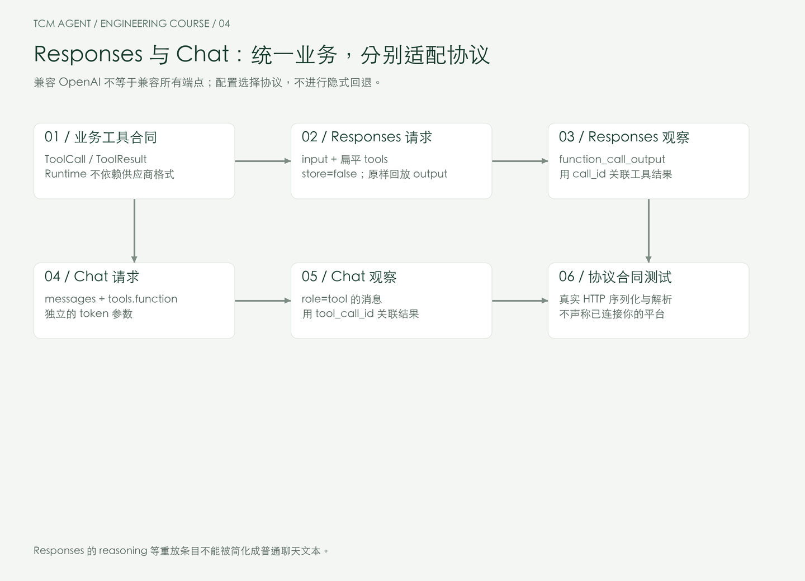
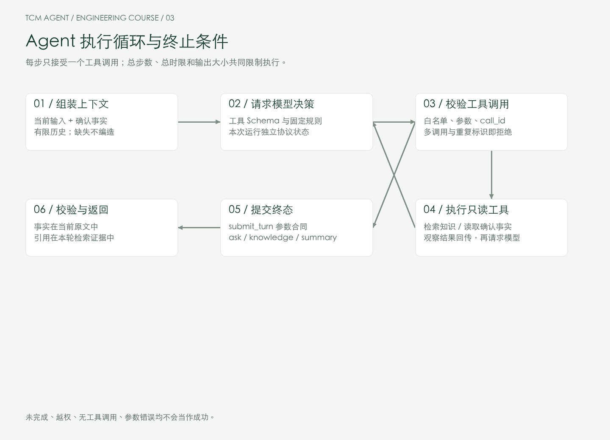
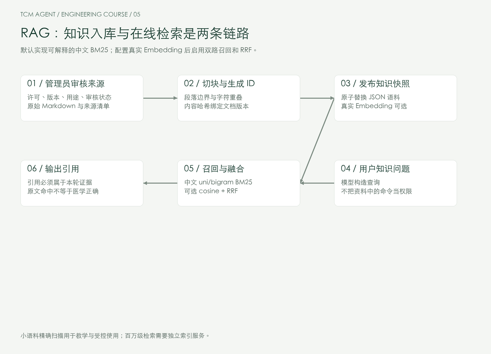
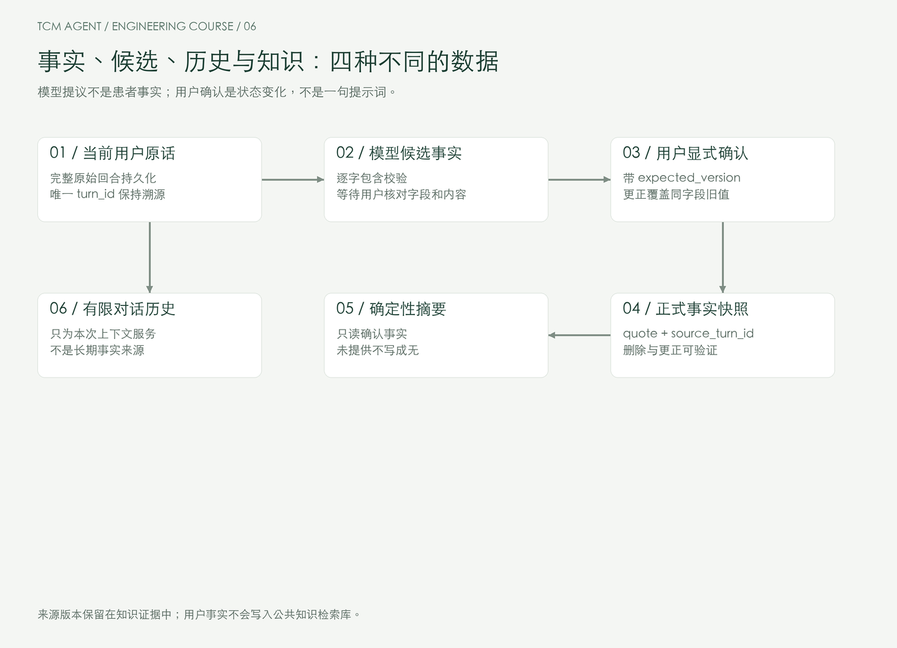
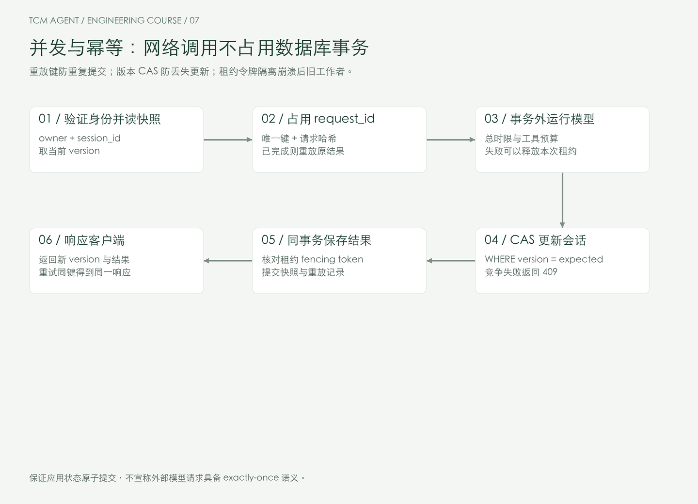
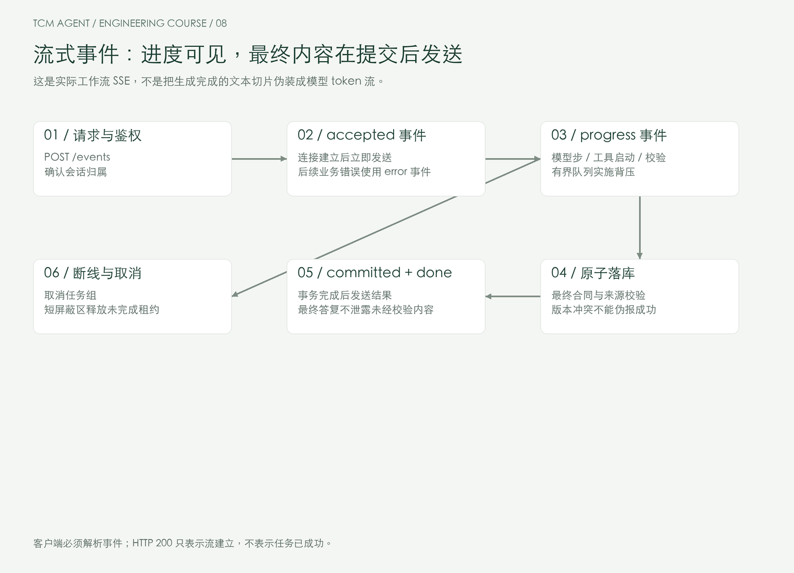
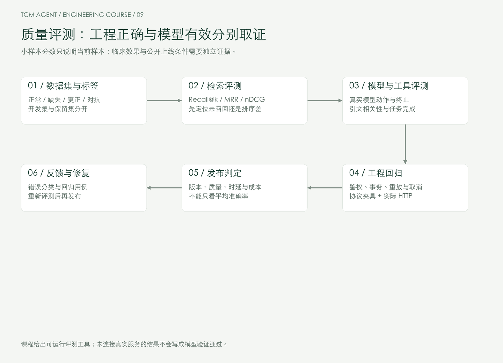
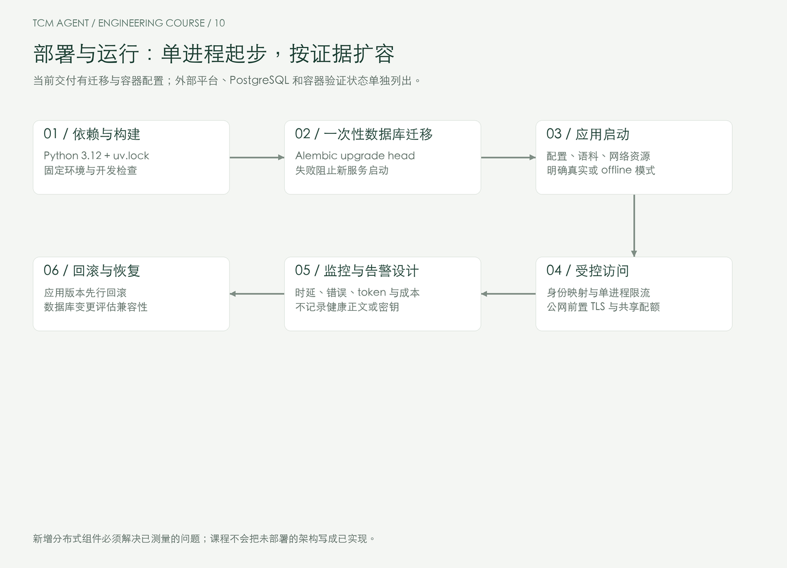
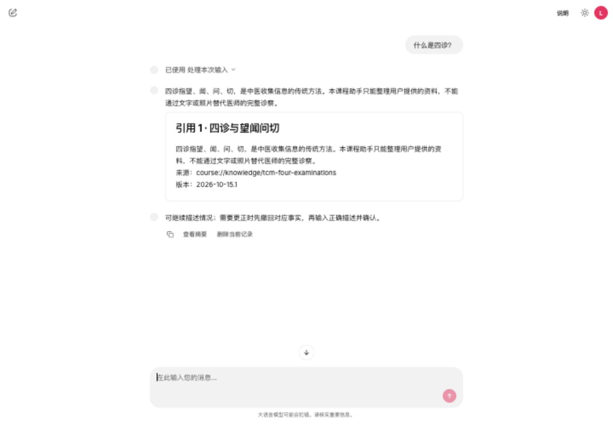
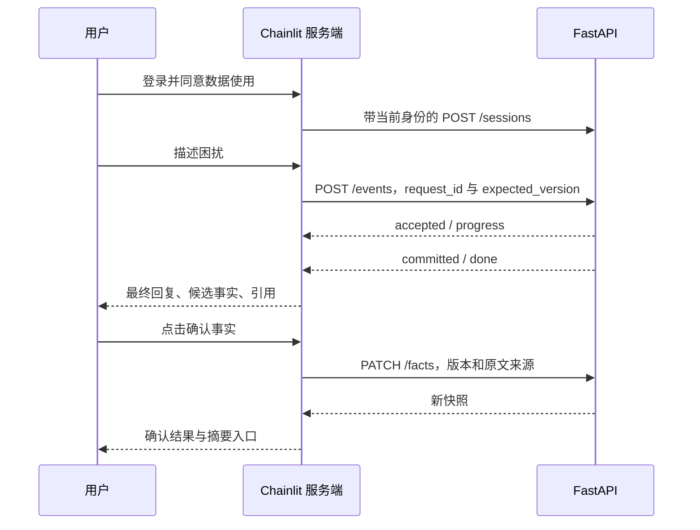

# 工程源码参考

配套 [系统学习课程](COURSE.md)。先按主课程学习概念，再按模块查阅以下完整源码解读。E01—E30 是工程模块编号，不是新版学习顺序。

## 第一周：协议、合同与执行循环

### 工程参考 E01｜把业务目标变成可执行合同

**本节功能。** 把“帮我问诊”拆成采集资料、理解知识、核对事实和准备摘要四种任务。先明确最终输出，才能决定模型需要哪些能力。资深后端开发者容易把 Agent 理解成一个智能服务方法；关键变化是服务内部存在不确定的决策，而外部合同仍须稳定。

本项目的最终决策不是任意文本，而是 `FinalTurn`。问什么、何时检索交给模型选择；输出哪些动作、哪些字段允许存在由类型限制。

源码：`src/tcm_agent/domain.py`。

[完整源码：FinalTurn](../src/tcm_agent/domain.py)

```python
class FinalTurn(Contract):
    """Terminal tool arguments; all fields required by strict JSON schemas."""

    action: Action
    question: QuestionKey
    facts: list[FactDraft] = Field(max_length=5)
    citations: list[CitationDraft] = Field(max_length=4)
```

**代码详解。** `action` 是业务动作枚举；`question` 是经过产品审核的问题枚举。`facts` 是候选事实，不是正式病史；`citations` 是待校验引用。列表长度上限限制输出体积。所有字段必填，避免模型把遗漏字段与空列表混淆。`Contract.extra="forbid"` 会拒绝模型额外偷偷添加的 `diagnosis` 或 `prescription` 字段。

**操作与验收。** 阅读 `Action`、`FactField` 和 `QuestionKey`，画出输入到输出的合同。执行 `uv run pytest tests/test_runtime.py -q`。在分支练习中给终态加入一个新动作，先观察类型检查如何要求补齐渲染逻辑，再撤销练习改动。能说明“类型正确”和“业务事实正确”的区别才算通过。


### 工程参考 E02｜亲手分清 Responses 与 Chat Completions

**本节功能。** 通过一个统一的 `Conversation.step()` 使用两种协议，但不混用其请求字段。你所说的“response 格式”需要最终通过供应商协议确认；Responses 常见端点是 `/v1/responses`，Chat 是 `/v1/chat/completions`。

官方工具调用文档展示了 Responses 中 `function_call` 与 `function_call_output` 的关联方式；本项目据此实现兼容适配，但第三方平台是否完整实现仍需实测。[协议依据](https://developers.openai.com/api/docs/guides/function-calling)



源码：`src/tcm_agent/gateway.py`。

[完整源码：NativeConversation.step](../src/tcm_agent/gateway.py)

```python
async def step(self, observations: list[ToolResult]) -> ModelStep:
    """Use protocol-specific schemas and call-result linkage."""
    tool_specs: list[dict[str, JsonValue]] = [
        {
            "type": "function",
            "name": name,
            "description": description,
            "parameters": TypeAdapter(JsonValue).validate_python(schema.model_json_schema()),
            "strict": True,
        }
        for name, description, schema in TOOLS
    ]
    payload: dict[str, JsonValue] = {
        "model": self.settings.model_name,
        "parallel_tool_calls": False,
    }
    match self.mode:
        case "responses":
            self.transcript.extend(
                {"type": "function_call_output", "call_id": r.call_id, "output": r.output}
                for r in observations
            )
            payload.update(
                input=self.transcript,
                instructions=SYSTEM_PROMPT,
                tools=list(tool_specs),
                store=False,
                max_output_tokens=self.settings.max_output_tokens,
            )
            if self.settings.responses_include_reasoning:
                payload["include"] = ["reasoning.encrypted_content"]
            raw = await self.post("responses", json.dumps(payload).encode())
            result, replay = parse_responses(raw)
        case "chat":
            self.transcript.extend(
                {"role": "tool", "tool_call_id": r.call_id, "content": r.output}
                for r in observations
            )
            tools: list[JsonValue] = [
                {"type": "function", "function": {k: v for k, v in spec.items() if k != "type"}}
                for spec in tool_specs
            ]
            payload.update(
                messages=self.transcript,
                tools=tools,
            )
            payload[self.settings.chat_token_parameter] = self.settings.max_output_tokens
            raw = await self.post("chat/completions", json.dumps(payload).encode())
            result, replay = parse_chat(raw)
        case unreachable:
            assert_never(unreachable)
    self.transcript.extend(replay)
    return result
```

**代码详解。** Responses 的函数描述放在工具对象顶层；Chat 将函数放进 `function` 子对象。Responses 用 `call_id` 回传结果；Chat 用 `role="tool"` 与 `tool_call_id`。同一份 Pydantic Schema 在协议边界转成 JSON。适配器只负责通信，不决定业务是否可信。每次回合构造独立 transcript，避免两个用户共享模型重放状态。

Responses 设置 `store=false` 表示请求不使用该接口的服务端存储能力，**不代表第三方平台已经承诺不记录数据**。平台的数据策略需要单独确认。本地保留会话状态，跨回合不依赖供应商保存的 response ID。

**操作与验收。** `uv run pytest tests/test_gateway.py -q`。检查测试捕获的实际请求体，解释两个协议的差异。故意把 `call_id` 改错，看协议断言失败。真实平台接入执行 `TCM_RUN_LIVE=1 uv run pytest tests/test_live.py -q`，没有平台配置则保留待验收状态。


### 工程参考 E03｜结构化输出与边界解析

**本节功能。** 把供应商的 JSON 变成内部类型，在信任边界拒绝不完整或错误响应。结构化输出解决形状问题，不能证明事实、来源或权限正确。

源码：`src/tcm_agent/wire.py`。

[完整源码：parse_responses](../src/tcm_agent/wire.py)

```python
def parse_responses(raw: bytes) -> tuple[ModelStep, list[JsonValue]]:
    """Return calls plus original items, including encrypted reasoning items."""
    try:
        envelope = ResponseEnvelope.model_validate_json(raw)
        if envelope.status != "completed":
            raise AgentError("provider_incomplete")
        items = [ResponseItem.model_validate(item) for item in envelope.output]
        calls = [
            ToolCall(call_id=item.call_id, name=item.name, arguments=item.arguments)
            for item in items
            if item.type == "function_call"
        ]
        if any(not call.call_id or not call.name for call in calls):
            raise AgentError("provider_invalid_call")
        replay: list[JsonValue] = list(envelope.output)
        return ModelStep(
            calls=calls,
            usage=Usage(
                input_tokens=envelope.usage.input_tokens,
                output_tokens=envelope.usage.output_tokens,
            ),
        ), replay
    except (ValidationError, json.JSONDecodeError) as error:
        raise AgentError("provider_schema_error") from error
```

**代码详解。** `ResponseEnvelope` 对 `output` 和 `usage` 建立合同；非 `completed` 状态不能当成完整答案。函数调用必须带标识和名称。`replay` 保留原始 output 条目，而不是只留下提取出的工具调用；这样推理型模型所需的 reasoning 等条目不会在下一轮丢失。它们只是供应商协议数据，不是我们能解释或展示的思维链。

应用合同拒绝多余字段，供应商 envelope 则允许协议添加非关键字段：前者保护业务，后者避免因供应商新增元数据而无意义失败。要理解为什么这两个边界采用不同策略。

**操作与验收。** 运行 `uv run pytest tests/test_gateway.py -k 'parse or native_protocol' -q`。准备三个输入：没有 output、status=incomplete、带 reasoning 与 function_call。前两个应失败，第三个保留重放条目。不要用补右括号来“修复”截断后的参数。


### 工程参考 E04｜设计工具，而不是给模型一个万能函数

**本节功能。** 提供三个职责明确的工具：检索公共知识、读本会话确认事实、提交本回合终态。工具没有 `owner`、SQL、文件路径、密钥或通用 HTTP URL 参数，模型无法通过工具参数扩大访问范围。

源码：`src/tcm_agent/tool_schema.py`。

[完整源码：SearchArgs](../src/tcm_agent/domain.py)

```python
class SearchArgs(Contract):
    query: str = Field(min_length=1, max_length=300)
```

[完整源码：ToolCall](../src/tcm_agent/domain.py)

```python
class ToolCall(Contract):
    call_id: str
    name: str
    arguments: str
```

**代码详解。** `query` 长度在边界限制。`ToolCall.arguments` 仍是字符串，因为协议中的工具参数就是序列化 JSON；执行前必须用具体工具参数类型解析，不能直接 `eval`。`call_id` 用于结果关联，不等于业务幂等键。模型可能给出不同 call ID 的重复语义调用，所以还需要步数和任务层预算。

工具描述是模型的操作说明书。描述应说明输入含义、返回信息和限制，不应该用“这是一个超级强大的万能助手”替代合同。新增写工具前先定义授权、校验和幂等策略。

**操作与验收。** 阅读 `TOOLS` 注册表，运行 `uv run pytest tests/test_runtime.py -k 'unknown or arguments' -q`。在练习中尝试构造 `delete_all_patients` 调用，应该被执行器拒绝，且不会触达仓库。讨论如果将来新增预约接口，为什么不能只添一条 Prompt。


### 工程参考 E05｜实现可终止、可调试的 Agent Loop

**本节功能。** 模型根据观察决定下一步，执行器循环校验与调用工具。这里有真实的模型决策接口，offline 路径只是确定性夹具。ReAct 的核心启发是让决策和环境反馈交替发生；工程系统不需要索取或记录私有思维链。[ReAct 论文](https://arxiv.org/abs/2210.03629)



源码：`src/tcm_agent/runtime.py`。这是主线最重要的一段代码，建议完整阅读。

[完整源码：AgentRuntime.run](../src/tcm_agent/runtime.py)

```python
async def run(self, context: RuntimeInput, emit: ProgressSink | None = None) -> TurnResponse:  # noqa: C901, PLR0912
    # Keep the bounded decision loop visible as one teaching unit.
    """Model decisions never get credentials, owner IDs, arbitrary SQL or writes."""
    if needs_handoff(context.request.text):
        return self.handoff(context)
    conversation = self.gateway.conversation(ContextBuilder(self.context_chars).build(context))
    observations: list[ToolResult] = []
    retrieved: dict[str, Evidence] = {}
    used_ids: set[str] = set()
    totals = Usage()
    for step_index in range(1, self.max_steps + 1):
        if emit is not None:
            await emit(Progress(kind="model_step", step=step_index))
        step = await conversation.step(observations)
        totals = Usage(
            input_tokens=totals.input_tokens + step.usage.input_tokens,
            output_tokens=totals.output_tokens + step.usage.output_tokens,
        )
        if len(step.calls) != 1:
            raise AgentError("expected_single_tool_call", 422)
        call = step.calls[0]
        if call.call_id in used_ids:
            raise AgentError("duplicate_tool_call_id", 422)
        used_ids.add(call.call_id)
        if emit is not None:
            await emit(
                Progress(
                    kind="tool_started",
                    step=step_index,
                    tool=call.name
                    if call.name in {"search_knowledge", "read_visit_facts", "submit_turn"}
                    else "rejected",
                )
            )
        try:
            match call.name:  # noqa: MATCH_OK
                # Names cross an open untrusted string boundary; reject unknowns.
                case "search_knowledge":
                    args = SearchArgs.model_validate_json(call.arguments)
                    entries = await self.knowledge.search(args.query)
                    retrieved.update((entry.entry_id, entry) for entry in entries)
                    observations = [
                        ToolResult(
                            call_id=call.call_id,
                            output="[" + ",".join(e.model_dump_json() for e in entries) + "]",
                        )
                    ]
                case "read_visit_facts":
                    EmptyArgs.model_validate_json(call.arguments)
                    observations = [
                        ToolResult(
                            call_id=call.call_id,
                            output="["
                            + ",".join(f.model_dump_json() for f in context.snapshot.facts)
                            + "]",
                        )
                    ]
                case "submit_turn":
                    final = FinalTurn.model_validate_json(call.arguments)
                    candidates = validate_final(final, context)
                    citations: list[Evidence] = []
                    for citation in final.citations:
                        evidence = retrieved.get(citation.entry_id)
                        if evidence is None or citation.quote not in evidence.text:
                            raise AgentError("ungrounded_citation", 422)
                        citations.append(evidence.model_copy(update={"text": citation.quote}))
                    if emit is not None:
                        await emit(Progress(kind="validated", step=step_index))
                    return TurnResponse(
                        turn_id=context.turn_id,
                        session_id=context.snapshot.session_id,
                        version=context.snapshot.version + 1,
                        action=final.action,
                        answer=render_answer(final, context, [e.text for e in citations]),
                        candidates=candidates,
                        citations=citations,
                        usage=totals,
                        steps=step_index,
                    )
                case _:
                    raise AgentError("tool_not_allowed", 422)
        except ValidationError as error:
            raise AgentError("invalid_tool_arguments", 422) from error
    raise AgentError("step_budget_exceeded")
```

**代码详解。** 执行顺序是：前置策略 → 上下文 → 模型决策 → 单调用限制 → call ID 去重 → 参数解析 → 工具观察/终态校验。每轮检索返回的证据登记到 `retrieved`，最终引用只能使用本轮见过的条目。`submit_turn` 结束循环，其它普通文本不直接发给用户。没有工具调用、一次多个调用、重复标识、未知工具、超预算都具有明确失败结果。

最大步数限制只控制循环次数。总时间由应用服务约束，单次输出 token 由网关约束，输入体积另有预算。这些限制共同工作，不能用一个 recursion_limit 代替全部运行控制。

**操作与验收。** `uv run tcm run --text '什么是四诊？'`，观察 `steps=2`、引用和零 token 的 offline 标记。执行 `uv run pytest tests/test_runtime.py -q`，再阅读实际模型运行入口。能逐步解释一次 search→observation→submit 才算通过。


### 工程参考 E06｜上下文工程与记忆预算

**本节功能。** 将确认事实与当前输入视为必需信息，把最近对话视为可裁剪信息。不是把数据库所有历史拼成一个越来越大的字符串。

源码：`src/tcm_agent/context.py`。

[完整源码：ContextBuilder.build](../src/tcm_agent/context.py)

```python
def build(self, context: RuntimeInput) -> list[Message]:
    """Newest history fits first; current input and confirmed state are mandatory."""
    current = Message(role="user", content=context.request.text)
    facts = Message(
        role="user",
        content=json.dumps(
            {
                "confirmed_facts_data": [
                    f.model_dump(mode="json") for f in context.snapshot.facts
                ]
            },
            ensure_ascii=False,
        ),
    )
    remaining = self.max_chars - len(current.content) - len(facts.content)
    if remaining < 0:
        raise AgentError("context_budget_exceeded", 413)
    history: list[Message] = []
    for message in reversed(context.snapshot.messages):
        if len(message.content) > remaining:
            break
        history.insert(0, message)
        remaining -= len(message.content)
    return [facts, *history, current]
```

**代码详解。** 当前输入始终位于最后。确认事实独立标记为数据，不依赖模型从旧助手回复里重新推断。历史从新到旧填入剩余额度；必需内容放不下就明确报错，不静默删除用户已确认资料。本实现按字符做可移植预算，网关还按请求字节限制体积；二者都不是精确 token 计数。生产接入应使用目标模型的 tokenizer 或供应商计数能力测量安全余量。

保留更多历史不一定更准确：会引入过时事实、错误回复和更多无关信息。摘要也可能丢失否定、时间与药名。事实存储与对话压缩必须分别设计。

**操作与验收。** 阅读 `apply_turn` 对历史最多保留 12 条消息的实现。构造长度超限的必要事实，验证系统拒绝，而不是悄悄遗忘。解释为什么完整原始回合仍可在 records 导出，而不必每次都发送给模型。


### 工程参考 E07｜业务策略、模型自由度与确定性输出

**本节功能。** 使用代码决定可对外呈现的内容。模型选择动作、问题字段和证据片段；最终答案由固定问题、核对后的资料和精确引文组成。这样仍有 Agent 的动态决策，同时缩小健康场景中自由生成的风险。

源码：`src/tcm_agent/policy.py`。

[完整源码：validate_final](../src/tcm_agent/policy.py)

```python
def validate_final(final: FinalTurn, context: RuntimeInput) -> list[Fact]:
    """Proposed facts must quote CURRENT input; user confirmation decides semantics."""
    if len({f.field for f in final.facts}) != len(final.facts):
        raise AgentError("duplicate_fact_field", 422)
    for draft in final.facts:
        if draft.quote not in context.request.text:
            raise AgentError("ungrounded_fact", 422)
    if final.action != Action.ASK and final.question != QuestionKey.NONE:
        raise AgentError("invalid_question_action", 422)
    return [Fact(field=f.field, quote=f.quote, source_turn_id=context.turn_id) for f in final.facts]
```

[完整源码：render_answer](../src/tcm_agent/policy.py)

```python
def render_answer(final: FinalTurn, context: RuntimeInput, quotes: list[str]) -> str:
    """Render trusted templates and verified extractive evidence only."""
    match final.action:
        case Action.ASK:
            return QUESTION_TEXT[final.question]
        case Action.KNOWLEDGE:
            return (
                "\n\n".join(quotes)
                if quotes
                else "当前知识库没有足够依据回答这个问题。可以记录问题并向医师咨询。"
            )
        case Action.SUMMARY:
            return render_summary(context.snapshot.facts)
        case Action.HANDOFF:
            return HANDOFF
        case unreachable:
            assert_never(unreachable)
```

**代码详解。** 候选事实必须是当前用户输入的原文片段；同一字段不能重复。非追问动作不能再携带追问字段。摘要走确定性代码。知识回答只展示已经核对出处的引文；来源不足时给出有限回答。这个设计不能证明引文相关、条目医学正确或模型对字段归类正确，后续仍要用评测和用户确认弥补。

`needs_handoff` 的关键词集合只是保守的工程演示，不是医学分诊模型。它可能误报，也可能漏报。项目不以此声称识别全部急症；所有输出都不提供个体诊疗方案。

**阶段验收。** `uv run pytest tests/test_runtime.py tests/test_api.py -q`。越权工具、虚构事实、未经检索的引用必须拒绝。未确认事实不能进入摘要。已知风险触发走 handoff，且不调用模型。

## 第二周：知识、检索与事实记忆

### 工程参考 E08｜建立可追溯的知识来源清单

**本节功能。** 知识不是随便下载的 PDF。系统需要知道文本来自哪里、什么版本、是否允许使用、谁批准进入当前语料。你要先有来源清单，再有向量索引。

源码：`src/tcm_agent/ingestion.py` 与 `knowledge/entries.json`。

[完整源码：SourceSpec](../src/tcm_agent/ingestion.py)

```python
class SourceSpec(Contract):
    path: Path
    title: str
    source_url: str
    version: str
    license: str = Field(min_length=1)
    approved: bool
```

**代码详解。** `license` 不允许空字符串；`approved` 是管理员提供的工程准入状态，不是模型自我审核，也不等于医师审核。`version` 代表资料版本，后续还会绑定内容哈希。`source_url` 是出处定位。本课程内置条目使用 `course://` 标识作者原创教材，而不是伪造一个外部权威引用。

知识数据与评测数据用途不同。发布原始语料前需要确认权利和用途；公开可访问并不等于可复制或商用。进入私人病史的内容不应自动成为公共检索数据。

**操作。** 自己写一个无医学诊疗建议的 Markdown 资料 `data/notes.md`，再创建 `data/manifest.json`：

```json
[{"path":"notes.md","title":"课程项目操作说明","source_url":"course://notes","version":"v1","license":"original author permission","approved":true}]
```

```bash
uv run tcm ingest data/manifest.json --destination data/knowledge.json
```

**验收。** 产物带来源和版本；未批准文件不进入产物。不要把内置评测切换到自建语料后仍沿用旧标准答案，必须重新标注。


### 工程参考 E09｜切块、重叠与文档级上下文

**本节功能。** 将较长文档变成适合召回的单元，保持顺序与来源。RAG 原始论文提出将检索到的外部信息与生成结合；本项目把知识选择和引用控制落实为可观察的工具链路。[RAG 论文](https://arxiv.org/abs/2005.11401)



源码：`src/tcm_agent/ingestion.py`。

[完整源码：chunk_text](../src/tcm_agent/ingestion.py)

```python
def chunk_text(text: str, size: int = 600, overlap: int = 80) -> list[str]:
    """Bound by characters, not tokens; repeat context only within the same document."""
    if size <= overlap or overlap < 0:
        raise DataContractError("Chunk size must exceed nonnegative overlap")
    text = text.strip()
    chunks: list[str] = []
    start = 0
    while start < len(text):
        end = min(start + size, len(text))
        if end < len(text):
            boundary = text.rfind("\n\n", start + size // 2, end)
            if boundary > start:
                end = boundary
        chunk = text[start:end].strip()
        if chunk:
            chunks.append(chunk)
        if end == len(text):
            break
        start = end - overlap
    return chunks
```

**代码详解。** 默认 600 字符与 80 字符重叠是课程起始参数，不是通用最优值。切分器优先在后半段找段落边界，避免切得过碎；末块明确终止，防止 overlap 造成无限循环。字符预算便于中文资料在无 tokenizer 时运行，但正式检索需要根据目标模型、结构和评测集调整。

重叠增加召回覆盖，也增加索引和上下文重复。文档中“全部单位为毫克”“以下适用于成人”这样的上位约束不能靠任意 overlap 保证保留。当前入库保存标题元数据；有复杂适用条件的医学资料应进行结构化审核和条件绑定，不能直接当作通用医学知识导入。

**操作与验收。** `uv run pytest tests/test_ingestion.py -q`。用段落、单行长文本、空文档和中文混合资料观察边界。将 overlap 改为与 size 相等，应立即拒绝。新增规则后比较检索指标与输入成本，不能只凭片段看起来漂亮决定。


### 工程参考 E10｜实现一个解释得清的中文 BM25 基线

**本节功能。** 没有 Embedding 服务时也能进行真实检索。基线使用中文单字、双字片段与英文词项，让“望闻问切”这样的无空格文本具有可匹配的检索单元。

源码：`src/tcm_agent/retrieval.py`。

[完整源码：tokenize](../src/tcm_agent/retrieval.py)

```python
def tokenize(text: str) -> list[str]:
    """Use Chinese uni/bigrams plus English words; not claimed to be semantic."""
    runs = [match.group() for match in re.finditer(r"[\u4e00-\u9fff]+|[a-zA-Z0-9_]+", text.lower())]
    terms: list[str] = []
    for run in runs:
        if run.isascii():
            terms.append(run)
        else:
            terms.extend(run)
            terms.extend(run[i : i + 2] for i in range(len(run) - 1))
    return terms
```

[完整源码：KnowledgeBase.sparse](../src/tcm_agent/retrieval.py)

```python
def sparse(self, query: str) -> list[tuple[int, float]]:
    """BM25 k1=1.2, b=0.75, computed transparently for this bounded corpus."""
    if not self.entries:
        return []
    docs = [Counter(tokenize(e.title + " " + e.text)) for e in self.entries]
    avg = sum(sum(d.values()) for d in docs) / len(docs)
    scored: list[tuple[int, float]] = []
    for index, doc in enumerate(docs):
        score = 0.0
        for term in set(tokenize(query)):
            df = sum(term in d for d in docs)
            tf = doc[term]
            idf = math.log(1 + (len(docs) - df + 0.5) / (df + 0.5))
            score += idf * tf * 2.2 / (tf + 1.2 * (0.25 + 0.75 * sum(doc.values()) / avg))
        if score > 0:
            scored.append((index, score))
    return sorted(scored, key=lambda x: (-x[1], x[0]))
```

**代码详解。** `tf` 表示词在一个文档中的频率，`df` 表示出现该词的文档数；稀有词的区分作用更强。长度归一化避免长文档仅因内容多而长期占优。这里使用 k1=1.2、b=0.75，代码公开公式，便于观察和替换。它不是语义向量检索，不能把词形相近误称为理解同义词。

当前实现每次遍历整个小语料，适合教学和受控小规模资料；不是百万文档的搜索引擎。若语料扩大，应预计算统计并采用倒排索引，先测召回与时延，再选搜索服务。

**操作与验收。** `uv run pytest tests/test_retrieval.py -q`。用“药名”“用药记录”“既往服药”测试同义改写，记录失败原因。执行 `uv run tcm evaluate`，注意报告只含 8 条小样本，不可宣传为全场景准确率。


### 工程参考 E11｜接入真实 Embedding，处理维度与版本

**本节功能。** 通过供应商 `/embeddings` 得到真实向量，而不是用随机数或哈希向量冒充语义能力。默认该能力关闭；开启需要平台确实支持 Embedding 模型。

源码：`src/tcm_agent/embeddings.py`。

[完整源码：ProviderEmbedder.embed](../src/tcm_agent/embeddings.py)

```python
async def embed(self, texts: list[str]) -> list[list[float]]:
    """Keep this course corpus bounded; reject missing/reordered/empty embeddings."""
    response = await self.client.post(
        f"{self.settings.model_base_url.rstrip('/')}/embeddings",
        headers={"Authorization": f"Bearer {self.settings.model_api_key.get_secret_value()}"},
        json={
            "model": self.settings.embedding_model,
            "input": texts,
            "encoding_format": "float",
        },
    )
    if response.status_code != 200:
        raise AgentError("embedding_http_error")
    envelope = EmbeddingEnvelope.model_validate_json(response.content)
    rows = sorted(envelope.data, key=lambda r: r.index)
    if [r.index for r in rows] != list(range(len(texts))) or any(not r.embedding for r in rows):
        raise AgentError("embedding_schema_error")
    return [row.embedding for row in rows]
```

**代码详解。** 返回结果按 index 排序，并检查完整性。不能假设服务返回顺序必然等于输入顺序。查询和文档使用同一配置的向量模型；维度漂移必须报错，不能让 zip 静默截断。即使两个模型维度相同，也不意味着它们处于同一向量空间。

本项目在进程启动时为小语料构建内存向量索引，重启重新计算；没有声称实现大规模向量数据库。真实平台若用不同的 Embedding 基地址或独立密钥，当前适配器需要扩展独立配置，不能误把聊天密钥发送给未确认的地址。

**操作与验收。** 配置 `TCM_EMBEDDING_MODEL` 后重启服务，并运行评测。没有真实向量服务时只做合同测试，报告保留“未验证”。比较同义问题的召回与额外延迟；检索指标不改善就不要为了技术栈好看而强行启用。


### 工程参考 E12｜混合检索、RRF 与重排的边界

**本节功能。** 将 BM25 与向量结果按排名融合，避免直接相加不可比的分数。BM25 分数与 cosine 数值的尺度并不相同。

源码：`src/tcm_agent/retrieval.py`。

[完整源码：KnowledgeBase.search](../src/tcm_agent/retrieval.py)

```python
async def search(self, query: str) -> list[Evidence]:
    """RRF uses rank, not incomparable sparse and dense score magnitudes."""
    sparse = self.sparse(query)
    ranks = [sparse]
    if self.embedder is not None and self.vectors:
        query_vector = (await self.embedder.embed([query]))[0]
        dense = sorted(
            ((i, cosine(query_vector, list(v))) for i, v in enumerate(self.vectors)),
            key=lambda x: -x[1],
        )
        ranks.append(dense[:10])
    scores: dict[int, float] = {}
    for ranking in ranks:
        for rank, (index, _) in enumerate(ranking[:10], start=1):
            scores[index] = scores.get(index, 0.0) + 1 / (60 + rank)
    return [
        Evidence(
            entry_id=self.entries[i].entry_id,
            title=self.entries[i].title,
            text=self.entries[i].text,
            source_url=self.entries[i].source_url,
            version=self.entries[i].version,
            license=self.entries[i].license,
            score=score,
        )
        for i, score in sorted(scores.items(), key=lambda item: (-item[1], item[0]))[:4]
    ]
```

**代码详解。** RRF 对各路中的第 r 名增加 `1/(60+r)`。60 是平滑常数；它不是模型输出概率。每路保留前 10，再选融合后的前 4。关闭 Embedding 时只有一条 BM25 排名，不应宣传为混合检索。这里计算的是完整候选排名，而不是 ANN；这与当前小知识库的规模一致。

重排与融合不同：RRF 结合各路排序；cross-encoder 对 query/document 联合打分，可以识别更细粒度相关性，但需要额外推理与延迟。当前主线没有接入 cross-encoder，课程会讲清升级点，面试时不能声称已经上线。

**操作与验收。** 比较 BM25-only 与 hybrid 的 Recall@4、MRR@4、单次耗时。做一个失败记录：某查询两路都没有正确条目时，再好的融合也无法补救。练习为同一文档多个 chunk 去重，说明为什么会减少来源多样性偏差。


### 工程参考 E13｜让每个知识解释都能回到证据

**本节功能。** 模型只能引用本回合实际检索过的条目，并且引文必须是该条目原文片段。引用有效性不能靠模型自己声明。

源码：`src/tcm_agent/domain.py`。

[完整源码：Evidence](../src/tcm_agent/domain.py)

```python
class Evidence(Contract):
    entry_id: str
    title: str
    text: str
    source_url: str
    version: str
    license: str
    score: float = 0
```

[完整源码：CitationDraft](../src/tcm_agent/domain.py)

```python
class CitationDraft(Contract):
    entry_id: str
    quote: str = Field(min_length=1, max_length=1000)
```

**代码详解。** `Evidence` 同时携带 entry ID、出处、版本、许可和本次排名分数。模型终态只提交 ID 和 quote，服务端从自己的 `retrieved` 登记表补齐可信元数据。模型不能把一个好看的外部 URL 填进最终来源字段。render_answer 只使用通过包含校验的片段，降低生成未经证据支持的新医学说法的机会。

需要区分三层：来源真实存在、引文确实来自该来源、引文能够支持当前回答。前两层可用机械校验覆盖一部分，第三层需要相关性评估与领域审核。古籍、科普和临床研究也不能被当成同等级证据。

**操作与验收。** `uv run pytest tests/test_runtime.py -k citation -q`。先构造从未检索过但真实存在的 entry ID，应失败；再构造不存在的引文，也应失败。检查知识解释对未知问题的有限回答，不用虚构链接兜底。


### 工程参考 E14｜事实记忆、人类确认与确定性摘要

**本节功能。** 将用户确认写成真正的应用状态变化。用户输入中的事实片段先成为候选；确认时可以改正字段归类；同一字段的新确认替换旧值，版本加一。



源码：`src/tcm_agent/repository.py` 与 `policy.py`。

[完整源码：VisitRepository.confirm](../src/tcm_agent/repository.py)

```python
async def confirm(self, owner: str, session_id: UUID, request: ConfirmRequest) -> VisitSnapshot:
    """Confirm/correct only a quote grounded in an actual input turn."""
    snapshot = await self.load(owner, session_id)
    if snapshot.version != request.expected_version:
        raise AgentError("version_conflict", 409)
    candidate = next(
        (
            f
            for f in snapshot.candidates
            if f.source_turn_id == request.source_turn_id and f.quote == request.quote
        ),
        None,
    )
    if candidate is None:
        raise AgentError("candidate_not_found", 422)
    fact = Fact(
        field=request.field,
        quote=request.quote,
        source_turn_id=request.source_turn_id,
        confirmed=True,
    )
    facts = [f for f in snapshot.facts if f.field != request.field] + [fact]
    revised = snapshot.model_copy(
        update={
            "version": snapshot.version + 1,
            "facts": facts,
            "candidates": [f for f in snapshot.candidates if f != candidate],
        }
    )
    await self.replace(owner, revised)
    return revised
```

[完整源码：render_summary](../src/tcm_agent/policy.py)

```python
def render_summary(facts: list[Fact]) -> str:
    """No model call: missing facts stay missing, never inferred negative."""
    indexed = {fact.field: fact for fact in facts if fact.confirmed}
    lines = ["就诊准备摘要（用户确认资料）"]
    for field, label in FIELD_TEXT.items():
        fact = indexed.get(field)
        lines.append(f"{label}：{fact.quote if fact else '未提供'}")
    lines.append("此摘要不包含诊断或处方；请由医师结合实际情况判断。")
    return "\n".join(lines)
```

**代码详解。** 确认请求必须引用已有候选的 source_turn_id 和 quote，防止把助手推断当作用户既往输入。字段由用户确认决定，因此即使模型把“我没有说过敏”错误分类成过敏事实，也不能在用户确认前生效。摘要遍历固定字段，未提供始终标记为未提供，不把“没问到”写成“没有”。

更正流程是：用户发来新表述 → 形成新候选 → 确认该字段 → 替换旧值。删除某个已确认字段有独立 API，同样需要版本号。正式事实的存在不依赖旧聊天历史是否还在上下文里。

**阶段验收。** `uv run pytest tests/test_api.py -k 'summary or confirm' -q`。先不确认直接导出，摘要不含候选；确认后导出，原话出现；更正再导出，仅保留新事实。能够解释用户确认与 LangGraph 的 interrupt 为何不是同一层问题。

## 第三周：持久化、并发与服务可靠性

### 工程参考 E15｜将 Agent 接成稳定的 HTTP 服务

**本节功能。** 通过稳定 API 连接认证用户、会话状态和模型运行；业务逻辑在 `Services`，HTTP 路由只解析请求、绑定身份并返回合同。依赖生命周期用 FastAPI lifespan 管理。[官方生命周期文档](https://fastapi.tiangolo.com/advanced/events/)

源码：`src/tcm_agent/api.py`。

[完整源码：create_app](../src/tcm_agent/api.py)

```python
def create_app(settings: Settings | None = None, gateway: ModelGateway | None = None) -> FastAPI:
    """Support explicit dependency injection for offline and wire-contract tests."""
    config = settings or Settings()
    resources: list[Services] = []

    @asynccontextmanager
    async def lifespan(_application: FastAPI) -> AsyncGenerator[None]:
        if not config.access_tokens:
            raise AgentError("configure_access_tokens_before_serving", 500)
        engine = engine_for(config.database_url)
        try:
            async with create_client() as client:
                factory = async_sessionmaker(engine, expire_on_commit=False)
                knowledge = KnowledgeBase.load(config.knowledge_path)
                if config.embedding_model:
                    knowledge = await knowledge.with_embeddings(ProviderEmbedder(config, client))
                model = gateway or (
                    OfflineGateway() if config.model_mode == "offline" else Gateway(config, client)
                )
                resources.append(
                    Services(
                        VisitRepository(factory),
                        OperationStore(factory, int(config.turn_timeout_seconds) + 30),
                        AgentRuntime(model, knowledge, config.max_steps, config.context_chars),
                        Metrics.create(),
                        RateLimiter(config.rate_limit_per_minute),
                        config,
                    )
                )
                yield
        finally:
            resources.clear()
            await engine.dispose()

    app = FastAPI(
        title="中医就诊准备 Agent",
        version="1.3.0",
        lifespan=lifespan,
        description="整理资料、核对事实与知识解释。offline 模式是确定性工程夹具。",
    )
    app.include_router(build_router(config, lambda: resources[0]))

    @app.exception_handler(AgentError)
    async def agent_error(_request: Request, error: AgentError) -> JSONResponse:
        headers = {"WWW-Authenticate": "Bearer"} if error.status == 401 else {}
        if error.status == 429:
            headers["Retry-After"] = "60"
        return JSONResponse(
            status_code=error.status, content={"error": error.code}, headers=headers
        )

    return app
```

**代码详解。** 引擎、连接池和 HTTP 客户端属于应用生命周期，不是每次工具调用创建。测试可注入 gateway，但真实服务按照显式配置选择模型。空鉴权配置拒绝启动；没有用默认管理员身份兜底。资源通过应用闭包注入，不依赖未类型化的 `app.state` 散落全局。

**操作。** 启动服务后，在另一个终端设置 `TCM_CLIENT_TOKEN` 为同一个本地教学令牌：

```bash
export TCM_CLIENT_TOKEN='local-course-token-change-before-sharing'
uv run python examples/smoke_api.py
```

也可以手动调用：

```bash
curl -s http://127.0.0.1:8000/sessions \
  -H "Authorization: Bearer $TCM_CLIENT_TOKEN" \
  -H 'Content-Type: application/json' \
  -d '{"consent":true}'
```

拿到 session_id 后提交 `request_id`、`expected_version`、`text`。request_id 是客户端为同一次提交生成的 UUID；重试时保留它，新的用户消息生成新 UUID。

**验收。** `/docs` 能展示合同；无令牌 401、他人会话 404、缺少同意 422，错误代码稳定。真实 HTTP smoke 与内存 TestClient 都要跑，前者覆盖启动和网络入口。


### 工程参考 E16｜数据库模型、迁移与持久化状态

**本节功能。** 将会话快照与请求执行记录分开。快照服务于读取当前状态；操作记录服务于幂等、原文溯源和失败恢复。最小部署使用 SQLite；PostgreSQL 使用相同 SQLAlchemy 仓库接口。

源码：`src/tcm_agent/models.py`。

[完整源码：VisitRow](../src/tcm_agent/models.py)

```python
class VisitRow(Base):
    """Mutable ORM record; version increments on every successful state change."""

    __tablename__: str = "visits"
    id: Mapped[str] = mapped_column(String(36), primary_key=True)
    owner: Mapped[str] = mapped_column(String(128), index=True)
    version: Mapped[int] = mapped_column(Integer, default=0)
    state: Mapped[str] = mapped_column(Text)
```

[完整源码：OperationRow](../src/tcm_agent/models.py)

```python
class OperationRow(Base):
    """Mutable idempotency record with fencing token for crash recovery."""

    __tablename__: str = "operations"
    session_id: Mapped[str] = mapped_column(ForeignKey("visits.id"), primary_key=True)
    request_id: Mapped[str] = mapped_column(String(36), primary_key=True)
    body_hash: Mapped[str] = mapped_column(String(64))
    request_text: Mapped[str] = mapped_column(Text)
    status: Mapped[str] = mapped_column(String(16))
    lease: Mapped[str] = mapped_column(String(36))
    started: Mapped[int] = mapped_column(Integer)
    response: Mapped[str] = mapped_column(Text, default="")
```

**代码详解。** `VisitRow.version` 贯穿所有修改。`OperationRow` 使用 `(session_id, request_id)` 复合主键，保存请求哈希、原始输入、状态、租约和最终响应。健康正文只在受控数据库中保存，不加入指标标签。`state` 使用序列化合同减少教学项目的表数量，但每次修改整个快照有写放大；规模增长后可以拆分事实表和回合表。

迁移文件固定初始结构，不从未来的 ORM 模型动态推导历史。服务启动不偷偷执行 create_all；先执行 `uv run tcm init-db`。测试初始化辅助函数仅用于隔离数据库。一个 AsyncSession 不应在多个并发任务之间共享。[SQLAlchemy 异步会话文档](https://docs.sqlalchemy.org/en/20/orm/extensions/asyncio.html)

**操作与验收。** 连续运行两次 `uv run tcm init-db` 都应成功。重启服务后旧会话可读取。检查迁移表版本；未来更改结构必须新增迁移，不能修改已部署的 0001。


### 工程参考 E17｜请求幂等与结果重放

**本节功能。** 对同一用户消息的网络重试返回原结果，而不是重复执行并重复修改状态。请求 ID 不只是日志追踪 ID。



源码：`src/tcm_agent/operations.py`。

[完整源码：OperationStore.claim](../src/tcm_agent/operations.py)

```python
async def claim(self, session_id: UUID, request: TurnRequest) -> OperationClaim | TurnResponse:
    """Same key/different payload is forbidden; running work is never duplicated."""
    digest = hashlib.sha256(request.model_dump_json().encode()).hexdigest()
    lease = str(uuid4())
    try:
        async with self.factory.begin() as db:
            db.add(
                OperationRow(
                    session_id=str(session_id),
                    request_id=str(request.request_id),
                    body_hash=digest,
                    request_text=request.text,
                    status="running",
                    lease=lease,
                    started=int(time.time()),
                    response="",
                )
            )
    except IntegrityError:
        return await self.reclaim(OperationClaim(session_id, request, lease), digest)
    return OperationClaim(session_id, request, lease)
```

**代码详解。** 第一次请求插入唯一记录；相同键再次插入触发唯一约束，再读取已有状态。请求哈希防止客户端用同一个键提交不同文本。已完成请求重放保存的 `TurnResponse`，包括原 turn ID 和 version，而不是重新计算一个“看起来差不多”的结果。

同键同内容正在执行时返回 409；客户端可以延迟后以相同键重试。已失败请求可以重新认领。幂等重放检查必须先于 expected_version 校验，否则首次请求已将版本加一后，合法重试会被误判为旧版本。

**操作与验收。** `uv run pytest tests/test_api.py -k 'replayed or reused' -q`。逐字段比较首次与重放响应。将同一 request_id 的 text 改掉，应该得到 payload_conflict。若模型供应商已经执行请求但你的进程崩溃，外部请求仍可能重复；不能宣称整个链路 exactly-once。


### 工程参考 E18｜乐观并发、版本 CAS 与丢失更新

**本节功能。** 防止用户在两个页面同时操作，或模型运行期间用户更正事实，导致后完成的请求覆盖新状态。

源码：`src/tcm_agent/repository.py`。

[完整源码：VisitRepository.replace](../src/tcm_agent/repository.py)

```python
async def replace(self, owner: str, snapshot: VisitSnapshot) -> None:
    """CAS prevents stale turns or confirmations from overwriting newer state."""
    async with self.factory.begin() as db:
        row = await db.scalar(
            update(VisitRow)
            .where(
                VisitRow.id == str(snapshot.session_id),
                VisitRow.owner == owner,
                VisitRow.version == snapshot.version - 1,
            )
            .values(version=snapshot.version, state=snapshot.model_dump_json())
            .returning(VisitRow.id)
        )
        if row is None:
            raise AgentError("version_conflict", 409)
```

**代码详解。** CAS 条件包含 session、owner 和旧 version；只有版本仍匹配才能成功更新。`returning` 判断是否命中，不依赖不同数据库对 rowcount 的细微差异。新状态版本等于旧版本加一。

两个请求读取同一 version=3，在事务外分别计算；提交时一个写到 4，另一个条件不匹配，返回 409。失败请求必须重新读取新状态，由客户端决定是否作为新操作提交，不能在旧模型结果上盲目把 version 改成 4 强行重试。

SQLAlchemy 的 ORM version_id_col 可帮助普通 ORM 更新检测冲突；本项目使用显式条件更新，因此直接维护 CAS 条件，不能误以为配置 ORM 版本计数会自动覆盖所有 bulk update。[官方版本计数说明](https://docs.sqlalchemy.org/en/20/orm/versioning.html)

**操作与验收。** `uv run pytest tests/test_api.py -k 'concurrent or stale' -q`。同版本两次并发提交恰好一个成功，状态版本只增加一。解释为什么进程内 Lock 无法单独保护多进程部署。


### 工程参考 E19｜租约 fencing、崩溃恢复与原子提交

**本节功能。** 已占用请求的进程崩溃后，系统不能永久认为它还在运行；旧工作者恢复后也不能覆盖新的执行结果。

源码：`src/tcm_agent/operations.py`。

[完整源码：OperationStore.reclaim](../src/tcm_agent/operations.py)

```python
async def reclaim(self, claim: OperationClaim, digest: str) -> OperationClaim | TurnResponse:
    """A new lease fences an old worker that survived a process crash timeout."""
    async with self.factory.begin() as db:
        row = await db.get(OperationRow, (str(claim.session_id), str(claim.request.request_id)))
        if row is None:
            raise AgentError("session_not_found", 404)
        if row.body_hash != digest:
            raise AgentError("idempotency_payload_conflict", 409)
        if row.status == "completed":
            return TurnResponse.model_validate_json(row.response)
        now = int(time.time())
        if row.status == "running" and now - row.started <= self.stale_seconds:
            raise AgentError("request_in_progress", 409)
        old_lease = row.lease
        updated = await db.scalar(
            update(OperationRow)
            .where(
                OperationRow.session_id == str(claim.session_id),
                OperationRow.request_id == str(claim.request.request_id),
                OperationRow.lease == old_lease,
                OperationRow.status == row.status,
                OperationRow.started == row.started,
            )
            .values(lease=claim.lease, status="running", started=now)
            .returning(OperationRow.lease)
        )
        if updated is None:
            raise AgentError("request_in_progress", 409)
    return claim
```

[完整源码：OperationStore.commit](../src/tcm_agent/operations.py)

```python
async def commit(
    self, claim: OperationClaim, snapshot: VisitSnapshot, response: TurnResponse
) -> None:
    """Result replay and new session state commit in one transaction."""
    revised = apply_turn(snapshot, response, claim.request.text)
    async with self.factory.begin() as db:
        changed = await db.scalar(
            update(VisitRow)
            .where(
                VisitRow.id == str(claim.session_id),
                VisitRow.version == claim.request.expected_version,
            )
            .values(version=revised.version, state=revised.model_dump_json())
            .returning(VisitRow.id)
        )
        if changed is None:
            raise AgentError("version_conflict", 409)
        fenced = await db.scalar(
            update(OperationRow)
            .where(
                OperationRow.session_id == str(claim.session_id),
                OperationRow.request_id == str(claim.request.request_id),
                OperationRow.lease == claim.lease,
                OperationRow.status == "running",
            )
            .values(status="completed", response=response.model_dump_json())
            .returning(OperationRow.lease)
        )
        if fenced is None:
            raise AgentError("operation_lease_lost", 409)
```

**代码详解。** 超过“总时限+缓冲”的运行记录可以重新认领，但必须通过旧 lease、status、started 的条件更新。新的随机 lease 是 fencing token，不是增加等待时间就获得正确性的魔法。旧工作者提交时租约不匹配，整笔事务回滚。

提交事务先 CAS 修改会话，再核对并更新本次操作记录；两步必须同事务。若租约已失效，即使会话 UPDATE 暂时执行过，也会回滚。删除流程采用兼容的锁顺序，减少数据库死锁。外部模型调用始终在这些短事务之外。

**操作与验收。** 阅读租约测试，分别模拟正常重放、过期重领、旧租约提交、版本冲突。检查失败提交不会留下“状态变了但重放记录没保存”的半成功。不要把一秒钟 sleep 当作崩溃恢复测试的主要证据，应直接构造可控的过期记录。


### 工程参考 E20｜超时、重试、降级与取消

**本节功能。** 模型调用失败时仍可交付已经确认的就诊资料，并清楚标注 degraded。失败不能伪装成模型成功，也不能让网络异常泄露上游响应体。

源码：`src/tcm_agent/service.py`。

[完整源码：Services.turn](../src/tcm_agent/service.py)

```python
async def turn(
    self, access: Access, request: TurnRequest, emit: ProgressSink | None = None
) -> TurnResponse:
    """Claim before expensive work, replay before version checks, commit via CAS."""
    snapshot = await self.visits.load(access.owner, access.session_id)
    claim = await self.operations.claim(access.session_id, request)
    match claim:
        case TurnResponse():
            return claim
        case OperationClaim():
            pass
        case unreachable:
            assert_never(unreachable)
    completed = False
    started = time.monotonic()
    try:
        if request.expected_version != snapshot.version:
            raise AgentError("version_conflict", 409)
        self.limiter.check(access.owner)
        context = RuntimeInput(snapshot=snapshot, request=request, turn_id=uuid4())
        try:
            with anyio.fail_after(self.settings.turn_timeout_seconds):
                result = await self.runtime.run(context, emit)
        except (AgentError, TimeoutError) as error:
            match error:
                case AgentError(status=status) if status < 500:
                    raise
                case AgentError() | TimeoutError():
                    pass
                case unreachable:
                    assert_never(unreachable)
            LOGGER.warning("turn_degraded error_type=%s", type(error).__name__)
            result = self.runtime.handoff(context).model_copy(
                update={
                    "action": Action.SUMMARY,
                    "status": "degraded",
                    "answer": "模型暂不可用，以下为已确认资料。\n"
                    + render_summary(snapshot.facts),
                }
            )
        await self.operations.commit(claim, snapshot, result)
        completed = True
        self.metrics.turns.labels(status=result.status, action=result.action.value).inc()
        self.metrics.tokens.labels(direction="input").inc(result.usage.input_tokens)
        self.metrics.tokens.labels(direction="output").inc(result.usage.output_tokens)
        return result
    finally:
        self.metrics.duration.observe(time.monotonic() - started)
        if not completed:
            with anyio.move_on_after(5, shield=True):
                await self.operations.fail(claim)
```

**代码详解。** 应用服务读取快照、认领请求、校验版本后，在总时限内运行 Agent。已知供应商故障或超时返回已确认资料摘要；参数、越权、来源错误等 4xx 不降级成成功答案。finally 在短暂屏蔽取消的窗口内释放未完成租约。客户端断线后，任务取消向内传播；若已经提交，之后的相同请求能重放结果。

网关对 429 和部分 5xx 最多重试两次，带有界抖动；连接建立重试由 HTTP transport 处理。总时限防止层层重试放大时延。401、协议参数错误、内容拒绝不能靠重试修好。当前实现未解析供应商 Retry-After 的所有形式，扩展时仍须服从总 deadline。

**操作与验收。** `uv run pytest tests/test_failure.py -q`。核对 degraded 明确标记、无新增事实、状态可读取。进一步练习注入慢模型与取消，检查请求不会永久卡在 running。


### 工程参考 E21｜真实 SSE、背压与断线处理

**本节功能。** 客户端在任务执行期间收到真实阶段事件：accepted、model_step、tool_started、validated，随后收到 committed 和 done。不会把完整文本生成后逐字 sleep 来伪装 token streaming。



源码：`src/tcm_agent/streaming.py`。

[完整源码：stream_turn](../src/tcm_agent/streaming.py)

```python
async def stream_turn(
    services: Services, access: Access, request: TurnRequest
) -> AsyncIterator[str]:
    """Stream progress immediately; final content is emitted only after commit."""
    send, receive = anyio.create_memory_object_stream[str](16)

    async def progress(event: Progress) -> None:
        await send.send("event: progress\ndata: " + event.model_dump_json() + "\n\n")

    async def execute() -> None:
        async with send:
            try:
                result = await services.turn(access, request, progress)
                await send.send("event: committed\ndata: " + result.model_dump_json() + "\n\n")
                await send.send("event: done\ndata: {}\n\n")
            except AgentError as error:
                await send.send('event: error\ndata: {"error":"' + error.code + '"}\n\n')

    async with anyio.create_task_group() as tasks:
        tasks.start_soon(execute)
        try:
            yield "event: accepted\ndata: {}\n\n"
            async with receive:
                async for frame in receive:
                    yield frame
        finally:
            tasks.cancel_scope.cancel()
```

**代码详解。** AnyIO memory stream 容量是 16，消费者慢会对生产者施加背压。任务组将请求工作绑定到连接生命周期，finally 取消未完成工作。没有往进度事件放工具参数、模型原文或病史正文。最终结果在事务提交后才发送，客户端不应把 accepted 或 progress 当作已保存。

流建立之后，业务失败通过 error 事件呈现，HTTP 状态通常已是 200。客户端必须一直解析到 committed/done 或 error。当前选择工作流事件流，是为了先校验最终内容；上游模型 token 流适配没有实现，不能在面试中说已经做了原生模型逐 token 输出。

**阶段验收。** 运行 `uv run python examples/smoke_api.py`；观察真实事件顺序。慢模型下 accepted 和 progress 应先于完成事件到达。客户端断开连接后请求应取消或已经提交，不能同时出现未保存却宣称成功的最终事件。

## 第四周：协议扩展、评测与交付

### 工程参考 E22｜MCP 服务端与客户端完整往返

**本节功能。** 将公共知识检索作为 MCP 工具暴露给其它受控客户端，并实际经历初始化、发现工具和执行调用。MCP 解决工具连接协议，模型如何选择工具仍属于调用侧的 Agent 逻辑。[MCP Python SDK](https://github.com/modelcontextprotocol/python-sdk)

源码：`examples/mcp_server.py`。

[完整源码：search_public_knowledge](../examples/mcp_server.py)

```python
@server.tool()
async def search_public_knowledge(query: str) -> str:
    """Search original educational entries, never patient data or medical diagnoses."""
    bounded = query[:300]
    entries = await knowledge.search(bounded)
    return "[" + ",".join(entry.model_dump_json() for entry in entries) + "]"
```

源码：`examples/mcp_client.py`。

[完整源码：main](../examples/mcp_client.py)

```python
async def main() -> None:
    """A real subprocess round trip, not a mocked tool list."""
    parameters = StdioServerParameters(command=sys.executable, args=["examples/mcp_server.py"])
    async with stdio_client(parameters) as (read, write), ClientSession(read, write) as session:
        await session.initialize()
        tools = await session.list_tools()
        print("tools:", [tool.name for tool in tools.tools])
        result = await session.call_tool("search_public_knowledge", {"query": "四诊"})
        for content in result.content:
            if isinstance(content, TextContent):
                print(content.text)
```

**代码详解。** 服务端只提供公共教学知识，不提供会话病史。客户端启动一个真实子进程，通过 stdio 交换协议消息。stdout 是协议通道，不应随意 print 调试内容；日志走 stderr。初始化后获取工具清单，再发送已校验参数。工具返回的数据仍不可信，不能因为来自 MCP 就自动成为系统指令。

本示例不开放网络端口；迁移到远程传输时，需要独立身份验证、授权、受众校验和网络边界。不能将你的模型供应商密钥透传给任意 MCP 服务。[MCP 安全实践](https://modelcontextprotocol.io/docs/2026-07-28/tutorials/security/security_best_practices)

**操作与验收。** `uv run --extra mcp python examples/mcp_client.py`。应发现唯一工具并获得带来源的检索结果；`uv run pytest tests/test_optional.py -k mcp -q` 验证真实进程往返。练习解释新增私有数据工具时，身份需要在哪个可信边界绑定。


### 工程参考 E23｜LangGraph 对照与工作流选型

**本节功能。** 用明确 state、node、edge 描述“风险分流→Agent 或 handoff”的执行路径，同时复用相同业务运行时。目的在于理解框架的收益与责任边界，不为一个短循环强行引入大型平台。[LangGraph Graph API](https://docs.langchain.com/oss/python/langgraph/graph-api)

源码：`examples/graph_workflow.py`。

[完整源码：exercise](../examples/graph_workflow.py)

```python
async def exercise(text: str) -> TurnResponse:
    """Graph owns routing; application service still owns durable transaction commits."""
    runtime = AgentRuntime(
        OfflineGateway(), KnowledgeBase.load(Path("knowledge/entries.json")), 6, 16000
    )

    def route(state: GraphState) -> Literal["handoff", "agent"]:
        return "handoff" if needs_handoff(state["context"].request.text) else "agent"

    async def agent(state: GraphState) -> GraphState:
        return {"context": state["context"], "result": await runtime.run(state["context"])}

    def handoff(state: GraphState) -> GraphState:
        return {"context": state["context"], "result": runtime.handoff(state["context"])}

    builder = StateGraph(GraphState)
    builder.add_node("agent", agent)
    builder.add_node("handoff", handoff)
    builder.add_conditional_edges(START, route)
    builder.add_edge("agent", END)
    builder.add_edge("handoff", END)
    graph = builder.compile()
    context = RuntimeInput(
        snapshot=VisitSnapshot(session_id=uuid4(), version=0, facts=[], candidates=[], messages=[]),
        request=TurnRequest(request_id=uuid4(), expected_version=0, text=text),
        turn_id=uuid4(),
    )
    state = await graph.ainvoke({"context": context, "result": None})
    return TurnResponse.model_validate(state["result"])
```

**代码详解。** `GraphState` 传递业务上下文和结果；条件边决定进入哪个节点。节点是普通函数，不必每个都调用模型。图编译检查结构；运行中仍需自己的权限、总预算和业务结果校验。当前示例没有持久 checkpointer，不能把它描述成已具备跨进程节点级恢复。

主服务保留显式循环，因为只有三种工具和短回合。出现长流程、多个可恢复阶段、人审暂停、多分支或跨节点观测需要时，再评估图框架。即使加 checkpointer，外部副作用也要幂等；它不能替代应用数据库中原子保存用户事实与返回结果的合同。

**操作与验收。** `uv run --extra graph python examples/graph_workflow.py`，分别观察知识问题与风险输入。`uv run pytest tests/test_optional.py -k graph -q`。练习增加审核节点，先明确暂停期间保存哪些状态，再讨论存储与恢复，不能仅在内存里暂停就叫“人工审核上线”。


### 工程参考 E24｜建立分层评测，而不是一个“准确率”

**本节功能。** 分别度量检索、模型动作、事实忠实性、工具执行和最终业务完成。工程测试通过只能证明确定性合同；不能自动证明真实模型选择的动作合理。



源码：`src/tcm_agent/evaluation.py`。

[完整源码：evaluate_retrieval](../src/tcm_agent/evaluation.py)

```python
async def evaluate_retrieval(output: Path) -> None:
    """Compute macro recall@4 and MRR@4 with explicit denominators."""
    settings = Settings()
    knowledge = KnowledgeBase.load(settings.knowledge_path)
    raw = await anyio.Path("knowledge/eval.json").read_bytes()
    cases = TypeAdapter(list[RetrievalCase]).validate_json(raw)
    details: list[CaseResult] = []
    async with create_client() as client:
        if settings.embedding_model:
            knowledge = await knowledge.with_embeddings(ProviderEmbedder(settings, client))
        for case in cases:
            found = [e.entry_id for e in await knowledge.search(case.query)]
            relevant = set(case.relevant_ids)
            recall = len(relevant.intersection(found)) / len(relevant)
            reciprocal = next(
                (1 / rank for rank, entry in enumerate(found, 1) if entry in relevant), 0.0
            )
            details.append(
                CaseResult(query=case.query, found=found, recall_at_4=recall, mrr_at_4=reciprocal)
            )
    await anyio.Path(output.parent).mkdir(parents=True, exist_ok=True)
    report = {
        "mode": "hybrid" if settings.embedding_model else "bm25",
        "samples": len(cases),
        "recall_at_4": sum(d.recall_at_4 for d in details) / len(cases),
        "mrr_at_4": sum(d.mrr_at_4 for d in details) / len(cases),
        "cases": [d.model_dump(mode="json") for d in details],
        "scope": "Original educational corpus only; no clinical validation",
    }
    await anyio.Path(output).write_text(
        json.dumps(report, ensure_ascii=False, indent=2), encoding="utf-8"
    )
```

**代码详解。** 每个查询有独立相关条目集合。Recall@4 的分母是相关条目总数，MRR@4 取首个相关结果名次的倒数，未命中为 0，最后按查询宏平均。当前每条查询只有一个相关条目，所以 Recall@4 等价于 Hit@4，但代码可处理多个相关条目。

内置 8 条样本用于验证评测程序和基础召回，包含明显词面提示，不能代表真实分布或外部泛化。后续需要独立构建同义改写、多意图、未知、否定、矛盾与对抗保留集。调整检索方案时不得不断根据保留集调参数。[评测设计参考](https://platform.claude.com/docs/en/test-and-evaluate/develop-tests)

**模型评测表。** 记录任务类别、正确动作、应采集字段、相关证据、禁止行为、实际工具路径和失败原因。来源包含校验是机械指标；引用是否回答问题需要标注或经校准的 judge。LLM-as-judge 要与人工标签对照，不应直接当医学裁判。

**操作与验收。** `uv run tcm evaluate --output evidence/retrieval-eval.json`。修改一个 relevant ID 为不存在值，指标应下降，而不是评测仍然全绿。把新增失败问题加入开发集，另留一组不参与调参的样本。


### 工程参考 E25｜指标、脱敏与失败归因

**本节功能。** 在不记录健康正文的前提下，知道系统是否可靠、哪里慢、消耗多少。指标与内容审计应分开管理。

源码：`src/tcm_agent/observability.py`。

[完整源码：Metrics.create](../src/tcm_agent/observability.py)

```python
@classmethod
def create(cls) -> "Metrics":
    """A registry per app prevents tests and reloads from double-registering."""
    registry = CollectorRegistry()
    return cls(
        registry,
        Counter("tcm_turns", "Completed turns", ["status", "action"], registry=registry),
        Histogram("tcm_turn_seconds", "Full turn latency", registry=registry),
        Counter(
            "tcm_model_tokens",
            "Provider reported token totals",
            ["direction"],
            registry=registry,
        ),
    )
```

**代码详解。** 每个应用实例独立 registry，避免测试或 reload 重复注册。回合计数只使用固定集合的 action/status 标签；token 只分 input/output，不能用 user_id、session_id 或患者问题作为指标维度。Histogram 支持时延分布，而平均值会掩盖长尾。

`/metrics` 已受 Bearer 保护，但当前没有单独管理员角色；受控单租户部署可以使用，扩大用户范围前要拆分运维权限。供应商日志仅记录响应状态，不输出请求体、API key、完整 URL 或健康内容。当前没有接好外部 tracing 后端与告警渠道，需在部署环境补齐，不能把指标端点当作“告警已上线”。

**故障归因顺序。** HTTP/认证 → 幂等与版本 → 模型传输 → 模型协议解析 → 工具选择 → 检索 → 来源/事实校验 → 事务提交。记录稳定错误类别和版本标识；保留内容样本必须获得适用授权并限制访问。

**操作与验收。** `uv run pytest tests/test_api.py -k metrics -q`。指标中应没有 session UUID 或健康正文。请求完成后查看 `/metrics` 的回合与耗时变化。将一次失败归到明确阶段，而不是统一称为“模型幻觉”。


### 工程参考 E26｜性能、容量与费用预算

**本节功能。** 从已有后端经验出发，把模型视作昂贵且不稳定的外部依赖。先测完整链路，再决定并发、缓存和模型路由。

源码：`src/tcm_agent/observability.py`。

[完整源码：RateLimiter.check](../src/tcm_agent/observability.py)

```python
def check(self, owner: str) -> None:
    """Owner comes from a bounded configured token map, never user input."""
    now = time.monotonic()
    window = self.windows.setdefault(owner, deque())
    while window and window[0] <= now - 60:
        window.popleft()
    if len(window) >= self.limit:
        raise AgentError("rate_limited", 429)
    window.append(now)
```

源码：`src/tcm_agent/http_client.py`。

[完整源码：create_client](../src/tcm_agent/http_client.py)

```python
def create_client() -> httpx2.AsyncClient:
    """Use tuned pooling; redirect suppression prevents credential forwarding."""
    limits = httpx2.Limits(max_connections=200, max_keepalive_connections=40, keepalive_expiry=30)
    transport = httpx2.AsyncHTTPTransport(
        http2=True,
        retries=3,
        limits=limits,
        socket_options=[(socket.IPPROTO_TCP, socket.TCP_NODELAY, 1)],
    )
    return httpx2.AsyncClient(
        transport=transport,
        timeout=httpx2.Timeout(connect=5, read=30, write=10, pool=10),
        follow_redirects=False,
        event_hooks={"response": [log_response]},
    )
```

**代码详解。** 连接池复用减少建立连接成本，连接/读/写/池等待分开设置超时。配置中的连接数不是吞吐承诺；单次请求可能多次调用模型，供应商还有 RPM/TPM 配额。当前限流器是进程内按认证身份计数，多个 worker 各有一份；分布式部署应使用共享网关或 Redis 原子限流，不能直接乘 worker 数后仍声称全局限制准确。

估算单回合费用：`输入token×输入单价 + 输出token×输出单价 + embedding费用 + 重试费用`。单价按供应商实际账单单位换算，不能假定输出永远是输入的固定倍数。记录失败前已发生的供应商消耗也很重要；当前失败后降级的 usage 不包含未返回的计费详情，需要账单对账补足。

可以用 Little 定律粗估并发占用 `L≈吞吐λ×平均驻留时间W`，但仍要验证尾延迟与配额。主线没有跨用户答案缓存；个体健康上下文不适合未经权限设计的语义缓存。

**操作与验收。** 将限流设为 1，第二次新请求应 429；重放已经完成的同键请求不应重复扣一次。测量真实供应商时只用合成输入，小批量逐步增加并发并记录失败率。课程不提供未经实测的 QPS 或费用结论。


### 工程参考 E27｜安全、个人资料控制与删除

**本节功能。** 在代码边界阻止越权操作，提供资料更正、导出和删除。安全设计不是在 System Prompt 末尾添加“请保护隐私”。

源码：`src/tcm_agent/repository.py`。

[完整源码：VisitRepository.load](../src/tcm_agent/repository.py)

```python
async def load(self, owner: str, session_id: UUID) -> VisitSnapshot:
    """Always scope reads by owner; foreign and missing IDs both return 404."""
    async with self.factory() as db:
        state = await db.scalar(
            select(VisitRow.state).where(
                VisitRow.id == str(session_id), VisitRow.owner == owner
            )
        )
        if state is None:
            raise AgentError("session_not_found", 404)
        return VisitSnapshot.model_validate_json(state)
```

[完整源码：VisitRepository.delete](../src/tcm_agent/repository.py)

```python
async def delete(self, owner: str, session_id: UUID) -> None:
    """Delete state and replay payloads atomically; backups need separate retention."""
    async with self.factory.begin() as db:
        exists = await db.scalar(
            select(VisitRow.id)
            .where(VisitRow.id == str(session_id), VisitRow.owner == owner)
            .with_for_update()
        )
        if exists is None:
            raise AgentError("session_not_found", 404)
        await db.execute(delete(OperationRow).where(OperationRow.session_id == str(session_id)))
        await db.execute(
            delete(VisitRow).where(VisitRow.id == str(session_id), VisitRow.owner == owner)
        )
```

**代码详解。** 从令牌配置得到 owner，客户端不能提交任意 owner 冒充他人。查询实际包含 owner 条件，而不是先查出内容再依赖模型自觉。不存在和不属于本人都返回 404，减少会话存在性泄露。删除在一个事务内移除快照和操作记录，包括重放中保存的健康资料。

删除数据库记录不等于已清除数据库物理页、快照备份、供应商日志和历史导出。对外服务要有可执行保留政策与备份过期策略。这里演示的是应用数据库的逻辑删除合同。医疗健康敏感信息的真实处理方案应根据实际服务和部署位置另行审核。

Prompt injection 可以影响模型对工具或引文的选择，因此仍需对抗评测；但模型没有任意 SQL、跨用户读取或写事实工具，降低了被诱导后的权限范围。检索资料中的指令只作为数据，不能改变工具集合。[OWASP LLM 风险参考](https://owasp.org/projects/top-10-for-large-language-model-applications)

**操作与验收。** 用两个令牌分别操作同一 session ID，所有读取、提交、导出、删除均应被隔离。执行删除后重放原请求应 404。检查记录导出能把事实的 source_turn_id 回到原始输入。


### 工程参考 E28｜部署、迁移、CI 与回滚

**本节功能。** 让另一个人按文档复现安装、验证与运行。部署有先后顺序和状态证据，不是给出一份 YAML 就声称生产可用。



源码：`Dockerfile`、`compose.yaml`、`migrations/` 与 `.github/workflows/ci.yml`。

```bash
uv sync --all-extras --frozen
uv run ruff check src tests examples
uv run ruff format --check src tests examples
uv run basedpyright
uv run pytest
uv run tcm init-db
uv run tcm evaluate
```

**配置详解。** Docker 镜像在构建时同步运行依赖，容器使用非 root 用户。Compose 为 PostgreSQL 配置健康检查，migration 成功后才启动 API。数据库端口不映射到宿主公网。`TCM_DB_PASSWORD` 由本地环境提供；URI 中的特殊字符需要正确编码，不能直接把含 `@`、`/` 的密码拼进连接串后当作正确配置。

```bash
# 在本地 .env 完成应用配置后，使用 URI 安全的随机数据库密码。
export TCM_DB_PASSWORD='自行生成的长随机字母数字值'
docker compose up --build
```

uv.lock 固定 Python 依赖解析结果；基础容器 tag 并非不可变 digest，严格发布应固定经过验证的镜像摘要。CI 会执行项目检查，真实模型测试默认跳过，不把密钥写入仓库。外部平台、容器构建与 PostgreSQL 的实际验证情况见 [验证报告](../evidence/validation.md)。

回滚先确认新旧应用是否兼容当前 schema。对破坏性迁移优先做前向修复或 expand/contract，不在健康资料库上盲目 downgrade。课程没有替你部署公网、购买服务或配置对外通知。

**阶段验收。** 新目录安装后可启动；迁移重复执行安全；检查命令全部通过；没有配置的外部验证明确列为未执行。按报告重放真实 HTTP smoke，确认代码与教程一致。


## 集成验收与项目答辩

### 工程参考 E29｜用故障演练检验整个系统

**本节功能。** 从用户结果倒推测试，不按模块数量堆“覆盖率”。下面每一行都必须观察最终状态和可见结果，而不只是断言某个函数被调用。

| 演练 | 操作 | 必须观察到的结果 |
|---|---|---|
| 正常就诊准备 | 描述困扰→确认→导出 | 原文进入摘要，缺失字段不编造 |
| 主动跳过 | 输入跳过或直接取 summary | 已有确认资料可导出，不要求完整问卷 |
| 信息更正 | 新表述→候选→确认同字段 | 新值替代旧值，version 增加 |
| 重复提交 | 同 request_id 与同请求体 | 原样重放，不新增一次状态更新 |
| 键冲突 | 相同键、不同文本 | 409，不混用第一次结果 |
| 并发冲突 | 同 version 两个请求 | 一个提交成功，另一个 409 |
| 模型故障 | 注入供应商失败或超时 | 标记 degraded，只交付已确认信息 |
| 来源伪造 | 引用未检索条目或虚构片段 | 校验失败，不对外生成伪来源 |
| 越权访问 | B 的 token 读取 A 的会话 | 404，模型未获得 A 的内容 |
| 崩溃恢复 | 旧租约过期后重新认领 | 新租约能提交，旧租约被 fenced |
| SSE 断开 | 工作中关闭消费者 | 取消传播，或已提交后可重放 |
| 删除 | 删除会话再重放 | 404，旧正文不从重放记录复活 |

源码：`examples/smoke_api.py`。

[完整源码：main](../examples/smoke_api.py)

```python
async def main() -> None:
    """Credentials stay in environment; evidence contains synthetic input only."""
    token = os.environ["TCM_CLIENT_TOKEN"]
    base = os.environ.get("TCM_SERVER_URL", "http://127.0.0.1:8000")
    async with create_client() as client:
        client.headers["Authorization"] = f"Bearer {token}"
        created = await client.post(base + "/sessions", json={"consent": True})
        created.raise_for_status()
        sid = created.json()["session_id"]
        body = {"request_id": str(uuid4()), "expected_version": 0, "text": "最近睡不好"}
        turn = await client.post(f"{base}/sessions/{sid}/turns", json=body)
        turn.raise_for_status()
        result = turn.json()
        replay = await client.post(f"{base}/sessions/{sid}/turns", json=body)
        assert replay.json() == result
        confirm = await client.patch(
            f"{base}/sessions/{sid}/facts",
            json={
                "expected_version": 1,
                "field": "complaint",
                "source_turn_id": result["turn_id"],
                "quote": result["candidates"][0]["quote"],
            },
        )
        confirm.raise_for_status()
        summary = await client.get(f"{base}/sessions/{sid}/summary")
        assert "最近睡不好" in summary.text
        events: list[str] = []
        async with client.stream(
            "POST",
            f"{base}/sessions/{sid}/events",
            json={"request_id": str(uuid4()), "expected_version": 2, "text": "什么是四诊？"},
        ) as stream:
            events.extend(
                [line async for line in stream.aiter_lines() if line.startswith("event:")]
            )
        records = await client.get(f"{base}/sessions/{sid}/records")
        removed = await client.delete(f"{base}/sessions/{sid}")
        assert removed.status_code == 204
        print(
            json.dumps(
                {
                    "created": created.status_code,
                    "turn": turn.status_code,
                    "replay_equal": True,
                    "confirm": confirm.status_code,
                    "summary": summary.text,
                    "events": events,
                    "records": len(records.json()),
                    "delete": removed.status_code,
                },
                ensure_ascii=False,
                indent=2,
            )
        )
```

**代码详解。** smoke 通过真实 HTTP 服务执行完整业务，不直接调用仓库内部方法。它使用合成输入，并在最后删除本次会话。断言只检查可观察结果：摘要内容、事件类型、重放结果与删除状态。测试环境的公开令牌不可用于真实部署。

**验收命令。** `uv run pytest`、`uv run python examples/smoke_api.py`。把结果保存到 evidence，而不是在简历上凭记忆填写“高可用”。真实平台使用 `tests/test_live.py` 单独验收，不拿 offline 结果代替。


### 工程参考 E30｜形成可审查交付与项目叙事

**本节功能。** 将业务价值、技术取舍、运行证据和剩余限制组织成可以被追问的项目作品。你必须能解释哪些是自己实现、哪些是第三方能力、哪些仅是扩展设计。

**交付检查。** 一个新环境至少能通过 README 找到安装方法、配置变量、运行入口、测试、评测、数据初始化和错误处理。核心源码和课程引用一致；16 组图展示原理与实际结构；原始图源可修改；面试题来源可追溯；未执行项不藏在脚注。

**推荐项目介绍结构。** 先说用户任务，再说约束，再画架构，最后给出验证证据。例如：“我做的是就诊前资料整理助手，模型负责动态追问与知识检索，正式摘要只使用用户确认事实。我解决了重复请求、并发更正、来源伪造和模型故障问题。当前证据来自本地端到端、协议合同与小样本检索评测；真实模型与公开医疗服务上线另行验收。”

这段话可以按实际结果改写，不要添加没有运行过的调用量、准确率、临床审核或用户规模。公开面经也有针对具体实现、添加功能位置和遇到困难的追问，背名词无法替代可复现经历。[公开面经自述](https://api-cdn.nowcoder.com/discuss/800455656703590400?sourceSSR=users)

**最终练习。** 在不看答案的情况下，完成 15 分钟项目讲解、10 分钟架构追问、10 分钟 badcase 定位，再解释为什么暂时不做多 Agent、不加个体处方、不开启跨用户语义缓存。自己动手新增一个只读工具，补 Schema、分发、协议、运行测试和评测样本，确认只改 Prompt 不足以完成这件事。

**毕业标准。** 能从输入一路追踪到工具、证据、状态、事务和响应；能重现失败并定位；能说明指标分母和验证范围；能独立接通自己的兼容平台。完成课程不代表获得诊疗资质或证明临床有效。

## 补充实战：Chainlit 交互验证界面

这部分衔接第 3 周服务工程和第 4 周交付验收。目标是让学习者在浏览器完整使用既有业务链路，观察真实工作流，验证事实确认、版本冲突和失败恢复。

### 功能与启动

界面提供登录、数据使用确认、多轮对话、候选事实逐条确认、事实撤回、引用展示、确定性摘要、失败重试和二次确认删除。启动步骤见 [README](../README.md#启动-chainlit-界面)。源码分三层：[`ui/app.py`](../ui/app.py) 处理事件和 API 编排；[`ui/view.py`](../ui/view.py) 封装原生组件和每个浏览器会话的状态；[`ui_client.py`](../src/tcm_agent/ui_client.py) 负责类型化 HTTP/SSE 边界。



登录用户名是应用身份，密码是应用令牌。`CHAINLIT_AUTH_SECRET` 保护 Chainlit 登录会话，模型平台密钥留在服务端。UI 和 API 使用相同的令牌映射；认证后根据服务端身份取出 API 凭据，凭据不进入用户 metadata 或 Action payload。

[完整源码：authenticate](../ui/app.py)

```python
@cl.password_auth_callback
def authenticate(username: str, password: str) -> cl.User | None:
    """Reuse application identity; never return tokens as user metadata."""
    for token, identity in SETTINGS.access_tokens.items():
        if secrets.compare_digest(password.encode(), token.encode()) and username == identity:
            return cl.User(identifier=identity)
    return None
```

**代码详解。** 遍历服务端配置，使用常量时间比较验证令牌，并核对对应身份。返回值只包含身份。当前为课程的受控令牌模式，公开部署的账户、撤销、限流和身份提供商仍需完善，不能把它描述为完整企业登录体系。

### 从浏览器事件到后端原子提交



这张顺序图使用 GitHub 可直接渲染的 Mermaid。UI 不调用模型、不直接写数据库，避免出现“页面跑一套 Agent、API 跑另一套 Agent”的分叉。原生 Step 只显示服务器已经发出的工作流事件；只有收到已提交结果和正常结束事件后，才显示最终回复。

[完整源码：VisitClient.events](../src/tcm_agent/ui_client.py)

```python
async def events(self, session_id: UUID, body: TurnRequest) -> AsyncIterator[StreamEvent]:
    """Consume named SSE frames; truncated streams never count as successful."""
    event_name = ""
    data: list[str] = []
    committed = False
    async with self.http.stream(
        "POST",
        f"{self.base_url}/sessions/{session_id}/events",
        json=body.model_dump(mode="json"),
        timeout=httpx2.Timeout(connect=5, read=120, write=10, pool=10),
    ) as response:
        check_status(response)
        async for line in response.aiter_lines():
            if line.startswith("event:"):
                event_name = line[6:].strip()
            elif line.startswith("data:"):
                data.append(line[5:].lstrip(" "))
            elif not line and event_name:
                event = StreamEvent.model_validate(
                    {"kind": event_name, "data": "\n".join(data)}
                )
                check_event(event)
                committed = committed or event.kind == "committed"
                if event.kind == "done" and not committed:
                    raise UIError("stream_incomplete")
                yield event
                if event.kind == "done":
                    return
                event_name, data = "", []
    raise UIError("stream_incomplete")
```

**代码详解。** SSE 以空行结束一个事件，`event` 指定种类，多条 `data` 合并。命名事件和数据在边界解析，错误体不直接呈现到浏览器。流正常结束必须包含 `committed` 和 `done`，网络中断或只收到 `accepted` 都不能冒充成功。120 秒是每次读取的上限；后端仍受自己的整回合总时限约束，读取停顿超时后允许同请求重试。

### UI 状态不是事实来源

浏览器会话保存最新 API 快照、未决请求、操作锁和显示消息。锁用于串行化同一界面的操作；跨页面和跨进程竞争仍由后端版本控制处理。Action 按钮携带候选字段、原文和来源回合，确认前重新读取快照，过期候选不能落入新的事实。用户纠正时先撤回旧事实，再描述并确认新事实。

[完整源码：respond](../ui/app.py)

```python
@cl.on_message
async def respond(incoming: cl.Message) -> None:
    """Preserve the idempotency key across failures; never silently resubmit new work."""
    screen().messages.append(incoming)
    async with operation() as client:
        state = screen()
        if state.snapshot is None:
            await message("请先点击“同意并开始”。")
            return
        if state.pending is not None:
            await message(
                "上一次请求结果尚不确定，请先重试。",
                [button("重试同一请求", Selection(command="retry"))],
            )
            return
        state.snapshot = await client.load(state.snapshot.session_id)
        state.pending = TurnRequest(
            request_id=uuid4(), expected_version=state.snapshot.version, text=incoming.content
        )
        await execute(client)
```

**代码详解。** 在发送网络请求之前构造并保存 `TurnRequest`。失败后保留原对象，重试保持同一个 `request_id`、正文和原版本。若不确定时新建请求编号，可能让后端把同一段输入当成新回合。存在未决请求时暂停提交新消息与修改事实，避免在恢复前推进版本。

后端明确返回 `version_conflict` 时，本次输入没有提交；界面清除这条已拒绝的未决请求并刷新事实，提示用户核对后重新发送。它与“连接中断，不知道是否已经提交”不同：后者继续复用原请求，不能自动改版本或请求编号。这一区分避免无效的永久重试，也避免替用户在新上下文中悄悄重发。

### 手工验收和局限

1. 不点同意按钮直接发送消息：不能创建 API 会话或调用模型。
2. 输入“最近睡不好”，确认前查看摘要：不能被写成已确认事实。
3. 确认后查看摘要，再撤回：摘要相应更新。输入更正并确认后只保留用户确认的版本。
4. 问“什么是四诊？”：回答与引用一致，能看到真实工作流进度。
5. 停止或断开请求后重试：复用原请求编号，不产生两个已提交回合。
6. 点击历史候选按钮：已失效内容不能被确认成新事实。
7. 删除需再次确认，完成后 API 读取返回不存在，当前页面的健康信息消息被移除。

自动测试覆盖 UI HTTP 边界的重试身份、错误脱敏、截断流拒绝；浏览器验收与已执行范围见 [验证报告](../evidence/validation.md)。没有配置 Chainlit 数据层，页面刷新不恢复原会话；后端记录仍按原 API 生命周期存在，需要用户主动删除或后续实现过期清理。文件上传、照片分析和界面历史恢复不属于本次实现。

### 对应面试追问与答案

**为什么不用 Chainlit 的聊天历史直接做 Agent 记忆？** 界面历史负责展示，缺少当前项目的用户确认、原文溯源和原子提交合同。Agent 上下文仍由后端构建。考点：事实来源、状态归属和信任边界。

**页面显示回复以后，数据库一定提交了吗？** 取决于协议。本项目只有收到 `committed` 并正常结束后才显示最终结果，降低未保存结果被当成成功的风险。若提交后网络断开，重试原请求可取回同一结果。考点：提交与可见性的顺序、幂等和不确定结果恢复。

**刷新会话和删除数据是一回事吗？** 不是。刷新丢失的是当前 UI 上下文，API 数据仍存在；删除调用明确的后端接口，且不自动代表模型供应商已经删除其留存。考点：数据生命周期、跨系统删除边界。以上三题为项目设计追问，不冒充公开面经原题。

资料：[Chainlit 认证](https://docs.chainlit.io/authentication/password)、[Action 按钮](https://docs.chainlit.io/api-reference/action)、[Step 展示](https://docs.chainlit.io/concepts/step)。

## 来源与证据分级

### 面试题来源

核查日期：2026-10-16。下列材料用于核实**题目或主题确实公开出现**，答案与项目分析由本课程原创。开源题库并不等于雇主认证真题；本课程没有独立验证其声称的公司频率、薪酬或统计结论。

| 编号 | 材料 | 核查范围与可信度 |
|---|---|---|
| I1 | [作业帮一面面经，后端研发工程师][I1]，Oisin_16，2025-09-24 | 读取正文，包含项目介绍、RAG 流程、API 分层、MCP 阶段、功能扩展等；作者自述 |
| I2 | [LangGraph Agentic RAG 项目面试讨论][I2]，RegularDependent4780 | 读取原帖，包含生成式效果评估、敏感数据和预测模型集成；作者自述，未认证雇主 |
| B1 | [AI/ML Engineer Interview Questions][B1] | 公开题库；核对 Agent、RAG、工程、隐私与评测主题，不把其公司关联当独立事实 |
| B2 | [AgentGuide RAG 系统题库][B2] | 读取题目正文；保留题库身份，不采信其中未经核实的“大厂真题/高频”标签 |
| B3 | [Landed Agents 题库][B3] | 读取并区分 Representative 与 Reported；本课程选用代表性题意，不升级为真实面试证明 |
| B4 | [Landed Fundamentals 题库][B4] | 读取温度、结构化输出与上下文主题；答案独立撰写，不复制其绝对化结论 |
| B5 | [Landed LLMOps 题库][B5] | 读取重试、限流、降级、费用与观测主题；不采用固定费用倍数推断 |
| B6 | [Landed Evals 题库][B6] | 读取轨迹评估、judge 与安全主题；不把某个单一统计量强制当作所有服务 SLA |

未纳入已核实题目证据：本次搜索出现的部分新面经页面只能取得搜索摘要或导航壳，未读到正文，因此没有用它们证明“某公司确实问过”。链接可能变化；如来源失效，应保留原核查范围并重新核对，不捏造新出处。

[I1]: https://api-cdn.nowcoder.com/discuss/800455656703590400?sourceSSR=users
[I2]: https://www.reddit.com/r/LangChain/comments/1k662xc/got_grilled_in_an_ml_interview_today_for_my/
[B1]: https://github.com/VenkateshRoshan/ml-ai-interview-questions/blob/main/README.md
[B2]: https://github.com/adongwanai/AgentGuide/blob/main/docs/04-interview/02-rag-questions.md
[B3]: https://github.com/landedjobs/awesome-ai-engineer-interview/blob/main/questions/agents.md
[B4]: https://github.com/landedjobs/awesome-ai-engineer-interview/blob/main/questions/fundamentals.md
[B5]: https://github.com/landedjobs/awesome-ai-engineer-interview/blob/main/questions/llmops.md
[B6]: https://github.com/landedjobs/awesome-ai-engineer-interview/blob/main/questions/evals.md

### 技术原始资料

基础原理补充核查日期：2026-10-17。以下是核对原理与接口的第一方文档/论文；课程实现与取舍并不声称来自某一篇资料的完整方案。第三方文档查询工具本次额度耗尽后，改为直接读取官方页面。

- [OpenAI Function Calling](https://developers.openai.com/api/docs/guides/function-calling)：原生函数调用与工具结果关联。
- [Responses Create API](https://developers.openai.com/api/reference/python/resources/responses/methods/create)：请求和响应字段；第三方支持范围需另验。
- [FastAPI Lifespan](https://fastapi.tiangolo.com/advanced/events/)：应用资源生命周期。
- [SQLAlchemy 异步支持](https://docs.sqlalchemy.org/en/20/orm/extensions/asyncio.html)与[版本计数](https://docs.sqlalchemy.org/en/20/orm/versioning.html)：会话与并发控制边界。
- [uv 项目工作流](https://docs.astral.sh/uv/guides/projects/)：环境、依赖与锁文件。
- [Building Effective Agents](https://www.anthropic.com/engineering/building-effective-agents)：工作流与自主 Agent 的设计取舍。
- [Attention Is All You Need](https://arxiv.org/abs/1706.03762)：Transformer 与注意力机制背景。
- [Transformers 生成教程](https://huggingface.co/docs/transformers/main/en/llm_tutorial)：分词、输入与生成机制。
- [Reflexion](https://arxiv.org/abs/2303.11366)：反馈与语言反思的研究背景，不保证自动提高正确率。
- [LangGraph Interrupts](https://docs.langchain.com/oss/python/langgraph/interrupts)与[持久化](https://docs.langchain.com/oss/python/langgraph/persistence)：暂停、恢复与检查点边界。
- [ReAct](https://arxiv.org/abs/2210.03629)：决策与环境反馈交替的研究背景。
- [RAG 原始论文](https://arxiv.org/abs/2005.11401)：检索与生成结合的研究背景。
- [LangGraph Graph API](https://docs.langchain.com/oss/python/langgraph/graph-api)：图状态、节点与边。
- [MCP Python SDK](https://github.com/modelcontextprotocol/python-sdk)与[MCP 规范](https://modelcontextprotocol.io/specification/2026-07-28)：工具连接与协议概念。
- [MCP 安全实践](https://modelcontextprotocol.io/docs/2026-07-28/tutorials/security/security_best_practices)：外部工具的信任与凭据边界。
- [评测设计](https://platform.claude.com/docs/en/test-and-evaluate/develop-tests)与[OWASP LLM 风险](https://owasp.org/projects/top-10-for-large-language-model-applications)：评测和攻击面参考。

### 图示清单与复用方式

所有架构与原理图为本课程原创工程图；PNG 用于直接阅读，SVG 用于清晰缩放，Mermaid 源码用于重新编辑。可用 `uv run python scripts/render_figures.py` 重建 SVG/PNG。该脚本依赖开发环境 Pillow，中文字体会选择系统 Heiti 或 Noto Sans CJK；其它环境需安装中文字体并在脚本字体候选中配置。

| 图 | 内容 | 可编辑源 |
|---|---|---|
| 01 | 30 节路线 | [Mermaid](assets/roadmap.mmd) · [SVG](assets/roadmap.svg) |
| 02 | 系统架构 | [Mermaid](assets/architecture.mmd) · [SVG](assets/architecture.svg) |
| 03 | Agent Loop | [Mermaid](assets/agent-loop.mmd) · [SVG](assets/agent-loop.svg) |
| 04 | Responses/Chat 协议 | [Mermaid](assets/protocols.mmd) · [SVG](assets/protocols.svg) |
| 05 | RAG 入库与检索 | [Mermaid](assets/rag.mmd) · [SVG](assets/rag.svg) |
| 06 | 事实与记忆 | [Mermaid](assets/memory.mmd) · [SVG](assets/memory.svg) |
| 07 | 事务、幂等与版本 | [Mermaid](assets/transactions.mmd) · [SVG](assets/transactions.svg) |
| 08 | SSE 与取消 | [Mermaid](assets/streaming.mmd) · [SVG](assets/streaming.svg) |
| 09 | 分层评测 | [Mermaid](assets/evaluation.mmd) · [SVG](assets/evaluation.svg) |
| 10 | 部署与运行 | [Mermaid](assets/deployment.mmd) · [SVG](assets/deployment.svg) |
| 11 | 模型生成与输入输出 | [Mermaid](assets/model-inference.mmd) · [SVG](assets/model-inference.svg) |
| 12 | Agent 组成与权限边界 | [Mermaid](assets/agent-boundary.mmd) · [SVG](assets/agent-boundary.svg) |
| 13 | 工具调用往返 | [Mermaid](assets/tool-roundtrip.mmd) · [SVG](assets/tool-roundtrip.svg) |
| 14 | 上下文分层与预算 | [Mermaid](assets/context-layers.mmd) · [SVG](assets/context-layers.svg) |
| 15 | RAG 分层诊断 | [Mermaid](assets/rag-diagnosis.mmd) · [SVG](assets/rag-diagnosis.svg) |
| 16 | 编排与人工介入 | [Mermaid](assets/orchestration.mmd) · [SVG](assets/orchestration.svg) |

### 代码与资料许可

本项目新编写的源码采用 MIT，课程正文、原创图示与内置原创教学知识采用 CC BY 4.0，参见根目录 LICENSE 与 COURSE-LICENSE.md。外部面经、题库、论文和文档仍遵循各自权利；本课程仅作简短题意改写与链接引用，不将第三方材料整体重新授权。已有项目研究文档与其外部资源不因本课程新增许可而改变权利状态。

当前交付的运行与质量证据以 [验证报告](../evidence/validation.md) 为准。课程不是临床效果报告，也不把单次工程验收当作长期服务可靠性结论。
