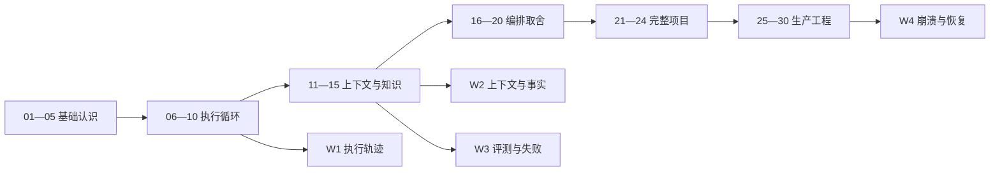

# 学习导航与术语索引

面向已有 Python 后端经验的学习者。无需先读完整仓库；每次按“机制→小实验→项目映射→反例”推进。30 个节点仍对应一个月路线，但以验收结果决定进度。

## 三种阅读路线

- 首次系统学习：01—20 建立机制，21—24 串项目，25—30 做工程；在 08、11—15、26 后阅读对应深讲。
- 已经跑通项目：先做四项独立作业，再用 40 题报告定位知识缺口；遇到实现问题查工程源码参考 E01—E30。
- 准备面试：先自答 80 题，再按综合答辩演练。引用证据时同时说明真实模型、夹具、框架示例和未执行能力。

## 30 节快速入口

| 节点 | 章节 |
|---|---|
| 01 | [LLM 的能力、推理过程与可靠性边界](COURSE.md#第-01-节llm-的能力推理过程与可靠性边界) |
| 02 | [Token、上下文窗口、采样与无状态请求](COURSE.md#第-02-节token上下文窗口采样与无状态请求) |
| 03 | [Prompt、消息角色与结构化输出](COURSE.md#第-03-节prompt消息角色与结构化输出) |
| 04 | [Agent 的组成与自主性边界](COURSE.md#第-04-节agent-的组成与自主性边界) |
| 05 | [普通 LLM、RAG、工作流与 Agent 如何区分](COURSE.md#第-05-节普通-llmrag工作流与-agent-如何区分) |
| 06 | [Function Calling 的一次完整往返](COURSE.md#第-06-节function-calling-的一次完整往返) |
| 07 | [工具描述、参数合同与执行边界](COURSE.md#第-07-节工具描述参数合同与执行边界) |
| 08 | [从零理解并运行 Agent Loop](COURSE.md#第-08-节从零理解并运行-agent-loop) |
| 09 | [ReAct、任务拆解、计划执行与反思](COURSE.md#第-09-节react任务拆解计划执行与反思) |
| 10 | [状态、终止、错误与恢复的基本合同](COURSE.md#第-10-节状态终止错误与恢复的基本合同) |
| 11 | [上下文工程与输入预算](COURSE.md#第-11-节上下文工程与输入预算) |
| 12 | [会话记忆、事实记忆与长期记忆](COURSE.md#第-12-节会话记忆事实记忆与长期记忆) |
| 13 | [RAG 全链路与文档处理](COURSE.md#第-13-节rag-全链路与文档处理) |
| 14 | [Embedding、BM25、混合检索与重排](COURSE.md#第-14-节embeddingbm25混合检索与重排) |
| 15 | [引用、事实性与分层评测](COURSE.md#第-15-节引用事实性与分层评测) |
| 16 | [确定性工作流、路由与模型决策](COURSE.md#第-16-节确定性工作流路由与模型决策) |
| 17 | [状态图、检查点与人工介入](COURSE.md#第-17-节状态图检查点与人工介入) |
| 18 | [原生实现与 LangGraph 的选择](COURSE.md#第-18-节原生实现与-langgraph-的选择) |
| 19 | [MCP 的角色、发现与调用边界](COURSE.md#第-19-节mcp-的角色发现与调用边界) |
| 20 | [单 Agent、多 Agent 与复杂度收益](COURSE.md#第-20-节单-agent多-agent-与复杂度收益) |
| 21 | [从业务需求推导 Agent 系统](COURSE.md#第-21-节从业务需求推导-agent-系统) |
| 22 | [串联知识检索、模型决策与引用校验](COURSE.md#第-22-节串联知识检索模型决策与引用校验) |
| 23 | [候选事实、用户确认、更正与摘要](COURSE.md#第-23-节候选事实用户确认更正与摘要) |
| 24 | [Chainlit 界面与完整交互验收](COURSE.md#第-24-节chainlit-界面与完整交互验收) |
| 25 | [服务接口、资源生命周期与存储边界](COURSE.md#第-25-节服务接口资源生命周期与存储边界) |
| 26 | [幂等、并发版本、事务与租约](COURSE.md#第-26-节幂等并发版本事务与租约) |
| 27 | [超时、重试、取消、降级与 SSE](COURSE.md#第-27-节超时重试取消降级与-sse) |
| 28 | [鉴权、注入防护与数据生命周期](COURSE.md#第-28-节鉴权注入防护与数据生命周期) |
| 29 | [评测、观测、成本与容量治理](COURSE.md#第-29-节评测观测成本与容量治理) |
| 30 | [部署、回滚、故障演练与项目答辩](COURSE.md#第-30-节部署回滚故障演练与项目答辩) |

## 配套材料

| 材料 | 什么时候使用 |
|---|---|
| [核心机制深讲](COURSE.md#核心机制深讲与故障工作坊) | 读懂概念后，用实际失败推导设计 |
| [独立练习与参考答案](../exercises/README.md) | 不看答案写实现，运行验收，再解释边界 |
| [六组入门实验](../labs/README.md) | 第一次接触机制时先观察结果 |
| [工程源码参考](ENGINEERING_REFERENCE.md) | 深入追踪具体实现，E 编号不是学习顺序 |
| [生产演练](OPERATIONS_LAB.md) | 用环境、命令、结果与限制形成验收记录 |
| [综合答辩](DEFENSE.md) | 将基础、实现、排障与项目边界串成回答 |
| [旧版迁移](MIGRATION.md) | 查旧题号和原工程章节 |

## 术语索引

| 术语 | 本课中的含义与容易混淆的地方 | 节点 |
|---|---|---|
| Token | 由具体分词器编码的单位，不等于汉字或字节 | 02 |
| logits / temperature | 下一单位的分数与分布变换；不是事实置信度 | 02 |
| prefill / decode | 输入前缀处理与逐步生成，延迟来源不同 | 02 |
| KV cache | 注意力中间结果缓存，不是业务长期记忆 | 02 |
| Prompt | 任务指令和示例，不承担数据库授权 | 03 |
| Schema | 对象形状约束，不证明内容真实 | 03、07 |
| Harness | 包围模型的执行、状态、工具和控制逻辑 | 04 |
| Agent Loop | 动作提议、执行、观察与再决策的受控循环 | 06—10 |
| Function Calling | 模型生成结构化调用提议，由应用执行 | 06 |
| call_id | 一次调用与观察的关联标识，不是业务幂等键 | 06、08 |
| ReAct | 决策与环境反馈交替的研究背景，不要求公开私有思维链 | 09 |
| 上下文工程 | 选择、排序、压缩和失效本次可见信息 | 11 |
| 事实记忆 | 有来源、确认和版本的声明；不同于原始对话 | 12 |
| RAG | 检索证据并用于回答的数据流程，不自动具有自主性 | 13 |
| BM25 | 稀有词、词频饱和和长度归一化的词面排序 | 14 |
| Embedding | 模型编码的向量；手工数组不具有已验证语义 | 14 |
| RRF | 融合不同检索名次，分数不是可答概率 | 14 |
| Reranker / ANN | 候选重排与搜索加速，分别独立于向量编码 | 14 |
| Recall / MRR | 相关集合覆盖率与第一相关位置，不能代替回答质量 | 15 |
| Grounding | 结论与实际证据的绑定；有链接不必然有支持 | 15 |
| Checkpoint | 图状态的恢复点，不自动提供外部写入幂等 | 17 |
| HITL | 人工介入，审批必须绑定对象、权限和版本 | 17、23 |
| MCP | 工具连接协议，协议连接不等于业务授权 | 19 |
| Multi-agent | 多决策主体协作；多函数或多节点不自动算多 Agent | 20 |
| CAS / expected_version | 仅在计算依据仍有效时更新状态 | 26 |
| Idempotency | 原操作重试的业务结果合同，不保证供应商仅调用一次 | 26 |
| Lease / fencing | 有时限的资格与旧资格提交拒绝 | 26 |
| Deadline / retry | 总时间预算与局部尝试，不能互相替代 | 27 |
| SSE | 事件传输；进度与 Token 输出是不同内容 | 27 |
| Golden set / judge | 版本化人工标签与自动评价辅助，二者都需审查 | 29 |

## 每阶段提交的学习证据

05：四类架构比较及一个不用模型的功能；10：一次正常与失败调用轨迹；15：手算指标、一条未知误引与归因；20：单/多主体及框架取舍；24：确认、更正、撤回和摘要链路；30：故障窗口、恢复报告、真实能力表和答辩记录。任何阶段都不能用“源码里有这个类”代替运行证据。
