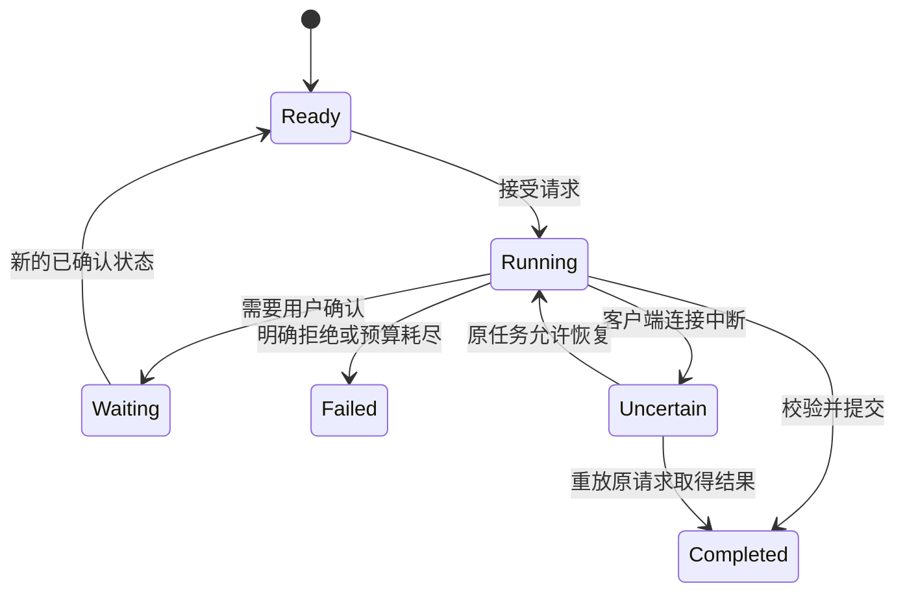

## 阶段二：掌握执行机制

先把一次工具调用解释清楚，再组合为循环。此阶段可以使用固定决策重现协议和执行错误；真实模型是否会正确选择工具，需要独立的模型接入与行为评测。

### 第 06 节：Function Calling 的一次完整往返

**问题与目标。** 模型返回 `lookup_term` 之后，为什么请求还没有结束？本节跟踪一次工具调用从说明、提议、执行到反馈的全过程。

**原理与机制。** 应用先提交工具名称、描述和参数 Schema；模型可能提出调用并给出参数；应用按注册表验证和执行；返回结果携带原调用编号，再请求模型决定下一步。外部查询、数据库读写和文件操作由程序发生，不是模型在生成某个字符串时已经发生。工具结果可以是失败、空结果或拒绝，不能一律包装为“成功”。


下面是人工编写的 **Responses 形状夹具**，不是某次真实 API 响应：

```json
{"type":"function_call","call_id":"c1","name":"lookup_term","arguments":"{\"term\":\"四诊\"}"}
```

执行得到结果后，回传形状是：

```json
{"type":"function_call_output","call_id":"c1","output":"四诊是望、闻、问、切的传统信息采集方法。"}
```

`arguments` 在这里是 JSON 字符串，需再解析一次；`call_id` 关联调用与观察。Chat Completions 使用另一套消息组织方式，通常以 `tool_calls` 和 `tool_call_id` 对应。课程以官方协议作对照，第三方平台的端点、字段和推理状态支持仍需实测。[协议文档](https://developers.openai.com/api/docs/guides/function-calling)。

**最小实验。** 运行工具实验后观察输出中的 `call-1`，它来自调用提议，工具结果保留同一个编号。运行协议测试可进一步检查实际 HTTP 请求的序列化，测试使用 MockTransport，不向平台发送请求。

```bash
uv run python -m labs.tool_loop
uv run pytest tests/test_gateway.py -q
```

**代码详解。** [`Observation`](../labs/tool_loop.py) 只含调用编号和执行结果，这足以展示关联概念；生产网关则需保留供应商要求的完整重放条目。不能把推理型协议的所有条目压缩成一条普通文本，否则下一轮可能无法继续。

**项目映射。** 阅读工程参考 E02 的 `NativeConversation.step`，对照 Responses 与 Chat 各自构造工具、追加观察和解析结果的位置。真实入口是 `tcm doctor` 与配置后的 `tcm run`，不要将 MockTransport 的通过解释为你的供应商已经连通。

**练习与验收。** 画出两次模型请求之间应用做了什么。故意把观察的调用编号改错，说明它属于协议关联错误，为什么不能用业务 `request_id` 直接代替。能区分调用提议、执行结果和最终回复才算通过。

**面试关联。** [完整工具链路](#legacy-q11)、[兼容接口失败](#legacy-q10)。

### 第 07 节：工具描述、参数合同与执行边界

**问题与目标。** 模型选错工具时，是换模型，还是先改工具接口？本节建立一个可诊断的工具合同，理解模型可选择与应用可执行之间的差别。

**原理与机制。** 工具说明要回答：什么时候用、输入是什么、结果代表什么、不能完成什么。`lookup_term` 比 `do_everything` 更容易界定责任；“检索已审核公共知识，返回原文与来源”比“超强专家助手”更能指导模型。描述里的示例应覆盖容易混淆的场景，不用堆砌夸张能力声明。

参数 Schema 负责形状，执行环境负责账户与能力范围。只读检索不需要接受任意 SQL、文件路径或用户身份；这些参数会无谓扩大可利用空间。写操作还需要预览、审批、幂等和执行回执。模型选择调用不构成用户授权，输出的 owner 也不是可信身份。

工具结果设计同样重要：查不到与服务故障要可区分，空集合不等于“没有这种情况”。过大的结果会占用上下文，过小又可能丢失限定条件；应返回与任务相关的证据、状态和可引用定位，而不是原样倾倒整个数据库。

**最小实验。** 使用两个坏调用：未注册的 `shell`，以及带 `owner` 的查询参数。预期在执行前拒绝。

```bash
uv run pytest tests/test_labs.py -k 'tool_or_args' -q
```

{{snippet:labs/tool_loop.py:lookup}}

**代码详解。** 词表查询函数本身非常普通，Agent 特性来自谁决定调用以及结果如何反馈。注册表只允许这个能力，不能通过把 `name` 改成任意函数名来获得 Python 执行权限。参数先经过 `LookupArgs` 解析，查不到只返回教学词表无条目的明确说明。

**项目映射。** [`tool_schema.py`](../src/tcm_agent/tool_schema.py) 注册检索、读取确认资料与提交终态三个工具；身份不出现在模型参数中。对照工程参考 E04，观察如何把模型可见的 Schema 与实际可执行函数绑定，避免 `eval` 或任意网络工具。

**练习与验收。** 为“读取已确认事实”写工具说明，分别给出应调用与不应调用的输入。准备工具选择错误、参数错误、执行失败三个案例，说明改描述、改 Schema 和改服务分别解决哪一类问题。不要把所有错误都叫成“Prompt 不好”。

**面试关联。** [选错工具怎么办](#legacy-q14)、[权限为什么不能由模型管理](#legacy-q21)。

### 第 08 节：从零理解并运行 Agent Loop

**问题与目标。** 工具往返如何变成能继续、能停止的循环？本节先读一个完整但短的执行器，再映射到实际项目。

**原理与机制。** 每一步输入当前观察，得到调用或终态。调用经过校验后产生新观察，终态结束。必须区分“模型表示完成”和“系统允许完成”：权限、来源和输出合同不满足时，不能因为模型说完成就成功返回。也必须限制总步数与总时间，否则重复检索可能不断消耗预算。

{{snippet:labs/tool_loop.py:run}}

**最小实验。** 默认夹具先查询四诊，再结束，预期输出真实词表结果。把预算降为 1 时，第二次决策尚未发生就应拒绝；重复调用编号或改成未注册工具也会失败。

```bash
uv run python -m labs.tool_loop
uv run pytest tests/test_labs.py -k 'loop' -q
```

**代码详解。** 执行器依赖 `DecisionSource`，每次将已有观察交给决策来源。`match` 明确处理调用和完成两个变体；新增变体时静态检查要求补齐逻辑。`seen` 避免同一编号重复执行，不能证明语义相同的两个新编号已经去重。这里还没有副作用写工具，也没有跨进程幂等，因此不能称为 exactly-once。

这个实验的 `Finish.answer` 直接来自固定夹具，仅用于说明停止分支。项目不会照搬这个自由文本出口，而是使用受约束终态并再次校验。最小实验少的是生产边界，不是把边界问题隐藏起来。

**项目映射。** 工程参考 E05 的 `AgentRuntime.run` 在同一机制上加入前置策略、上下文、协议错误、工具限制、检索证据登记和终态校验。按“小循环每一行对应大循环哪一步”的方式读源码，不要从上百行实现中反向猜 Agent 是什么。

**练习与验收。** 写出正常、未知工具、重复编号、错误参数、超预算五条轨迹。每条指出发生失败的确切位置，并确认失败之前有没有执行工具。能解释循环本身确定、决策来源可能不确定，才算掌握。

**面试关联。** [停止无限循环](#legacy-q16)、[三种标识为何不能合并](#legacy-q39)。

### 第 09 节：ReAct、任务拆解、计划执行与反思

**问题与目标。** 一个循环会调用工具，是否就具备可靠规划？本节区分即时反馈决策、先生成计划和用反馈修正三种设计，不把名称当效果保证。

**原理与机制。** ReAct 强调决策与环境反馈交替：查到的信息会影响下一步动作。教学时可以观察工具选择与结果，不需要索取或记录模型私有思维链。[ReAct 研究](https://arxiv.org/abs/2210.03629) 是方法背景，本课程不复制其论文中的全套实验条件。

Plan-and-Execute 把任务拆成计划，再由执行器落实；好处是可以检查依赖、范围和预算，代价是计划会过时，执行失败后需要修订而非盲目继续。计划中的步骤也可能编造不存在的工具，所以计划 Schema 合法仍需语义与依赖校验。简单查询不一定值得多一次规划调用。

反思机制利用失败信息或评估反馈修正后续行为。反馈必须来自独立可检查的标准，单纯让模型再夸自己一次不会增加证据。限定修正次数，并比较加入反思前后的成功率、成本与错误传播。[Reflexion 研究](https://arxiv.org/abs/2303.11366) 可供理解反馈记忆思路；当前项目没有实现其训练或完整代理方法。

**最小实验。**

```bash
uv run python -m labs.workflows
```
 验证一份固定计划的依赖：retrieve→explain→review。故意形成 A 依赖 B、B 依赖 A，预期执行任何任务前发现环。

{{snippet:labs/workflows.py:order}}

**代码详解。** 先验证唯一编号与依赖存在性，再每轮选择前置条件已完成的任务；没有就绪节点却仍有剩余任务即存在环。这是计划执行前的结构检查，不会生成计划，也不是一个多 Agent 系统。真实 Planner 需要把模型输出解析成同类结构，再经过同样检查。

**项目映射。** 主项目采用短而受控的工具循环，没有为了术语解释增加通用规划器。独立实验用于理解何时值得扩展；项目答辩应说明为什么当前任务用不到复杂计划，而不是声称已经实现所有 Agent 模式。

**练习与验收。** 为“整理资料并解释一个术语”写出固定工作流和可动态决策的版本，列出两个方案额外产生的调用。给计划增加预算和允许工具清单的设计，说明执行中资料被用户更正时如何使旧计划失效。

**面试关联。** [ReAct 与计划反思](#legacy-q68)、[多步骤可靠性](#legacy-q71)。

### 第 10 节：状态、终止、错误与恢复的基本合同

**问题与目标。** 断网后重新点击发送，究竟应该继续旧任务还是开始新任务？在深入事务前，先建立行为层面的状态与错误分类。

**原理与机制。** 至少区分任务状态、模型协议状态、业务事实和 UI 显示状态。任务状态说明运行、等待、完成或失败；协议状态保存下一次模型调用所需的重放条目；事实状态保存用户确认资料；UI 可能尚未收到已经提交的结果。把它们混成一段聊天历史，会使恢复时无法判断什么已经发生。

结束条件包括合法完成、需要人工信息、策略拦截、步数耗尽和总时限到达。错误也分不同类型：未知工具通常不应无限重试；短暂网络故障可在预算内重试；版本冲突需要重新审视状态；结果不确定时应使用原请求身份查询或重放。自动把所有异常当成新请求，可能扩大副作用。



**最小实验。** 分别运行步数耗尽、重复编号和旧版本确认测试。它们应暴露不同的失败理由，不通过“补一个默认答案”变成成功。

```bash
uv run pytest tests/test_labs.py -k 'budget or repeated or stale' -q
```

**代码详解。** 小实验的状态是不可变对象，确认返回新版本；工具执行器的步数限制在请求下一决策前生效。这些是单进程机制演示，尚未解决崩溃后的持久化。第 26 节再把版本、请求认领和结果一起放进数据库合同。

**项目映射。** [`ui_client.py`](../src/tcm_agent/ui_client.py) 明确区分截断流和正常完成；[`ui/app.py`](../ui/app.py) 对不确定结果保留原请求，对明确版本冲突则刷新并提示重新发送。此时先理解行为，不急着阅读租约 SQL。

**练习与验收。** 写一张“故障 → 已知事实 → 是否重试 → 是否复用 request_id”的表，覆盖请求尚未发出、服务已提交但断线、明确版本拒绝、工具参数错误。阶段验收是能说明每次恢复操作可能重复什么。

**面试关联。** [幂等与 exactly-once](#legacy-q40)、[超时重试](#legacy-q45)、[断线取消](#legacy-q48)。
