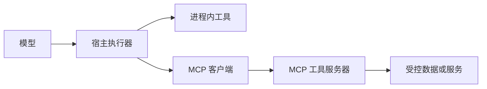

## 阶段四：编排与系统设计

已经理解循环与知识能力之后，再讨论框架与系统拓扑。框架帮助组织执行，不替你证明业务合理，也不自动赋予生产可靠性。

### 第 16 节：确定性工作流、路由与模型决策

**问题与目标。** 同一系统中哪些步骤固定，哪些步骤适合让模型选？本节以不确定性发生的位置划分控制，而不是把所有节点都变成 Agent。

**原理与机制。** 常见组合包括顺序链、条件路由、并行独立任务、汇聚和有限反馈循环。顺序链适合依赖已知的步骤；路由适合任务类别可判定且后续路径明确的情况；并行只适合读操作或相互独立的任务。一个模型给出的分类可以驱动路由，但分类结果仍需限制在允许集合，并测量误路由代价。

在就诊准备中，用户身份绑定和删除是确定性服务行为，危险情况可以先由受控规则处理，摘要只读确认事实；模型主要决定检索或追问。把固定逻辑交给模型可能增加延迟与错误路径，却没有带来相应能力收益。


**最小实验。** 对 `route` 的两个条件分别给出预期路径；检查固定计划中 explain 依赖 retrieve，因而不能为了“并行”同时启动。这里没有模型路由器，不能宣称测试了分类准确率。

```bash
uv run python -m labs.workflows
```

**代码详解。** 计划依赖和分支由普通 Python 表达。若升级为模型分类，应加入结构化类别、未知类和拒绝路径，而不是把任意模型输出拼成函数名。若增加并行读取，观察应按调用 ID 关联，不能依赖完成顺序。带副作用的节点还需检查相互冲突，不能只看参数不同。

**项目映射。** [`policy.needs_handoff`](../src/tcm_agent/policy.py) 在模型循环前决定受控分支，`render_summary` 从事实确定性生成文本。框架对照例子也保留这个决策边界，说明“图里有模型节点”和“整张图由模型自主决定”不是同一件事。

**练习与验收。** 为检索、事实确认、摘要导出、删除四个操作画一张控制权分布图；每个模型节点都要写下让它自主决定的理由。能给出一个删掉模型调用、结果反而更稳的步骤，才算掌握架构简化。

**面试关联。** [编排与模型分工](#legacy-q09)、[并行工具调用](#legacy-q73)。

### 第 17 节：状态图、检查点与人工介入

**问题与目标。** 等待用户确认时，应当一直占着一个请求吗？本节理解暂停、持久状态与恢复，以及审批为什么必须绑定具体版本。

**原理与机制。** 状态图显式描述节点、边与状态更新。检查点保存执行快照，使系统可以暂停或恢复；人工介入在特定边界取得新输入或授权。但快照存下来了，不代表节点中的外部操作只执行一次。恢复可能重新进入节点，所以不可重复的操作不能随便放在暂停前，仍需业务幂等。

审批对象应明确：用户确认的是哪条事实、哪份草稿、哪个版本，而不是一次永久的“我同意”。如果草稿被修改，旧审批不应继续授权新内容。一个会话 ID 也不能充当账户授权，恢复入口仍必须验证访问身份。

**最小实验。** 本版补充了真正调用 LangGraph 的 interrupt/resume 示例。它先暂停，使用相同 thread_id 恢复；第二条路径在暂停期间把版本改成 2，再用版本 1 的审批恢复，应被拒绝。

```bash
uv run --extra graph python examples/checkpoint_approval.py
uv run pytest tests/test_checkpoint_example.py -q
```

{{snippet:examples/checkpoint_approval.py:approve}}

**代码详解。** `interrupt` 的返回值是外部恢复输入，先解析成 `Decision` 再比较 revision。恢复时节点可能从头运行，示例故意不在 interrupt 前做外部写入。`InMemorySaver` 只验证进程内暂停恢复，进程重启后不会保留；它不是生产持久化数据库，也没有实现一个公网审批接口。[官方中断说明](https://docs.langchain.com/oss/python/langgraph/interrupts)。

**项目映射。** 主项目的确认不是一个悬挂的模型协程：候选与原始回合在后端保存，用户随后通过独立 HTTP 请求确认。它没有使用 LangGraph checkpointer，但解决了相同的“先呈现、后确认”业务需要。两种实现都要防止过期确认与越权读取。

**练习与验收。** 实际执行成功与旧审批两条路径。画出服务重启前后哪些状态仍存在。设计一个写操作时，分别指出检查点、request_id 与数据库事务各保证什么。不能把“可恢复执行”解释为“外部 API exactly-once”。

**面试关联。** [人审位置](#legacy-q34)、[checkpoint 能解决什么](#legacy-q50)。

### 第 18 节：原生实现与 LangGraph 的选择

**问题与目标。** 掌握原生循环以后，何时值得引入图框架？本节比较维护需求与新增约束，而不是评选一个永远最好的框架。

**原理与机制。** 少量工具、短循环与明确终态可以用原生代码表达；分支较多、节点复用、状态更新和暂停恢复较复杂时，框架提供的组织与执行能力可能更有价值。与此同时，你仍需理解状态合并、节点重入、并发更新、持久化后端和升级兼容。把逻辑搬进图不自动改善 Prompt 或检索质量。

做选型时比较四项：控制流是否真的复杂，团队是否能调试真实执行轨迹，恢复语义是否符合业务，框架版本升级是否可被测试覆盖。不要把框架名称当成“可上线”证据，也不要因为自己能手写循环就否定所有框架收益。

**最小实验。** 先执行原生工具夹具，再运行同一项目 Runtime 的图路由对照，最后执行带检查点的审批示例。前两个比较执行组织，第三个验证新增恢复能力，不能把三个结果合成一个“模型更聪明”的结论。

```bash
uv run python -m labs.tool_loop
uv run --extra graph python examples/graph_workflow.py
uv run --extra graph python examples/checkpoint_approval.py
```

{{snippet:examples/graph_workflow.py:GraphState}}

**代码详解。** 图状态保存 `RuntimeInput` 与结果，节点仍调用现有 runtime；路由不复制一套 Agent 实现。例子没有数据库持久化，应用服务里的幂等与事务也没有迁移到图里。检查点示例进一步演示恢复，但使用独立合成数据，不冒充主服务已经换成 LangGraph。

**项目映射。** 原生主线的 `service.py` 管理回合，`runtime.py` 管理工具循环；图示例只展示编排选择。若将来迁移，需要先定义哪层拥有可恢复状态，再处理重复节点执行、权限和已有 API 合同，而不只是替换入口函数。

**练习与验收。** 写一页简短技术决策记录：保留原生循环的理由、引入图框架的触发条件、如何证明迁移没有改变用户行为。列出至少一项框架替不了你的业务保证。

**面试关联。** [LangGraph 取舍](#legacy-q50)、[项目分层](#legacy-q02)。

### 第 19 节：MCP 的角色、发现与调用边界

**问题与目标。** Function Calling 已经能执行函数，为什么还会出现 MCP？本节区分模型接口与工具连接协议，不把两次往返合成一个黑箱。

**原理与机制。** 在典型 MCP 架构中，宿主应用管理模型与用户交互，客户端连接工具服务器；双方完成初始化与能力协商，再发现和调用允许的工具。服务器提供工具不表示模型自动获得执行权限，宿主仍要筛选工具、校验参数、绑定当前身份并限制结果体积。

Function Calling 描述“模型如何提出动作、应用如何反馈观察”；MCP 描述“应用如何通过标准化连接访问外部工具能力”。进程内函数可以不经过 MCP；MCP 服务器也不必内部再运行一个 Agent。协议还涉及资源、提示等能力，具体采用哪些取决于宿主，不应把整个规范缩成“另一个 HTTP API”。[官方架构](https://modelcontextprotocol.io/docs/learn/architecture)。



**最小实验。** 执行真实 stdio 客户端，观察初始化、列出工具、调用检索与取得结果。它是两个进程的真实协议交互，不是模拟函数名匹配。

```bash
uv run --extra mcp python examples/mcp_client.py
```

**代码详解。** [`mcp_client.py`](../examples/mcp_client.py) 管理连接生命周期；[`mcp_server.py`](../examples/mcp_server.py) 仅暴露公共教学知识检索。stdio 的 stdout 是协议通道，普通日志写入可能破坏通信。当前示例不开放公网，也不把模型供应商密钥转交给工具服务器。

**项目映射。** 主服务仍用进程内检索，MCP 位于独立示例。引入远程工具时还需要服务器身份验证、授权、允许地址、超时和操作审计；工具发现返回的描述也属于外部数据，不能提升为应用指令。

**练习与验收。** 手画模型 API 与 MCP 各自的请求—响应，分别标出调用标识的作用。解释为什么 list_tools 成功不代表模型已经会选工具，更不代表用户同意执行一个外部写操作。

**面试关联。** [MCP 阶段](#legacy-q04)、[MCP 与 Function Calling](#legacy-q49)、[Skills、工具与记忆](#legacy-q70)。

### 第 20 节：单 Agent、多 Agent 与复杂度收益

**问题与目标。** 为什么不直接设置问诊、检索、诊断和审核四个 Agent？本节从任务可分解性、沟通成本和错误传播判断是否需要多个决策主体。

**原理与机制。** 多个工具不等于多个 Agent，多个模型调用也可能只是固定流水线。多 Agent 通常引入多个具有独立任务或决策上下文的执行主体，由某种协作协议交换结果。可选结构包括主控—工作者、交接和并行独立子任务；每种结构都需要明确谁拥有状态、谁能写、何时结束和如何合并冲突。

多视角可能增加覆盖，也可能重复检索、传播同一错误或相互给出无依据的认可。若 n 个步骤独立且每步成功率都为 p，全部成功的理想化概率才是 p 的 n 次方；现实错误常相关，不能直接拿这个简化式预测项目质量。增加审核模型也不能替代医学专业审核或授权校验。

**最小实验。** 用固定计划检验并行前置条件，而不是伪造“多个专家正在思考”的日志。把两个任务设计成争抢同一份可写事实，说明此时缺少的不只是执行线程，还包括状态所有权和冲突解决。

```bash
uv run python -m labs.workflows
uv run pytest tests/test_labs.py -k 'plan' -q
```

**代码详解。** `order` 只根据依赖安排任务，完全没有独立模型主体，所以诚实称为工作流实验。扩展成多 Agent 后，消息需要结构、证据和预算，不能直接把一个模型的自由文本当成另一个的可信结论。总预算还应覆盖所有子任务与重试。

**项目映射。** 主项目保留单 Agent 配合公共检索、确定性政策和人工确认，未实现通用多 Agent 协作。当前小业务不需要额外的状态协调和模型费用；课程讲解多 Agent 是为了能判断何时值得升级，不是为了给简历增加框架名。

**练习与验收。** 提出一个确实能独立并行的扩展，例如分别检查两份公开知识来源，再定义证据合并和冲突出口。与单 Agent 基线比较任务质量、调用数、总时延和越权风险，只有测得收益才推进。阶段验收是一份有证据要求的架构选择说明。

**面试关联。** [为什么不拆多 Agent](#legacy-q51)、[整体可靠性](#legacy-q71)、[并行工具](#legacy-q73)。
