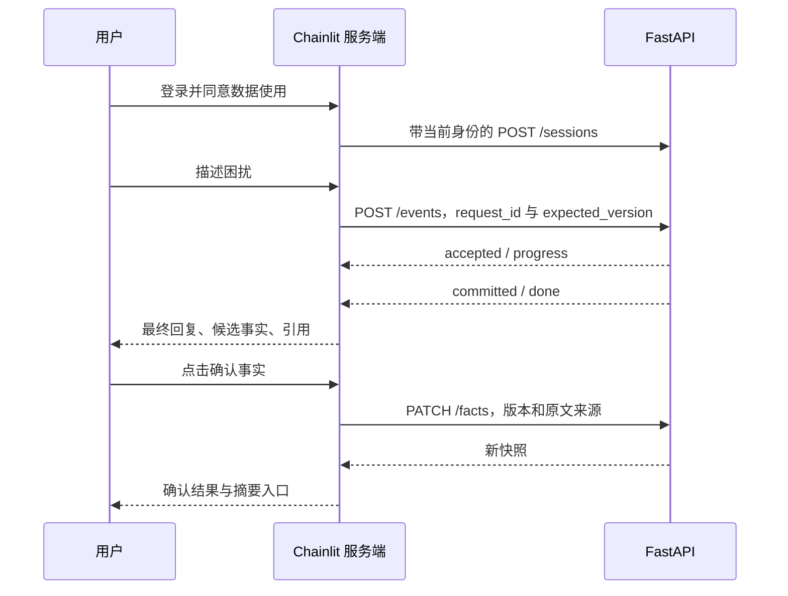

## 补充实战：Chainlit 交互验证界面

这部分衔接第 3 周服务工程和第 4 周交付验收。目标是让学习者在浏览器完整使用既有业务链路，观察真实工作流，验证事实确认、版本冲突和失败恢复。

### 功能与启动

界面提供登录、数据使用确认、多轮对话、候选事实逐条确认、事实撤回、引用展示、确定性摘要、失败重试和二次确认删除。启动步骤见 [README](../README.md#启动-chainlit-界面)。源码分三层：[`ui/app.py`](../ui/app.py) 处理事件和 API 编排；[`ui/view.py`](../ui/view.py) 封装原生组件和每个浏览器会话的状态；[`ui_client.py`](../src/tcm_agent/ui_client.py) 负责类型化 HTTP/SSE 边界。

登录用户名是应用身份，密码是应用令牌。`CHAINLIT_AUTH_SECRET` 保护 Chainlit 登录会话，模型平台密钥留在服务端。UI 和 API 使用相同的令牌映射；认证后根据服务端身份取出 API 凭据，凭据不进入用户 metadata 或 Action payload。

{{snippet:ui/app.py:authenticate}}

**代码详解。** 遍历服务端配置，使用常量时间比较验证令牌，并核对对应身份。返回值只包含身份。当前为课程的受控令牌模式，公开部署的账户、撤销、限流和身份提供商仍需完善，不能把它描述为完整企业登录体系。

### 从浏览器事件到后端原子提交

这张顺序图使用 GitHub 可直接渲染的 Mermaid。UI 不调用模型、不直接写数据库，避免出现“页面跑一套 Agent、API 跑另一套 Agent”的分叉。原生 Step 只显示服务器已经发出的工作流事件；只有收到已提交结果和正常结束事件后，才显示最终回复。

{{snippet:src/tcm_agent/ui_client.py:VisitClient.events}}

**代码详解。** SSE 以空行结束一个事件，`event` 指定种类，多条 `data` 合并。命名事件和数据在边界解析，错误体不直接呈现到浏览器。流正常结束必须包含 `committed` 和 `done`，网络中断或只收到 `accepted` 都不能冒充成功。120 秒是每次读取的上限；后端仍受自己的整回合总时限约束，读取停顿超时后允许同请求重试。

### UI 状态不是事实来源

浏览器会话保存最新 API 快照、未决请求、操作锁和显示消息。锁用于串行化同一界面的操作；跨页面和跨进程竞争仍由后端版本控制处理。Action 按钮携带候选字段、原文和来源回合，确认前重新读取快照，过期候选不能落入新的事实。用户纠正时先撤回旧事实，再描述并确认新事实。

{{snippet:ui/app.py:respond}}

**代码详解。** 在发送网络请求之前构造并保存 `TurnRequest`。失败后保留原对象，重试保持同一个 `request_id`、正文和原版本。若不确定时新建请求编号，可能让后端把同一段输入当成新回合。存在未决请求时暂停提交新消息与修改事实，避免在恢复前推进版本。

后端明确返回 `version_conflict` 时，本次输入没有提交；界面清除这条已拒绝的未决请求并刷新事实，提示用户核对后重新发送。它与“连接中断，不知道是否已经提交”不同：后者继续复用原请求，不能自动改版本或请求编号。这一区分避免无效的永久重试，也避免替用户在新上下文中悄悄重发。

### 手工验收和局限

1. 不点同意按钮直接发送消息：不能创建 API 会话或调用模型。
2. 输入“最近睡不好”，确认前查看摘要：不能被写成已确认事实。
3. 确认后查看摘要，再撤回：摘要相应更新。输入更正并确认后只保留用户确认的版本。
4. 问“什么是四诊？”：回答与引用一致，能看到真实工作流进度。
5. 停止或断开请求后重试：复用原请求编号，不产生两个已提交回合。
6. 点击历史候选按钮：已失效内容不能被确认成新事实。
7. 删除需再次确认，完成后 API 读取返回不存在，当前页面的健康信息消息被移除。

自动测试覆盖 UI HTTP 边界的重试身份、错误脱敏、截断流拒绝；浏览器验收与已执行范围见 [验证报告](../evidence/validation.md)。没有配置 Chainlit 数据层，页面刷新不恢复原会话；后端记录仍按原 API 生命周期存在，需要用户主动删除或后续实现过期清理。文件上传、照片分析和界面历史恢复不属于本次实现。

### 对应面试追问与答案

**为什么不用 Chainlit 的聊天历史直接做 Agent 记忆？** 界面历史负责展示，缺少当前项目的用户确认、原文溯源和原子提交合同。Agent 上下文仍由后端构建。考点：事实来源、状态归属和信任边界。

**页面显示回复以后，数据库一定提交了吗？** 取决于协议。本项目只有收到 `committed` 并正常结束后才显示最终结果，降低未保存结果被当成成功的风险。若提交后网络断开，重试原请求可取回同一结果。考点：提交与可见性的顺序、幂等和不确定结果恢复。

**刷新会话和删除数据是一回事吗？** 不是。刷新丢失的是当前 UI 上下文，API 数据仍存在；删除调用明确的后端接口，且不自动代表模型供应商已经删除其留存。考点：数据生命周期、跨系统删除边界。以上三题为项目设计追问，不冒充公开面经原题。

资料：[Chainlit 认证](https://docs.chainlit.io/authentication/password)、[Action 按钮](https://docs.chainlit.io/api-reference/action)、[Step 展示](https://docs.chainlit.io/concepts/step)。
