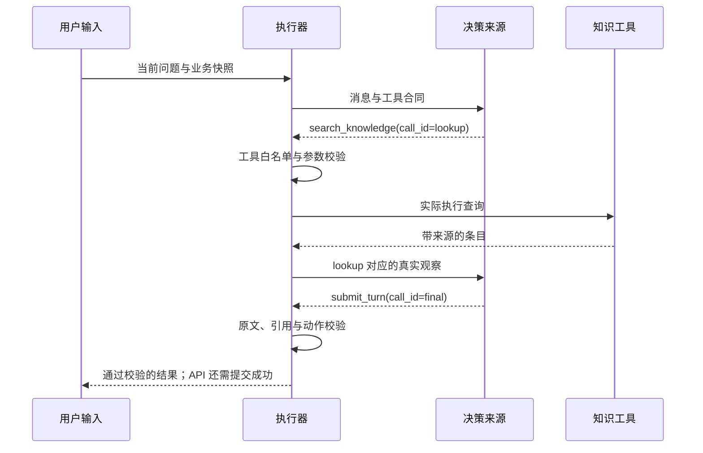

## 核心机制深讲与故障工作坊

本模块把第 08、11—15、26—27 节展开成四次完整推导。建议在对应节点第一次阅读，项目整合后再复做。每次都从一个可观察错误出发：预测失败 → 运行证据 → 定位边界 → 修改实现 → 用反例验收。主项目和离线夹具分别承担执行与决策职责，不能把夹具成功说成真实模型效果。

### W1：沿一条执行轨迹理解 Agent Loop

**先问一个具体问题。** 用户输入“什么是四诊？”，模型返回了 `search_knowledge`，页面是否可以马上显示“查询成功”？不可以。工具提议只是待执行动作；参数可能不合法，执行可能失败，最后输出也可能引用没有查到的条目。一次回合至少有请求构造、决策、执行、观察、再次决策、终态校验几个阶段；有数据库时，还要等状态提交。



这里 M 可以是真实兼容平台，也可以是公开固定决策的 OfflineGateway。图表达执行合同，不表示我们已经取得真实模型的上述输出。执行以下命令会调用生产 `AgentRuntime`、真实 BM25 与校验策略；决策仍是固定夹具，没有 HTTP 模型请求和数据库写入。

```bash
uv run python -m labs.trace_demo
```

查看 [实际轨迹](../evidence/runtime-traces.json) 的 `knowledge`：第一轮 decision 的 `observation_count=0`，调用检索；第二轮为 1，调用终态提交；最后出现 validated。观察数量是当前传入工具结果的数量，不是历史累计长度。决策器返回之后，执行器才校验和执行；所以“轨迹记录到某工具名”不能证明工具已经成功。终态输出同样要经过引用校验。

{{snippet:labs/trace_runtime.py:RecordingConversation.step}}

**为什么采用这个记录位置？** 包装 `Conversation.step` 可以看到每次决策拿到了几个观察、返回哪些允许的工具以及用量；Runtime 的进度补充后续校验过程。它不改变模型请求、不替代业务逻辑，不保存 Prompt、参数、工具正文、认证头、网址或 reasoning。主项目没有默认启用全量追踪，也不应该为了调试把健康正文全部写入日志。这个教学记录器用于合成输入；部署前仍需控制接收方、保留期和访问权限。

**故意让系统犯错。** 同一命令还执行六条反例，实际错误码分别是：

| 决策错误 | 真实拒绝点 | 错误码 |
|---|---|---|
| 提议未注册删除工具 | 白名单 | tool_not_allowed |
| query 使用数字 | Pydantic 参数合同 | invalid_tool_arguments |
| 反复使用同一 call_id | 回合调用去重 | duplicate_tool_call_id |
| 凭空增加“无既往史” | 当前原文来源 | ungrounded_fact |
| 未检索就引用条目 | 本轮证据集合 | ungrounded_citation |
| 只允许一轮但需要两轮 | 总步数 | step_budget_exceeded |

修复不是“忽略报错继续聊天”。先判断错误属于协议、参数、业务还是预算；只在合同允许时重新请求，否则停止或降级。在主服务中，错误可能被转为已提交的降级结果，直接 Runtime 实验则展示原始错误码。这是两层行为，不能把 HTTP 200 自动视为模型成功。

**带着代码答辩。** 如果工具会预约或发消息，当前 `call_id` 去重还够吗？不够。它只覆盖本次循环，进程重启后还要有持久幂等记录及下游业务合同。再问：步骤上限为什么不是费用上限？一次步骤可以重试网络，也可能消耗不同输入/输出 Token；观察 decision 次数没有统计全部 HTTP 尝试或实际扣费。

**验收。** 运行 `uv run pytest tests/test_benchmark.py -q`。画出错误提议在哪一条箭头上被拒绝，说明哪些事件证明决策发生，哪些证明校验完成，以及为什么此实验不证明数据库提交或真实模型能力。进一步接平台时使用后文的显式 live 入口，不能改报告里的 mode 冒充。

### W2：从“记住更多”推导正确的上下文与事实

**先构造错误实现。** 把所有历史连接成字符串，每次都发给模型；再把模型提取出的字段直接写进摘要。第一轮“最近睡不好”，第二轮“前面说错了，是白天犯困”，第三轮撤回旧记录。即使全部对话仍在窗口内，模型也可能重新引用旧表述。问题不只是长度，而是权威、时效和状态没有被明确表达。

区分三份数据：原始回合说明发生过什么；当前确认事实说明现在允许摘要采用什么；模型上下文说明这一次决策实际可看见什么。原始回合为了审计可以保留更长，而失效声明不应该再次变成当前事实。删除历史、压缩上下文和撤回确认也是三种操作，它们不能彼此替代。

**第一步修复：规定必需输入与可裁剪输入。** 将任务规则、当前问题和确认事实放在必要集合中，只给历史剩余预算。如果必要集合已经超限，明确拒绝并要求减少输入，不能静默丢掉过敏声明。历史选取应保持连续关系；最新一条太长时，跳过它却加入更旧的“是的”会丢失指代对象。

在 [练习 1](../exercises/README.md) 中独立实现这个选择器。它以字符计算，真实请求还有分隔符、Schema、角色封装和输出余量，因此不能把实验预算等同于模型窗口。

{{snippet:exercises/solution.py:select_context}}

逐行理解：先扣除必要字符数；不足立即失败；从新向旧遍历；遇到放不下的内容停止；把选中的消息放回原顺序。`selected` 是新的元组，原历史不修改。验收中的“最新放不下却旧消息很短”专门区分连续后缀和随意凑满预算，两种实现都可能看似合理，但只有前者符合此练习合同。

**第二步修复：把候选与确认分开。** 原文包含只能证明字符串存在，不能证明字段归类正确。例如“目前没有提供过敏资料”不能归纳为“无过敏”。确认还要绑定最新版本；用户在等待时更正了内容，旧审批不能授权新草稿。完整项目进一步绑定候选字段、来源回合与已认证身份。练习 2 只实现版本、非空与原文约束，刻意不把它说成完整审批系统。

```bash
TCM_EXERCISE=starter uv run pytest exercises/acceptance.py -k 'context or confirmation' -q
TCM_EXERCISE=solution uv run pytest exercises/acceptance.py -k 'context or confirmation' -q
```

starter 第一次出现失败是预期行为；在自己的分支补齐代码，不能通过修改验收条件把错误实现改绿。正常项目测试不会收集这份未完成练习。答案解释见练习说明的折叠区。

**第三步修复：压缩必须有保真评测。** 记录压缩前后的否定、主体、时间、药名和撤回状态；若丢失关键项，不应继续把摘要当权威资料。向量库可以帮助找到旧事件，但当前事实的版本裁决仍由数据库完成。KV cache、供应商会话状态和跨会话个人记忆也各有生命周期，不能因为都让调用“有历史”就混为一谈。

**验收。** 对“未提供”“明确否认”“不确定”“已更正”各给一条合成输入，写出候选、确认、摘要三层分别应该保留什么。再运行 `uv run pytest tests/test_api.py -k 'corrects or unconfirmed or removed or remove' -q`，查看原始记录仍可导出而当前摘要已采用新确认内容的证据。最后解释为何源字符串匹配通过仍可能语义错误，不能承诺这层检查解决了全部幻觉。

### W3：用失败样本拆开检索、证据选择与回答质量

**先推翻一个容易误判的结果。** 原来的 8 条检索题词面提示明显，Recall@4 满分不表示最终回答正确。top-4 包含正确条目，模型可能选了另一个；引用确实来自库，也可能完全不能支持问题。这里新增 [40 条原创合成问题](../knowledge/benchmark.json)，包含精确术语、改写、否定、边界和未知问题，预先给出标签及理由。

```bash
uv run python -m labs.benchmark
```

[当前报告](../evidence/benchmark.json) 没有通过筛题或改标签制造 Agent 优势：关键词规则 25/40，固定 BM25 首条 31/40，离线策略经真实 Runtime 14/40。这里的通过只表示“已知题选择支持条目，未知题不输出引用”，不评价自由回答、医学正确性或总体任务完成。离线模式是固定工程夹具，所以这不是任何真实模型的分数。

**为什么同一检索器结果差这么大？** 固定检索总会执行查询；离线策略先用少数关键词判断是否检索，没有触发时可能走追问或摘要。其错误主要体现简单路由的覆盖不足。另一方面，未知题可能因为共享“知识”“课程”等词召回无关资料；RRF 分数并不是“有答案的概率”。当前实现没有经过校准的拒答阈值，不能编造一个分数界线就宣称解决。

**看清打分的输入。** 规则和固定检索只取一条证据；Agent 检查它全部提交的引用都在相关集合中。只引用相关集合的一个条目即可通过；因此这是精确证据选择合同，不是 Recall。无相关资料的题要求引用为空；Agent 还必须正常结束为 knowledge，不能用任意追问冒充未知回答成功。评分器不读取答案来生成标签，也不把期望标签传给推理路径。

{{snippet:labs/benchmark.py:evidence_pass}}

同一数据集、语料文件都记录 SHA256，报告含分类结果与逐题轨迹。耗时来自单机顺序执行，p95 使用最近秩法；它描述这次实验的分布，不是在线并发 SLO。离线 Token 为零表示没有模型调用，不能推算真实费用；供应商未返回的用量也不能当作免费。报告没有填造货币成本。

**如何修复而不泄漏测试集？** 先按资料缺失、路由未触发、未召回、排序、证据选择、生成越界分类。把用于调阈值/改 Prompt 的题当开发集，另建由他人审核或新写的留出集；当前 40 题没有独立盲审，不把同题调参后的上涨当泛化。对未知问题可比较置信信号、交叉编码重排或显式问题可答性判断，但每项都要增加延迟、费用和误拒答测量。

**真实平台怎么比？** 配好本地兼容平台后先运行已有 live 工具往返测试，再显式执行：

```bash
TCM_RUN_LIVE=1 uv run pytest tests/test_live.py -m live -q
TCM_RUN_LIVE=1 uv run python -m labs.benchmark --live --limit 5
```

第二条最多跑 5 个题，每题最多 `max_steps` 次决策，底层重试还会增加 HTTP 尝试；有实际平台费用。默认顺序前缀只是连通性试跑，不代表均衡抽样。确认可用后用 `--limit 40` 执行完整集，结果保存在被忽略的 `tmp/benchmark-live.json`。记录器不保存原始请求与正文；输入只来自仓库合成题。没有配置时应报错，不能回退 offline 并保留 live 标记。

**验收。** 在练习 3 手算 RR，并解释 RR 不变但 Recall 降低的例子；从报告中各挑一个未知误引和改写失败，提出不同修复方案。最后补一个你自写的反例，先标注再运行。不要通过删除难题或换分母提高通过率。

### W4：用真实进程退出理解幂等、租约与恢复

**先构造故障。** 工作者认领任务后退出，客户端没拿到答案。如果重试立刻创建新请求，就可能重复调用供应商；如果旧任务永远保持 running，就会永久阻塞。仅用内存锁无法解决进程退出后的持久状态。相反，租约过期也不证明旧进程已经死掉，迟到结果仍必须被隔离。

```bash
uv run python -m labs.crash_recovery
uv run pytest tests/test_crash_recovery.py tests/test_operations.py -q
```

此实验使用全新临时 SQLite 数据库，启动真实 Python 子进程。子进程在 `OperationStore.claim` 事务完成后执行 `os._exit(73)`，绕过正常资源清理；父进程验证认领记录仍存在。它不读取你的数据库配置、不删除已有数据。租约到期通过 SQL 把时间戳设为过去，避免等待一分钟或时间抖动；这一步模拟时间推进，不是假装发生过真实等待。

[实际结果](../evidence/crash-recovery.json) 应为：退出码 73；到期前相同请求返回 request_in_progress；到期后取得新租约；旧租约提交返回 operation_lease_lost；旧提交后的会话版本仍是 0；新提交推进到 1；同一请求重放完全相同。父进程额外构造旧资格提交，模拟仍存活的旧工作者，其失败与真实子进程退出分别验证不同条件。

**为什么旧提交后版本仍为 0？** `commit` 先按 expected_version 更新快照，再按 lease 更新操作记录。如果第二条失败，事务异常使第一条一起回滚。不能把这两步拆成两个独立事务，否则会出现用户状态已变化、请求结果却没有持久化的半提交。原有并发测试继续验证两个不同请求基于同一版本只能有一个提交。

**不要把三种身份合并。** request_id 识别业务请求；正文哈希限制同编号不能换输入；expected_version 识别计算依据；lease 识别当前提交资格。练习 4 的 ID/哈希比较只是请求身份的一小部分，不实现数据库认领、版本锁、租约或外部幂等。哈希也不是脱敏，低熵健康描述仍可能被猜测。

**故障窗口决定恢复方式。**

| 中断位置 | 重试应做什么 | 仍有的限制 |
|---|---|---|
| 认领前 | 按原 ID 尝试认领 | 网络错误不能推断服务端没收到 |
| 认领后、调用模型前 | 到期后按原 ID 重领 | 到期前明确处理中 |
| 模型返回后、提交前 | 检查资格并重新计算或拒绝旧结果 | 可能重复产生供应商费用 |
| 提交后、响应前 | 重放已保存结果 | UI 必须保留原 ID 和正文 |
| 用户已确认新资料 | 旧 expected_version 拒绝 | 不能把旧模型结果强写入新快照 |

这里保证业务提交与重放合同，不保证模型调用 exactly-once；SQLite 子进程退出也不证明断电、磁盘故障或 PostgreSQL 主从切换。进程内限流、多副本配额与外部写工具的去重仍是独立问题。

**验收。** 先预测故障窗口，再执行并解释报告每项。完成练习 4 后，把它对应到 UI 的 pending request 与 `OperationStore` 的两个不同位置，说明为什么浏览器按钮禁用不能代替数据库合同。最后按 [生产演练手册](OPERATIONS_LAB.md) 记录环境能力，未执行的 Docker/PostgreSQL 不得写成已验收。
