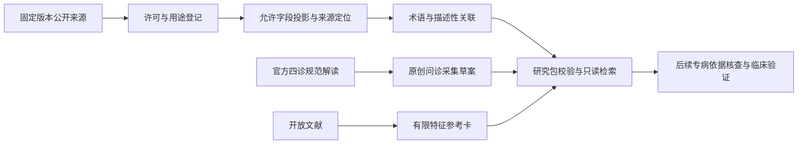

# 问诊、诊断与辨证研究知识包 v0.1

整理日期：2026-10-18。本包为新版多模态辅助问诊方向准备数据与接口合同。当前运行的问诊准备服务仍使用原有教学知识；本包没有接入患者诊断流程，没有把模型改成可独立确诊的系统。

已经实际完成采集与整理，而非待办目录：

| 内容 | 数量 | 当前用途 |
|---|---:|---|
| 来源登记 | 6 | 记录出处、版本、许可、用途与局限 |
| 原创问诊条目 | 63 | 展示问题、采集字段、原因、前置问题与场景 |
| 来源术语 | 845 | 病名、证名、观察、病位和病性分别保留 |
| 描述性观察—证候关联 | 769 | 原始训练分片中的共现；不是诊断条件 |
| 候选证候资料卡 | 294 | 汇总来源记录数和关联观察；不计算患者诊断 |
| 文献参考卡 | 3 | 睡眠相关历史综述中的部分表现与重叠限制 |

**稀疏性：267 张候选卡只涉及一条训练记录，40 张没有保留下来的观察特征，只能作为来源标签资料。这些数量不能作为诊断依据充分性的证明。**

数量由 [实际审计](../../evidence/clinical-knowledge-audit.json) 生成。200 条 TCMEval 训练记录可以包含多个证候标签，因此候选证候数可以大于病例数；不能把每个标签当作一个独立患者。术语也有跨来源重复标签合并，合并只针对同一种类的完全相同文本，不自动进行繁简转换或医学同义归并。

## 为什么采用结构化数据，而不直接建向量库

问题、患者观察、证候标签、诊断标准和病例关联的含义不同。向量检索只能找到相近文本，无法自动提供必要条件、排除条件或诊断阈值。因此先使用可版本控制的 JSON 和 Pydantic 合同；以后需要 RAG 时，再为允许的文本建立索引，而不是把所有数据直接批准进入诊断 Prompt。



最后一个节点尚未完成，不通过一个 JSON 的 approved=true 开关跳过。当前所有候选与文献卡的 clinical_use 固定为 disabled；`require_clinical_ready()` 明确拒绝进入诊断。这个限制是对数据证据状态的真实表达，不妨碍查看、整理和对接。

## 已采集的两个开源数据源

### TCMEval-SDT 训练分片

固定提交 `12473b50ce94ad2fd22b1e984b826b0a618c4407`；读取 200 条 Train_TCM_Data_v1.json。子目录 README 明确提供 CC BY 4.0 链接。论文：Wang Z., Hao M., Peng S. et al., *TCMEval-SDT: a benchmark dataset for syndrome differentiation thought of traditional Chinese medicine*, Scientific Data 12, 437 (2025), [DOI](https://doi.org/10.1038/s41597-025-04772-9)。

只投影 Clinical Information 与 TCM Syndrome。观察标签只有至少在两个训练记录出现、通过保守字符/长度与敏感模式过滤后才导出；该阈值只是减少碎片和长片段的工程策略，不是医学阈值，也不保证任意文本已匿名。语料仍具有健康语义。

同一记录内重复观察和标签去重；关联的 record_count 是训练记录数，不是人群概率、独立证据数量、因果强度或诊断权重。没有把“病例出现过”推导成“具备这些条件就确诊”。

未下载 test/validation 作为知识输入；当前也没有将它们作为已完成评测的证据。以后评测仍需检查跨来源和跨分片重复，单凭原分片名称不能保证独立性。

### MTCMB TCM-Diagnosis

固定提交 `faffd813c67fe012cef74277a23270d5dd6db9b8`；读取 200 条。README 区分数据 CC BY 4.0 与代码 Apache-2.0；本包没有执行或复制上游代码。

只保留 answer 中的疾病名称、证名、病位证素与病性证素短标签。题干、叙述性病例、治疗、方药和用量均未导出。上游说明存在教材来源，本包保留来源局限，不能仅以仓库许可推断全部第三方原始材料的权利已经清理。

MTCMB 仅用于词表，不从它生成观察—证候诊断规则，也不作为独立留出验证集。完整声明见 [来源登记](sources.json)、[采集回执](receipts.json)、[来源处置记录](source_review.json) 与 [署名/许可](ATTRIBUTION.md)。

## 问诊条目是什么依据

条目文字由本项目原创。官方《中医四诊操作规范》系列解读用于组织采集域：病程、寒热、汗、疼痛与身体不适、饮食、二便、情绪、睡眠及相关生殖健康信息等。我们核查了官方题录和解读，未声称逐条解析或再分发标准全文。

每条数据都包含 prompt、target_field、reason、source_refs、profiles、priority、prerequisites 和 review_status。问题能解释“为什么采集”，但尚不是针对某个患者的经过审核的临床决策。general、sleep、digestive、pain 是工程预览场景，不代表四条已经验证的专病诊疗路径。

排序先看工程优先级，再看前置问题是否已处理。answered 只代表这一问题已经处理，包括未知或拒答；它不代表症状阴性，也不保证已经获得充分诊断证据。受询者不应被迫回答全部问题，采集完成也不能自动等价于可以出诊断。

第一版不覆盖儿童、妊娠、急危重症或全部专病人群。相关信息用于标明需要专门流程，不建立自动排除风险的结论。

## 文献卡与诊断规则的区别

三张文献卡摘取并用中文重新整理 Poon 等 2012 年睡眠相关系统综述 Table 2 的少量描述性表现，涉及心脾两虚、阴虚火旺和心胆气虚。论文开放署名许可版本未明确，因此登记为 CC-BY (version unspecified)，没有擅自改写成 CC BY 4.0。

这是一篇历史综述，检索截至 2008 年；作者明确指出证候间表现重叠，建议的清单仍需验证。本包不把它称为当前指南，也不把相关表现当作必有症状。每张卡都保留适用局限、原表定位与可关联的采集问题。

所有资料卡的诊断必要条件、排除条件或鉴别规则尚未从这些资料中取得，使用 null 表示未知。不能改成空数组后利用“全部条件均满足”的逻辑把未知当成功。八纲、脏腑、病位/病性标签也没有自动组成统一的诊断树。

后续应按首批目标主诉补充当前指南、适用人群、必要/支持/反对条件、鉴别与证据等级，核查来源具体条款，再以独立病例评测和专业审核验证。软件可以辅助这项整理，不能凭预训练知识伪造已经存在的规则或临床审核记录。

## 如何使用与重建

```bash
uv run python scripts/clinical_knowledge.py audit
uv run python scripts/clinical_knowledge.py questions --profile sleep --limit 8
uv run python scripts/clinical_knowledge.py search --query 心脾
uv run python scripts/clinical_knowledge.py schemas
```

重建上游派生数据：

```bash
uv run python scripts/collect_clinical_sources.py
uv run python scripts/build_clinical_knowledge.py
uv run pytest tests/test_clinical_knowledge.py -q
```

collector 只访问 inputs.json 中固定提交的公开原始文件和许可声明，校验 SHA256 后保存在被忽略的 tmp/；不执行外部代码，不读取模型密钥。builder 使用严格字段投影，输出可以离线审计。源码包不携带原始病例和下载的原始文件。若来源文件变化，哈希不符会拒绝，不偷偷接受新版本。

[对接合同](INTEGRATION.md) 说明明天面舌诊与脉诊示例到达后如何映射。原服务仍使用 knowledge/entries.json；临床研究包与当前教学检索不会混合。
